# Cosmic Platformer

<p align="center"><a href="docs/media/trailer.mp4"></a><br><sub>La bande-annonce (40 s) — <a href="docs/media/trailer.mp4">en vidéo MP4, avec sa musique</a> ; le jeu la montre sur son écran d'accueil après une minute d'inactivité.</sub></p>

<p align="center"><b>Nova traverse six mondes, apprend dix-neuf pouvoirs et tient tête à des giga-boss à huit phases —
puis, avec son clan, à Asterion, le Dévoreur de mondes.</b><br>
Un jeu de plateforme 2D nerveux et précis, en C++20 / SDL3 : seul, à deux ou trois, ou par groupes de huit dans les
raids de clan, au clavier, à la manette ou à la souris, en français ou en anglais — et toute la campagne se joue hors ligne.</p>

<p align="center"></p>

> **Télécharger (Windows)** : l'installateur est produit par la CI à chaque version — onglet **Actions**
> du dépôt › workflow *Build* › dernier passage réussi › artefact **CosmicPlatformer-Setup** (ou
> **CosmicPlatformer-portable-windows**, sans installation). Une fois le jeu installé, ses *Notifications*
> annoncent chaque nouvelle version : l'installateur se télécharge, est vérifié (SHA-256), puis
> « Lancer l'installateur ». Sous Linux, ou pour compiler vous-même : voir [Compiler](#compiler).

<p align="center">
<a href="#dix-neuf-pouvoirs">Pouvoirs</a> ·
<a href="#six-mondes-et-une-campagne">Mondes</a> ·
<a href="#giga-boss-et-histoires-animées">Giga-boss</a> ·
<a href="#le-premier-envol-avec-bip">Didacticiel</a> ·
<a href="#fantômes-et-entraînement">Fantômes</a> ·
<a href="#fiches-des-boss-et-statistiques">Statistiques</a> ·
<a href="#succès-et-vestiaire">Succès</a> ·
<a href="#défis-du-jour-de-la-semaine-et-du-mois">Défis</a> ·
<a href="#éditeurs-et-niveaux-de-la-communauté">Éditeurs</a> ·
<a href="#coopération-à-deux-ou-trois">Coopération</a> ·
<a href="#clans">Clans</a> ·
<a href="#raids-de-clan-contre-asterion">Raids</a> ·
<a href="#cosmic-online">Cosmic Online</a> ·
<a href="#historique-des-versions">Versions</a>
</p>

## Dix-neuf pouvoirs

Nova court, saute, glisse, s'accroupit sous les attaques et frappe — puis chaque monde lui apprend
quelque chose de nouveau : **Dash** et **Ruée aérienne**, **Onde énergétique**, **Bouclier**,
**Téléportation**, **Planeur**, **Grappin**, **Frappe sismique**, **Tir chargé**, **Triple saut**,
**Ralenti temporel**, **Bombe plasma**, **Aimant**, **Lame boomerang** (et sa version chargée),
**Nova de givre**, **Leurre holographique**, **Balise de rappel**… Quatre pouvoirs portés à la fois
dans la plupart des niveaux : on choisit lesquels, et des **stations de pouvoirs** proposent ceux dont
la suite a besoin, si bien qu'on ne reste jamais bloqué. Chaque emplacement de pouvoir a sa touche,
que vous choisissez.

<p align="center">
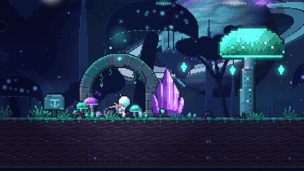
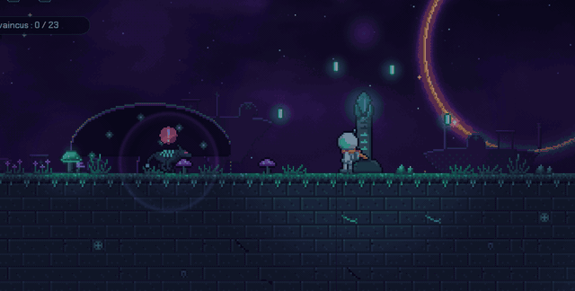
</p>
<p align="center"><sub>À gauche, l'Onde puis le Dash dans « La Canopée des Spores » ; à droite, la Lame boomerang, la Nova de
givre (l'ennemi gelé devient une plateforme) et un Dash, sur Aethra.</sub></p>

Le **Guide des pouvoirs** (menu pause) montre chacun d'eux joué en boucle par le vrai moteur du jeu,
avec son coût d'énergie et toutes ses caractéristiques :

<p align="center"></p>

## Six mondes et une campagne

**25 niveaux** sur six mondes du système Kepler-Voss : **Sylvanox**, le monde-jardin des Anciens ;
**Pyralis**, la forge en fusion ; **Glacior**, les plaines de cristal gelé ; **Aethra**, la planète des
sanctuaires ; le **Noyau stellaire**, au cœur de l'étoile ; et **Les Confins**, au bord du système. Chaque
niveau a son chronomètre, ses médailles de bronze à platine et ses boss ; les niveaux classiques cachent
reliques et cœurs de cristal, et les **épreuves** et niveaux **EXTRÊME** (une seule vie) attendent les plus
téméraires.

<p align="center">
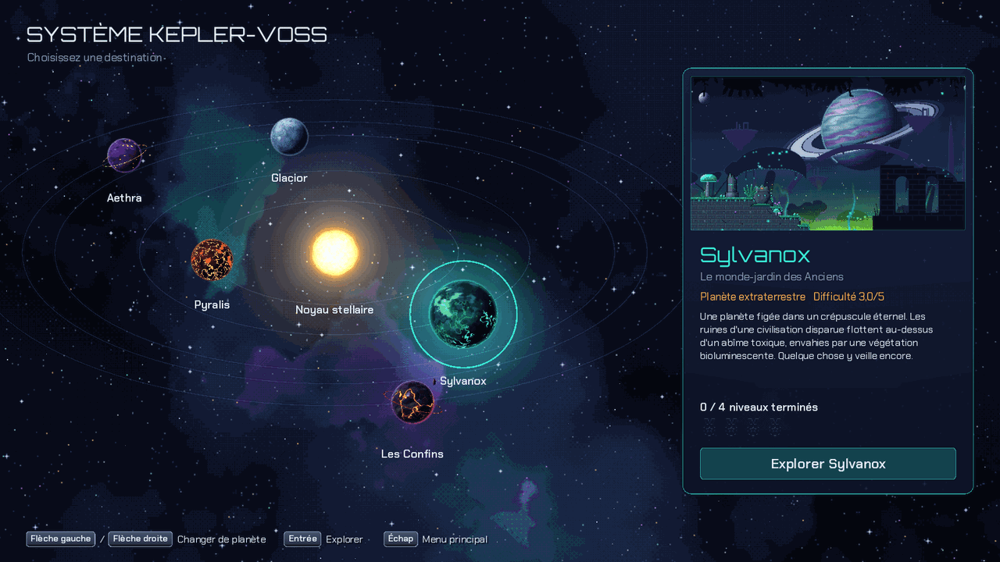

</p>

## Giga-boss et histoires animées

Aux Confins vivent les **giga-boss** : Pyrrhax le dragon d'obsidienne, le Monolithe, le Kraken des
Abysses, le Phénix stellaire, la Liche des Catacombes et le Titan mécanique — huit phases chacun, dans des
arènes géantes, sans checkpoint ; au cœur de l'étoile, **Singularis**. Les boss lisent le combat, visent
là où vous allez atterrir, enchaînent des combos et entrent en rage si le combat s'éternise ; leurs
attaques sont annoncées avant de frapper.

Avant le premier combat, chaque giga-boss raconte son **histoire**. Celles des Confins — **Pyrrhax**, le
**Monolithe**, le **Kraken**, le Phénix, la Liche et le Titan — sont de petits dessins animés faits de vrais
sprites du jeu, sur des décors en couches qui bougent :

<p align="center">
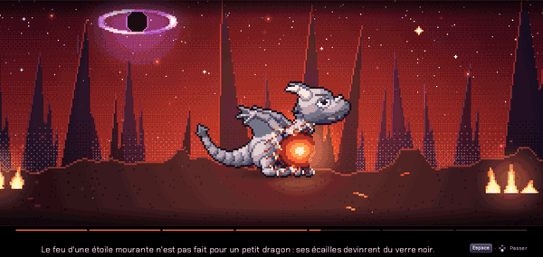
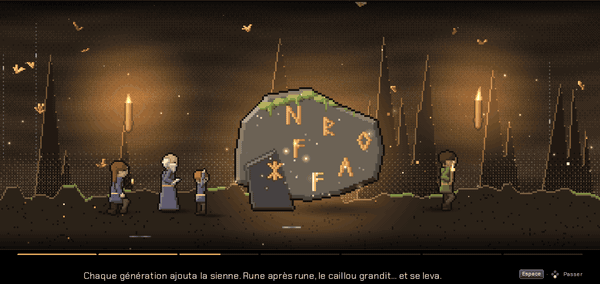
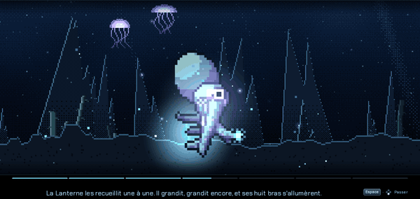
</p>
<p align="center"><sub>« Le Dragon d'Obsidienne », « Le Golem Primordial », « La Lanterne des profondeurs » —
une pastille NOUVEAU mène à « Revoir l'histoire ».</sub></p>

## Le premier envol avec Bip

Au tout premier lancement, **Bip**, un petit robot compagnon, propose un vol d'essai d'environ six
minutes dans la **Pépinière d'étoiles** : se déplacer, sauter, rebondir sur les champignons, attaquer,
prendre la Ruée, traverser un ruisseau sur des bulles porteuses, puis affronter Mycélia la Câline. Neuf
explications arrêtent vraiment le jeu, avec un aperçu animé et **vos** touches (clavier, manette Xbox
ou PlayStation). Aucune chute n'est mortelle ; on peut passer le didacticiel à tout moment.

<p align="center">


</p>

## Fantômes et entraînement

Courez contre vos **fantômes** — meilleur temps, record précédent, dernière course —, le **record
mondial** ou ceux de vos amis (jusqu'à 8 à la fois), avec les **écarts en direct** sous le chronomètre
et un **panneau des segments** façon LiveSplit (meilleurs segments en or). L'**entraînement par
segment** répète une section depuis un point de sauvegarde ; la **somme des meilleurs segments** (SOB)
réunit vos courses et vos entraînements, et **« Regarder »** enchaîne ces meilleurs segments, chacun
rejoué à l'identique depuis son replay exact. Les boss ont aussi leur **entraînement** (phase, cœurs,
pouvoirs et lieu d'apparition au choix). L'entraînement ne compte pour aucun record, et les fantômes,
purement visuels, ne changent rien à la partie. Détails : [docs/GHOST_RACING.md](docs/GHOST_RACING.md).

## Fiches des boss et statistiques

Chaque boss a sa **fiche** : caractéristiques lues dans sa définition, phases, et chaque attaque qui se
déplie avec ses dégâts, son annonce, sa recharge — et un **exemple animé joué par le moteur**, où Nova
montre comment l'esquiver. L'écran **Statistiques** suit vos vraies parties, sur votre ordinateur :
vue d'ensemble sur 7, 30 ou 90 jours, combat (esquive, précision), boss tentative après tentative,
niveaux (record, somme des meilleurs segments, zones à travailler) et passages difficiles, chacun avec
son entraînement. Voir [Statistiques](#statistiques).

<p align="center">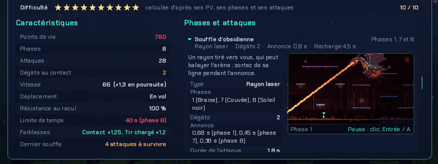</p>

## Succès et Vestiaire

**259 succès** et leurs **785 étoiles** de difficulté, présentés sur une **toile** (un secteur par
catégorie, des fils entre les étapes) ou en liste, avec des suggestions de ce qui est à votre portée.
Ils débloquent les récompenses de la **Collection** : combinaisons, traînées, cadres d'avatar, titres et
effets de victoire du **Vestiaire**, la route des étoiles, le juke-box et la galerie. Les objets
exclusifs gagnés en défi portent une aura dorée.

<p align="center">
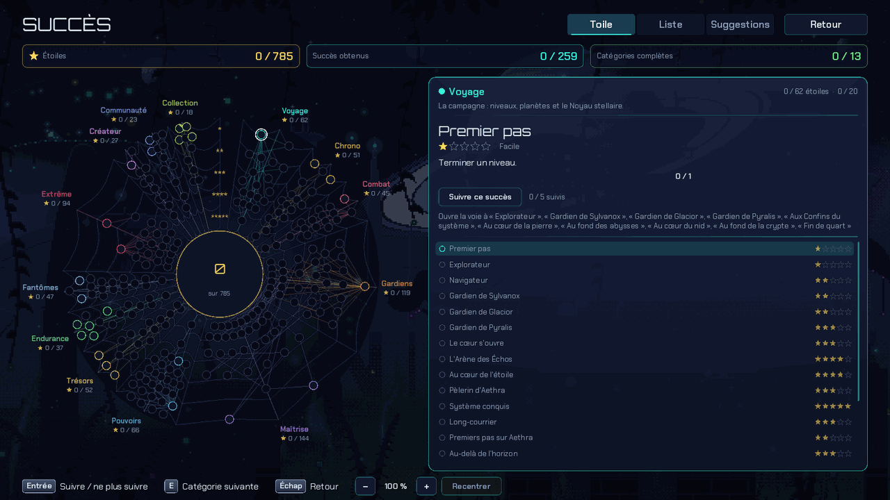

</p>
<p align="center"><sub>Captures d'un profil neuf : tout reste à gagner.</sub></p>

## Défis du jour, de la semaine et du mois

Chaque jour, chaque semaine et chaque mois, un **défi** : un niveau, des règles (cœurs, pouvoirs,
stations, checkpoints), des paliers **bronze, argent, or** et des **récompenses** exclusives pour le
Vestiaire. Les parties sont vérifiées par Cosmic Online ; on peut aussi s'entraîner hors classement et
rejouer les anciens défis depuis le **calendrier**, qui montre combien de joueurs ont atteint chaque palier.

<p align="center">
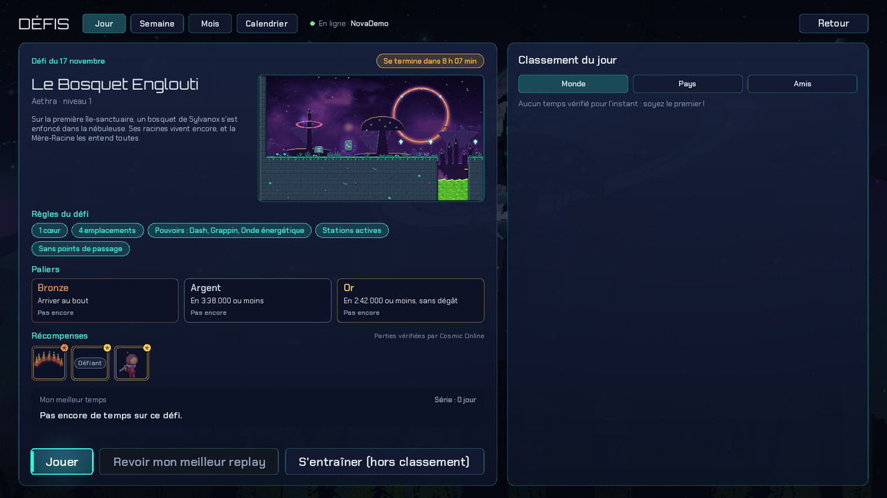

</p>

## Éditeurs et niveaux de la communauté

Le jeu contient ses propres outils : l'**éditeur de niveaux** (calques, bibliothèque d'objets,
événements et déclencheurs, cinématiques, test immédiat avec F5), l'**éditeur d'ennemis** (animations,
comportements, attaques, phases de boss, arène de test) et l'éditeur du HUD. Un niveau se partage en
fichier `.cplanet` vérifié, ou se publie dans **NIVEAUX EN LIGNE** (populaires, plus durs, récents,
mieux notés, amis…) ; **PROJETS** permet de créer un niveau à plusieurs, en direct.

<p align="center">

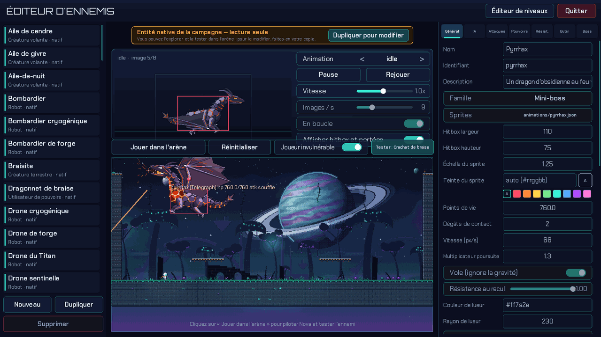
</p>

## Coopération à deux ou trois

Les niveaux EXTRÊME se jouent aussi à **2 ou 3 joueurs** : **sur un même PC** (une manette par joueur en
plus du clavier), **en réseau local** (sans compte ni serveur) ou **en ligne** avec vos amis. Une vie
chacun, pas de coups entre alliés, des joueurs qui **se traversent** (les autres dessinés en
semi-transparence), **2 réanimations** par tentative — un joueur tombé ne revient qu'une fois relevé, sans
déplacer les autres : un allié **maintient « Interagir » 2 s** près de son âme, posée sur son **dernier endroit
sûr** (même mort dans la lave ou le vide, on peut le rejoindre) —, une caméra commune et des classements **Duo** et
**Trio** à part. Architecture :
[docs/COOP.md](docs/COOP.md).

<p align="center">
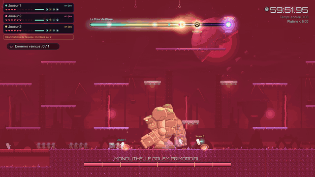
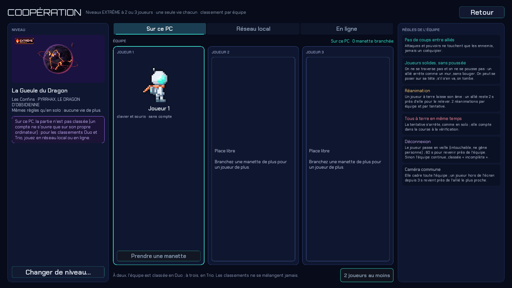
</p>
<p align="center"><sub>À gauche, trois joueurs sur un même PC (joueurs pilotés par des scripts pour la capture) ; à droite, le
salon : le niveau, l'équipe, un périphérique par joueur et les règles.</sub></p>

## Clans

Un clan par joueur, jusqu'à **50 membres** : un nom, un **tag** (affiché **[AUBE]** à côté du pseudo),
une devise, un **emblème**, un chef et des officiers, une adhésion sur invitation, sur candidature ou
ouverte, et sa propre **discussion**. Le **classement des clans** additionne les meilleurs résultats
vérifiés par le serveur sur les niveaux EXTRÊME officiels.

<p align="center">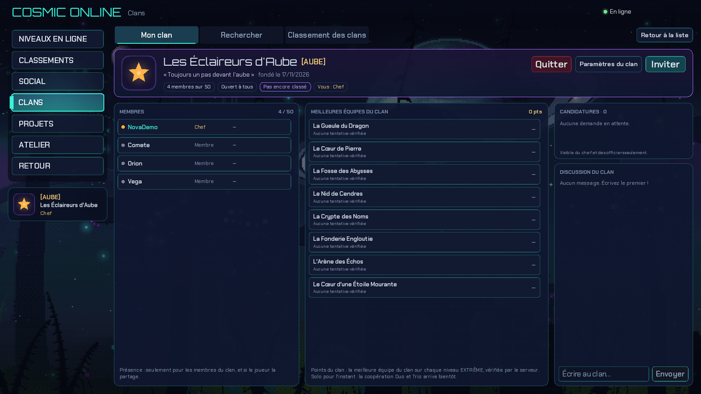</p>

## Raids de clan contre Asterion

Avant la première étoile, il y avait une faim. Elle s'est forgé un corps de mondes brisés et s'est donné un
nom : **Asterion, le Dévoreur de mondes**. Sa première apparition est un mini-film de deux minutes, joué par
le moteur des histoires du jeu :

<p align="center">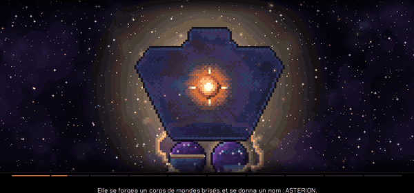<br><sub>Deux moments du film : Asterion se forge un corps, puis se nomme.</sub></p>

Les clans l'affrontent **par groupes de huit**, chaque groupe dans son instance, tous les jeux avançant au
même pas. Chaque branche commence par un **vestiaire** où chacun choisit ses pouvoirs avant la route.
En raid, un joueur à terre revient **autant de fois qu'un coéquipier le relève** ; si **tout le groupe** tombe,
il est **éliminé** de la zone : ses joueurs deviennent spectateurs (caméra libre, ou un joueur encore en jeu de la
branche) et la zone attend qu'un groupe ayant fini la sienne vienne la **reprendre**. Les liquides qui montent
remplissent tout leur bassin, d'un bord de l'écran à l'autre ([docs/RAIDS.md §20](docs/RAIDS.md)). Le titan a **sept branches** — Crâne, Bras gauche, Torse, Abdomen, Jambe gauche, Jambe droite et Bras
droit — de huit zones chacune : deux chemins, une zone secrète et sa relique, un raccourci au levier, des
objectifs qu'il faut **deux groupes** pour réussir, et un quart d'heure d'expédition sur trois étages avant
chaque antre. Les branches sont liées : les yeux détruits dans le Crâne éteignent les tourelles du Bras gauche,
les réacteurs de la Jambe droite arrêtent les coulées du Bras droit… Le serveur ne valide un objectif que si
la majorité des joueurs de l'instance a vu la même chose.

<p align="center">
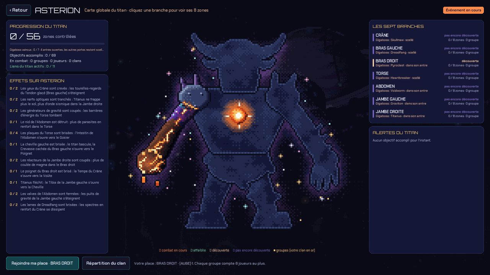
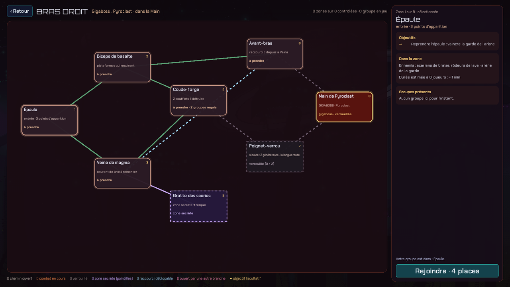
</p>
<p align="center"><sub>La carte du titan et celle d'une branche, au début d'un raid de clan (serveur Cosmic Online lancé en
local, comptes de démonstration).</sub></p>

### Les Gigaboss

Au fond de chaque branche attend un **gigaboss** taillé pour huit joueurs, en trois phases, dans une arène de
plus de six écrans de large : sa vie et sa cadence suivent le nombre de joueurs, ses attaques visent **tout le
groupe à la fois** (une marque sous chaque joueur, puis le coup), et chaque combat a son **mécanisme
collectif**, qu'aucun joueur ne réussit seul.

<p align="center">
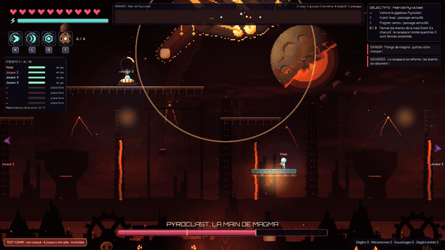
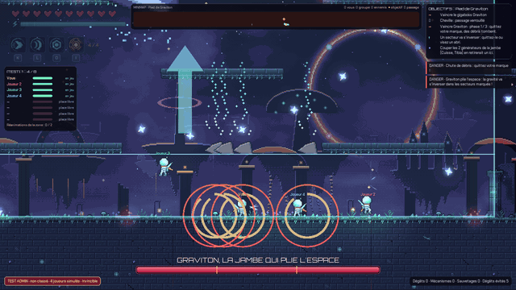
</p>
<p align="center"><sub>À gauche, Pyroclast : ses trois évents fermés ensemble, sa carapace éclate et ses points faibles
apparaissent ; à droite, Graviton inverse la gravité et soulève le groupe vers la jambe géante.</sub></p>

* **Pyroclast** (Bras droit), une main de magma : ses Poings de magma tombent sur chaque joueur ; sa carapace
  ne cède que si ses trois évents, sur deux tours et une plateforme, sont tenus **ensemble** ; alors son cœur
  est à nu et ses points faibles se brisent.
* **Voidworm** (Abdomen), le ver du vide : il fouit sous chaque joueur, **avale** ceux qui restent dans son
  anneau vert — les autres crèvent sa poche pour les libérer — et ses trois crochets, tenus ensemble,
  l'épinglent gueule ouverte.
* **Graviton** (Jambe gauche) : la gravité s'inverse par secteurs (abri sous les dalles) et ses quatre
  générateurs, aux quatre coins de l'arène, doivent être coupés **au même instant**.
* **Titanus** (Jambe droite) : ses ondes de choc filent le long du sol, à sauter ; ses deux entraves de
  cheville, brisées à moins de 1,5 s d'écart, le mettent à genou.

<p align="center"><sub>Combats filmés dans le test des administrateurs (« Tester Asterion » : en local, jamais classé),
les autres joueurs pilotés par des scripts.</sub></p>

Les trois autres Gigaboss gardent les antres du Crâne, du Bras gauche et du Torse :

**Skullmaw, le crâne qui voit tout** (le Crâne) : un regard laser traque chaque joueur ; sous son voile psychique,
son Regard de mort frappe tous ceux qu'il voit, sauf si assez de joueurs tiennent un **miroir** à cet instant : son
regard renvoyé l'aveugle et met à nu ses yeux et son cristal ; dans ses ténèbres, seule la lumière de son œil révèle
les plateformes.

<p align="center">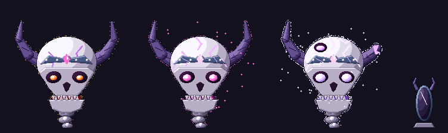</p>

**Dreadfang, les griffes qui déchirent** (le Bras gauche) : des griffes jaillissent du sol sous chaque joueur, sa
lame balaie un, deux puis trois étages ; une griffe **cloue** un joueur jusqu'à ce qu'un autre la brise, et seules
ses **trois chaînes** tenues ensemble le plaquent au sol, jointures offertes.

<p align="center">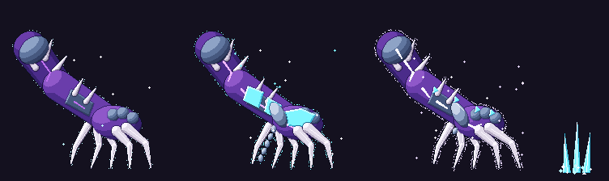</p>

**Heartbreaker, la cage qui garde le cœur** (le Torse) : ses **quatre plaques** se brisent dans la même fenêtre ou
repoussent, ses battements lancent des ondes au sol ; il faut ensuite **écarter ses deux côtes** en même temps pour
atteindre la lumière de son cœur, avant qu'il ne s'affole.

<p align="center">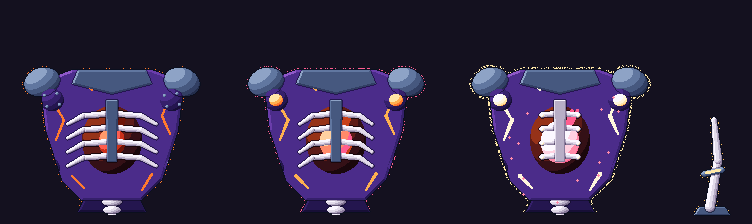</p>
<p align="center"><sub>Les trois phases de chaque Gigaboss avec les sprites du jeu (générés par <code>tools/assetgen</code>).</sub></p>

### Le combat final : le Cœur d'Asterion

Quand les **sept Gigaboss** sont tombés (validés par le serveur), le **Cœur d'Asterion** s'ouvre sur la carte du titan :
une longue **Aorte cosmique** à huit, puis une arène gigantesque (neuf écrans de large, navettes et bacs mobiles) où
flotte une étoile captive plus grande qu'un écran. **Tous les groupes de tous les clans** le combattent en même temps :
chaque instance joue sa propre partie, mais sa **vie est partagée** — la part que chaque groupe lui arrache, validée par
le consensus de ses joueurs, s'additionne sur le serveur et revient à tous les autres au même pas. Quatre phases
(« Le cœur qui bat », « Les artères », « La couronne d'étoiles », puis une **Supernova** à contenir sur les ancres), des
lances sur les huit joueurs à la fois, une marée de plasma. **Ce que les branches ont détruit l'affaiblit vraiment** :
le Crâne tombé, ses lances perdent leur précision ; le Bras gauche, plus de balayages ; le Bras droit, plus de pluie de
magma ; le Torse, plus de cage ; l'Abdomen, plus d'engeances ; la Jambe gauche, plus de pièges de gravité ; la Jambe
droite, ses charges ralentissent. Sa chute validée lance le film **« La chute d'Asterion »** pour tout le groupe et
accorde, une seule fois, le badge « Cœur d'Asterion », l'effet de victoire « Supernova d'Asterion », le cadre de profil
des 10 meilleures contributions et le titre de clan « Briseurs d'étoile ». Détails : [docs/RAIDS.md §16](docs/RAIDS.md#17-phase-6-274--le-cœur-dasterion).

**Après Asterion** : juste après le film de la victoire, un second mini-film (81 s) raconte ce que la chute change dans le
monde — les mondes qu'il avait dévorés se rallument, le ciel de nos planètes s'éclaircit, les peuples partis reviennent,
le Phénix s'endort enfin, l'étoile morte du centre frémit — et **écrit le nom des clans présents à la chute**, le vôtre en
évidence. Tout le monde le voit **au même moment**, à l'heure fixée par le serveur : l'instance du Cœur, et les membres en
ligne de ces clans (une notification « Asterion est tombé — regarder le film avec votre clan » ; jamais lancé par-dessus un
niveau). Arrivé en retard, on le prend en cours ou « Depuis le début ». Il se revoit depuis la fiche de l'événement, la fiche
récapitulative du raid et Collection › Galerie › Films, une fois débloqué (pour ceux qui ont pris part, puis pour tous quand « Asterion est tombé »
est officiel). Détails : [docs/RAIDS.md §31](docs/RAIDS.md#31--après-asterion---le-film-du-monde-daprès-regardé-ensemble-281).

### Récompenses et événements mondiaux

* **Contributions** calculées par la simulation pour chaque joueur — dégâts, dégâts évités, soutien,
  sauvetages, évents et points faibles, objectifs, présence à la chute — puis validées par le consensus de
  l'instance : jamais les seuls dégâts. **Résultats du raid** : classement des clans et des joueurs, catégorie
  par catégorie.
* **Récompenses** accordées une seule fois par le serveur : un badge par gigaboss (« Main de Pyroclast »,
  « Ventre de Voidworm », « Pied de Graviton », « Talon de Titanus »), les titres « Assaillant d'Asterion »,
  « Briseur de magma », « Fléau de Pyroclast »… et le corps d'Asterion qui s'affaiblit, partie par partie.
* **Événements mondiaux** : tous les clans contre **un seul titan**, aux mêmes heures ; chaque objectif compte
  une fois pour le monde, le **classement mondial** montre la progression, les clans, les groupes et les
  joueurs, puis le **résultat officiel** est figé à la clôture — « Asterion est tombé » ou « a survécu ».
  À la clé : la combinaison « Écorce d'Asterion », le titre de clan « Dévoreurs dévorés » pour le top 10, et
  des sessions de rattrapage pour les absents.
* **Fiche récapitulative** (2.78.1) : chaque raid terminé du clan, gagné ou non, garde sa fiche dans CLANS › RAIDS —
  « Asterion est tombé » ou jusqu'où il est allé, sept chiffres clés, la frise des sept parties et du Cœur (le portrait
  animé de chaque Gigaboss, l'heure de sa chute, le groupe qui l'a abattu, la relique de sa branche), le titan par parties,
  les meilleurs du clan avec leur avatar, les récompenses dessinées avec leur texture et votre raid ; seulement ce que le
  serveur a validé ([docs/RAIDS.md §27](docs/RAIDS.md#27-la-fiche-récapitulative-dun-raid-terminé-dans-le-clan-2781)).

### Fiabilité, charge et anti-triche

* **Une liaison qui tombe ne vous sort pas du raid** : le jeu se reconnecte tout seul pendant les 60 s où le relais
  garde votre place (carte « LIAISON PERDUE », puis rattrapage hors du fil principal) ; une instance attend son groupe
  60 s si tout le monde décroche, et survit au redémarrage de son relais (partie enregistrée chaque seconde).
* **Testé sous charge** : quatre clans de 50 joueurs qui s'inscrivent, se placent, valident leurs objectifs et récupèrent
  leurs récompenses au même instant, un événement mondial de 2 500 joueurs agrégé et clos ; rien n'est compté, accordé
  ni annoncé deux fois, et chaque requête fait le même travail avec 2 ou 30 groupes.
* **Contre la triche** : le joueur est celui de la session, seuls les joueurs en jeu votent, les faits impossibles sont
  refusés et journalisés, rien n'entre après la clôture ; huit jeux simulés sous latence, gigue et pertes reçoivent les
  mêmes trames, et un pas de simulation à 8 dans les zones les plus lourdes tient dans le budget de 120 Hz.

Tout le détail : [docs/RAIDS.md](docs/RAIDS.md) (§15 « Fiabilité, charge et anti-triche »).

### Dans un raid : zones, carte, HUD et magma

Des instances de **8 joueurs** contre le titan **Asterion**, branche par branche (Bras droit et son gigaboss
**Pyroclast**, et six autres branches) : des zones reliées par des passages, des objectifs validés par le
serveur au consensus de l'instance, des mécanismes de groupe (plaques, monte-charges, évents), des embuscades
géantes et une progression partagée par tous les groupes du clan. Ce qui est fait dans une zone **y reste** :
en y revenant, portes, leviers, générateurs, arènes nettoyées et ennemis vaincus sont comme le groupe les a
laissés. Le **magma montant** du Bras droit monte depuis le fond et redescend, annoncé avant chaque montée
(le sol se fissure, son futur niveau s'allume), il recouvre vraiment ce qu'il engloutit et brûle aussi les
ennemis pris dedans.

Le HUD des raids a sa **propre disposition** (Paramètres › HUD › onglet « Raids ») : minimap en textures
(terrain, passages ouverts ou verrouillés, portes, objectifs, points de contrôle, plaques, ennemis, alliés à
leur couleur, légende), panneau du groupe, objectifs, alertes, barre du gigaboss, contributions et un
**chronomètre** (le temps de l'instance et celui de la zone, le même pour tout le groupe). La touche **M**
(Vue / Retour à la manette) agrandit la **carte** sur presque tout l'écran, sans jamais mettre le jeu en pause.
La touche **Tab** (L3 à la manette) ouvre et ferme le **menu du raid** (ce qu'il reste à faire, zones terminées et leurs
tableaux, journal des notifications, groupe, titan) ; ce qui arrive en jeu n'est qu'une **notification courte** qui ne
prend jamais les touches.
Les flèches vers les ennemis hors de l'écran fonctionnent comme dans les niveaux. Les administrateurs testent
une zone avec des **joueurs simulés** visibles (« Joueur simulé 2 »…) qui **jouent la zone eux-mêmes**, même quand
l'administrateur est AFK : ils lisent ce qu'il reste à faire, se répartissent générateurs, plaques et combats, trouvent
leur chemin en simulant leur propre physique (doubles et triples sauts, ruées, impulsion, sauts muraux, plateformes
mobiles visées là où elles seront, [§27](docs/RAIDS.md)), esquivent tirs, rayons et coups annoncés, fuient le liquide qui
monte, battent les Gigaboss et relèvent les joueurs à terre, au niveau Débutant, Confirmé ou Expert, en disant ce
qu'ils font (« Double saut au-dessus du vide »…). **« Simuler un raid complet »** joue tout le raid
de clan **en local** (les sept branches, leurs vestiaires, puis le Cœur avec tous les groupes) : événements du monde,
carte du titan, contributions, groupes éliminés remplacés par un groupe en attente (un groupe dont le Gigaboss est tombé reste dans sa branche), le Cœur à plusieurs instances avec une seule vie ; l'administrateur rejoint ou regarde n'importe quel groupe,
et **rien n'est envoyé**. Détails : [docs/RAIDS.md §22](docs/RAIDS.md). Dans les deux tests, l'administrateur peut aussi
**inviter de vrais joueurs** connectés (liste avec recherche, administrateurs ou non) : chacun prend la place d'un joueur
simulé de son groupe, avec sa case **« Invincible »** que seul l'administrateur change ; le test passe alors par le
serveur, sans jamais rien compter ([docs/RAIDS.md §30](docs/RAIDS.md#30-tester-avec-des-joueurs-invités-280)).

Dans le **vestiaire**, les tablettes de pouvoir sont en hauteur sur leurs rebords (deux étages), avec le nom, l'icône et
le coût d'énergie de chaque pouvoir au-dessus : on n'en prend une qu'en sautant dessus.

Le panneau **« Ce qu'il reste à faire »** (lui aussi placé dans l'onglet « Raids ») liste chaque condition pour terminer
la zone, cochée dès que le serveur l'a validée, puis ce qu'il manque dans les autres zones de la branche (les **zones à
reprendre** d'abord) ; la grande carte le répète zone par zone. Une zone terminée s'annonce à tous les joueurs de
l'instance au même moment, avec son **tableau des contributions** (part des dégâts au boss et aux mini-boss, soutien,
mécanismes, objectifs, comptés par la simulation), gardé dans « Résultats du raid ». Les fiches des Gigaboss ont un
schéma **« Où frapper »** par phase et par état, lu dans les règles mêmes du combat. Détails :
[docs/RAIDS.md §19](docs/RAIDS.md#19-ce-quil-reste-à-faire-zones-terminées-tableaux-des-zones-et-modération-275).

<p align="center">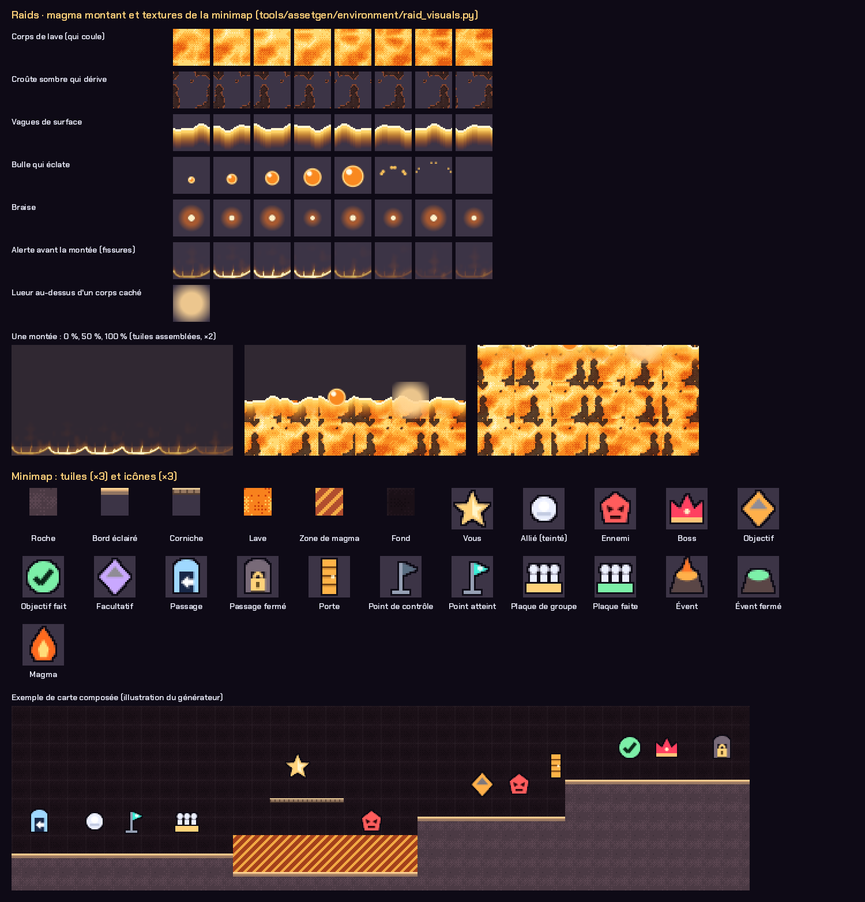</p>

## Cosmic Online

Facultatif, et jamais nécessaire pour jouer : un **globe 3D** interactif (rotation à la souris ou au
stick, zoom, clic sur un pays ou un joueur), des **classements** par niveau, pays, amis, planète et
points cosmiques (ANY%, 100 %, SANS MORT, SANS DÉGÂT ; historique ou hebdomadaire), des **profils**
publics, des **amis**, une messagerie (**SOCIAL**) et des **replays exacts** : le moteur est
déterministe, un replay rejoue la partie à l'identique et le serveur vérifie chaque record. La
localisation se limite au pays choisi.

<p align="center"></p>
<p align="center"><sub>Les captures des défis, du clan et du globe viennent d'un serveur Cosmic Online lancé en
local, avec des comptes de démonstration (aucun record n'y est encore vérifié).</sub></p>

<p align="center"></p>

---

## Commandes

| Action | Clavier AZERTY (QWERTY) – principal / secondaire | Manette (Xbox / PlayStation) |
|---|---|---|
| Se déplacer | Q D (A D) / ← → | Stick gauche / croix |
| Haut / bas, grimper | Z S (W S) / ↑ ↓ | Stick gauche |
| Sauter / double saut | Espace / W (Z) | A / Croix |
| Glissade | Bas en courant au sol | Bas (stick / croix) en courant |
| S'accroupir | Bas seul au sol (même sur place) | Bas (stick / croix) sans direction |
| Attaque | J / X | X / Carré |
| Pouvoir 1 (1er emplacement du HUD) | K / Maj gauche | B / Rond |
| Pouvoir 2 | L / C | RT / R2 |
| Pouvoir 3 | O / V | LB / L1 |
| Pouvoir 4 | I / B | RB / R1 |
| Pouvoir 5 et 6 (niveaux à plus de 4 pouvoirs) | U / N, F / H | LT / L2, R3 |
| Pouvoir 7 et 8 | à choisir | à choisir |
| Planeur | maintenir Saut en tombant | maintenir A / Croix |
| Frappe sismique | Bas + Attaque en l'air | Bas + X / Carré |
| Tir chargé | maintenir Attaque, relâcher | maintenir X / Carré |
| Grappin | Interagir près d'un point d'ancrage | Y / Triangle |
| Triple saut | troisième Saut en l'air (passif) | A / Croix |
| Interagir | E / Entrée | Y / Triangle |
| Pause | Échap / P | Menu / Options |
| Carte du raid (agrandir / fermer) | M | Vue / Partage (− sur Switch) |
| Menu du raid (ouvrir / fermer ; Échap ou B le ferment aussi) | Tab | L3 (clic du stick gauche) |

**Touches des pouvoirs (2.24)** : chaque emplacement de pouvoir du HUD a sa touche, que le
joueur choisit (*Paramètres → Clavier / souris* et *Manette*, « Pouvoir 1 » à « Pouvoir 8 ») ;
elle utilise le pouvoir équipé dans cet emplacement, quel qu'il soit (Dash, Onde, Bouclier,
Impulsion, Téléportation, Ralenti, Bombe plasma, Lame boomerang, Nova de givre, Leurre,
Balise de rappel). Deux pouvoirs de l'ancien bouton Spécial se portent donc ensemble. Les
pouvoirs passifs (Aimant, Ruée aérienne) et ceux qui s'utilisent avec un mouvement (Planeur,
Triple saut, Frappe sismique, Tir chargé, Grappin) n'utilisent pas la touche de leur
emplacement : un **cadre pointillé doré** les distingue dans le HUD, le choix du pouvoir à
remplacer et le guide des pouvoirs, avec leur mouvement (ou « passif ») à la place de la
touche. Les paramètres d'avant la 2.24 sont repris : les touches choisies pour les six
pouvoirs d'alors (Dash, Onde, Bouclier, Impulsion, Téléportation, Spécial) deviennent celles
des emplacements 1 à 6.

Les touches sont des **positions physiques** (scancodes) : les déplacements tombent sur ZQSD
en AZERTY et sur WASD en QWERTY, et le jeu affiche toujours le nom réel de la touche. Toutes les commandes se reconfigurent dans
*Paramètres → Clavier / souris* et *Paramètres → Manette* (profils indépendants, zones mortes,
sensibilité, inversion des axes, vibrations, réinitialisation). Les icônes affichées
s'adaptent à la manette utilisée (Xbox, PlayStation ou générique) et basculent
automatiquement entre clavier et manette.

Touches globales : **F3** mode debug (FPS, dt, colliders, hitboxes, position/vitesse du
joueur, états des ennemis, chrono, particules), **F11** plein écran, **F12** capture d'écran.

**HUD — ennemis hors écran (2.52)** : un ennemi déjà rencontré qui sort de l'écran est signalé
par une flèche ambrée sur le bord, tournée vers lui (plus pâle s'il est loin) ; plusieurs ennemis
dans la même direction n'ont qu'une flèche, vers le centre du groupe, avec leur nombre (« ×5 »).
Ces flèches ne passent jamais sur le HUD, sur la flèche du boss (qui garde la sienne) ni les unes
sur les autres ; option *Paramètres → Jeu → Flèches vers les ennemis hors écran* (activée par défaut).

### Les pouvoirs

Les cinq premiers (Dash, Onde, Bouclier, Impulsion, Téléportation) s'obtiennent dans
« Les Ruines Suspendues » ; les suivants s'apprennent chacun dans un niveau : Planeur
(La Canopée des Spores, courants ascendants), Grappin (Le Cœur de la Machine), Frappe
sismique (Les Forges Englouties, sols fissurés), Tir chargé (Le Fleuve de Lave, récepteurs
lointains, boucliers des Remparts) et Triple saut (Les Plaines de Givre). Les niveaux joués
hors de l'ordre donnent d'office les pouvoirs des niveaux précédents.

Sur Glacior, la glace est glissante et les attaques gelées ralentissent ; sur Pyralis, la
lave, les éruptions et les bombes sont mortelles.

Chaque pouvoir actif coûte de l'énergie selon sa force (jauge de 150) : Dash 5, Impulsion 8,
Onde 10, Frappe sismique 10, Lame boomerang 12, Balise de rappel 15 (pour revenir ; la poser est
gratuit), Tir chargé 20 (la référence), Bombe plasma 20, Bouclier 20, Téléportation 25, Leurre
holographique 25, Nova de givre 30, Ralenti 60 ; les pouvoirs passifs sont gratuits. Le *Guide des pouvoirs*
(menu pause) montre chaque pouvoir joué en boucle par le moteur avec son coût ; sa fiche donne
toutes ses caractéristiques.

Chaque niveau a un chrono (limite de 15 à 20 min), des médailles bronze / argent / or /
platine, records locaux (meilleur temps, morts, collectibles, ennemis vaincus, score,
pouvoirs utilisés, date) avec comparaison au meilleur essai.

## Cosmic Online en détail

Menu principal → **En ligne** (compte obligatoire pour cette section, jamais pour jouer) : globe 3D interactif (rotation à la souris ou au stick
droit, zoom molette / gâchettes, clic sur un marqueur ou un pays), classements par niveau,
pays, amis, planète et points cosmiques, catégories ANY% / 100% / SANS MORT / SANS DÉGÂT,
période historique ou hebdomadaire, profils publics, amis (avec notifications des
demandes) et **replays exacts** : le moteur est déterministe (pas fixe de 1/120 s, hasard du
gameplay à graine fixe par niveau, mathématiques identiques sous Windows et Linux), un replay
contient les commandes de chaque pas et le jeu rejoue la partie à l'identique (mêmes
animations, mêmes ennemis, mêmes attaques), avec vérification de l'état toutes les 0,5 s
(`CosmicPlatformer --replay fichier.cprz`, *Revoir la partie* à la fin d'un niveau). Le jeu reste entièrement jouable sans compte ; hors ligne, les
performances sont gardées et envoyées au retour de la connexion. La localisation se limite au pays choisi (affiché au centre du pays), jamais de
position précise.

Le serveur (Cloudflare Workers, D1, R2) est dans [`server/`](server/README.md) ; il se lance en
local sans compte Cloudflare. Documentation complète : [docs/online/](docs/online/README.md).

## Menu principal

*Continuer* (dernier niveau joué) · *Campagne* (planètes et niveaux) · *Défis* · *Coopération* ·
*En ligne* · *Notifications* · *Succès* (la toile des succès et de leurs étoiles) · *Collection*
(vestiaire, route des étoiles, musiques, galerie, replays) · *Statistiques* (vos statistiques de jeu,
et les fiches des boss) · *Paramètres* · *Quitter*.

### Statistiques

Calculées à partir de **vos vraies parties**, sans compte ni Internet, et gardées dans
`saves/stats.json`. L'écran démarre vide et se remplit au fil des parties. Six sections :

* **Vue d'ensemble** — sur 7, 30 ou 90 jours : temps de jeu, jours joués et leur calendrier (un
  carré par jour, plus clair = plus de temps de jeu), taux d'esquive, précision, morts par heure,
  chacun comparé à la période précédente de même durée (▲ / ▼, l'écart et « en progrès » / « en
  recul ») avec sa petite courbe ; étoiles de succès cumulées ; morts par heure jour après jour avec
  la moyenne des 7 derniers jours joués ; **Récemment joué** (2.91) : les niveaux et les boss joués en
  dernier, d'après le dernier jour de chaque niveau et l'ordre des combats (aucune donnée en plus),
  sur la bannière de leur planète ou avec le portrait du boss ; Entrée / clic mène à leur section.
* **Combat** — taux d'esquive (une attaque ennemie vous menace quand elle passe à moins d'une tuile
  et demie de vous ; esquivée si elle ne vous blesse pas) et précision (un tir, un coup ou une lame
  touche s'il retire des points de vie à au moins un ennemi), côte à côte sur la même échelle ;
  précision par pouvoir (icône de chaque pouvoir) et ce qui vous touche (tirs, attaques d'ennemis,
  de boss, contacts, pièges, chutes ; une image d'exemple par origine : le jeu ne garde que
  l'origine d'un coup).
* **Boss** — tous les boss, trois par page (les combattus d'abord, les plus récents en premier),
  chacun avec son portrait animé sur la bannière de sa planète ; votre meilleure part des points de
  vie retirée, tentative après tentative (une couleur par boss, son nom au bout de sa courbe, une
  étoile à la première victoire) ; la fiche du boss choisi, les défaites par phase (sur les
  tentatives arrivées à la phase) avec l'entraînement sur la phase la plus dure et la fiche complète
  (lieux, animations, entraînement).
* **Niveaux** (classiques, hors EXTRÊME, joués depuis le début) — la **somme des meilleurs (SOB)
  unique** du niveau (2.91, la même partout : le meilleur temps de chaque segment, qu'il ait été fait
  en partie, à l'entraînement — segment, enchaînement, segment entier après une startpos — ou dans
  vos courses vérifiées en ligne ; voir [Course aux fantômes](docs/GHOST_RACING.md)), avec la source
  de chaque segment ; record, temps perdu possible, arrivées, régularité ; une ligne par segment avec
  l'**aperçu du niveau** entre ses deux points de passage, ce qu'on y trouve (créatures, boss,
  tablettes, stations, dalles fragiles), son meilleur temps (« ▶ Regarder » rejoue le replay exact qui
  le tient), son temps dans le record, sa constance et « S'entraîner » ; puis l'évolution du record et
  de la SOB (le temps gagnable en bande entre les deux), les zones à travailler, la constance de
  chaque segment et la régularité des parties complètes.
* **Passages difficiles** — où vous tombez dans un niveau : ses 40 tranches en couleurs de chaleur
  posées sur le **vrai rendu du niveau**, tranche par tranche le long de son parcours, avec ses points
  de passage ; vos 5 passages les plus difficiles, niveaux et phases de boss mêlés, chacun avec son
  image (le morceau du niveau, ou le boss sur sa planète) et son entraînement.
* **Données et sauvegarde** — ce qui est enregistré, où et quand, la taille du fichier, comment les
  statistiques voyagent avec la progression, l'interrupteur « Enregistrer mes statistiques » (aussi
  dans *Paramètres › Jeu*, activé par défaut), « Réinitialiser les statistiques » et la
  **Répartition du fichier** (2.91 : la taille de chaque partie de `stats.json`, lue dans le fichier).

Les images des niveaux sont faites par le moteur du jeu (terrain, décors, créatures) : le niveau est
lu hors du fil principal, son terrain cuit quelques millisecondes par image, puis chaque aperçu est
dessiné une fois et gardé ; l'écran n'attend jamais.

**Avec votre progression** (2.55) : connecté à Cosmic Online, `stats.json` fait partie de la copie
privée de la progression (comme les records et les succès ; aucun autre joueur ne la voit), et la
progression restaurée après « Migrer vers un nouveau compte » apporte ses statistiques, copiées
d'abord avec les autres sauvegardes dans `saves/avant_restauration_…`. La fusion ne compte jamais
rien deux fois, et restaurer deux fois la même copie ne change rien :

* chaque jour (et chaque mois de plus d'un an) : pour chaque compteur, le plus grand des deux côtés
  (une même journée jouée sur deux ordinateurs est rare) ; de même pour les 40 tranches d'un niveau ;
* tentatives de boss : réunies par leur identifiant (tiré au hasard quand la tentative est gardée),
  puis les 200 plus récentes ; les totaux (tentatives, victoires, phases, attaques fatales) comptent
  chaque tentative une fois ;
* niveaux classiques (même version du niveau ; sinon celle jouée le plus récemment) : temps de
  chaque segment réunis (50 gardés), meilleur temps et somme des meilleurs : le meilleur ; parties
  complètes réunies par jour et temps ; historique du record et de la somme des meilleurs : réuni et
  trié par jour ;
* le fichier fusionné reste sous 300 Ko (mêmes plafonds qu'en jeu).

Chaque graphique a une info-bulle à la souris, un curseur au clavier et à la manette (← →) et une
vue **Tableau** ; les couleurs des séries suivent une palette lisible par les daltoniens, et chaque
valeur est aussi écrite. Les statistiques lisent la partie sans la changer : replays, records et classements
sont identiques. L'entraînement est compté à part, le mode Invincible (admin), les replays relus et
les parties d'amis regardées jamais.

**En ligne** (compte requis) : **NIVEAUX EN LIGNE** (les niveaux publiés par les joueurs : Populaires,
Plus durs, Récents, Mieux notés, Amis, Recherche, Les miens ; télécharger et jouer, noter,
signaler, classement par niveau ; *ATELIER → Mes niveaux → Publier* après avoir terminé son
niveau depuis le départ dans l'éditeur), **CLASSEMENTS** (classements, globe, profils), **SOCIAL**
(messagerie privée avec vos amis, groupes de discussion jusqu'à 20 membres, amis et demandes,
joueurs bloqués, signalement de messages ; notifications des nouveaux messages et demandes,
gardées pendant une partie et affichées ensuite) et l'**ATELIER** (vos niveaux,
niveaux importés, export / import `.cplanet`, éditeur d'ennemis). Dans ONLINE, un niveau se
joue depuis sa fiche (*Jouer ce niveau*) ; à la fin (ou en quittant), on revient à ONLINE sur
ce niveau.

## Éditeurs

Les **entités natives** (ennemis, boss, pouvoirs, effets et graphismes de la campagne) sont
utilisables dans tous les niveaux des joueurs mais ne sont jamais modifiables : l'éditeur
d'ennemis enregistre vos réglages dans une copie, et un fichier utilisateur ou un package qui
réutilise l'identifiant d'une entité native est ignoré (renommé à l'import).

* **Éditeur de niveaux** (*Online → Workshop → Mes niveaux* ou `CosmicPlatformer --editor [id]`) :
  calques, bibliothèque d'objets, propriétés, grille magnétique, zoom, déplacement de vue,
  sélection multiple, déplacement / redimensionnement / rotation / miroir, copier-coller,
  annuler / rétablir, événements et déclencheurs, cinématiques d'intro / outro, chrono et
  médailles, test immédiat (F5) avec retour à l'éditeur, sauvegarde automatique.
* **Éditeur d'ennemis** (*Online → Workshop → Éditeur d'ennemis* ou `--enemy-editor`) : aperçu animé, statistiques, comportements IA,
  attaques, phases de boss, arène de test où l'on peut contrôler le joueur.

Voir [docs/EDITORS.md](docs/EDITORS.md).

## Partager un niveau

*Online → Workshop → Exporter* crée un fichier `.cplanet` autonome contenant le niveau,
la planète, les ennemis, les pouvoirs, les effets et **tous** les fichiers graphiques et
audio utilisés, avec un manifeste signé par empreintes SHA-256. *Importer* vérifie
l'archive (empreintes, chemins, tailles, version, dépendances, conflits) avant de
l'installer ; aucun code n'est jamais exécuté depuis un package. Avec l'installateur
Windows, un double-clic sur un `.cplanet` ouvre directement l'écran d'import.

En ligne de commande :

```
CosmicPlatformer --export sylvanox_01 MonNiveau.cplanet --author "Mon nom"
CosmicPlatformer --import MonNiveau.cplanet
```

Voir [docs/PACKAGE_FORMAT.md](docs/PACKAGE_FORMAT.md).

## Langue / Language

Le jeu est **en français ou en anglais**. L'installateur Windows demande la langue (il
s'affiche lui-même dans cette langue) et le jeu démarre dans celle-ci ; elle se change à
tout moment dans *Paramètres › Jeu › « Langue / Language »*, avec effet immédiat (ou
`--lang en|fr` en ligne de commande). Le français reste la source de tous les textes ;
l'anglais vient du dictionnaire `data/i18n/en.json`, appliqué à l'affichage. Les contenus
des joueurs (niveaux de la communauté, pseudonymes, commentaires, messages) ne sont jamais
traduits. Ajouter ou compléter une traduction : [docs/I18N.md](docs/I18N.md).

## Données utilisateur

Sauvegardes, paramètres, records, niveaux créés, packages importés, exports, captures et
journal (`cosmic.log`) sont stockés dans :

* Windows : `%APPDATA%\CosmicStudio\CosmicPlatformer\`
* Linux : `~/.local/share/CosmicStudio/CosmicPlatformer/`

Les statistiques des boss sont dans `saves/boss_stats.json`, celles de l'écran Statistiques dans
`saves/stats.json` (seulement dans la copie privée de la progression, pour un compte connecté).
Les fichiers sont versionnés et migrés automatiquement ; un fichier corrompu est mis de
côté (`.corrupt`) au lieu de faire planter le jeu. La désinstallation les conserve, sauf
demande explicite.

## Compiler

Prérequis : CMake ≥ 3.24, un compilateur C++20 (Visual Studio 2022, GCC 12+ ou Clang 15+),
Git, et une connexion Internet **uniquement** au premier configure (téléchargement de SDL3,
SDL3_image, SDL3_ttf, SDL3_mixer, nlohmann/json, miniz, aux versions épinglées).

```
cmake -S . -B build
cmake --build build --config Release --parallel
ctest --test-dir build -C Release --output-on-failure
```

L'exécutable est dans `build/bin/`. Installateur Windows : `installer\build_installer.ps1`
(Inno Setup 6). Détails, options et compilation croisée : [docs/BUILDING.md](docs/BUILDING.md).

## Documentation

* [docs/COLLECTION.md](docs/COLLECTION.md) – récompenses de la collection, juke-box et galerie (2.19)
* [docs/ARCHITECTURE.md](docs/ARCHITECTURE.md) – modules, boucle de jeu, flux de données
* [docs/LEVEL_FORMAT.md](docs/LEVEL_FORMAT.md) – format JSON des niveaux, objets, événements
* [docs/PACKAGE_FORMAT.md](docs/PACKAGE_FORMAT.md) – format `.cplanet` et vérifications à l'import
* [docs/EDITORS.md](docs/EDITORS.md) – guide des éditeurs
* [docs/BUILDING.md](docs/BUILDING.md) – compilation, tests, installateur
* [docs/ASSET_SPEC.md](docs/ASSET_SPEC.md) – contrat des assets (sprites, animations, tuiles, audio)
* [docs/I18N.md](docs/I18N.md) – langues (français / anglais) : choix, fonctionnement, ajouter une traduction
* [docs/CONTROLES.md](docs/CONTROLES.md) – inventaire des touches et boutons : ce qui se règle dans Paramètres › Contrôles, ce qui reste fixe et pourquoi
* [docs/GHOST_RACING.md](docs/GHOST_RACING.md) – fantômes, écarts, entraînement, succès, mode concentré (et leurs limites)
* [docs/COOP.md](docs/COOP.md) – coopération à 2 ou 3 joueurs : même PC, réseau local, en ligne
* [docs/TAS.md](docs/TAS.md) – courses de la machine : format des fichiers, recherche hors ligne (`cosmic_tas`), vérification, états sauvegardés, audit du déterminisme
* [docs/RAIDS.md](docs/RAIDS.md) – raids de clan contre Asterion : branches, instances de 8 (chacun sa zone), consensus, gigaboss, récompenses, événements mondiaux, fiabilité, charge et anti-triche, tableau des contributions
* [docs/online/](docs/online/README.md) – Cosmic Online : installation, déploiement, secrets, API, règles, confidentialité, dépannage

Chaque page renvoie à celle d'où l'on vient (« ← Retour », en tête et en fin) ; `python3 tools/docs/check_links.py`
vérifie tous les liens et toutes les images des fichiers `.md`.

## Licences

Code et assets du jeu : Cosmic Studio. Les assets (sprites, décors, sons, musiques) sont
générés par les scripts de `tools/assetgen`. Bibliothèques et polices tierces : voir
[licenses/](licenses/). Le globe utilise des données Natural Earth (domaine public), les
drapeaux flag-icons (MIT), les noms de pays i18n-iso-countries (MIT) et les lumières des villes
de GeoNames (CC BY 4.0, © GeoNames), générés par `tools/globegen`.

## Historique des versions

**Nouveau dans la version 2.82.0** :
* **« Le Balancier » et « Encore un tour »**, deux films de transition de près de deux minutes, avant-premières du raid 2 :
  ce qui vient après Asterion, s'il tombe (le temps se fige, une montre grande comme une lune sort d'une déchirure près de
  Lyse, balancier brisé) ou s'il survit (une main de laiton l'attrape, des fils d'or le recousent, il devient le balancier
  de la montre) ; les deux passent par l'atelier aux mille horloges et les six mondes de la montre, puis finissent sur les
  mêmes plans et « À SUIVRE » ; leur musique, « Le Mécanisme », est une horlogerie qui se dérègle. Ouverts à tous dans **Collection › Galerie ›
  Films** et dans ADMINISTRATION › Films
  ([docs/RAIDS.md §34](docs/RAIDS.md#34--le-balancier--et--encore-un-tour---les-films-de-transition-avant-premières-du-raid-2-282)).
* **Mode Film** dans tous les films et histoires : F, Y (manette) ou le bouton « Mode Film » ne laissent que l'image et ses
  sous-titres (ni bandes, ni barre de progression, ni touches) ; le choix est gardé, Passer et Quitter marchent toujours.
* Films : un élément d'une scène peut **figer son temps** (`hold`), sans rien changer aux films existants.

**Nouveau dans la version 2.81.0** :
* **« Après Asterion »**, le film du monde d'après la chute : huit plans animés, 81 s, sur ce que la victoire change dans
  la galaxie, ses planètes et ses peuples, avec **le nom des clans présents à la chute** (le vôtre en évidence) ; regardé
  **ensemble**, à l'heure du serveur, par l'instance du Cœur juste après le film de la victoire et par les membres en ligne
  de ces clans ; jamais imposé dans un niveau ; « Depuis le début » pour qui arrive en retard
  ([docs/RAIDS.md §31](docs/RAIDS.md#31--après-asterion---le-film-du-monde-daprès-regardé-ensemble-281)).
* **Collection › Galerie › Films** : les films d'Asterion et la bande-annonce, à revoir une fois débloqués.
* **ADMINISTRATION › Films** : tous les films et présentations du jeu (histoires des giga-boss, films d'Asterion,
  bande-annonce, didacticiel) avec leur vignette, leur durée et où les joueurs les voient, à lancer d'un clic ; **« Rejouer
  le didacticiel »** sans rien toucher à la progression, aux records, aux succès ni aux statistiques
  ([docs/RAIDS.md §32](docs/RAIDS.md#32-administration--films--tous-les-films-et-présentations-rejouer-le-didacticiel-281)).

**Nouveau dans la version 2.80.0** :
* **Tester Asterion avec de vrais joueurs** (administration) : dans le test d'une zone comme dans le raid complet simulé,
  l'administrateur invite des joueurs connectés (liste avec recherche, administrateurs ou non) ; chacun prend la place d'un
  joueur simulé de son groupe (jamais un de plus), avec sa case **« Invincible »** (décochée par défaut) que seul
  l'administrateur change, avant comme pendant le test
  ([docs/RAIDS.md §30](docs/RAIDS.md#30-tester-avec-des-joueurs-invités-280)).
* **L'invitation** : une notification et un message ; en haut de NOTIFICATIONS, l'invité l'accepte ou la refuse dans les
  3 minutes (qui invite, quel test, son groupe, s'il sera invincible). L'administrateur voit chaque réponse, annule une
  invitation ou retire un joueur. Une autre version du jeu ne peut pas rejoindre.
* **Un test relayé** : chaque ordinateur calcule les mêmes joueurs simulés, un invité qui arrive rattrape la partie, un
  invité absent ou parti laisse sa place à son joueur simulé ; « Invincible » change au même instant partout. Sans invité,
  le test reste local et hors ligne. Rien ne compte jamais : ni record, ni contribution, ni récompense, ni classement, ni
  progression du raid (le serveur refuse tout rapport d'un test).

**Nouveau dans la version 2.79.0** :
* **Joueurs simulés : terrain et anticipation** ([docs/RAIDS.md §28](docs/RAIDS.md)) : ils lisent la zone en **simulant
  leur propre physique** (une copie exacte de celle du joueur : 0 px d'écart) — chaque saut du graphe est un mouvement
  qui a atterri dans la simulation —, essaient leurs mouvements quelques dizaines de pas à l'avance sur une copie de la
  zone et utilisent **tous** leurs mouvements : double et triple saut, ruée au sol et en l'air, impulsion, sauts muraux,
  traversée d'une plateforme vers le bas. Ils visent une **plateforme mobile là où elle sera**, se rattrapent en l'air,
  esquivent tirs, rayons et coups annoncés, remontent au-dessus du liquide qui monte, sautent par-dessus un passage qui
  les emmènerait ailleurs et ne tombent plus dans le vide. Chacun **dit ce qu'il fait** (« Double saut au-dessus du
  vide », « Esquive du rayon »…, français et anglais). Prouvé dans les **66 zones** d'Asterion (vestiaire compris) : un
  Expert seul va à chaque objectif puis à la sortie sans que le terrain le tue.
* Débutant, Confirmé, Expert : temps de réaction, profondeur d'anticipation et précision du geste, **jamais de triche** ;
  le test ne déplace plus jamais un joueur simulé bloqué.
* **Des joueurs simulés « GOAT »** : une **tactique par Gigaboss** (Pyroclast, Skullmaw, Dreadfang, Titanus, Voidworm,
  Graviton, Heartbreaker, le Cœur) qui lit sa vraie routine : coups annoncés esquivés (sortir d'une zone ou d'un rayon,
  sauter une onde au bon moment, monter au-dessus d'un liquide, quitter un secteur ou s'abriter sous une dalle, se
  cacher d'un regard), points faibles frappés à nu, mécanismes résolus à plusieurs (évents, miroirs, chaînes,
  générateurs, côtes, artères, ancres ; les deux entraves de Titanus achevées ensemble) ; l'onde **visée** en huit
  directions depuis une place d'où elle atteint sa cible, hors du corps du boss ; bouclier, leurre et énergie au bon
  moment ([docs/RAIDS.md §29](docs/RAIDS.md)).
* **Rôles** répartis selon le nombre de joueurs : réanimateur, appât, coureurs, frappeurs ; redonnés quand quelqu'un
  tombe ; le groupe se regroupe aux plaques qui demandent plusieurs joueurs.
* **Ce qu'ils pensent** : une bulle au-dessus de chacun (rôle → intention, et comment il se déplace), mesurée, jamais
  sur une autre ni sur un personnage ; **V**, la roue ou Paramètres › HUD › « Raids » ; la section « Groupe » du menu du
  raid les écrit aussi.
* **Ordres** (roue : **C**, clic du stick droit, souris) : Suivez-moi, Attendez ici, Tous sur l'objectif, Réanimez-le,
  Libres, Marquer un endroit ; ils passent par les entrées du test (rejoués à l'identique).
* **Mesuré sans invincibilité** ni aide du test : contre chaque Gigaboss et le Cœur, 8 joueurs simulés Experts (temps,
  morts, phase atteinte, vie restante, ce qui a mis chacun à terre), et « Simuler un raid complet ». Aucun Gigaboss
  n'est encore battu sans aide : la carapace de leur deuxième phase, dont les places se tiennent ensemble, les arrête
  (seule celle de Dreadfang tombe). Ce qui tuait le plus est mieux lu : le rayon qui balaie de Skullmaw, la couronne de
  Graviton et du Cœur à son vrai rayon (chiffres avant et après, limites : [docs/RAIDS.md §29](docs/RAIDS.md)).
* Correctif : le nom d'un joueur hors de la vue n'est plus poussé au bord de l'écran, où les noms s'empilaient sous les
  panneaux du HUD (raids et coopération).

**Nouveau dans la version 2.78.1** :
* **Fiche récapitulative d'un raid terminé**, dans CLANS › RAIDS (l'historique des raids, la fiche de l'événement et les
  résultats l'ouvrent) : chaque raid du clan, gagné ou non. En tête, sur le décor de la chute d'Asterion, « Asterion est
  tombé » ou « Raid terminé », la date, la durée, le clan, ses joueurs, groupes et renforts, son rang mondial et la note des
  joueurs ; sept chiffres clés (parties du titan, Cœur, zones, reliques, morts, réanimations, groupes éliminés et repris)
  ([docs/RAIDS.md §27](docs/RAIDS.md#27-la-fiche-récapitulative-dun-raid-terminé-dans-le-clan-2781)).
* **« Les sept parties et le Cœur »** : le portrait animé de chaque Gigaboss, l'heure de sa chute validée, le groupe qui
  l'a abattu (renforts compris) et la relique de sa branche ; le titan du raid dessiné partie par partie, reliques posées dessus.
* **« Les meilleurs du raid »** avec leur avatar, les **récompenses du clan** dessinées avec leur vraie texture (badge, titre,
  combinaison portée par Nova, cadre, effet de victoire), **« Votre raid »**, et les boutons « Tableau des contributions »
  (celui du clan), « Carte du titan », « Revoir le film de victoire », « Fiche de l'événement », « Noter ce raid ».
* **Seulement ce que le serveur a validé** (`GET /clans/{id}/raids/{événement}/recap`, membres du clan et administrateurs) ;
  ce qui attend encore sa majorité est dit « en attente de validation ». Mise en page vérifiée en 1280 × 720, 1600 × 900 et
  1920 × 1080, en français et en anglais.

**Nouveau dans la version 2.78.0** :
* **Raids : chacun sa zone** : un passage n'emmène que le joueur qui y entre ; le groupe peut se répartir sur plusieurs
  zones de la branche, toutes jouées en même temps (un monde par zone occupée, en verrouillage sur tous les jeux du groupe).
  Les **passages de groupe** restent : la plaque « Prêts » d'un vestiaire demande tous les joueurs présents et seuls ceux
  qui sont dessus partent ensemble. La grande carte, « Ce qu'il reste à faire », le menu du raid et le panneau du groupe
  disent qui est dans quelle zone ; en spectateur, on regarde aussi les autres zones ([docs/RAIDS.md §26](docs/RAIDS.md#26-chacun-sa-zone-toutes-les-embuscades-avant-lantre-le-vestiaire-de-lantre-et-le-tableau-des-contributions-278)).
* **Une zone qui se vide continue** : ses âmes attendent qu'un allié de la même zone vienne les relever ; le groupe n'est
  éliminé que si tous ses joueurs sont à terre, toutes zones confondues (chaque zone touchée est alors à reprendre).
* **Toutes les embuscades avant l'antre** : le passage vers l'antre de chaque Gigaboss (et vers le Cœur) reste fermé tant
  qu'une vague d'embuscade de la zone d'avant reste (« Embuscades restantes : 2 sur 4 »).
* **Vestiaire de l'antre** : entre l'expédition et l'arène, on ajuste ses pouvoirs pour le boss ; un indicateur du HUD
  (« Passage vers l'antre : 124 m », sa flèche, son état) mesure la distance le long du parcours.
* **Tableau des contributions refait** : onglets « Zone » / « Raid entier », barres des dégâts au boss et aux mini-boss,
  icônes et couleurs par catégorie, couronne du meilleur, tri par colonne, infobulles, et trois chiffres de plus par joueur :
  **morts**, **réanimations faites** et **reçues** (comptés par la simulation, validés par consensus ; « — » dans les
  tableaux d'avant).

**Nouveau dans la version 2.77.4** :
* **Les raids sont des événements** : le bouton « Organiser un raid du clan… » et sa fenêtre quittent CLANS › RAIDS.
  Seule l'équipe du jeu crée et publie les événements de raid (ADMINISTRATION › Raids) ; les clans s'y inscrivent et y
  jouent. Le serveur refuse `POST /raids/events` avec un message clair (« Les raids sont des événements publiés par
  l'équipe du jeu… ») ; les raids de clan déjà programmés restent lisibles et jouables jusqu'à leur fin, rien n'est
  effacé ([docs/RAIDS.md §25](docs/RAIDS.md#25-les-raids-sont-des-événements-avis-des-joueurs-2774)).
* **Noter un raid après l'avoir joué** : 1 à 5 étoiles et un commentaire facultatif (500 caractères au plus), un avis par
  joueur et par événement, modifiable ou supprimable. Seul un joueur qui a vraiment joué l'événement (une place dans une
  de ses instances et une contribution validée par le consensus) peut noter : le serveur le vérifie avec ses propres
  données. « Noter ce raid » sur l'écran des résultats et sur la fiche de l'événement, jamais une fenêtre qui s'impose.
* **Avis des joueurs** : la note moyenne et le nombre d'avis sur les cartes de CLANS › RAIDS et sur la fiche ; la liste
  des avis (auteur, étoiles, date, texte) défile, le vôtre en tête avec « Modifier ». La modération des commentaires :
  mêmes filtres et limites, signalement (masqué après 3), et dans ADMINISTRATION › Raids › « Avis », tous les avis d'un
  événement, « Masquer » ou « Rétablir » un commentaire (Journal). Serveur : migration **0185** (à appliquer avant de
  déployer).

**Nouveau dans la version 2.77.3** :
* **Statistiques des Gigaboss d'Asterion** dans leur fiche (onglet « Combat ») : PV de 2 à 8 joueurs, phases (seuil en %
  et en PV, états), dégâts du contact et de chaque coup en cœurs, multiplicateurs des parties, vitesse, taille, limite de
  temps, rythme selon le groupe ; une infobulle par chiffre, tout lu dans les données
  ([docs/RAIDS.md §24](docs/RAIDS.md#24-statistiques-des-gigaboss-fiche-du-cœur-et-groupes-du-raid-simulé-2773)).
* **Fiche du Cœur d'Asterion** en trois colonnes : ce que le clan a accompli (l'état réel pendant un raid, sinon une
  simulation), sa vie de 2 à 8 joueurs avec les reliques, ses phases partagées, ses attaques selon les parties tombées.
* **STATISTIQUES › Boss › « Raid Asterion »** : les sept Gigaboss et le Cœur, avec les mêmes onglets que les autres boss.
* **Raid simulé : « Joueurs par groupe (vous compris) »** : tous les groupes ont la même taille (le vôtre : vous et
  N − 1 joueurs simulés).

**Nouveau dans la version 2.77.2** :
* **Groupe éliminé : le jeu ne tremble plus.** Son monde ne fait plus de pas, mais il était dessiné avec l'interpolation
  de l'affichage, qui change à chaque image : la caméra et tout ce qui avait bougé allaient et venaient entre leurs deux
  derniers états. Il est maintenant dessiné tel qu'il est (aussi pendant le choix d'un pouvoir et, en coopération, à la fin
  et pendant la pause sur un même PC) ([docs/RAIDS.md §23](docs/RAIDS.md#23-à-terre-ou-groupe-éliminé--deux-états-clairs-une-vue-qui-ne-tremble-plus-2772)).
* **À terre, un état clair** : un bandeau en haut, « À TERRE — en attente de réanimation », ce qu'il faut (un allié maintient
  Interagir 2 s près de votre âme), la jauge quand un allié vous relève (« Joueur 2 vous réanime… 60 % »), en coopération
  les réanimations restantes de l'équipe, où est votre âme (flèche au bord de l'écran quand elle est hors de la vue) et un
  léger filtre sur l'image.
* **Raids, à terre : regarder les autres** : joueur précédent / suivant (Q / E, LB / RB), revenir sur mon âme (Entrée, A),
  ou les boutons du bandeau à la souris ; la caméra commence sur l'âme et chaque changement de vue est un mouvement doux.
* **Groupe éliminé, un autre bandeau** : « GROUPE ÉLIMINÉ — mode spectateur jusqu'à la fin de l'événement », les mêmes
  touches et la caméra libre (Entrée, A). Le menu du raid › « Groupe » explique les deux états. Bandeaux mesurés, sous le
  HUD, les notifications sous eux.

**Nouveau dans la version 2.77.1** :
* **« Où frapper »** (statistiques des boss, fiches des Gigaboss d'Asterion, éditeur d'ennemis › Parties) : la **boîte
  d'avant n'est plus dessinée**, seule compte la forme précise de chaque image ([docs/HITBOX_PARTS.md](docs/HITBOX_PARTS.md)).
* **Pause et image par image** (bouton, Espace, A ; ← →, croix), **zoom de 0,5× à 6×** (+ −, molette autour du pointeur,
  gâchettes ou stick droit), déplacement (glisser, stick gauche, Maj + flèches) et « Recentrer » ; le dessin reste dans
  son cadre.
* **Infobulle sur chaque partie** (survol ; Tab ou Y au clavier et à la manette) : son rôle, les dégâts infligés au boss,
  les dégâts reçus à son contact et pendant chacune de ses attaques, lus dans les données du boss.
* **Légende propre** : une entrée par rôle (couleur, motif, parties nommées), la règle du combat en entier, défilement
  quand elle est longue, accords justes (« Jointures blessent aussi pendant… »).

**Nouveau dans la version 2.77.0** :
* **Tester Asterion** : les joueurs simulés **jouent vraiment** la zone, même si vous êtes AFK (pilote automatique de
  votre place après 15 s) : objectifs de la zone répartis, chemin sur un graphe du niveau, combats, esquives, fuite du
  liquide qui monte, Gigaboss (mécanisme quand il est blindé, points faibles à nu), réanimations, choix des pouvoirs au
  vestiaire ; « Niveau des joueurs simulés » : Débutant, Confirmé, Expert ([docs/RAIDS.md §22](docs/RAIDS.md)).
* **« Simuler un raid complet »** : tout le raid de clan en local, sept branches puis le Cœur avec tous les groupes,
  événements du monde, carte du titan, contributions, groupes en attente et remplacements, une seule vie du Cœur pour tous ; rejoindre ou regarder n'importe
  quel groupe ; **TEST LOCAL — rien n'est envoyé**.
* **Coopération et raids** (règles de coopération **3**) : l'âme **tombe** sous le point de la mort (tué en plein saut :
  juste dessous), ou va sur le **dernier endroit sûr** du joueur au-dessus du vide ou d'un danger ; elle glisse jusqu'à sa
  place, une marque au sol et une flèche hors écran la montrent ; la
  réanimation se fait en **maintenant « Interagir »** 2 s (relâcher interrompt) ; replays d'avant rejoués à l'identique
  ([docs/COOP.md §1](docs/COOP.md)). Dans un raid, une âme n'attend jamais dans un passage : réanimer ne fait jamais
  changer le groupe de zone.
* **Vestiaire** : tablettes **en hauteur** sur leurs rebords, nom, icône et coût de chaque pouvoir au-dessus ; traverser
  la salle au sol ne prend plus rien. Révision du titan **7**.

**Nouveau dans la version 2.76.2** :
* **Boss par parties, règle des joueurs** (version de simulation **17**) : toucher n'importe quelle partie d'un boss blesse
  au contact, avec ses dégâts de contact : la forme précise de son image, plus sa boîte. Ses parties rouges frappent en
  plus pendant leurs attaques, avec les dégâts de l'attaque. Point faible × 2 et blindé × 0,5 ne changent pas. Les
  replays de Pyrrhax de la 2.76.0 gardent leur règle (seules ses parties rouges blessaient).
* **Pyrrhax pique les ailes repliées** : son piqué tient dans le couloir annoncé, à sa vraie largeur, et s'esquive en
  courant hors de ce couloir.
* **Raids** : les 8 Gigaboss d'Asterion se battent **par parties** (version de simulation **17**) : leurs points
  faibles dessinés × 2, leurs parties blindées × 0,5, tout leur corps blesse au contact et leurs griffes, mâchoires ou épines frappent pendant leurs attaques
  ([docs/HITBOX_PARTS.md](docs/HITBOX_PARTS.md)).
* **Gigaboss de la campagne par parties** (version de simulation **17**, `partsFromVersion` 17) : Singularis (œil × 2,
  coquille × 0,5, mains, épines et couronne de feu qui blessent), Monolithe (tête × 2, carapace × 0,5, torse, bras,
  poings qui frappent, jambes), Phénix (tête × 2, queue × 0,5, corps, ailes, serres), Liche (crâne et phylactère × 2,
  traîne × 0,5, robe, bâton, flammes d'âme), Titan (tête et réacteur × 2, blindage × 0,5, torse, canon, poing, jambes,
  cheminées), Kraken (yeux × 2, manteau, tentacules qui fouettent, bec) et Astrarque (cœur × 2, anneaux et plaques
  × 0,5, coque, bras, chaînes, creusets et pointes). Leurs mécanismes restent (carapace roulée, cendres, phylactère, vannes, réacteur à nu) ; les
  replays d'avant rejouent avec leur boîte et les records sont gardés.
* **Régions de `hitparts.py`** : une région peut ne valoir que pour certaines poses (`clips`, `attack:2`), certaines
  feuilles (`sheets`, une phase redessinée), prendre le reste (`rest`) ou écarter un effet (`drop`)
  ([docs/HITBOX_PARTS.md](docs/HITBOX_PARTS.md)).
* **Feuille de phase dans le pas fixe** : un boss par parties prend la feuille de sa phase dans la simulation, sa pose
  gardée ; ses parties sont les mêmes à toute fréquence d'image. Les tirs partent de son dessin, et `parts.origins`
  corrige l'origine d'une attaque sans toucher à sa définition (Astrarque).
* **Boss classiques par parties** (version de simulation **17**) : les 16 gardiens des planètes et d'Aethra, Mycélia la
  Câline et les 16 échos du Noyau se battent par parties. Leurs parties viennent de leur générateur de sprites (profil
  « rig » de `tools/assetgen/hitparts.py` : chaque pixel de chaque image porte la partie qui l'a dessiné).
* **Rôles** : tête, yeux et cœur exposé × 2 ; carapaces, épaulières, anneaux, chapeau et queues × 0,5 ; ronces,
  pointes, flammes, armes et tentacules blessent ; poing, bras, gueule ou têtes blessent pendant leur attaque
  (`hurtDuring`). Un écho prend les parties de son original.
* **Tirs** : ils partent du dessin (« origins » des parties : poing, cœur, lance, chapeau, yeux, œil, marteau). Les
  replays d'avant rejouent avec la boîte et l'origine d'avant ; les records sont gardés.
* **Éditeur d'ennemis › Boss › Parties (où frapper)** : les parties d'un boss sur son sprite (pose et image
  choisies) et, pour chacune, son rôle, son multiplicateur de dégâts et les attaques pendant lesquelles elle blesse.
  Lecture seule pour un boss du jeu, réglé par un administrateur et écrit dans `data/enemies/<id>.json`
  ([docs/HITBOX_PARTS.md](docs/HITBOX_PARTS.md)).
* **Parties lisibles sur tous les sprites** : contour épais et motif propre à chaque rôle, dans les fiches « Où
  frapper » comme dans l'éditeur.
* **Langues : plus rien dans l'autre langue.** Le jeu vérifie lui-même chaque texte dessiné : `--i18n-audit <fichier>`
  (sans écran) relève ce qui reste en français quand le jeu est en anglais — texte absent du dictionnaire, inchangé, partie
  insérée restée en français, texte traduit deux fois — et, en français, un texte anglais. Plus de cent écrans parcourus
  (menus, paramètres, fiches, « Où frapper », vestiaire et HUD des raids d'Asterion, coopération, administration, profils,
  replays, histoires), chaque fuite corrigée ; `tests/test_i18n_audit.cpp` garde les écrans clés
  ([docs/I18N.md](docs/I18N.md#vérifier-quil-ne-reste-rien-2762)).
* **Textes du serveur** : l'extracteur lit aussi les messages sans accent (« Mot de passe incorrect. », « votre clan »,
  « Rappel : … commence dans … ») et ignore commentaires et SQL : près de deux cents messages de plus ont leur anglais.
* **Notes de version en anglais** : colonne `notes_en` (migration 0170, remplie pour toutes les versions publiées depuis le
  dictionnaire), écrite par `server/scripts/release-migration.mjs` ; le jeu affiche les notes de sa langue (un simple choix
  d'affichage). Un `language.ini` « en » donne un jeu en anglais dès le premier lancement, et « Langue / Language » change
  de langue à tout moment.

**Nouveau dans la version 2.76.1** :
* **Raids : plus aucune carte qui bloque le joueur.** Une zone terminée, le groupe éliminé, une zone reprise par un
  renfort, un gigaboss vaincu, un lien du titan : une **notification courte** (3,5 s, un son, trois au plus l'une sous
  l'autre) qui ne prend aucune touche, sous le bouton du menu et loin du milieu de l'écran, avec le rappel de sa touche
  (« Tableau : Tab ») ; sa place se règle dans Paramètres › HUD › « Raids ». La carte « ZONE TERMINÉE », qui réagissait au
  saut et aux déplacements, et celle de la chute du gigaboss, qui pouvait figer le personnage sous les résultats, n'existent
  plus.
* **Menu du raid** (**Tab**, **L3** à la manette, ou le bouton du HUD ; Échap ou B le ferment) : « Ce qu'il reste à
  faire », « Zones terminées » et leurs tableaux des contributions, « Journal » (toutes les notifications, à l'heure du
  raid), « Groupe » (à terre, spectateur…), « Titan » (parties, liens, événements, « Résultats du raid »). Le jeu continue
  comme pendant la pause, et ses touches ne bougent jamais le personnage ([docs/RAIDS.md §21](docs/RAIDS.md)).

**Nouveau dans la version 2.76.0** :
* **Boss en parties** : chaque boss est découpé en parties qui suivent son dessin image par image. Les formes sont
  des polygones convexes tirés des sprites par `tools/assetgen/hitparts.py` (`assets/hitparts`), et les rôles et
  dégâts se trouvent dans `data/enemies` ([docs/HITPARTS.md](docs/HITPARTS.md) ; brancher un boss :
  [docs/HITBOX_PARTS.md](docs/HITBOX_PARTS.md)).
* **Pyrrhax** se bat par parties (version de simulation **16**) : tête × 2, queue blindée × 0,5. Seules ses griffes,
  son souffle et sa tête pendant la morsure blessent. Les replays d'avant rejouent avec sa boîte et les records sont
  gardés.
* **Fiches** : onglet « Où frapper » pour chaque boss, avec le vrai sprite, ses poses, ses parties et une légende de
  leurs rôles ; les fiches d'Asterion montrent aussi les parties.
* **Fuite bornée** : un ennemi affaibli ne s'éloigne plus qu'à 5,5 tuiles d'où il a commencé à fuir, et monte 2 tuiles
  au plus ; à la limite, il est acculé et se laisse toucher (`fleeMaxDistance`, réglable dans l'éditeur d'ennemis).

**Nouveau dans la version 2.75.3** :
* **Modération : les administrateurs voient tout des profils** (le rôle de leur session, jamais un paramètre) : profil
  masqué ou compte inactif, statistiques, temps de jeu, abonnés et abonnements privés, brouillons, records et tentatives
  **non vérifiés** (en attente, refusés : marqués, jamais comptés comme vérifiés) et leurs replays, réglages de
  confidentialité, présence réelle, amis, demandes de clan ; nouvel onglet **« Admin »** du profil, une marque discrète
  « Vu en tant qu'admin » sur ce qui serait caché aux autres, et pendant la lecture d'un replay. Les autres joueurs gardent
  exactement leurs verrous ; un pays ou une région masqués restent cachés, même aux administrateurs ; jamais de message
  privé ni de secret. Le **Journal** regroupe les consultations (une entrée par joueur et par heure, avec leur nombre), et
  Paramètres en ligne le dit ([docs/online/PRIVACY.md](docs/online/PRIVACY.md#ce-que-voit-un-administrateur-2753)).

**Nouveau dans la version 2.75.2** :
* **Fiches d'Asterion** : « Où frapper » par **pose**. Chaque attaque d'une phase est jouée sur sa vraie animation (élan
  puis coup), avec ce qui part de son corps : rouge, ce qui blesse ; rose, d'où partent les tirs. Les points faibles et les
  cibles sont dessinés avec leur sprite, là où le combat les colle. Correction : les plaques de Heartbreaker sont le blindage de
  sa **première** phase ([docs/RAIDS.md §18](docs/RAIDS.md)).
* **Raids** : les tirs des Gigaboss partent de leur dessin (leurs `origin` étaient multipliées par leur échelle), et leur
  couronne de flammes respecte son rayon. Seuls leurs combats de raid changent ; rien en solo ni en coopération, aucun
  record effacé.

**Nouveau dans la version 2.75.1** :
* **Raids et coopération** : les joueurs **se traversent** (les autres dessinés en semi-transparence, vous opaque) ; un
  joueur qui tombe ne déplace personne et ne revient qu'une fois **réanimé** près de son âme (2 par tentative en
  coopération, **illimitées** en raid) ; coopération version 2 (les replays d'avant se rejouent à l'identique, records
  gardés). Correctif : la chute d'un joueur simulé ne renvoie plus l'administrateur au départ.
* **Raids** : tout le groupe à terre = **groupe éliminé** (spectateurs : caméra libre, joueur suivant / précédent), sa
  zone **à reprendre** par un groupe qui a fini la sienne ; un **vestiaire** au début de chaque branche pour choisir ses
  pouvoirs ; liquides montants d'un bord à l'autre ; « Joueurs simulés : 0 … 7 » ; migration **0161**
  ([docs/RAIDS.md §20](docs/RAIDS.md)).

**Nouveau dans la version 2.75.0** :
* **Raids de clan** : panneau « Ce qu'il reste à faire » (HUD des raids, placé dans l'onglet « Raids ») et ce qu'il
  manque à chaque zone sur la grande carte ; une zone terminée annoncée à toute l'instance (carte, son) et une seule fois
  dans les alertes du titan ; **tableau des contributions** de chaque zone (dégâts au boss et aux mini-boss, soutien,
  mécanismes, objectifs ; validé par la majorité du groupe, dans « Résultats du raid ») ; schéma **« Où frapper »** dans
  les fiches des Gigaboss ; migration **0160** (docs/RAIDS.md §19).
* **Modération** : les administrateurs voient la présence réelle et les profils masqués (marqués « masqué »), jamais les
  autres joueurs ; aucune position précise, le pays seulement si le joueur le montre. ADMINISTRATION › Joueurs : chaque
  ligne se déplie (« + ») sur les **derniers niveaux joués** (date, meilleur temps ou temps de jeu, tentatives,
  « Regarder »), et un admin regarde un replay vérifié malgré un profil masqué (« Vu en tant qu'admin (profil masqué) »),
  chaque consultation notée au Journal ([docs/online/PRIVACY.md](docs/online/PRIVACY.md)).

**Nouveau dans la version 2.74.2** :
* **Correctif** : la fiche d'Asterion compte de nouveau sept branches (56 zones, 7 antres), le Cœur à part.

**Nouveau dans la version 2.74.1** :
* **Raids de clan : les fiches d'Asterion et de ses sept Gigaboss** (`ui/screens/RaidSheetsScene`, modèle
  `game/raid/RaidSheets`, mots dans `data/raids/asterion_sheets.json`), visibles même sans les avoir rencontrés, depuis
  CLANS › RAIDS, la fiche d'un événement et l'antre de chaque carte de branche (pastilles « NOUVEAU ») : le titan partie
  par partie (`AsterionFigure`, une partie ouvre la fiche de son Gigaboss), son cœur (ce qui en est connu, une fiche
  ajoutée par les données quand son combat existera), les sept parties et leurs effets, la structure du raid, les
  récompenses ; pour chaque Gigaboss, son sprite par phase, sa difficulté, ses phases, ses attaques et mécanismes
  dépliables avec un exemple animé (moteur du jeu ou schéma aux sprites du combat, `RaidSheetSketch`) et « Comment
  l'éviter », ses mécanismes collectifs, points faibles, contributions, branche, antre et badge. Chaque nombre est lu
  dans les règles de son antre (celles des routines) ou dans `game/raid/GigabossTunables.h` (constantes des routines
  nommées une fois, sans changement de règle) ; la liste d'attaques dépliables est partagée avec Statistiques des boss ›
  Fiche (`ui/widgets/BossSheetWidgets`). Tests : `tests/test_raid_sheets.cpp`.

**Nouveau dans la version 2.74.0** :
* **Raids de clan, phase 6 : LE CŒUR D'ASTERION, le combat final** (`tools/levelgen/raid_coeur.py` : l'Aorte cosmique,
  longue expédition à huit, et une arène gigantesque à plateformes mobiles ; `game/raid/AsterionHeartRoutine`, sur le cadre
  `GigabossRoutine` et la caméra d'arène). Il s'ouvre quand les sept gigaboss sont tombés ; tous les groupes le combattent
  en même temps et sa **vie est partagée** : la part de chaque instance, validée par son consensus, est additionnée par le
  serveur (`server/src/raidHeart.ts`, une ligne par instance, jamais comptée deux fois) et revient aux autres par
  `RAID_STATE` au même pas (le verrouillage reste exact). Quatre phases, une dernière **Supernova** à contenir sur les
  ancres, marée de plasma, lances sur chaque joueur ; les sept parties détruites agissent vraiment sur le combat (précision,
  balayages, pluie de magma, cage, engeances, pièges de gravité, charges ralenties), les reliques l'affaiblissent.
* **Film « La chute d'Asterion »** (`data/raids/asterion_victoire.json`, scènes générées par
  `tools/assetgen/environment/story_asterion_victoire.py`) joué pour toute l'instance quand la chute est validée, puis
  « Revoir la victoire » sur la fiche de l'événement ; sprites du cœur (quatre phases), de ses ventricules et de son arène
  générés par `tools/assetgen/characters/boss_n_coeur.py`.
* **Récompenses** accordées une seule fois : badge « Cœur d'Asterion », effet de victoire « Supernova d'Asterion », cadre
  de profil « Cœur d'Asterion » (10 meilleurs scores mixtes), titre de clan collectif « Briseurs d'étoile » ; « Asterion
  est tombé » (événement mondial) exige maintenant le cœur ; notifications à son ouverture et à sa chute ; migration
  **0148**. « Tester Asterion » : le cœur, sa phase de départ (1 à 4), les parties simulées comme tombées, les reliques.
* **HUD des raids** : la **vie partagée du Cœur** (part de votre groupe, part des autres, phase) et les **effets des
  branches** sur lui sont deux éléments de l'éditeur de HUD › « Raids » (`ui/online/RaidHud`), placés, redimensionnés ou
  masqués comme les autres ; la liste de l'onglet passe sur deux colonnes quand une seule ne tient pas.

**Nouveau dans la version 2.73.2** :
* **Raids, flèches hors écran** : les flèches des niveaux reviennent en raid (ennemis déjà vus en orange, embuscade en
  violet, avec leur nombre), en plus du gigaboss et des alliés (`game/gameplay/EnemyArrowsDraw`, partagé avec les niveaux).
* **Les zones d'un raid gardent leur état** (`raid::RaidRun`, `LevelEntity::keepState`) : portes et passages ouverts, leviers,
  générateurs, arènes nettoyées, ennemis vaincus, reliques, plaques et point de contrôle, en revenant comme après une chute
  du groupe ; ce que les autres groupes ont validé s'applique au chargement.
* **« Tester Asterion » comme une vraie instance** (`game/raid/RaidTest`) : l'état de la branche suit de zone en zone
  (structure de `RAID_STATE`), les **joueurs simulés** sont visibles et nommés (« Joueur simulé 2 »…), menés par une IA
  déterministe par trames (suivre, sauter, frapper, plaques, monte-charges, évents, relever, fuir le magma) ; jamais de rapport.
* **Minimap en textures et grande carte** (touche M / Vue, modifiable ; affichage seulement, le groupe continue) : terrain,
  passages, portes, objectifs, points de contrôle, plaques, évents, ennemis, alliés, légende (`ui/online/RaidHud`).
* **Éditeur de HUD › « Raids »** : une disposition à part pour la minimap, le groupe, les objectifs, la barre du gigaboss,
  les alertes, les contributions, le badge TEST ADMIN, le chronomètre et les flèches, aperçue sur un exemple de raid à 8 joueurs.
* **Symboles lisibles partout** : les coches, croix, flèches doubles et losanges que les polices n'ont pas (des carrés vides
  dans le HUD des raids et la légende des cartes) sont remplacés par des signes qu'elles ont ; `tests/test_font_glyphs.cpp`
  vérifie chaque texte du catalogue (français et anglais) et les chaînes des écrans de raid avec `TTF_FontHasGlyph`.
* **Chronomètre en raid** (vrais raids et test admin) : le chrono des niveaux, compté sur les pas de la simulation (le même
  pour tout le groupe) : le temps de l'instance et celui de la zone ; il continue pendant la pause.
* **Magma réaliste** : montée et descente, dessiné devant les personnages (une lueur seulement au-dessus de ce qu'il cache),
  les ennemis pris dedans brûlent ; lave animée générée par `tools/assetgen/environment/raid_visuals.py` (corps, croûte,
  vagues, bulles, braises, alerte avant la montée ; `--check` mêmes octets) ; montées plus fréquentes dans le Bras droit.

**Nouveau dans la version 2.73.1** :
* **Qui est en ligne dans les listes du clan** : CLANS › Membres et les inscrits de la fiche d'un raid portent la
  pastille de présence de SOCIAL (en ligne, absent, hors ligne) et leur en-tête annonce **« X/Y en ligne »** (X : joueurs
  « en ligne », Y : membres ou inscrits) ; les membres en ligne passent en tête, puis absents, puis hors ligne (ordre
  des rôles gardé dans chaque groupe). Le serveur calcule tout depuis le signal de présence du jeu
  (`listPresenceOf`, `countOnline` dans `server/src/friends.ts` ; `members_online`, `roster_online`) et ne l'envoie
  qu'aux membres du même clan ; une présence masquée compte et s'affiche « hors ligne ». Sans compte, d'un autre clan
  ou hors ligne (réponse du cache) : ni pastille ni compteur. Rafraîchi avec la page (30 s, fil réseau). En-tête
  mesuré (`ui/online/PresenceList`) : « X/Y en ligne » garde sa taille à 1280×720 et ne chevauche jamais le titre.
* **« En ligne - 25ms »** : la pastille de connexion en haut à droite des écrans de COSMIC ONLINE affiche la latence
  réelle vers le serveur, chronométrée sur le fil réseau par le transport (`HttpResponse::roundTripMs` : de l'envoi
  au premier octet de la réponse) sur les requêtes légères déjà envoyées (`GET /health`, `POST /presence`), médiane
  des 5 dernières (`game/online/LatencyMeter`). « En ligne » seul avant la première mesure ; mesures oubliées hors
  ligne ; « Hors ligne », « Connexion… » inchangés. Texte mesuré dans sa place (plus petit, puis raccourci).
* **Page d'un clan** : membres et rôles (la **présence** seulement pour les membres du clan, et si le joueur la
  partage déjà : pastille en ligne, absent ou hors ligne, membres « en ligne » d'abord et **« X/Y en ligne »** en
  tête de la liste depuis la 2.72 ; les inscrits d'un raid du clan aussi), **meilleure équipe du clan sur chaque
  niveau EXTRÊME** (Solo pour l'instant, la coopération Duo et Trio arrive bientôt), candidatures (chef et
  officiers) et **discussion du clan** (un groupe de SOCIAL qui suit ses membres).

**Nouveau dans la version 2.73.0** :
* **Raids de clan, phase 7 : fiabilité, charge et anti-triche** (docs/RAIDS.md §15, migration **0149**). Relais d'une
  instance (`CoopRoom` en mode raid) : plus de trames de veille données à personne quand le dernier joueur part (l'objet
  allait jusqu'à la limite de 2 h et épuisait sa mémoire), la partie attend ses joueurs 60 s, une seconde connexion du
  même compte reprend sa place, la partie est stockée chaque seconde et revient après un redémarrage de l'objet. Jeu :
  reconnexion automatique pendant 60 s (`raid::Reconnect`, carte « LIAISON PERDUE »). Consensus : seuls les joueurs en
  jeu votent, un rapport minoritaire croisé avec l'acceptation est refusé et journalisé une fois, rien n'est accepté
  après le gel ou pendant une suspension, le pas de zone le plus récent gagne ; résultat officiel protégé des `DELETE` et
  `INSERT OR REPLACE`. Charge : réveil des relais après la réponse, index manquants ajoutés. Nouveaux tests :
  `raidRelay`, `raidLoad`, `raidCheat` (serveur) et `test_raid_net` (réseau simulé à 8, performance).

**Nouveau dans la version 2.72.0** :
* **Attaque dirigée** : Haut + Attaque frappe au-dessus de Nova (au sol ou en l'air), Bas + Attaque frappe en dessous, en
  l'air seulement (au sol, Bas reste « s'accroupir » ; avec la Frappe sismique, Bas + Attaque en l'air reste la frappe). Mêmes
  dégâts, recul et objets cassables que le coup vers l'avant ; un coup vers le bas en l'air rebondit toujours sur
  l'ennemi touché et rend les sauts en l'air, comme avant ; la direction est celle choisie au début du coup ;
  animations et arcs de lame générés par `tools/assetgen/characters/nova.py` (lignes 27 à 29 de la planche de Nova).
  `kSimulationVersion` passe à 15, `kRankingGeneration` reste à 8 : **records et classements conservés** ; un replay
  enregistré avant se rejoue avec les règles de son époque (la version de la simulation est notée dans les nouveaux replays).
* **Documentation illustrée** : nouvelles sections « Raids de clan contre Asterion » et coopération avec des mini-films tournés
  dans le jeu (`docs/media/` : trois joueurs sur un niveau EXTRÊME, Pyroclast, Graviton, le film
  d'Asterion, cartes du titan et d'une branche) ; images dans les pages de `docs/`, lien « ← Retour » en
  tête et en fin de chaque page atteinte depuis le README, vérifiés par `tools/docs/check_links.py` ; options de capture
  `--raid-test`, `--coop-test`, `--input2` … `--input8`, `--spawns` (seulement avec `--headless`) et `--raid-screen`
  (docs/BUILDING.md).

**Nouveau dans la version 2.71.0** :
* **Raids de clan, phase 4B : les gigaboss SKULLMAW (Crâne), DREADFANG (Bras gauche) et HEARTBREAKER (Torse)** dans
  leurs antres (zone 8 de leur branche, `tools/levelgen/raid_skullmaw.py`, `raid_dreadfang.py`, `raid_heartbreaker.py`) :
  énormes, trois phases annoncées chacun, des attaques sur les 8 joueurs à la fois et des mécanismes collectifs
  (`game/raid/SkullmawRoutine`, `DreadfangRoutine`, `HeartbreakerRoutine`, routines du cadre commun `GigabossRoutine`) ;
  sprites, points faibles et éléments d'arène en pixel art générés par `tools/assetgen/characters/boss_l_*.py` (sur
  `gigaboss_kit.py`). Correctifs : un joueur avalé par Voidworm ne reçoit plus de marque de « Fouissement » ;
  à la fin d'une exposition, un gigaboss reforme sa carapace (`exposedStep` rend l'étape « combat »).
* **Skullmaw** : regards lasers traqueurs (un par joueur), « Regard de mort » qui aveugle ceux qu'aucune colonne ne cache,
  miroirs à tenir ensemble pour l'aveugler (yeux et cristal à briser), ténèbres où seule la lumière de son œil révèle les
  plateformes. **Dreadfang** : griffes du sol sous chaque joueur, balayages d'étages entiers, joueur cloué à libérer,
  trois chaînes à tenir ensemble pour le plaquer au sol, plateformes tranchées. **Heartbreaker** : quatre plaques à briser
  ensemble (sinon elles repoussent), battements en rythme et leurs ondes, côtes-pièges, côtes à écarter des deux côtés.
* Badge par gigaboss accordé une seule fois par le serveur (présence à une chute validée de sa branche), partie du titan
  détruite, sauvetages et coups esquivés dans les contributions ; résultats et carte du titan pour plusieurs gigaboss.
* **ADMINISTRATION › Assets : pastille « NOUVEAU » sur chaque nouvel asset** (vignette de la grille ou ligne de la
  liste) ; elle part dès que l'asset reçoit le focus (clavier, manette, souris) ou un clic, et reste sur ses dossiers
  du rangement, sur l'onglet Assets et sur l'entrée ADMINISTRATION tant qu'un asset en dessous est nouveau. Même
  règle que les autres nouveautés (`game/progression/NewBadges.h`) : un asset arrivé dans une version plus récente
  que celle que le joueur avait, sans une ligne par asset dans `data/news/new_features.json`.
* **Version d'apparition de chaque asset** : `data/assets/asset_versions.json`, écrit par
  `tools/assets/asset_versions.py` (amorcé une fois depuis l'historique git : la version qui a livré le commit
  ajoutant le fichier ; ensuite, un asset qui apparaît reçoit la version en préparation). `tools/assets/code_refs.py`
  le met à jour dans le même lancement (et `--check` le vérifie) : après une fusion qui apporte des assets, le
  lancement habituel leur donne leur pastille. Seuls les assets depuis la 2.65.0 (les raids : Asterion en calques,
  son mini-film, Pyroclast, Voidworm, Graviton, Titanus…) peuvent la porter.

**Nouveau dans la version 2.70.0** :
* **Raids de clan, phase 5 : les événements mondiaux** (`server/src/raidWorld.ts`, migration **0147**) : tous les clans
  inscrits sur un seul titan aux mêmes heures UTC ; les résultats validés de chaque instance agrégés par le serveur en
  totaux de clan et en progression mondiale (un objectif détruit par deux groupes à la fois compte une fois ; un rapport
  répété, tardif ou plus ancien jamais deux fois), les doublons journalisés pour les administrateurs.
* **Classement mondial** (`RaidWorldScene`, fiche d'un événement mondial) : progression mondiale, tous les clans, les
  groupes, les joueurs dans chaque catégorie, mon clan ; « en attente de validation » à part, jamais final ; « Résultat
  officiel » figé une seule fois à la clôture (un déclencheur SQL interdit toute modification), clans et joueurs prévenus,
  historique des raids dans CLANS › RAIDS.
* **Récompenses exclusives** : combinaison « Écorce d'Asterion » (participation validée à l'événement mondial), titre de
  clan « Dévoreurs dévorés » (top 10 officiel), accordées une fois ; **sessions de rattrapage** avec la version argentée,
  sans effet sur le résultat officiel ; **arrivée en retard** réglable.
* **ADMINISTRATION › Raids › En direct** : joueurs connectés, instances (zone, joueurs, latence mesurée), gigaboss
  vaincus, reconnexions (comptées par la base), rapports refusés, journal des actions et anomalies ; « Suspendre » /
  « Reprendre », « Valider la carte » (exigée pour publier), « Session de rattrapage » ; chaque action au Journal.

**Nouveau dans la version 2.69.0** :
* **Raids de clan, phase 4B : VOIDWORM, GRAVITON et TITANUS** dans les antres descellées de l'ABDOMEN, de la JAMBE GAUCHE
  et de la JAMBE DROITE (zones 8 générées par `tools/levelgen/raid_voidworm.py`, `raid_graviton.py`, `raid_titanus.py`,
  appelés par `raid_asterion.py`) : trois combats en trois phases, chacun sa routine (`game/raid/GigabossRoutine` et
  `VoidwormRoutine`, `GravitonRoutine`, `TitanusRoutine`) autour des règles de Pyroclast (vie selon les sièges, marques sous
  chaque joueur, points faibles, chute, rapports) ; sprites et planches en pixel art générés par
  `tools/assetgen/characters/boss_m_voidworm.py`, `boss_m_graviton.py`, `boss_m_titanus.py`.
* **Mécanismes collectifs** : les trois crochets de Voidworm tenus ensemble, les quatre générateurs de Graviton coupés au
  même instant dans des secteurs séparés, les deux entraves de Titanus brisées à moins de 1,5 s d'écart ; Voidworm avale des
  joueurs que les autres libèrent (sauvetages), Graviton inverse la gravité par secteurs (abris sous les dalles), Titanus
  envoie des ondes de choc à sauter ; liens avec la phase 4A (nid, valves, générateurs, réacteurs de la branche).
* **Serveur** : un badge par gigaboss (« Ventre de Voidworm », « Pied de Graviton », « Talon de Titanus »), accordé une seule
  fois à qui était présent à sa chute validée ; la partie du titan détruite ; les résultats nomment chaque gigaboss tombé.

**Nouveau dans la version 2.68.2** :
* **La pause ne fige jamais le jeu en ligne ni dans le test admin** : seul le joueur cesse d'agir, les ennemis et le
  boss continuent et peuvent encore le toucher.

**Nouveau dans la version 2.68.1** :
* **Correctif de la pause en ligne** : Échap ne referme plus aussitôt la pause en raid et en coopération ; en ligne,
  seul le joueur qui la demande est en pause, et le test admin d'Asterion s'arrête entièrement.

**Nouveau dans la version 2.68.0** :
* **Raids de clan, phase 3 : le gigaboss PYROCLAST** dans la Main de Pyroclast (zone 8 du « BRAS DROIT », générée par
  `tools/levelgen/raid_bras_droit.py`) : une main de magma en trois phases (« Poing de magma », « Carapace de basalte »,
  « Cœur de magma ») aux attaques annoncées (coup de poing, poings de magma sur chaque joueur, pluie de magma, éruptions, poing
  météore, secousses, marée de magma), le sol qui cède au magma sous les tours, des rideaux de lave, une dernière
  éruption ; sprite et évents en pixel art générés par `tools/assetgen/characters/boss_k_pyroclast.py`.
* **Un géant pour 8** (sprite × 2,5, arène de plus de six écrans, tours, fosses, monte-charges) dont les **Poings de
  magma** visent chaque joueur à la fois ; **caméra des arènes de gigaboss** (`game/raid/ArenaCamera`, affichage
  seulement : l'arène entière, puis une vue adaptée à chaque joueur, flèches vers le boss, ses points faibles et les alliés).
* **Le Poignet-verrou, longue route d'environ 15 min à 8** (estimation vérifiée par les tests) : galeries à deux voies,
  quatre embuscades géantes sur plusieurs étages, vanne double, monte-charge et plaques jumelles de groupe, points de contrôle.
* **Mécanisme collectif** : sa carapace tient tant que ses 3 évents ne sont pas fermés ensemble (3 s debout sur chacun,
  un évent fermé se rallume après 15 s), puis son cœur est à nu et ses points faibles se brisent ; sa vie et sa
  cadence suivent les joueurs de l'instance (2 à 8), déterministe dans le verrouillage par entrées.
* **Contributions calculées dans la simulation** (dégâts, dégâts évités, soutien, évents, points faibles, objectifs,
  temps, sauvetages, présence à la chute), validées par le consensus de l'instance (valeurs impossibles refusées,
  menteurs journalisés, égalités jamais acceptées), migration **0143** ; corps d'Asterion : bras droit « détruit » une
  fois sa chute validée (plus de pluies de lave).
* **Résultats du raid** (classement des clans, classement individuel par catégorie, « en attente de validation » tant
  qu'un tableau attend sa majorité) et **récompenses à récupérer** (badge « Main de Pyroclast », titres « Assaillant
  d'Asterion », « Briseur de magma », « Fléau de Pyroclast »), accordées une seule fois par le serveur.
* **ADMINISTRATION › Raids › « Tester Asterion »** : une zone de n'importe quelle branche, seul et en local,
  invincible, joueurs simulés et phase de départ au choix ; jamais rapporté ni classé.

**Nouveau dans la version 2.67.1** :
* **Le mini-film d'Asterion** : la première fois que le joueur va voir le titan (CLANS › RAIDS, la fiche d'un
  événement, tout écran qui le montre), une cinématique d'environ deux minutes en dix plans animés (le Cœur cosmique seul
  dans le vide, le corps forgé de mondes brisés, une planète dévorée, les sept parties et leurs Gigaboss révélés un par
  un, notre galaxie visée, Nova balayée par Dreadfang, les balises des clans, l'hologramme des branches, le rugissement
  et le titre « ASTERION — LE DÉVOREUR DE MONDES », l'appel aux clans), jouée par le moteur des histoires avec le **vrai
  sprite en calques** du titan (chaque branche bouge, brille et respire), sa musique et ses bruitages générés
  (`tools/assetgen`). Le texte et la durée de chaque plan se modifient à la main dans `data/raids/asterion_film.json` ;
  les scènes sont écrites par `tools/assetgen/environment/story_asterion.py`. Cette **première projection ne se passe
  pas** (aucune touche, aucun bouton, aucun clic ; fermer la fenêtre ferme le jeu) et n'est notée « vue » dans la
  progression qu'à sa fin (gardée par les copies de progression et la migration de compte) ; « Revoir la cinématique »
  sur la carte de l'événement la rejoue, et celle-là se quitte.
* **Confort** : le pointeur de la souris disparaît pendant qu'on joue un niveau et réapparaît avec les menus
  (pause, résultats…) ; F11 passe en plein écran sans bordure, à la résolution du bureau.

**Nouveau dans la version 2.67.0** :
* **Raids de clan, phase 4 : les sept branches d'Asterion** : six nouvelles branches de 8 zones générées par
  `tools/levelgen/raid_asterion.py` (56 zones avec le Bras droit), chacune avec son monde, ses ennemis, ses traversées
  et son danger périodique : Crâne (Skullmaw), Bras gauche (Dreadfang), Torse (Heartbreaker, quatre plaques à briser par
  plusieurs groupes), Abdomen (Voidworm), Jambe gauche (Graviton), Jambe droite (Titanus) ; deux chemins, une zone
  secrète, un raccourci au levier, une zone à deux groupes et un verrou à plusieurs objectifs par branche ; les portes
  des gigaboss restent scellées (prochaine version).
* **Une longue expédition avant chaque antre** (≈ 15 min même à 8, estimée et vérifiée par le générateur) : trois
  étages, écluses et monte-charge qui demandent plusieurs joueurs, points de contrôle à chaque étage (la zone reprend
  au dernier, les joueurs à terre s'y relèvent), quatre embuscades géantes sur les trois étages ; derrière la porte
  scellée, une arène de gigaboss immense (plus de deux écrans, cinq étages de plateformes, bornes déclarées).
* **Carte globale du titan** (premier niveau de carte) : Asterion entier, l'état de ses branches, les groupes, la
  progression (zones contrôlées sur 56), les effets entre branches, les renforts demandés et les alertes ; une branche
  ouvre sa carte (souris, clavier, manette). La carte d'une branche sert désormais aux sept branches.
* **Branches liées** : un objectif accompli dans une branche ouvre un passage, éteint des tourelles ou des barrières,
  supprime des renforts ou arrête le danger d'une autre ; l'état arrive dans la simulation au même pas pour tous les
  joueurs de l'instance (bits 24 et plus de l'état de la branche, `RAID_STATE`), jamais depuis l'interface.
* **Répartition des joueurs** : 8 par instance au plus, jusqu'à 50 par clan ; placement par le serveur (groupe du clan
  qui a de la place, nouvelle instance quand tout est plein, retardataires là où le clan se bat), écran « Répartition du
  clan » où le chef, les officiers et le chef de raid déplacent et équilibrent ; migration **0144** (docs/RAIDS.md).

**Nouveau dans la version 2.66.1** :
* **Asterion dessiné en pixel art, partie par partie** : dans CLANS › RAIDS et la fiche d'un événement, le titan
  est un vrai sprite en calques (crâne, bras, torse, abdomen, jambes, cœur cosmique, aura) qui respire, dont le cœur bat
  et autour duquel dérivent des particules ; survoler une partie à la souris (ses propres pixels) ou y aller au clavier
  ou à la manette l'éclaire et affiche son infobulle : nom, gigaboss, état (intact, sous attaque, affaibli, détruit,
  non découvert) et effet de sa destruction sur Asterion ; un clic sur le bras droit d'un raid en cours ouvre la carte de sa branche.

**Nouveau dans la version 2.66.0** :
* **Raids de clan, phase 2 : la branche « BRAS DROIT » d'Asterion est jouable** : 8 sous-zones générées par
  `tools/levelgen/raid_bras_droit.py` (Épaule à 3 points d'apparition, Biceps de basalte, Veine de magma et sa coulée,
  Coude-forge à deux soufflets pour deux groupes, Grotte des scories secrète, Avant-bras et son raccourci, Poignet-verrou
  ouvert par deux générateurs, Main de Pyroclast scellée jusqu'à la phase 3) ; **instances de 8 joueurs** en
  verrouillage par entrées (le relais de la coopération étendu à 8 sièges : arrivée en cours de partie, règle des 60 s,
  siège libéré), changement de zone sans rien perdre (cœurs, énergie, pouvoirs) ; **carte de la branche** (zones,
  états, groupes, « Rejoindre » / « Aider ») et **HUD de combat** (minimap, groupe de 8, objectifs, alertes, danger).
  Le serveur n'accepte un objectif ou un changement de zone que sur le **consensus** de la majorité des joueurs de
  l'instance (menteur minoritaire ignoré et journalisé, objectif compté une fois) ; migration **0142** (docs/RAIDS.md).

**Nouveau dans la version 2.65.0** :
* **Raids de clan « ASTERION, LE DÉVOREUR DE MONDES », phase 1** : onglet CLANS › RAIDS (événement mondial à venir en
  heure locale et UTC avec compte à rebours, format, difficulté et inscrits ; raids du clan programmés par le chef ou un
  officier ; invitations entre clans pour un raid commun ; historique ; notifications de raid groupées avec « Tout marquer
  lu » et rappels 24 h / 1 h / 10 min au choix), fiche d'un événement (inscription, inscription du clan, « Inviter des
  membres… », groupes de 8 et chef de raid, consignes), **ADMINISTRATION › Raids** (programmation à l'heure locale
  enregistrée en UTC, aperçu dans plusieurs fuseaux, inscriptions ouvertes ou fermées, capacité, publication à tous les
  clans, annulation, Journal). Heures au fuseau de l'ordinateur avec son changement d'heure ; le combat arrive dans une
  prochaine version (serveur : migration 0141, rappels par le cron chaque minute).

**Nouveau dans la version 2.64.2** :
* **Coopération sur un même PC, un périphérique par joueur** : clavier et souris à un seul joueur, une manette
  chacun (Start / Ⓐ pour rejoindre, Ⓑ pour partir, « Changer de périphérique », vibration à l'attribution), boutons
  allumés en direct sur chaque carte, liste des périphériques en direct (numéros gardés au rebranchement), glyphes
  Xbox / PlayStation / Switch / génériques ; **manette débranchée** (solo et même PC) : partie et chrono en pause,
  reprise après 3-2-1 au rebranchement, Ⓐ sur une autre manette ou Entrée pour le clavier, « Continuer sans… » ;
  **touches par joueur** (profils J1, J2, J3, un onglet par joueur dans « Touches de ce niveau » et les Paramètres).

**Nouveau dans la version 2.64.1** :
* **Vérification des touches** : dans Paramètres › Clavier / souris et Manette et dans « Touches de ce niveau », la
  touche, le bouton de souris ou de manette, la gâchette ou la direction de stick tenus s'allument en direct dans la
  liste (hors choix d'une nouvelle touche) : de quoi vérifier que c'est la bonne touche, sans rien changer.

**Nouveau dans la version 2.64.0** :
* **Bruitages des histoires** et de la bande-annonce : une ambiance sous chaque plan (vent, grotte, magma, mer
  profonde, catacombes, fonderie, cosmos) et les bruits de l'action (œuf qui craque, flammes, pierre qui se fend, ailes,
  effondrement de l'étoile, bulles, bougies, os, vapeur, chant de Lyse, rugissements), placés à gauche ou à droite
  selon l'image, sur le volume « Effets » ; la musique baisse un peu sous les plus gros.
* **Histoires** : « Passer » (Espace, Entrée, Ⓐ, clic) ne passe que le plan en cours ; « Quitter » (Échap, Ⓑ ou un
  clic sur son indication) quitte toute l'histoire.

**Nouveau dans la version 2.63.9** :
* **Bande-annonce** (environ 40 s, [vidéo MP4](docs/media/trailer.mp4)) : plans rapides et grands titres faits de vraies
  scènes du jeu (Nova sur trois planètes, les sept giga-boss dans les décors de leurs histoires, la coopération, Cosmic
  Online) sur la musique de Singularis. Elle se lance sur l'écran d'accueil après **1 minute sans aucune action** et
  tourne en boucle ; n'importe quelle entrée ramène au menu sans rien déclencher. Jamais pendant une saisie, une
  fenêtre ouverte, un téléchargement ou avant le didacticiel ; désactivable dans Paramètres › Jeu.

**Nouveau dans la version 2.63.8** :
* Mise à jour du jeu : barre de progression du téléchargement, plus de coupure au bout de 90 s sur une connexion lente, vraie raison d'un échec.

**Nouveau dans la version 2.63.7** :
* **Clans** : une **fiche de clan** publique, comme un profil (emblème, tag, devise, membres et rôles, points et
  rang, meilleurs résultats EXTRÊME, « Rejoindre » / « Postuler »), ouverte d'un clic sur un tag [TAG] partout ;
  onglet **« Clan »** dans les profils, avec **« Inviter dans mon clan »** pour le chef et les officiers ; onglet
  **« Gestion »** dans CLANS (candidatures, invitations envoyées, membres et rôles, paramètres du chef).

**Nouveau dans la version 2.63.6** :
* **Coopération sur les niveaux EXTRÊME de la communauté** : le salon propose « Campagne / Communauté »
  (titre, auteur, version) et la page d'un niveau EXTRÊME de NIVEAUX EN LIGNE a « Jouer en coop ». Un invité
  sans le niveau (ou sans cette version) le reçoit avant « Prêt » : téléchargé depuis Cosmic Online, ou envoyé
  par le PC hôte en réseau local (16 Mo au plus, SHA-256 puis empreinte de jeu vérifiés) ; jamais deux versions
  dans une même partie. Classements Duo et Trio par version sur la page du niveau et à la fin de la partie (sans
  points de clan). Une pastille NOUVEAU signale « Communauté » et « Jouer en coop ».

**Nouveau dans la version 2.63.5** :
* L'**histoire de Singularis** (« Le Cœur effondré ») devient un **petit dessin animé** : Lyse, la jeune
  étoile qui chante, les trois planètes qui fleurissent de ses dons, les machines qui boivent sa lumière, la
  dernière étincelle, l'effondrement et Singularis affamé ; nébuleuse, étoiles et poussières animées. Une
  pastille NOUVEAU mène à « Revoir l'histoire ».

**Nouveau dans la version 2.63.4** :
* Petits textes : les espaces entre les mots ne disparaissent plus en 1280×720.

**Nouveau dans la version 2.63.3** :
* L'**histoire du Titan** (« Le Dernier Quart ») devient un **petit dessin animé** : la fonderie et ses
  ouvriers, le colosse qui s'éveille sur son échafaudage, la promesse du contremaître, la roche qui engloutit
  la fonderie, la rouille et la vapeur, le Titan face à la visiteuse ; fourneaux, engrenages, chaînes et
  fumée animés. Une pastille NOUVEAU mène à « Revoir l'histoire ».

**Nouveau dans la version 2.63.2** :
* L'**histoire de la Liche** (« Le Gardien des noms ») devient un **petit dessin animé** : Ossian qui allume
  une bougie pour chaque mort, les noms qui s'illuminent, la fuite des vivants, l'âme cachée dans le cristal,
  les siècles qui ne laissent que les os et la flamme verte, la Liche dans sa crypte ; bougies, niches, toiles
  et brume animées. Une pastille NOUVEAU mène à « Revoir l'histoire ».

**Nouveau dans la version 2.63.1** :
* L'**histoire du Phénix** (« Le Porteur d'aube ») devient un **petit dessin animé** : l'oiseau de lumière qui
  porte l'aube, le jour qui se lève derrière lui sur les volcans et le verre noir, la longue nuit, les plumes
  qui brûlent jusqu'aux cendres, la renaissance, le Phénix qui se consume dans son nid ; aube, fumées et
  brume animées. Une pastille NOUVEAU mène à « Revoir l'histoire ».

**Nouveau dans la version 2.63.0** :
* **Coopération** sur les niveaux EXTRÊME, à **2 ou 3 joueurs** (menu principal › *Coopération*) : une vie
  chacun, les mêmes règles qu'en solo, **sur un même PC** (une manette par joueur en plus du clavier), **en
  réseau local** (un PC héberge le relais, sans compte ni serveur) ou **en ligne** avec vos amis (salon,
  invitations, « Prêt »). Le jeu reste jouable sans compte ni Internet.
* **Pas de coups entre alliés** ; **joueurs solides, sans poussée** (un allié arrête comme un mur, on peut se
  poser sur sa tête) ; les ennemis visent le **joueur le plus proche** ; **réanimation** en restant 2 s près
  de l'âme d'un allié (2 par tentative) ; **caméra commune** (un joueur hors de l'écran depuis 3 s revient
  près de l'équipe) ; **déconnexion** : 60 s pour revenir, la partie se rattrape en accéléré.
* **Course à la vérification Duo et Trio** (jamais mélangées entre elles ni avec le solo) : progression du
  joueur le plus avancé, vérification par le serveur avec les entrées de chaque joueur, confirmation de chaque
  joueur avec son compte (une partie sur un même PC n'est pas classée : un compte ne s'ouvre que sur son propre
  ordinateur). Les records solo restent tous valides. Architecture : [docs/COOP.md](docs/COOP.md).

**Nouveau dans la version 2.62.5** :
* L'**histoire du Kraken** (« La Lanterne des profondeurs ») devient un **petit dessin animé** : l'œuf qui éclot
  dans la mer noire, la petite lueur que suivent les poissons perdus, la pluie d'étincelles de l'étoile, les huit
  bras qui s'allument, les poissons qui fuient son ombre, la Fosse ; rayons de lumière, vase, algues, méduses et
  récifs lumineux animés. Une pastille NOUVEAU mène à « Revoir l'histoire ».

**Nouveau dans la version 2.62.4** :
* L'**histoire du Monolithe** (« Le Golem Primordial ») devient elle aussi un **petit dessin animé** : le caillou
  dans la poussière des origines, les enfants de la caverne qui gravent leur rune, la pierre qui grandit puis se
  lève, le village, les vaisseaux qui partent, le golem seul dans les ruines ; décors en couches animées
  (cristaux, torches, brume), personnages animés image par image. Une pastille NOUVEAU mène à « Revoir
  l'histoire ».

**Nouveau dans la version 2.62.3** :
* Embuscades : une chute ne les fait plus recommencer (reprise à la même vague, ennemis ramenés dans l'arène) ;
  HUD « Embuscade : N ennemis restants » et flèches violettes vers ses ennemis hors écran.

**Nouveau dans la version 2.62.2** :
* Didacticiel proposé une fois à tout joueur qui ne l'a pas vu (même avec une progression).
* SEGMENTS : record du monde aussi pour les niveaux de la communauté.

**Nouveau dans la version 2.62.1** :
* **Somme des meilleurs tout confondu** et **« Regarder »** (entraînement par segment) : la SOB prend le meilleur temps
  de chaque segment parmi les courses complètes **et** les entraînements par segment de la même version du niveau
  (écran d'entraînement, Statistiques et son graphique, panneau des fantômes, résumé des segments ; le record, les
  temps et la régularité restent ceux des courses). « Regarder » enchaîne ces meilleurs segments, chacun **rejoué à
  l'identique** depuis le replay exact de la course ou de l'essai qui l'a fait (bannière « Segment k · entraînement
  du 17/11 · 0:23,45 » ou « course du 12/11 », chronomètre jusqu'à la SOB, écart au record). Replays gardés sur ce
  PC seulement tant qu'un meilleur segment s'y rapporte ; un meilleur temps d'avant 2.60.3 sans replay est annoncé
  comme tel. Affichage seulement : rien de classé, rien d'envoyé, simulation inchangée.
* **Segments** (fin de course, en ligne) : colonne « Record du monde · pseudo » avec les temps de passage du record du
  monde **vérifié** de la même version du niveau, lus dans son replay vérifié (durée, écart cumulé).

**Nouveau dans la version 2.62.0** :
* **Administration › Assets** : tous les fichiers installés sous `assets/`, rangés en arbre —
  Personnages (Nova, combinaisons), Ennemis et Boss et giga-boss (par monde), Pouvoirs, Décors et tuiles
  (par planète), Interface et icônes, Effets et particules, Histoires, Musiques (par groupe du juke-box),
  Sons, Polices —, chaque dossier avec son nombre d'assets et son poids.
* **Recherche instantanée** (nom, chemin, dossier, type et « utilisé par » : un ennemi, un niveau…), filtres
  par type et **« Inutilisés »** ; résultats en **grille de vignettes** ou en **liste**, seules les lignes
  visibles sont lues (vignettes décodées hors du thread principal, cache LRU de textures).
* **Aperçu** : image à l'échelle sur damier, animation qui défile (clip, images par seconde, pause), son et
  musique à l'écoute (la musique du menu attend ou baisse, puis reprend), spécimen d'une police, début d'un
  fichier texte ; taille, dimensions (lues dans l'en-tête PNG), images et clips, durée (en-têtes WAV et Ogg).
* **Utilisé par** : chaque ennemi, boss, niveau (compté objet par objet), planète, pouvoir, histoire,
  combinaison du Vestiaire, effet de particules, morceau du juke-box, et le code du jeu
  (`data/assets/code_refs.json`, écrit par `tools/assets/code_refs.py`) ; une ligne montre tout ce
  qu'utilise ce « client », **Fiche** ouvre sa fiche dans le jeu (fiche du boss, niveau, entité dans
  Administration › Ennemis, Vestiaire, histoire, guide des pouvoirs) et « Retour » ramène à l'asset.
  « **Ouvrir le dossier** » montre le fichier sur le PC. Lecture seule : rien n'est modifié.
* Pour le Studio de Créations : le catalogue (`game/content/AssetCatalog.h` : liste, filtre) et ses
  vignettes et aperçus (`ui/widgets/AssetPreview.h`) forment une API documentée et réutilisable.
* **Statistiques des boss › Fiche** : chaque **attaque se déplie et se replie** (clic, Entrée / A, flèches ;
  « Tout déplier », « Tout replier ») ; dépliée, elle dit ce qu'elle fait et donne ses **caractéristiques
  lues dans la définition du boss** (dégâts, annonce et recharge dans chaque phase où elle sort, récupération,
  portée, ce que son type utilise) avec un **exemple animé joué par le moteur** : le boss dans son arène, à la
  phase où elle sort (son dernier souffle pour les attaques finales), la lance en boucle et Nova montre comment
  l'esquiver. Un seul exemple à la fois, préparé sans figer l'écran, jamais compté (records, statistiques,
  succès) ; pour tous les boss, gardiens d'Aethra, giga-boss des Confins et Singularis compris.
* **Administration › Créations › Studio** : un éditeur complet des images des créations, pour les admins.
  L'**explorateur** (combinaisons, traînées, cadres, effets de victoire du serveur et brouillons de ce PC,
  recherche, nouveau, dupliquer, renommer, archiver, bibliothèque des sprites et palettes du jeu), des
  **onglets** (● non enregistrée, fermeture confirmée), une **toile** de pixels (zoom, grille, pelure
  d'oignon, coordonnées) et ses outils — crayon, gomme, pot de peinture, pipette, ligne, rectangle, ellipse,
  sélection, déplacer, miroirs et symétrie, annuler / rétablir — au clavier, à la manette (un curseur, les
  outils sur LB / RB, les images sur les gâchettes) et à la souris, avec leurs raccourcis en infobulles.
* Une **combinaison** se dessine image par image sur la planche de Nova : la **frise** de chaque animation du
  jeu, la lecture, la **pelure d'oignon** et « **Recolorer toutes les images…** » d'un coup. Une **traînée**
  ou un **effet de victoire** devient une **particule animée et son émetteur** (particules par seconde, durée
  de vie, taille, vitesse, dispersion, gravité, rotation, fondu, couleurs, étincelles) ; un **cadre**, un
  anneau autour de l'avatar. **Aperçu en direct** : Nova qui court, son fantôme, l'effet rejoué, le cadre sur
  le profil et dans un classement.
* **Importer une image** : glissez un PNG dans la fenêtre, choisissez-le, ou déposez-le dans le dossier
  « **Images à importer** » du jeu (surveillé) ; **détection automatique des zones**, grille régulière ou à la
  main, l'animation du jeu de chaque rangée, un **aperçu animé** avant d'importer ; un fichier refusé dit
  pourquoi.
* « Enregistrer » garde un **brouillon** sur ce PC ; « **Envoyer au serveur** » publie la création et son
  image (migration **0119**) : le serveur vérifie le PNG (signature, IHDR, dimensions, taille), le garde dans
  R2 sous son empreinte SHA-256 et note chaque envoi et chaque refus au Journal. Un joueur ne télécharge que
  l'image d'une création qu'il a gagnée, ou qui apparaît dans un classement, un profil ou les récompenses
  d'un défi commencé ; le jeu la garde pour le hors-ligne et dessine l'apparence simple tant qu'elle manque.
* **Objets exclusifs** (récompenses de défi seulement) : une **aura** dorée qui pulse autour de leur vignette et
  une infobulle qui dit d'où ils viennent (« Exclusif : défi du jour du 10/11/2026 · Or atteint ») ;
  **Administration › Créations** apporte la **réserve du jeu** (40 combinaisons, 30 traînées, 30 cadres, 30
  effets de victoire), invisible des joueurs tant qu'aucun défi ne la donne, avec un filtre réserve / donnée /
  archivée.
* L'**histoire de Pyrrhax** (« Le Dragon d'Obsidienne ») devient un **petit dessin animé** : ses six plans sont
  des scènes animées faites de vrais sprites dans le style du jeu (la Fumerolle et ses frères et sœurs de feu,
  l'œuf qui éclot dans le nid de cendres, flammes, fumée, pluie de braises, ventre qui s'illumine,
  transformation en dragon de verre noir), animés image par image. Le **décor vit aussi**, en couches de
  sprites animés qui défilent chacune à sa vitesse (parallaxe) : ciel et étoiles qui scintillent, nuages et
  brume qui dérivent, magma qui respire au pied des pics, braises qui crépitent, cendres dans le vent, lueurs
  qui respirent et ombres qui suivent le feu ; la caméra suit l'action. Format des histoires en
  **version 2** (les autres histoires gardent leurs peintures). Une pastille NOUVEAU mène à « Revoir
  l'histoire ».
* **Clans** (EN LIGNE › **CLANS**) : un clan par joueur, **50 membres** au plus, un nom, un **tag** de 2 à 5
  lettres ou chiffres, unique sans tenir compte de la casse (affiché **[AUBE]**), une devise et un **emblème**
  (une forme et deux couleurs, comme les cadres). Le **chef** (un seul, rôle transmissible) et les **officiers**
  invitent, acceptent ou refusent les candidatures et excluent (un officier n'exclut pas un officier, personne
  n'exclut le chef) ; le chef nomme les officiers, modifie le clan et peut le **dissoudre** (avec confirmation).
* Adhésion **sur invitation**, **sur candidature** (avec un court message) ou **ouverte**, au choix du chef.
  Chaque règle est décidée par le serveur dans une seule transaction : deux actions simultanées ne font jamais
  un 51ᵉ membre, deux chefs ou un clan sans chef.
* **Classement des clans** : la somme des meilleurs résultats **vérifiés par le serveur** de chaque clan sur les
  niveaux EXTRÊME officiels. Le **tag** s'affiche à côté du pseudo dans les classements, le profil et SOCIAL.
* **Administration › Clans** : un admin renomme ou dissout un clan ; chaque action va au **Journal**.
* Serveur : migration D1 `0120_clans.sql`, routes `/api/v1/clans/*` et `/api/v1/admin/clans/*`
  ([`server/openapi.yaml`](server/openapi.yaml)) ; le jeu reste jouable sans compte et sans Internet (la page
  de son clan reste visible hors ligne, depuis le cache).
* Notification de mise à jour : les nouveautés de toutes les versions depuis celle du joueur.

**Nouveau dans la version 2.61.1** :
* Didacticiel : bulles porteuses au-dessus de la terre ferme, traînée d'éclats à hauteur de Nova ; correctif des combinaisons recolorées.

**Nouveau dans la version 2.61.0** :
* **Didacticiel du premier lancement, « Le premier envol de Nova »** : au tout premier lancement (aucune
  progression), **Bip**, un petit robot compagnon qui flotte près de Nova, propose un vol d'essai d'environ six
  minutes dans la **Pépinière d'étoiles**, un petit monde pastel hors de la campagne : aucune planète sur la carte,
  aucun classement, aucun record, aucun succès compté, rien d'envoyé en ligne. « Passer le didacticiel » est
  proposé au départ (avec confirmation) et dans le menu Pause.
* **Sept zones** : se déplacer ; sauter (plus haut en maintenant, double saut) ; rebondir sur les **champignons**
  et attraper les éclats en l'air ; attaquer des **petites bêtes endormies** qui ne ripostent pas ; prendre la
  **Ruée** (le Dash) sur une tablette, briser un mur de cristal et traverser un ruisseau sur des **bulles
  porteuses** ; repartir d'une **lanterne** ; affronter **Mycélia la Câline**, variante ralentie du boss le plus
  facile du jeu selon la note de difficulté des boss, aux attaques longuement annoncées. Aucune chute n'est
  mortelle : Bip ramène Nova sur la dernière terre ferme.
* **Neuf explications bloquantes** : la simulation s'arrête vraiment ; une carte montre Bip, « 3 / 9 », un
  petit aperçu animé, le texte mesuré et les **touches réelles** du joueur (clavier, manette Xbox ou
  PlayStation) ; « **Compris, je continue** » (Entrée, A ou clic) reprend la partie.
* **Fin** : « Bravo, Nova ! », ce qui a été appris, le souvenir **« Premier envol »** (un titre du Vestiaire,
  accordé sur cet ordinateur ; en ligne, le serveur ne pouvant pas le vérifier, le titre par défaut s'affiche) et
  « Commencer l'aventure », qui ouvre Sylvanox. Le didacticiel ne se rejoue **jamais**, qu'on le finisse ou
  qu'on le passe ; un joueur qui avait déjà une progression ne le voit pas ; les copies de progression et la
  migration de compte gardent ce choix.
* **Éditeur de niveaux** : la **Bulle porteuse** et l'action « Didacticiel : explication bloquante ». Le niveau
  est généré par `tools/levelgen/tutorial.py` (`data/tutorial/premier_envol.json`) ; aucune règle des niveaux
  existants ne change (même version de simulation, mêmes empreintes).

**Nouveau dans la version 2.60.3** :
* Entraînement par segment : interrupteur « Invincible (admin) · non classé » sur l'écran de choix du segment (administrateurs).

**Nouveau dans la version 2.60.2** :
* **Administration › Calendrier des défis** : un défi du jour, de la semaine ou du mois **déjà commencé** se
  change encore (niveau, règles, objectif, paliers, récompenses, ou retour au tirage) **tant qu'aucun joueur n'y
  a de résultat** ; dès qu'une partie, un essai ou une récompense existe, il est figé et la fiche dit combien de
  joueurs ont déjà un résultat. Le serveur porte la condition dans l'écriture même (migration `0117`) et refuse
  toute partie de l'ancienne version ; le jeu reçoit la nouvelle version et dit « ce défi a changé ».
* **Défis › Calendrier** : chaque défi montre combien de joueurs vérifiés ont atteint le **bronze**, l'**argent**
  et l'**or** (votre médaille entourée, détail au survol ou au focus), comptés par le serveur.

**Nouveau dans la version 2.60.1** :
* **Le HUD s'efface quand il cache l'action** : un bloc du HUD (chronomètre, barre de progression, vie et
  énergie, pouvoirs, éclats et reliques, ennemis vaincus, pastilles d'état, panneau des fantômes) placé
  au-dessus du **boss**, de **Nova** ou d'une **attaque du boss** (projectiles, télégraphes, réticules, zones
  dangereuses) descend vers **28 %** d'opacité en 0,15 s, puis revient dès que plus rien n'est dessous. Chaque
  bloc est mesuré là où il est réellement dessiné (positions de l'éditeur du HUD comprises) ; le boss et Nova,
  par les pixels visibles de leur image du moment ; les attaques, forme par forme (un laser en diagonale ne
  compte que là où il passe). Les giga-boss volants (Phénix, Singularis, Pyrrhax, la Liche…) restent visibles.
* La **barre de vie du boss** ne s'efface que sous Nova ; les **annonces de phase** ne s'effacent jamais.
* **Paramètres › Jeu** : option « **Effacer le HUD quand il cache l'action** », activée par défaut.
* **Arènes de boss** : quand l'arène tient à l'écran avec de la hauteur en trop, la caméra la place entre le HUD
  du haut et la barre de vie du boss (voûte plus basse, sol au-dessus de la barre), sans jamais la couper ni
  s'éloigner ; les arènes des giga-boss, plus hautes que l'écran, gardent leur cadrage. Affichage seulement :
  ni la simulation ni les records ne changent.

**Nouveau dans la version 2.60.0** :
* **Pause › Succès suivis** sous la carte : les cinq places toujours visibles (une place libre en pointillés) et
  la description de chaque succès, mesurée pour ne jamais déborder.
* **Touches de ce niveau** : un changement s'applique aussi aux niveaux qui avaient **exactement les mêmes
  touches** (option, activée par défaut) ; plus besoin de les refaire niveau par niveau.
* **Invincible (admin)** : « activé · non classé » sur le bouton de la pause.

**Nouveau dans la version 2.59.0** :
* **Administration › Créations**, trois nouveaux types en plus des combinaisons : des **traînées** (une forme
  que le jeu sait dessiner, la couleur près de Nova et celle du bout, la largeur, la durée, les étincelles),
  des **cadres d'avatar** (un style, la couleur du bord et de la lueur) et des **effets de victoire** (feu
  d'artifice, pluie d'étoiles, supernova, vortex, aurore boréale ou couronne solaire, en deux couleurs), chacun
  avec son **aperçu animé** ; le serveur vérifie tout (couleurs `#rrggbb`, styles d'une liste blanche, rôle
  admin par la session) et note chaque action au Journal.
* Comme les combinaisons, ils se donnent en **récompense d'un défi** ; gagnés, ils rejoignent leur catégorie
  du **Vestiaire** et s'équipent sans mise à jour du jeu, même hors ligne : la traînée derrière Nova et ses
  fantômes, le cadre sur le profil et dans les classements, l'effet de victoire à la sortie des niveaux.
* Les **fantômes** laissent la traînée de leur joueur ; l'**effet de victoire** se joue dès la sortie du
  niveau, pendant sa scène de fin.
* Les succès « **tous les niveaux** » (l'or et le platine partout, Silence total, Immortel, noter toute la
  campagne) et le titre Chronomaître demandent maintenant les **25 niveaux** de la campagne, comme leur texte ;
  un succès déjà obtenu reste acquis.

**Nouveau dans la version 2.58.0** :
* **« La Fonderie Engloutie »** (EXTRÊME, Les Confins) : le combat seul du **Titan Mécanique**, giga-boss à
  huit phases, une machine de guerre qui marche dans sa fonderie : **presses hydrauliques** qui s'abattent de
  la voûte (une sur deux, toutes sauf une — la colonne épargnée s'éclaire en vert —, ou en marche ; des bandes
  jaunes et noires les annoncent), **missiles à verrouillage** (les réticules vous suivent puis se
  verrouillent), **tapis roulants** qui vous emportent vers lui ou loin de lui, poing-piston, canon rotatif,
  laser, drones.
* **Surchauffe** : chaque attaque fait monter sa jauge de chaleur (affichée à l'écran) ; pleine, il évacue sa
  vapeur au ras du sol et son cœur reste à nu quelques secondes. **Calage** : à la fin de sa quatrième phase,
  il cale ; tournez ses trois vannes avant qu'il redémarre et sa chaudière explose.
* Son **histoire** avant le premier combat (« Le Dernier Quart ») ; ses succès et son Vestiaire (Fonte et
  laiton, Rouages, Coulée d'acier, Engrenages, titre Briseur de titans).
* Sa musique, **« Le Titan Mécanique »**, au juke-box (26 morceaux).

**Nouveau dans la version 2.57.0** :
* **« La Crypte des Noms »** (EXTRÊME, Les Confins) : le combat seul de la **Liche des Catacombes**,
  giga-boss à huit phases qui flotte au-dessus des **autels** de sa crypte et se téléporte de l'un à
  l'autre (l'autel suivant s'illumine avant) : **runes funestes** tracées sur le sol (armées, elles
  éclatent sous vos pieds), **Maléfice** (un cercle de runes se referme : restez dedans et vos sauts
  s'alourdissent), murs d'os, spectres ; à la fin de la phase « Spectres », elle cache son âme dans son
  **phylactère** : intouchable tant que le cristal n'est pas brisé.
* Son **histoire** avant le premier combat (« Le Gardien des noms ») ; ses succès et son Vestiaire
  (Linceul des catacombes, Âmes errantes, Veillée des âmes, Ossuaire, titre Gardien des noms).
* Sa musique, **« La Liche des Catacombes »**, au juke-box (25 morceaux).

**Nouveau dans la version 2.56.0** :
* **« Le Nid de Cendres »** (EXTRÊME, Les Confins) : le combat seul du **Phénix Stellaire**, giga-boss à huit
  phases qui plane : colonnes solaires tombant de la voûte, lame de plumes au ras du sol ou à hauteur de
  saut, plumes traqueuses, piqués, cendres qui voilent l'arène ; à la fin de la phase « Cendres » il se
  consume puis **renaît avec les PV de sa phase**. Ses perchoirs de braise brûlent et renaissent.
* Son **histoire** avant le premier combat (« Le Porteur d'aube ») ; ses succès et son Vestiaire (Plumage
  d'aube, Plumes de lumière, Renaissance, Couronne de plumes, titre Porteur d'aube).
* Sa musique, **« Le Phénix Stellaire »**, au juke-box (24 morceaux).

**Nouveau dans la version 2.55.0** :
* Vos **statistiques** voyagent avec vos sauvegardes : dans la copie privée de la progression de
  Cosmic Online et dans « Migrer vers un nouveau compte », ajoutées à celles du nouvel ordinateur
  **sans double compte**. Voir [Statistiques](#statistiques).

**Nouveau dans la version 2.54.0** :
* **Statistiques** (menu principal) : vos vraies parties en courbes et en chiffres, calculées sur
  votre ordinateur (vue d'ensemble, combat, boss, niveaux classiques avec somme des meilleurs
  segments, passages difficiles avec leur entraînement). Voir [Statistiques](#statistiques).

**Nouveau dans la version 2.53.0** :
* **« La Fosse des Abysses »** (EXTRÊME, Les Confins) : le combat seul du **Kraken des Abysses**, giga-boss à
  huit phases qui nage : fouet plongeant, tentacules jaillissant du sol, encre, marées d'eau noire,
  tourbillons, ondes sonar ; rester sous lui ou à côté ne protège pas.
* Son **histoire** avant le premier combat ; ses succès et son Vestiaire (Encre des abysses, Bulles des
  abysses, Raz-de-marée, Étreinte du Kraken, titre Chasseur de Kraken).
* Sa musique, **« Le Kraken des Abysses »**, au juke-box (23 morceaux).

**Nouveau dans la version 2.52.0** :
* **Le Monolithe se réveille** : il marche vers vous (fini les coins et les fosses), Carapace roulante,
  Tremblement de terre, Bond titanesque et ses ondes de choc ; aucun classement remis à zéro.
* **Flèches vers les ennemis hors écran**, regroupées par paquets avec leur nombre (« ×4 »).
* **Succès › Suggestions** (5 proposés d'après votre progression), jusqu'à 5 succès suivis avec leur avancée
  dans le menu pause, et le HUD « Ennemis vaincus X / Y ».

**Nouveau dans la version 2.51.0** :
* **L'histoire des giga-boss** : une cinématique illustrée avant le premier combat (passable, hors chrono),
  « Revoir l'histoire » sur la fiche du boss et dans la Galerie, option dans Paramètres › Jeu.
* **Migrer vers un nouveau compte** : code à usage unique, le meilleur des deux comptes gardé, progression
  restaurée après une copie de sauvegarde.
* Succès du Boomerang chargé ; mode **Invincible** des admins en entraînement ; colonne **Version du jeu**
  dans Administration › Joueurs.

**Nouveau dans la version 2.50.0** :
* **Pyrrhax déchaîné** : Piqué traversant, Atterrissage et souffle au sol, Boules de feu à nuage,
  Rafale d'ailes ; rester sous lui ne protège plus.
* Nouveau pouvoir : **le Boomerang chargé** (la lame tourne sur la cible selon la charge, puis revient ;
  25 d'énergie).
* Les arènes des giga-boss offrent **tous les pouvoirs**, sans remettre aucun classement à zéro.
* **Touches de ce niveau** : les pouvoirs en main d'abord, lignes compactes, boutons de manette partagés.

**Nouveau dans la version 2.49.1** :
* **Records et révisions** : un record fait sur une révision téléchargée n'est plus effacé au
  démarrage (plus de faux « NOUVEAU RECORD ! ») ; une révision **sans changement majeur** ne remet
  aucun classement à zéro, record local compris, et l'écran de publication le dit clairement.

**Nouveau dans la version 2.49.0** :
* **« Le Cœur de Pierre »** (EXTRÊME, Les Confins) : le combat seul du **Monolithe, le Golem
  Primordial**, boss géant à huit phases qui combat au sol.
* Les niveaux des Confins sont le **combat du boss seul** : choix des pouvoirs, puis l'arène
  (« La Gueule du Dragon » aussi, nouvelle version : son classement repart de zéro).
* Pastilles **« NOUVEAU »** sur tout ce qu'apportent Les Confins (planète, niveaux, boss, galerie,
  créatures, succès, Vestiaire, juke-box) ; un test l'exige désormais pour tout nouveau contenu.
* Succès et récompenses du Vestiaire du Monolithe (combinaison Granit, Éclats de roche, Séisme
  runique, Cercle runique, titre Briseur de pierre).
* Sa musique, **« Le Golem Primordial »**, au juke-box (22 morceaux).

**Nouveau dans la version 2.48.0** :
* **Les Confins**, sixième planète, au bord du système (ouverte dès le départ), et son niveau EXTRÊME **« La Gueule du Dragon »** : la croûte brûlée des Confins, une
  seule vie, aucun checkpoint, puis **Pyrrhax, le Dragon d'Obsidienne**, boss géant à huit phases.
* **Réessayer en entraînement** après une chute dans un niveau EXTRÊME : réapparition sur place,
  hors classements, avec un bandeau permanent.

**Nouveau dans la version 2.47.0** :
* **Un compte, un ordinateur** : le compte se lie à son ordinateur ; une connexion depuis un autre
  est refusée et signalée (alerte « Sécurité »), un seul compte par ordinateur.
* **Local et en ligne** : déconnecté, on joue en local ; à la reconnexion, « De retour en ligne »
  montre ce qui part au compte. Copie en ligne de la progression (EN LIGNE › PARAMÈTRES › Cet ordinateur).
* **Administration** : délier un compte ou le lier au nouvel ordinateur d'un joueur.
* Éditeur d'entités : le bandeau « lecture seule » des entités natives reprend celui de l'éditeur de niveaux.
* Correctifs : « Garder les records » garde aussi la course à la vérification ; présence masquée
  affichée par un rond barré ; chrono indépendant de l'intro.

**Nouveau dans la version 2.46.0** :
* **Entités natives en lecture seule** dans l'éditeur d'ennemis (EN LIGNE › ATELIER), avec
  « Dupliquer pour modifier ».
* **Administration › Ennemis** : un admin modifie une entité native et la publie ; chaque niveau
  de la campagne qui l'utilise reçoit une nouvelle révision, avec une case par niveau pour
  réinitialiser ou garder ses records.

**Nouveau dans la version 2.45.0** :
* **Créations** (Administration) : combinaisons recolorées créées par un admin (nom, trois
  couleurs, aperçu animé), données en récompense des défis et portées partout sans mise à jour.

**Nouveau dans la version 2.44.0** :
* **Replays téléchargés** : gardés sur le PC depuis les classements, défis et profils, et regardés
  sans connexion dans Collection › Replays.
* **Campagne modifiable** (Administration) : publication d'une nouvelle révision d'un niveau, avec le
  choix de réinitialiser ou garder les records.

**Nouveau dans la version 2.43.0** :
* **Récompenses par défi** (Administration) : éléments de la Collection ou titres créés sur le
  serveur, selon le palier, le Top N ou le niveau fini ; accordés par le serveur à la fin du défi.
* **Sauvegardes** (Administration) : copies de toutes les données, téléchargement chiffré, import.

**Nouveau dans la version 2.42.0** :
* **Calendrier des défis** dans l'écran Administration (niveau, règles, objectif « Vitesse » ou
  « Finir le niveau » avec paliers en % du parcours, retour au tirage).
* **Entraînement de boss** : choix du lieu d'apparition sur la carte de l'arène.

**Nouveau dans la version 2.41.0** :
* **Badges du profil** : dès 100 étoiles, 2 succès à afficher sur le profil Cosmic Online (3 dès
  250 étoiles), choisis dans Collection › Vestiaire ; le serveur vérifie succès et étoiles.

**Nouveau dans la version 2.40.1** :
* **Plus de catégorie SPEEDRUN** dans les classements : elle doublait ANY% (et ses notifications).

**Nouveau dans la version 2.40.0** :
* **Rôle administrateur** : un écran Administration réservé aux comptes admin (joueurs, rôles,
  journal des actions) ; le serveur vérifie le rôle à chaque demande, aucune clé dans le jeu.

**Nouveau dans la version 2.39.0** :
* **Barres de défilement à la souris** : attraper et faire glisser chaque barre, ou cliquer dans
  son couloir pour y sauter ; une liste déplacée reste où on l'a laissée.

**Nouveau dans la version 2.38.0** :
* **Calendrier des défis illustré** : l'image du niveau dans chaque case, un ruban par type de
  défi et des balises (EXTRÊME, communauté, cœurs, sans checkpoint, sans station).

**Nouveau dans la version 2.37.0** :
* **Fiche de chaque boss** (Statistiques des boss) : PV, phases, attaques, faiblesses, limite de
  temps, et une difficulté de 1 à 10 étoiles calculée d'après ses données.

**Nouveau dans la version 2.36.0** :
* **Regarder un ami jouer** : « Regarder » dans SOCIAL › Amis rejoue en direct la partie d'un
  ami (amis acceptés seulement, sans notification ; réglage « Mes amis peuvent me regarder jouer »).

**Nouveau dans la version 2.35.0** :
* **Récompenses des défis** : cinq cosmétiques (titre, cadre, traînée, combinaison, victoire)
  gagnés par les parties de défi vérifiées, montrés en icônes avec infobulle avant de jouer.

**Nouveau dans la version 2.34.1** :
* **« Le Cœur d'une Étoile Mourante »** devient le combat seul contre Singularis (choix des
  pouvoirs puis l'arène géante), comme L'Arène des Échos.

**Nouveau dans la version 2.34.0** :
* **Singularis, le Cœur Effondré** : gardien à huit phases dans une arène géante, au cœur du
  niveau EXTRÊME **« Le Cœur d'une Étoile Mourante »** (Noyau stellaire, une seule vie).

**Nouveau dans la version 2.33.1** :
* Présence des amis aussi dans les discussions privées et dans le profil d'un ami.

**Nouveau dans la version 2.33.0** :
* **Défis de la semaine et du mois**, **calendrier** des défis (anciens défis rejouables hors
  délai), classement **« Plus loin »** des essais notés par le serveur.
* **Présence des amis** dans SOCIAL (en ligne, absent, hors ligne) ; un clic sur un avatar ouvre
  le profil du joueur.

**Nouveau dans la version 2.32.2** :
* **Replays partout** : chaque joueur classé a son replay (CLASSEMENTS, NIVEAUX EN LIGNE, course à
  la vérification EXTRÊME). Profil : onglet « Meilleures progressions », recherche et filtres.
* **Niveaux EXTRÊME** : un encadrement qui fait peur (rouge sang, flammes, sang qui coule, griffes).

**Nouveau dans la version 2.32.1** :
* **Alerte de mise à jour** en bas du menu principal : un clic télécharge l'installateur (vérifié
  par SHA-256) et lance l'installation. « Touches… » avant un défi ; boutons de CLASSEMENTS
  uniformes.

**Nouveau dans la version 2.32.0** :
* **Défis du jour** (menu « Défis ») : un niveau par jour avec ses règles et trois paliers, niveau de
  la campagne ou niveau ONLINE LEVELS choisi par l'administrateur, classement du jour des temps
  vérifiés, série, archives, fantôme du 1er. Jouable sans compte et hors ligne (résultat gardé sur
  le PC).

**Nouveau dans la version 2.31.2** :
* Les **boss du niveau** s'affichent dans le choix du niveau, à côté du titre (« +N » quand il y en a
  beaucoup) ; « Mode concentré » de la pause aligné sur les autres boutons.

**Nouveau dans la version 2.31.1** :
* Quitter un entraînement par segment ramène à l'écran d'entraînement, sur le même segment.

**Nouveau dans la version 2.31.0** :
* **Touches des pouvoirs par niveau** : chaque pouvoir garde sa touche, quel que soit l'ordre de
  ramassage. Le créateur les choisit dans l'éditeur ; le joueur les change dans le choix du niveau
  (« Touches… ») ou dans la pause. Plus de touches d'emplacement dans les paramètres ; records
  conservés.

**Nouveau dans la version 2.30.2** :
* **Entraînement par segment** : aperçu du segment, meilleur segment, temps dans le record,
  meilleur temps à l'entraînement (gardé), **Sum of Best** et gain possible, choix des pouvoirs.
* **Boutons de la souris et molette** liables aux commandes (*Clavier / souris*), toutes souris.
* Notification **« Record battu »** quand un temps vérifié vous prend un record mondial.

**Nouveau dans la version 2.30.1** :
* **Replays recadrés** : la partie tient dans la place que laissent le panneau et les commandes,
  rien n'est caché dessous ; **« Masquer les infos »** (touche I, Select à la manette) lui donne
  toute la largeur. Les noms A et B ne s'écrivent plus sur la jauge du boss ni sur le HUD.

**Nouveau dans la version 2.30.0** :
* **Pastilles « NOUVEAU » sur tout le chemin** jusqu'à chaque nouveauté, même très profonde : menu
  principal, onglets, catégories des succès et de la Collection, cartes, fiches du Guide des
  pouvoirs. La pastille d'un parent ne part que quand tout ce qui est nouveau dessous a été vu.
* Sur la toile des succès, un point doré marque chaque nouveau succès (pastille près du nom en
  zoomant) ; le cadre d'animation des statistiques des boss se choisit aussi au clavier/manette.

**Nouveau dans la version 2.29.1** :
* **Une touche par commande** (*Paramètres › Clavier / souris* et *Manette*, une seule colonne) :
  plus de seconde touche cachée ; les flèches et la croix déplacent toujours Nova. Un bouton
  **« Par défaut »** par ligne remet cette commande seule à sa touche d'origine.

**Nouveau dans la version 2.29.0** :
* **72 nouveaux succès** (218 en tout, **597 étoiles**, 13 catégories dont « Collection ») :
  médailles par planète, chaque phase d'un boss sans être touché, ennemis par famille,
  comparaisons de replays, musiques et créatures, tenues équipées, notes et commentaires.
* **22 nouvelles récompenses** dans la Collection (53 en tout) : 4 combinaisons, 3 traînées,
  4 cadres, 8 titres, 3 effets de victoire ; Route des étoiles à 28 paliers, toutes les
  récompenses par étoiles accessibles sans compte.
* Corrigé : « Inventaire complet » et « Cartographe des ombres » étaient impossibles (18 niveaux
  demandés, 13 en ont).
* Corrigé : changer une touche ou un bouton dans les paramètres ne déclenche plus d'autre action
  (la touche choisie ne sert qu'à la nouvelle commande, jusqu'à ce qu'elle soit relâchée).
* Claviers AZERTY / QWERTY : touches gardées par leur place sur le clavier et toujours affichées
  avec le nom que leur donne le clavier du joueur (ZQSD ou WASD), aides comprises.

**Nouveau dans la version 2.28.0** :
* **Entraînement contre les boss** (*Statistiques › un boss › Entraînement*) : cœurs, nombre
  d'emplacements et pouvoirs au choix, toutes les phases ou une seule, dans le vrai niveau du
  boss juste avant son arène ; fin d'entraînement avec temps, dégâts et phase atteinte.
* **Ne compte jamais** : ni succès, ni statistiques des boss, ni records, ni progression, ni
  récompenses, rien en ligne (`GameWorld::training()`, vérifié par chaque enregistrement ;
  tests dédiés). Les derniers réglages sont gardés pour chaque boss (`saves/boss_training.json`).

**Nouveau dans la version 2.27.0** :
* **Statistiques des boss** : le boss choisi s'anime avec ses vraies animations, l'une après
  l'autre (attaques et préparations comprises) ; avant de l'avoir battu, une silhouette.
* **« Où l'affronter »** : tous les lieux où combattre chaque boss, lus dans les niveaux du jeu
  (`game/content/CreaturePlaces`, sur un fil à part) : niveau de la campagne, dernier point de
  sauvegarde avant lui, pouvoirs trouvés en route, et son écho dans L'Arène des Échos. Un lieu
  ouvre la page du niveau ; un lieu verrouillé dit pourquoi.

**Nouveau dans la version 2.26.0** :
* **Globe** : les points des pays sont bien visibles (taille selon l'écran et le zoom,
  contour, nombre de joueurs dans une pastille). **SOCIAL** montre un globe de tous les
  joueurs par pays (centre du pays seulement ; uniquement ceux qui ont choisi d'apparaître sur
  le globe avec un profil public ; route publique `GET /globe/players`, sans identifiant).
* **Messages non lus** : un compteur sur SOCIAL, sur « En ligne » au menu principal, sur
  l'onglet Discussions et sur chaque conversation ou groupe (`GET /social/unread` détaillé).
* En anglais, les noms de groupes et les messages des joueurs restent tels qu'ils ont été écrits.

**Nouveau dans la version 2.25.0** :
* **Touches des pouvoirs par emplacement** : « Pouvoir 1 » à « Pouvoir 8 » se règlent dans
  *Paramètres › Clavier / souris* et *Manette* ; la touche d'un emplacement utilise le pouvoir
  qui y est équipé. Les anciennes touches de pouvoirs deviennent celles des emplacements 1 à 6.
* Les pouvoirs qui n'utilisent pas la touche de leur emplacement (passifs, ou liés au saut, à
  l'attaque, à Bas + Attaque, à Interagir) ont un **cadre pointillé doré** dans le HUD, au choix
  d'un pouvoir et dans le guide, avec la touche concernée ; les fiches des autres pouvoirs
  n'affichent plus de touche. Simulation version 10 : les anciens replays et records restent
  valides et rejouables à l'identique (format de replay 3).
* Pastille **« NOUVEAU »** sur chaque nouveauté d'une mise à jour et sur le menu qui y mène
  (`data/news/new_features.json`) ; elle part dès que l'élément a le focus ou un clic.

**Nouveau dans la version 2.24.0** :
* **Version française entièrement en français** : les boutons et titres restés en anglais
  (NIVEAUX EN LIGNE, CLASSEMENTS, ATELIER, VOIR LE REPLAY, ENVOYER LE RECORD, SANS MORT,
  SANS DÉGÂT, En ligne…) sont traduits ; la version anglaise ne change pas.
* **Corrigé** : « Retour » dans la Collection fermait le jeu. Il ramène au menu principal, et
  aucun « Retour » ne peut plus fermer le jeu (seul « Quitter » le fait).
* **Replay de comparaison** : la barre de progression du niveau montre les deux personnages
  (A sur la barre, B dessous, avec leur lettre et leur couleur).

**Nouveau dans la version 2.23.0** :
* **Collection en ligne** : le cadre d'avatar et le titre équipés suivent le joueur dans les
  CLASSEMENTS et sur son profil public, qui montre aussi sa tenue
  (combinaison, traînée, cadre, effet de victoire). Les fantômes portent la combinaison de
  leur joueur, teintés de leur couleur.
* Le serveur n'accepte que les récompenses débloquées par les succès déclarés par le jeu
  (`PUT /players/me/cosmetics`) ; un profil privé ne montre rien de tout cela. Affichage
  seulement : rien n'entre dans la vérification des records. Voir
  [docs/COLLECTION.md](docs/COLLECTION.md).

**Nouveau dans la version 2.22.0** :
* **Français ou anglais** : l'installateur Windows demande la langue (il s'affiche lui-même
  dans la langue choisie) et le jeu démarre dans celle-ci ; *Paramètres › Jeu › « Langue /
  Language »* la change à tout moment, avec effet immédiat. Tout est traduit : menus,
  écrans, HUD, niveaux et messages du monde, ennemis et gardiens, pouvoirs, succès,
  Collection, actualités, éditeurs et messages connus du serveur Cosmic Online. Les
  contenus des joueurs (niveaux de la communauté, pseudonymes, commentaires, messages)
  restent tels que leurs auteurs les ont écrits. En anglais, le badge EXTREME, les nombres
  (2.45 ; 12,345) et les pluriels suivent l'usage anglais.
* Le français reste la source de tous les textes ; l'anglais vient du dictionnaire
  `data/i18n/en.json`, appliqué à l'affichage (`tools/i18n/extract.py` liste ce qui reste à
  traduire). Voir [docs/I18N.md](docs/I18N.md).

**Nouveau dans la version 2.21.0** :
* **Notes des joueurs** pour les niveaux de la campagne : un niveau terminé avec un temps
  **vérifié** en ligne peut être noté de 1 à 5 étoiles (écran de fin ou la section En ligne) ; la moyenne
  (« 4,3 ★ · 128 notes »), calculée par le serveur, s'affiche sur la fiche du niveau et dans
  ONLINE, à côté de la difficulté calculée (qui ne change pas). Hors ligne : la dernière
  moyenne reçue, marquée comme telle.
* **Commentaires des niveaux de la campagne**, visibles **uniquement dans la section En ligne** (bouton
  *Avis et commentaires*), et **commentaires sur les runs** des classements (une bulle sur
  chaque ligne ; l'auteur du run est notifié). Mêmes règles que les commentaires des niveaux
  des joueurs : réponses, réactions, signalement, modération, profils masqués, export et
  suppression des données.

**Nouveau dans la version 2.20.0** :
* **Aethra**, cinquième planète (ouverte avec le Noyau, après Sylvanox, Glacior et Pyralis) :
  la planète des sanctuaires, des îles flottant sur un océan de nébuleuse. **4 niveaux
  complets** (secrets, reliques, médailles), chacun avec la tablette d'un nouveau pouvoir au
  départ et un **nouveau gardien** à la fin.
* **4 gardiens** et **12 attaques inédites**, toutes annoncées avant de frapper :
  *Mycélia, la Mère-Racine* (racine traqueuse, cage de ronces, inspiration), *Aurorax, le Miroir
  boréal* (reflets, lac gelé, prisme qui rebondit), *Pyrogyre, l'Anneau solaire* (couronne de
  feu, spirale, marée de lave) et *Nyxara, la Dévoreuse d'étoiles* (puits gravitationnel, pas de
  l'ombre, onde d'éclipse ; l'arène s'assombrit en phase 3). Les 12 gardiens classiques ne
  changent pas. **L'Arène des Échos** enchaîne maintenant les **16** gardiens.
* **4 pouvoirs** (bouton *Spécial*) : **Lame boomerang** (touche à l'aller et au retour,
  rapporte éclats et orbes), **Nova de givre** (gèle les ennemis proches, qui deviennent des
  plateformes ; ralentit les boss), **Leurre holographique** (ennemis et boss le visent 3 s),
  **Balise de rappel** (retour instantané à la balise dans les 5 s).
* **12 nouveaux succès** (146 au total, 383 étoiles), nouveaux gardiens dans les
  *Statistiques* et la *Galerie*, et 6 nouvelles musiques dans le juke-box.

**Nouveau dans la version 2.19.0** :
* **Collection** (menu principal → *Collection*) : des **récompenses visuelles** débloquées par
  les étoiles des succès — 7 **combinaisons** de Nova, 4 **traînées**, 5 **cadres d'avatar**,
  des **titres** tirés des succès et 3 **effets de victoire**. Le *Vestiaire* les montre sur
  Nova et les équipe ; la *Route des étoiles* présente les 17 paliers et les récompenses de
  succès précis. Rien ne s'achète, tout se débloque aussi après coup, et rien ne change dans la
  partie (ni simulation, ni replay, ni record). À la fin d'un niveau, une carte présente les
  nouvelles récompenses : *Équiper* ou *Plus tard*.
* **Musiques** : un juke-box des morceaux déjà entendus en jeu (lecture, pause, position,
  précédent / suivant, répéter, aléatoire) ; un morceau peut devenir la musique du menu.
* **Galerie** : les planètes atteintes (enregistrables en PNG dans le dossier *Galerie*),
  les gardiens battus (animations, victoires et combats sans dégât) et les créatures
  rencontrées.
* **Lecteur de replay avancé** : vitesses ×0,25 à ×4, image par image (avant et arrière),
  barre de temps, sauts aux points de sauvegarde, entrées du joueur ; **comparer deux
  replays** avec un **décalage de temps** (±10 ms à ±1 s, saisie directe) ou un **recalage sur
  un point de sauvegarde**, tableau des segments (voir `docs/GHOST_RACING.md`).
* Corrigé : mourir contre un boss puis le finir sans être touché n'est plus annoncé « sans
  dégât » (ni la phase reprise). Champs de texte : curseur, sélection, **Ctrl+A / C / X / V**.

**Nouveau dans la version 2.18.0** :
* **Ghost Racing** : courez contre des **fantômes** : vos propres courses (meilleur temps,
  record précédent, dernière course de cette version du niveau), le **record mondial**, les
  records de vos **amis**, un replay **téléchargé** ou **importé** — jusqu'à 8 à la fois. Les
  fantômes sont translucides, colorés, entourés d'une lueur, avec leur nom et leur temps ; ils
  ne touchent à rien (aucune collision, aucun mécanisme, aucun point de sauvegarde). Touche
  **G** (clic du stick gauche) pour les masquer, options dans la pause.
* **Écarts en direct** sous le chronomètre (« +2,450 s » de retard, « -1,230 s » d'avance),
  temps du fantôme au même endroit, fin estimée, et un **panneau des segments** façon
  LiveSplit (durée et écart de chaque segment, temps cumulé et écart cumulé, meilleurs
  segments en or, animation de nouveau record) — un élément « Fantômes » de l'éditeur du HUD.
* **Avant le départ** (« Fantômes… » sur la fiche d'un niveau, « Défier ce temps »
  dans CLASSEMENTS, « Course contre un fantôme… » dans NIVEAUX EN LIGNE) : choix des
  fantômes, version et type de record affichés, options d'affichage, et le **mode
  entraînement** (un segment depuis un point de sauvegarde, répété contre les fantômes, sans
  aucun record). En fin de course : écart sur chaque fantôme et écran **Segments** (durées,
  temps cumulés, meilleurs segments, record, fantômes, historique).
* **Succès** (menu principal → *Succès*) : **134 succès** (146 depuis la 2.20) en 12 catégories, avec 1 à 5
  **étoiles** de difficulté, présentés sur une **toile d'araignée** (un secteur par catégorie,
  les étoiles du dehors vers le cœur, des fils entre les étapes, zoom et déplacement) ou en
  liste. Ils se débloquent d'après vos vraies sauvegardes ; vos étoiles s'affichent sur votre
  profil en ligne, comme **déclarées par le jeu** (non vérifiées par le serveur).
* **Mode concentré** : un HUD réduit (vie, pouvoirs, boss par défaut), choisi dans l'onglet
  « Mode concentré » de l'éditeur du HUD ; touche **T** (Partage à la manette) ou menu pause.
  Les **messages du niveau** (indications, titres) s'affichent ou non dans chaque mode.

**Nouveau dans la version 2.17.0** :
* **S'accroupir** : Bas seul au sol, même sur place, baisse le personnage pour laisser passer
  les attaques au-dessus (Bas en courant reste une glissade, une diagonale fait marcher).
* **Combats de boss** : la caméra montre **toute l'arène** pendant le combat (vérifié sur les
  24 combats de la campagne) ; une **flèche lumineuse qui clignote** sur le bord de l'écran
  indique un boss hors de vue ; les **créatures invoquées disparaissent avec leur boss**.
* **Statistiques des boss** (menu principal → *Statistiques*) : combats, victoires, défaites,
  victoires sans dégât, et pour chaque phase le nombre de fois battue et battue **sans
  dégât**, meilleur combat, dernière victoire. Un petit son salue chaque phase battue sans
  dégât ; l'écran de fin résume les boss vaincus. Gardées sur l'ordinateur (et dans la copie privée
  de la progression d'un compte connecté).
* **Pouvoirs** : coûts d'énergie selon leur force (référence : le tir chargé à 20, une attaque
  moins forte coûte moins). Leurs **caractéristiques** (énergie, dégâts, rayon, portée,
  vitesse, recharge…) sont lues dans leur définition et affichées sur les cartes du guide,
  dans la **fiche** de chaque pouvoir (une carte du guide l'ouvre) et quand on les ramasse.
* **Nouvelle génération de classement** : les règles changent (coûts, créatures des boss), les
  classements en ligne de la campagne repartent à zéro (anciens records archivés).
* Correction : un profil ouvert depuis un classement ne se recharge plus quand on clique sur
  ses onglets (un écran recouvert par un autre ne reçoit plus aucun clic).

**Depuis la version 2.9** (résumé) : **NIVEAUX EN LIGNE** s'enrichit de favoris, commentaires
avec réponses et réactions, profils de créateurs, abonnés et notifications en ligne, et du
temps joué par niveau ; **PROJETS** permet de créer un niveau à plusieurs (rôles, invitations
à clé, demandes d'adhésion, **édition en direct** avec présence des autres, verrous et
discussion, historique des révisions et versions nommées) ; la pause montre une **carte des
zones explorées** ; les **niveaux EXTRÊME** (une seule vie) ont une **course à la
vérification** : chaque tentative est classée selon sa progression (parcours, vie retirée aux
boss, vagues d'embuscade) et le premier à finir le niveau en devient le vérificateur.

**Nouveau dans la version 2.8.0** : les **rayons des boss** ne sont plus des traits : ils sont
dessinés avec des textures animées (`animations/beams.json`, générées par
`tools/assetgen/characters/beams.py` dans les palettes des souffles des boss) — flamme pour
Pyralis, givre pour Glacior, plasma et sève pour Sylvanox, lumière d'étoile pour l'Astrarque
— avec une embouchure, un corps répété sur toute la longueur et une extrémité effilochée.
Dans l'éditeur d'ennemis (onglet Attaques), la *texture du rayon* et son *épaisseur* se
choisissent avec un aperçu animé, à côté des sprites, animations, projectiles, effets et sons
déjà paramétrables. L'aspect d'un rayon ne fait pas partie de l'empreinte des niveaux : le
changer ne fait perdre aucun record. Le faisceau n'est plus peint dans les sprites d'attaque
des boss (`tools/assetgen/characters`, seuls les clips de rayon et de télégraphe changent) :
un seul rendu, sans double trait.

**Règles de niveau** (paramètres du niveau dans l'éditeur, affichées sur la fiche du niveau
avant de jouer) : *facteur de dégâts reçus* (×0,25 à ×5) et *nombre de vies* (illimitées par
défaut ; « Plus de vies » met fin à la partie). Le mode défi les affiche aussi (l'Arène des
Échos : « Vies : 1 »). Les niveaux existants gardent leurs règles et leurs empreintes.

**Nouveau dans la version 2.7.0** : le **Noyau stellaire**, l'étoile au centre du système,
s'ouvre quand Sylvanox, Glacior et Pyralis sont terminées (décors propres : l'étoile et les
trois mondes revus dans sa lumière). Deux niveaux :
* **L'Arène des Échos** (boss rush) : les douze gardiens de la campagne, l'un après l'autre,
  en *échos* spectraux — même combat, mais aucun orbe de vie à leur mort. Aucun soin, aucun
  checkpoint, **une seule vie** (mode défi) ; on choisit ses quatre pouvoirs au départ.
* **Le Cœur de l'Étoile** (niveau final, selon la maquette) : le Seuil (huit pouvoirs, on en
  garde quatre), les échos de Sylvanox, de Glacior et de Pyralis (salles calibrées des
  épreuves, embuscades, Sentinelle Prime, Hydre de Givre et Forgeron Primordial en échos),
  la Couronne (les trois mondes mêlés, deux embuscades à la suite) et le Cœur : l'**Astrarque**
  (190 PV, trois phases, attaques de quatre gardiens, rage après 90 s), sur des plateformes
  qui tournent, la caméra élargie pour qu'il ne frappe jamais hors de l'écran. L'Astrarque
  reprend la silhouette du Forgeron Primordial, agrandie et dorée.
* Barre de progression : une seule icône par boss ; compteur d'éclats masqué quand le niveau
  n'en a pas. Éditeur d'ennemis : *teinte du sprite*.

**Nouveau dans la version 2.6.0** : **éditeur du HUD** (Paramètres › Jeu › « Personnaliser le
HUD », ou `--hud-editor`). Sur un aperçu du vrai HUD posé sur un vrai niveau, chaque élément —
vie et énergie, pouvoirs, éclats et reliques, chronomètre, barre de progression, vie du boss —
se déplace (glisser à la souris, ou curseurs de position au clavier et à la manette), change de
taille (50 à 200 %, molette ou curseur) et peut être masqué. Deux éléments ne peuvent jamais se
chevaucher ni sortir de l'écran : un déplacement qui le ferait est bloqué (l'élément glisse le
long de l'obstacle) et un message dit pourquoi ; une disposition en conflit ne s'enregistre pas.
Les positions sont relatives à l'écran : elles suivent la résolution. « Tout réinitialiser »
revient à la disposition d'origine.

**Nouveau dans la version 2.5.0** :
* **4 nouveaux pouvoirs** (14 au total) : **Ralenti temporel** (les ennemis et leurs tirs
  ralentissent quelques secondes) et **Bombe plasma** (rebondit puis explose : dégâts autour
  d'elle, brise la roche fissurée) sur la nouvelle touche **Spécial** (F, manette R3) ;
  **Aimant** (éclats, reliques et orbes proches filent vers vous) et **Ruée aérienne** (un Dash
  de plus avant de toucher le sol), passifs. Réserve d'énergie portée à 150, barre agrandie.
* **Guide des pouvoirs** (menu Pause et aide de l'éditeur, ou `--power-guide`) : chaque
  pouvoir avec un exemple animé joué en boucle par le moteur du jeu, sa touche et ce qu'il
  fait. Les tests vérifient que chaque exemple montre réellement le pouvoir réussir.
* **Les boss gardent leurs blessures** quand vous mourez dans leur arène : à votre retour, ils
  ont la vie et la phase où vous les avez laissés (réglable par arène dans l'éditeur).
* Barre de progression **sans encadré** : rail lumineux, repères et pourcentage seulement.

**Nouveau dans la version 2.4.0** :
* **Barre de progression** du niveau (Paramètres › Jeu : en haut, en bas ou masquée) : une
  capsule lumineuse avec le pourcentage parcouru, la section en cours, les checkpoints, les
  **embuscades** (tête de mort à la couleur choisie dans l'éditeur, champ « Aspect » de la zone ;
  par défaut la couleur de la planète), les **boss** (leur portrait, ou l'icône et la couleur
  choisies dans l'éditeur d'ennemis, onglet Boss, avec aperçu) et le **portail** de fin.
* **Notifications** dans le menu principal : nouveaux niveaux de la campagne, nouveaux pouvoirs,
  monstres et boss, niveaux modifiés, **records perdus** (un temps établi sur une autre version
  d'un niveau ne compte plus : il est retiré et c'est dit), version installée avec ses
  nouveautés, et **nouvel installateur** disponible : téléchargement depuis le serveur,
  vérification SHA-256, puis « Lancer l'installateur ».

**Nouveau dans la version 2.3.0** : **4 pouvoirs portés au plus** dans chaque niveau (réglable
par niveau dans l'éditeur). Toucher la tablette d'un nouveau pouvoir quand tout est pris
ouvre un choix : remplacer un pouvoir porté (il reste sur la tablette, à reprendre quand vous
voulez) ou laisser le nouveau. Les niveaux de la campagne partent avec 4 pouvoirs au plus et
des **stations de pouvoirs** (tablettes en hauteur après certains checkpoints, avec un
panneau) proposent ceux dont la suite a besoin : on ne peut jamais rester bloqué. Le choix
fait partie du replay. Les niveaux créés ou importés restent dans l'Atelier, jamais dans la
campagne.

**Contenu de la version 2.2.0** : 3 planètes et 12 niveaux, chacun avec son boss. Le
quatrième niveau de chaque planète est une **épreuve** bâtie sur une mécanique propre à la
planète, avec un gardien d'élite qui n'apparaît nulle part ailleurs :

* *Les Catacombes des Anciens* (Sylvanox) — **la machinerie des Anciens** : salles des
  métronomes (lasers qui battent la mesure au-dessus de dalles qui s'effritent : un saut par
  temps), porte du gardien du temps (Onde sur un récepteur, puis course avant qu'elle se
  referme), ancrages entre deux tirs de laser, murs de cristal brisés au Dash en plein saut,
  salle des leviers (chaque levier ouvre le rideau laser devant vous et referme celui de
  derrière). Gardien : l'**Archonte des Catacombes**.
* *Le Creuset Profond* (Pyralis) — **la lave et la forge** : radeaux de basalte (le premier
  part quand vous montez : choisissez le moment, un laser coupe sa route), cheminées de
  chaleur à remonter en planant sous une voûte hérissée, pistons de forge, fonderie (tir
  chargé sur le récepteur, puis course sur des dalles qui s'effondrent), descente du
  creuset en brisant trois dalles au martèlement. Gardien : le **Cœur du Creuset**.
* *La Crevasse Hurlante* (Glacior) — **la glace et le vent** : pentes de glace vive, ponts de
  givre qui cèdent au premier pas, lac gelé à traverser à la nage sous la banquise, couloir
  des vents et rayons de givre, pics glissants au-dessus des pointes. Gardienne : la **Wyrm
  Hurlante**.

Chaque épreuve ne donne que les pouvoirs dont elle a besoin, et ses fosses sont peu profondes
(le vol plané prolonge un saut, il ne survole plus une salle). Les salles clés sont jouées par
des tests avec le vrai moteur (bots scriptés). La **note de difficulté** affichée est calculée
à partir du niveau (voir [docs/LEVEL_FORMAT.md](docs/LEVEL_FORMAT.md)) : 2,5 à 4/5 pour la
campagne, les épreuves en tête.

| Planète | Niveaux (boss) |
|---|---|
| **Sylvanox**, le monde-jardin | Les Ruines Suspendues (Thornwarden) · La Canopée des Spores (Reine Sporale) · Le Cœur de la Machine (Sentinelle Prime) · *Les Catacombes des Anciens* (Archonte des Catacombes) |
| **Pyralis**, la forge en fusion | Les Forges Englouties (Magmaroth) · Le Fleuve de Lave (Ignivore) · La Fonderie Primordiale (Forgeron Primordial) · *Le Creuset Profond* (Cœur du Creuset) |
| **Glacior**, le sanctuaire gelé | Les Plaines de Givre (Cryowyrm) · Les Grottes de Cristal (Hydre de Givre) · Le Bastion Gelé (Glaciarque) · *La Crevasse Hurlante* (Wyrm Hurlante) |

Aucun niveau ne se contourne : chaque niveau a un plafond (on ne passe plus par le haut) et
le **détecteur de raccourcis** (`CosmicPlatformer --analyze-levels <dossier>`) vérifie, avec
les capacités du joueur dans chaque niveau, qu'aucun point de contrôle ni aucune arène ne peut
être évité ; un test l'exécute sur toute la campagne. Les niveaux classiques ont deux fois
moins d'orbes de soin qu'en 2.1.2.

**Boss** (version 2.2) : ils lisent le combat — distance, joueur en l'air ou perché,
attaques déjà utilisées —, visent là où le joueur va atterrir, enchaînent des combos dans
les dernières phases, punissent le joueur qui reste hors de portée et entrent en rage si le
combat s'éternise ; chacun a 4 nouvelles attaques (saut balistique, lignes d'éruptions
successives, projectiles à tête chercheuse, salves re-visées) et des annonces plus courtes.

51 sortes d'ennemis (12 espèces, chacune en version Sylvanox, feu et glace, plus les boss),
10 pouvoirs, 10 cœurs de vie (plus des cœurs de cristal cachés), 3 reliques et un cœur de
cristal secrets par niveau. Par défaut, l'option *Paramètres → Jeu → Tout débloquer* rend
toutes les planètes et tous les niveaux accessibles ; sans elle, ils se débloquent dans
l'ordre.
