# Cosmic Platformer

<p align="center"><a href="docs/media/trailer.mp4">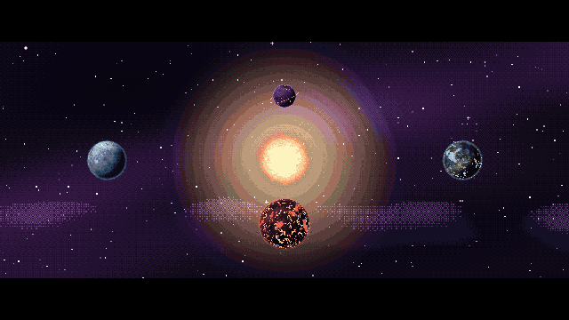</a><br><sub>La bande-annonce (40 s) — <a href="docs/media/trailer.mp4">en vidéo MP4, avec sa musique</a> ; le jeu la montre sur son écran d'accueil après une minute d'inactivité.</sub></p>

<p align="center"><b>Nova traverse six mondes, apprend dix-neuf pouvoirs et tient tête à des giga-boss à huit phases.</b><br>
Un jeu de plateforme 2D nerveux et précis, en C++20 / SDL3 : seul ou à deux ou trois, au clavier, à la
manette ou à la souris, en français ou en anglais — et entièrement jouable hors ligne.</p>

<p align="center">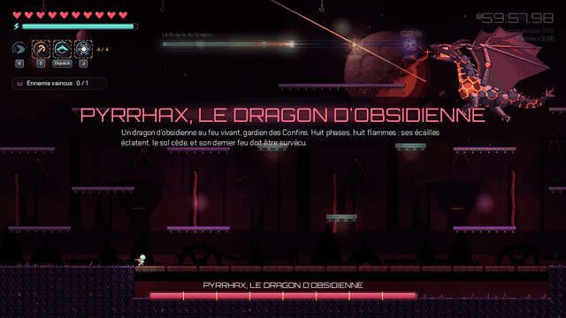</p>

> **Télécharger (Windows)** : l'installateur est produit par la CI à chaque version — onglet **Actions**
> du dépôt › workflow *Build* › dernier passage réussi › artefact **CosmicPlatformer-Setup** (ou
> **CosmicPlatformer-portable-windows**, sans installation). Une fois le jeu installé, ses *Notifications*
> annoncent chaque nouvelle version : l'installateur se télécharge, est vérifié (SHA-256), puis
> « Lancer l'installateur ». Sous Linux, ou pour compiler vous-même : voir [Compiler](#compiler).

<p align="center">
<a href="#dix-neuf-pouvoirs">Pouvoirs</a> ·
<a href="#six-mondes-et-une-campagne">Mondes</a> ·
<a href="#giga-boss-et-histoires-animées">Giga-boss</a> ·
<a href="#le-premier-envol-avec-bip">Didacticiel</a> ·
<a href="#fantômes-et-entraînement">Fantômes</a> ·
<a href="#fiches-des-boss-et-statistiques">Statistiques</a> ·
<a href="#succès-et-vestiaire">Succès</a> ·
<a href="#défis-du-jour-de-la-semaine-et-du-mois">Défis</a> ·
<a href="#éditeurs-et-niveaux-de-la-communauté">Éditeurs</a> ·
<a href="#coopération-à-deux-ou-trois">Coopération</a> ·
<a href="#clans">Clans</a> ·
<a href="#cosmic-online">Cosmic Online</a> ·
<a href="#historique-des-versions">Versions</a>
</p>

## Dix-neuf pouvoirs

Nova court, saute, glisse, s'accroupit sous les attaques et frappe — puis chaque monde lui apprend
quelque chose de nouveau : **Dash** et **Ruée aérienne**, **Onde énergétique**, **Bouclier**,
**Téléportation**, **Planeur**, **Grappin**, **Frappe sismique**, **Tir chargé**, **Triple saut**,
**Ralenti temporel**, **Bombe plasma**, **Aimant**, **Lame boomerang** (et sa version chargée),
**Nova de givre**, **Leurre holographique**, **Balise de rappel**… Quatre pouvoirs portés à la fois
dans la plupart des niveaux : on choisit lesquels, et des **stations de pouvoirs** proposent ceux dont
la suite a besoin, si bien qu'on ne reste jamais bloqué. Chaque emplacement de pouvoir a sa touche,
que vous choisissez.

<p align="center">


</p>
<p align="center"><sub>À gauche, l'Onde puis le Dash dans « La Canopée des Spores » ; à droite, la Lame boomerang, la Nova de
givre (l'ennemi gelé devient une plateforme) et un Dash, sur Aethra.</sub></p>

Le **Guide des pouvoirs** (menu pause) montre chacun d'eux joué en boucle par le vrai moteur du jeu,
avec son coût d'énergie et toutes ses caractéristiques :

<p align="center">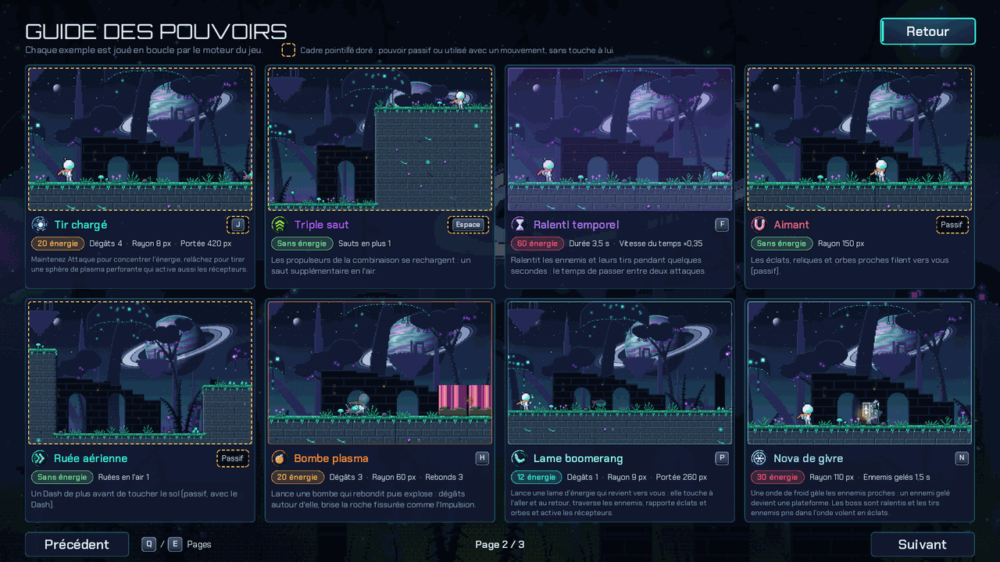</p>

## Six mondes et une campagne

**25 niveaux** sur six mondes du système Kepler-Voss : **Sylvanox**, le monde-jardin des Anciens ;
**Pyralis**, la forge en fusion ; **Glacior**, les plaines de cristal gelé ; **Aethra**, la planète des
sanctuaires ; le **Noyau stellaire**, au cœur de l'étoile ; et **Les Confins**, au bord du système. Chaque
niveau a son chronomètre, ses médailles de bronze à platine et ses boss ; les niveaux classiques cachent
reliques et cœurs de cristal, et les **épreuves** et niveaux **EXTRÊME** (une seule vie) attendent les plus
téméraires.

<p align="center">

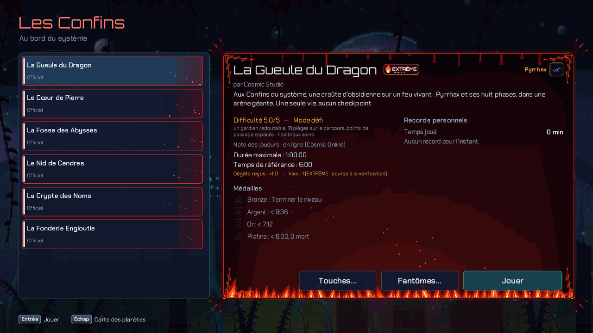
</p>

## Giga-boss et histoires animées

Aux Confins vivent les **giga-boss** : Pyrrhax le dragon d'obsidienne, le Monolithe, le Kraken des
Abysses, le Phénix stellaire, la Liche des Catacombes et le Titan mécanique — huit phases chacun, dans des
arènes géantes, sans checkpoint ; au cœur de l'étoile, **Singularis**. Les boss lisent le combat, visent
là où vous allez atterrir, enchaînent des combos et entrent en rage si le combat s'éternise ; leurs
attaques sont annoncées avant de frapper.

Avant le premier combat, chaque giga-boss raconte son **histoire**. Celles des Confins — **Pyrrhax**, le
**Monolithe**, le **Kraken**, le Phénix, la Liche et le Titan — sont de petits dessins animés faits de vrais
sprites du jeu, sur des décors en couches qui bougent :

<p align="center">


</p>
<p align="center"><sub>« Le Dragon d'Obsidienne », « Le Golem Primordial », « La Lanterne des profondeurs » —
une pastille NOUVEAU mène à « Revoir l'histoire ».</sub></p>

## Le premier envol avec Bip

Au tout premier lancement, **Bip**, un petit robot compagnon, propose un vol d'essai d'environ six
minutes dans la **Pépinière d'étoiles** : se déplacer, sauter, rebondir sur les champignons, attaquer,
prendre la Ruée, traverser un ruisseau sur des bulles porteuses, puis affronter Mycélia la Câline. Neuf
explications arrêtent vraiment le jeu, avec un aperçu animé et **vos** touches (clavier, manette Xbox
ou PlayStation). Aucune chute n'est mortelle ; on peut passer le didacticiel à tout moment.

<p align="center">
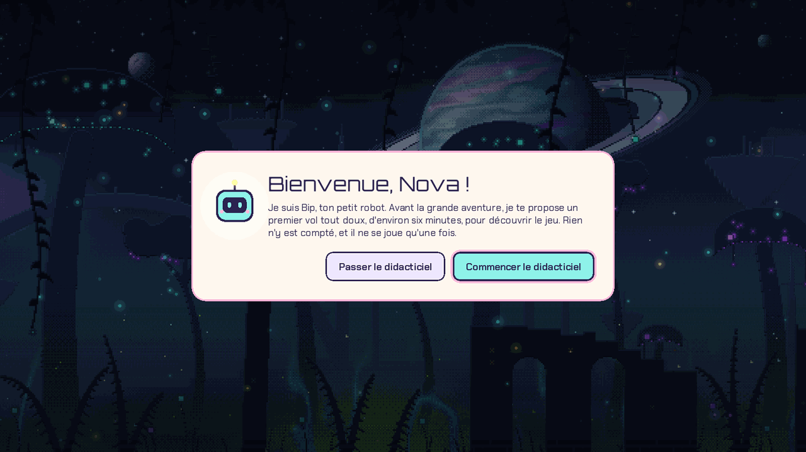
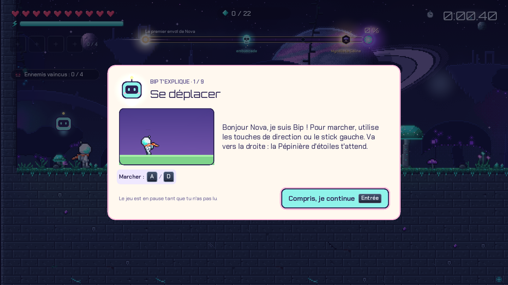
</p>

## Fantômes et entraînement

Courez contre vos **fantômes** — meilleur temps, record précédent, dernière course —, le **record
mondial** ou ceux de vos amis (jusqu'à 8 à la fois), avec les **écarts en direct** sous le chronomètre
et un **panneau des segments** façon LiveSplit (meilleurs segments en or). L'**entraînement par
segment** répète une section depuis un point de sauvegarde ; la **somme des meilleurs segments** (SOB)
réunit vos courses et vos entraînements, et **« Regarder »** enchaîne ces meilleurs segments, chacun
rejoué à l'identique depuis son replay exact. Les boss ont aussi leur **entraînement** (phase, cœurs,
pouvoirs et lieu d'apparition au choix). L'entraînement ne compte pour aucun record, et les fantômes,
purement visuels, ne changent rien à la partie. Détails : [docs/GHOST_RACING.md](docs/GHOST_RACING.md).

## Fiches des boss et statistiques

Chaque boss a sa **fiche** : caractéristiques lues dans sa définition, phases, et chaque attaque qui se
déplie avec ses dégâts, son annonce, sa recharge — et un **exemple animé joué par le moteur**, où Nova
montre comment l'esquiver. L'écran **Statistiques** suit vos vraies parties, sur votre ordinateur :
vue d'ensemble sur 7, 30 ou 90 jours, combat (esquive, précision), boss tentative après tentative,
niveaux (record, somme des meilleurs segments, zones à travailler) et passages difficiles, chacun avec
son entraînement. Voir [Statistiques](#statistiques).

<p align="center"></p>

## Succès et Vestiaire

**259 succès** et leurs **785 étoiles** de difficulté, présentés sur une **toile** (un secteur par
catégorie, des fils entre les étapes) ou en liste, avec des suggestions de ce qui est à votre portée.
Ils débloquent les récompenses de la **Collection** : combinaisons, traînées, cadres d'avatar, titres et
effets de victoire du **Vestiaire**, la route des étoiles, le juke-box et la galerie. Les objets
exclusifs gagnés en défi portent une aura dorée.

<p align="center">

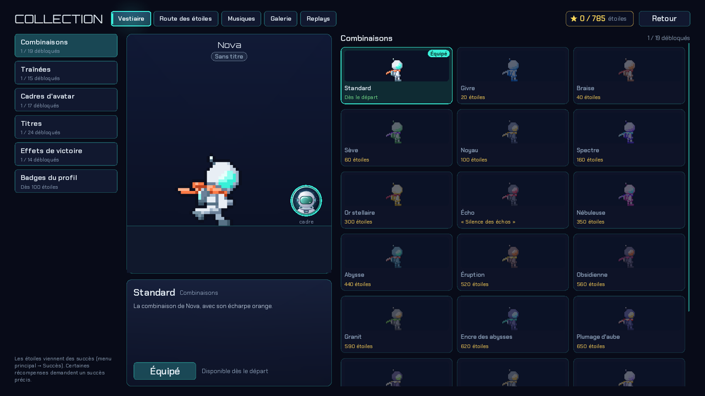
</p>
<p align="center"><sub>Captures d'un profil neuf : tout reste à gagner.</sub></p>

## Défis du jour, de la semaine et du mois

Chaque jour, chaque semaine et chaque mois, un **défi** : un niveau, des règles (cœurs, pouvoirs,
stations, checkpoints), des paliers **bronze, argent, or** et des **récompenses** exclusives pour le
Vestiaire. Les parties sont vérifiées par Cosmic Online ; on peut aussi s'entraîner hors classement et
rejouer les anciens défis depuis le **calendrier**, qui montre combien de joueurs ont atteint chaque palier.

<p align="center">

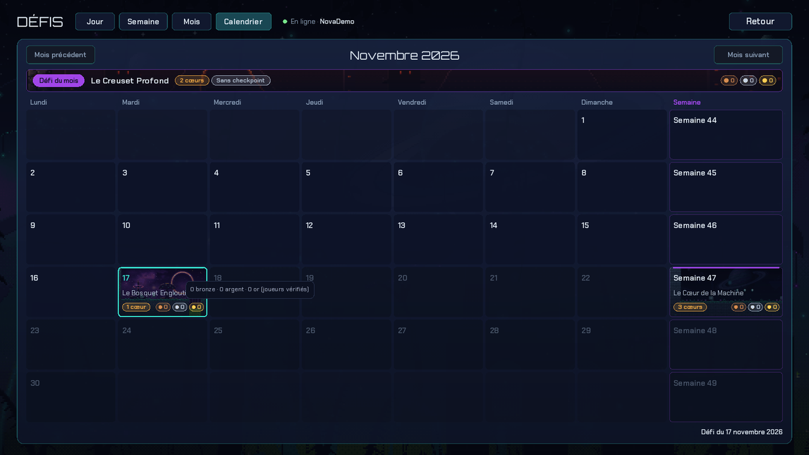
</p>

## Éditeurs et niveaux de la communauté

Le jeu contient ses propres outils : l'**éditeur de niveaux** (calques, bibliothèque d'objets,
événements et déclencheurs, cinématiques, test immédiat avec F5), l'**éditeur d'ennemis** (animations,
comportements, attaques, phases de boss, arène de test) et l'éditeur du HUD. Un niveau se partage en
fichier `.cplanet` vérifié, ou se publie dans **NIVEAUX EN LIGNE** (populaires, plus durs, récents,
mieux notés, amis…) ; **PROJETS** permet de créer un niveau à plusieurs, en direct.

<p align="center">
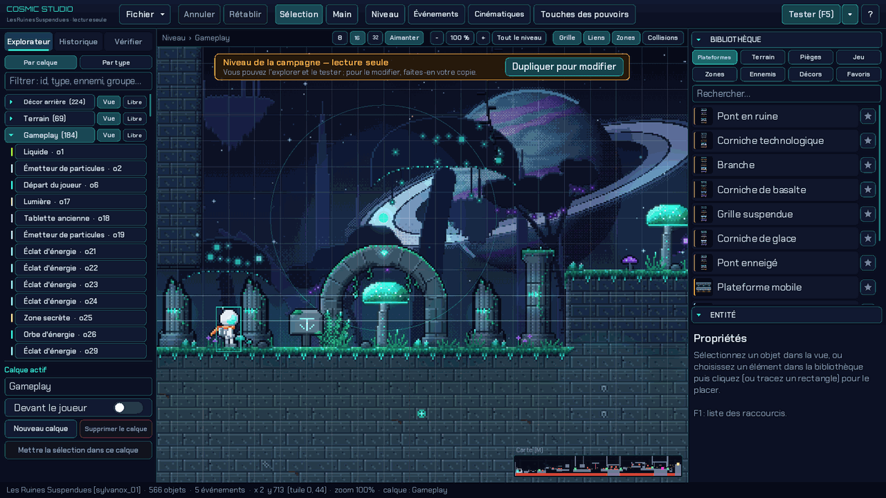

</p>

## Coopération à deux ou trois

Les niveaux EXTRÊME se jouent aussi à **2 ou 3 joueurs** : **sur un même PC** (une manette par joueur en
plus du clavier), **en réseau local** (sans compte ni serveur) ou **en ligne** avec vos amis. Une vie
chacun, pas de coups entre alliés, des joueurs solides sur lesquels on peut se poser, des
**réanimations**, une caméra commune — et des classements **Duo** et **Trio** à part. Architecture :
[docs/COOP.md](docs/COOP.md).

<p align="center"></p>

## Clans

Un clan par joueur, jusqu'à **50 membres** : un nom, un **tag** (affiché **[AUBE]** à côté du pseudo),
une devise, un **emblème**, un chef et des officiers, une adhésion sur invitation, sur candidature ou
ouverte, et sa propre **discussion**. Le **classement des clans** additionne les meilleurs résultats
vérifiés par le serveur sur les niveaux EXTRÊME officiels.

<p align="center"></p>

## Cosmic Online

Facultatif, et jamais nécessaire pour jouer : un **globe 3D** interactif (rotation à la souris ou au
stick, zoom, clic sur un pays ou un joueur), des **classements** par niveau, pays, amis, planète et
points cosmiques (ANY%, 100 %, SANS MORT, SANS DÉGÂT ; historique ou hebdomadaire), des **profils**
publics, des **amis**, une messagerie (**SOCIAL**) et des **replays exacts** : le moteur est
déterministe, un replay rejoue la partie à l'identique et le serveur vérifie chaque record. La
localisation se limite au pays choisi.

<p align="center">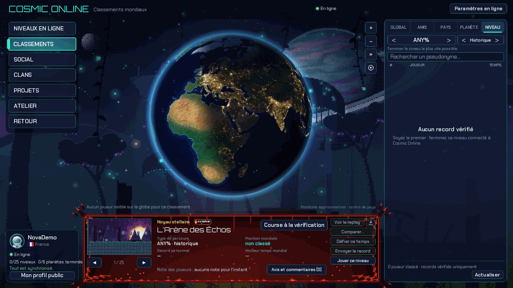</p>
<p align="center"><sub>Les captures des défis, du clan et du globe viennent d'un serveur Cosmic Online lancé en
local, avec des comptes de démonstration (aucun record n'y est encore vérifié).</sub></p>

<p align="center">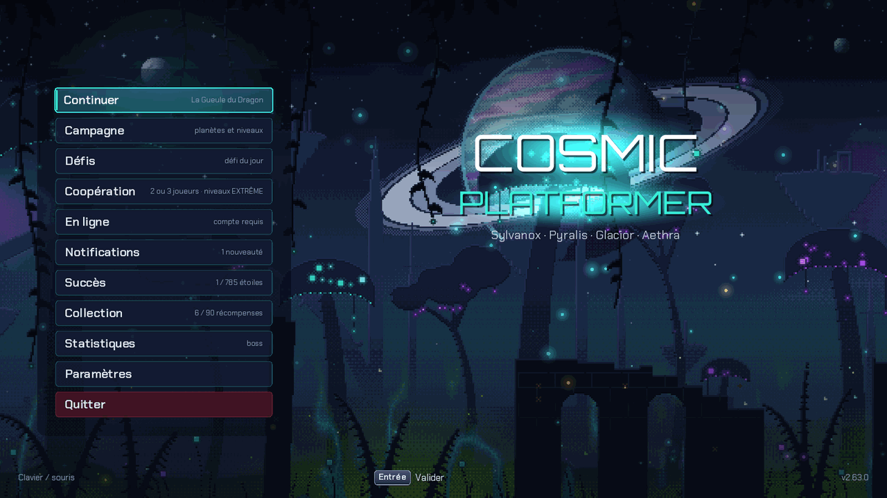</p>

---

## Commandes

| Action | Clavier AZERTY (QWERTY) – principal / secondaire | Manette (Xbox / PlayStation) |
|---|---|---|
| Se déplacer | Q D (A D) / ← → | Stick gauche / croix |
| Haut / bas, grimper | Z S (W S) / ↑ ↓ | Stick gauche |
| Sauter / double saut | Espace / W (Z) | A / Croix |
| Glissade | Bas en courant au sol | Bas (stick / croix) en courant |
| S'accroupir | Bas seul au sol (même sur place) | Bas (stick / croix) sans direction |
| Attaque | J / X | X / Carré |
| Pouvoir 1 (1er emplacement du HUD) | K / Maj gauche | B / Rond |
| Pouvoir 2 | L / C | RT / R2 |
| Pouvoir 3 | O / V | LB / L1 |
| Pouvoir 4 | I / B | RB / R1 |
| Pouvoir 5 et 6 (niveaux à plus de 4 pouvoirs) | U / N, F / H | LT / L2, R3 |
| Pouvoir 7 et 8 | à choisir | à choisir |
| Planeur | maintenir Saut en tombant | maintenir A / Croix |
| Frappe sismique | Bas + Attaque en l'air | Bas + X / Carré |
| Tir chargé | maintenir Attaque, relâcher | maintenir X / Carré |
| Grappin | Interagir près d'un point d'ancrage | Y / Triangle |
| Triple saut | troisième Saut en l'air (passif) | A / Croix |
| Interagir | E / Entrée | Y / Triangle |
| Pause | Échap / P | Menu / Options |

**Touches des pouvoirs (2.24)** : chaque emplacement de pouvoir du HUD a sa touche, que le
joueur choisit (*Paramètres → Clavier / souris* et *Manette*, « Pouvoir 1 » à « Pouvoir 8 ») ;
elle utilise le pouvoir équipé dans cet emplacement, quel qu'il soit (Dash, Onde, Bouclier,
Impulsion, Téléportation, Ralenti, Bombe plasma, Lame boomerang, Nova de givre, Leurre,
Balise de rappel). Deux pouvoirs de l'ancien bouton Spécial se portent donc ensemble. Les
pouvoirs passifs (Aimant, Ruée aérienne) et ceux qui s'utilisent avec un mouvement (Planeur,
Triple saut, Frappe sismique, Tir chargé, Grappin) n'utilisent pas la touche de leur
emplacement : un **cadre pointillé doré** les distingue dans le HUD, le choix du pouvoir à
remplacer et le guide des pouvoirs, avec leur mouvement (ou « passif ») à la place de la
touche. Les paramètres d'avant la 2.24 sont repris : les touches choisies pour les six
pouvoirs d'alors (Dash, Onde, Bouclier, Impulsion, Téléportation, Spécial) deviennent celles
des emplacements 1 à 6.

Les touches sont des **positions physiques** (scancodes) : les déplacements tombent sur ZQSD
en AZERTY et sur WASD en QWERTY, et le jeu affiche toujours le nom réel de la touche. Toutes les commandes se reconfigurent dans
*Paramètres → Clavier / souris* et *Paramètres → Manette* (profils indépendants, zones mortes,
sensibilité, inversion des axes, vibrations, réinitialisation). Les icônes affichées
s'adaptent à la manette utilisée (Xbox, PlayStation ou générique) et basculent
automatiquement entre clavier et manette.

Touches globales : **F3** mode debug (FPS, dt, colliders, hitboxes, position/vitesse du
joueur, états des ennemis, chrono, particules), **F11** plein écran, **F12** capture d'écran.

**HUD — ennemis hors écran (2.52)** : un ennemi déjà rencontré qui sort de l'écran est signalé
par une flèche ambrée sur le bord, tournée vers lui (plus pâle s'il est loin) ; plusieurs ennemis
dans la même direction n'ont qu'une flèche, vers le centre du groupe, avec leur nombre (« ×5 »).
Ces flèches ne passent jamais sur le HUD, sur la flèche du boss (qui garde la sienne) ni les unes
sur les autres ; option *Paramètres → Jeu → Flèches vers les ennemis hors écran* (activée par défaut).

### Les pouvoirs

Les cinq premiers (Dash, Onde, Bouclier, Impulsion, Téléportation) s'obtiennent dans
« Les Ruines Suspendues » ; les suivants s'apprennent chacun dans un niveau : Planeur
(La Canopée des Spores, courants ascendants), Grappin (Le Cœur de la Machine), Frappe
sismique (Les Forges Englouties, sols fissurés), Tir chargé (Le Fleuve de Lave, récepteurs
lointains, boucliers des Remparts) et Triple saut (Les Plaines de Givre). Les niveaux joués
hors de l'ordre donnent d'office les pouvoirs des niveaux précédents.

Sur Glacior, la glace est glissante et les attaques gelées ralentissent ; sur Pyralis, la
lave, les éruptions et les bombes sont mortelles.

Chaque pouvoir actif coûte de l'énergie selon sa force (jauge de 150) : Dash 5, Impulsion 8,
Onde 10, Frappe sismique 10, Lame boomerang 12, Balise de rappel 15 (pour revenir ; la poser est
gratuit), Tir chargé 20 (la référence), Bombe plasma 20, Bouclier 20, Téléportation 25, Leurre
holographique 25, Nova de givre 30, Ralenti 60 ; les pouvoirs passifs sont gratuits. Le *Guide des pouvoirs*
(menu pause) montre chaque pouvoir joué en boucle par le moteur avec son coût ; sa fiche donne
toutes ses caractéristiques.

Chaque niveau a un chrono (limite de 15 à 20 min), des médailles bronze / argent / or /
platine, records locaux (meilleur temps, morts, collectibles, ennemis vaincus, score,
pouvoirs utilisés, date) avec comparaison au meilleur essai.

## Cosmic Online en détail

Menu principal → **En ligne** (compte obligatoire pour cette section, jamais pour jouer) : globe 3D interactif (rotation à la souris ou au stick
droit, zoom molette / gâchettes, clic sur un marqueur ou un pays), classements par niveau,
pays, amis, planète et points cosmiques, catégories ANY% / 100% / SANS MORT / SANS DÉGÂT,
période historique ou hebdomadaire, profils publics, amis (avec notifications des
demandes) et **replays exacts** : le moteur est déterministe (pas fixe de 1/120 s, hasard du
gameplay à graine fixe par niveau, mathématiques identiques sous Windows et Linux), un replay
contient les commandes de chaque pas et le jeu rejoue la partie à l'identique (mêmes
animations, mêmes ennemis, mêmes attaques), avec vérification de l'état toutes les 0,5 s
(`CosmicPlatformer --replay fichier.cprz`, *Revoir la partie* à la fin d'un niveau). Le jeu reste entièrement jouable sans compte ; hors ligne, les
performances sont gardées et envoyées au retour de la connexion. La localisation se limite au pays choisi (affiché au centre du pays), jamais de
position précise.

Le serveur (Cloudflare Workers, D1, R2) est dans [`server/`](server/README.md) ; il se lance en
local sans compte Cloudflare. Documentation complète : [docs/online/](docs/online/README.md).

## Menu principal

*Continuer* (dernier niveau joué) · *Campagne* (planètes et niveaux) · *Défis* · *Coopération* ·
*En ligne* · *Notifications* · *Succès* (la toile des succès et de leurs étoiles) · *Collection*
(vestiaire, route des étoiles, musiques, galerie, replays) · *Statistiques* (vos statistiques de jeu,
et les fiches des boss) · *Paramètres* · *Quitter*.

### Statistiques

Calculées à partir de **vos vraies parties**, sans compte ni Internet, et gardées dans
`saves/stats.json`. L'écran démarre vide et se remplit au fil des parties. Six sections :

* **Vue d'ensemble** — sur 7, 30 ou 90 jours : temps de jeu et jours joués, taux d'esquive,
  précision, morts par heure, chacun comparé à la période précédente de même durée (▲ / ▼, l'écart
  et « en progrès » / « en recul ») ; étoiles de succès cumulées ; morts par heure jour après jour
  avec la moyenne des 7 derniers jours joués.
* **Combat** — taux d'esquive (une attaque ennemie vous menace quand elle passe à moins d'une tuile
  et demie de vous ; esquivée si elle ne vous blesse pas) et précision (un tir, un coup ou une lame
  touche s'il retire des points de vie à au moins un ennemi), précision par pouvoir, et ce qui vous
  touche (tirs, attaques d'ennemis, de boss, contacts, pièges, chutes).
* **Boss** — votre meilleure part des points de vie retirée, tentative après tentative (trois boss
  à la fois, les plus récents d'abord), une fiche par boss, les défaites par phase ; les fiches des
  boss d'avant (lieux, animations, entraînement) sont à un clic.
* **Niveaux** (classiques, hors EXTRÊME, joués depuis le début) — évolution du record (PB) et de la
  somme des meilleurs segments (SOB), temps gagnable, zones à travailler (temps perdu en moyenne
  par segment, avec « S'entraîner sur ce segment »), constance de chaque segment et régularité des
  parties complètes.
* **Passages difficiles** — où vous tombez dans un niveau (40 tranches sur son vrai relief, avec
  ses points de passage) et vos 5 passages les plus difficiles, niveaux et phases de boss mêlés,
  chacun avec son entraînement.
* **Données et sauvegarde** — ce qui est enregistré, où et quand, comment les statistiques
  voyagent avec la progression, et « Réinitialiser les statistiques ». *Paramètres › Jeu ›
  « Enregistrer mes statistiques »* (activé par défaut).

**Avec votre progression** (2.55) : connecté à Cosmic Online, `stats.json` fait partie de la copie
privée de la progression (comme les records et les succès ; aucun autre joueur ne la voit), et la
progression restaurée après « Migrer vers un nouveau compte » apporte ses statistiques, copiées
d'abord avec les autres sauvegardes dans `saves/avant_restauration_…`. La fusion ne compte jamais
rien deux fois, et restaurer deux fois la même copie ne change rien :

* chaque jour (et chaque mois de plus d'un an) : pour chaque compteur, le plus grand des deux côtés
  (une même journée jouée sur deux ordinateurs est rare) ; de même pour les 40 tranches d'un niveau ;
* tentatives de boss : réunies par leur identifiant (tiré au hasard quand la tentative est gardée),
  puis les 200 plus récentes ; les totaux (tentatives, victoires, phases, attaques fatales) comptent
  chaque tentative une fois ;
* niveaux classiques (même version du niveau ; sinon celle jouée le plus récemment) : temps de
  chaque segment réunis (50 gardés), meilleur temps et somme des meilleurs : le meilleur ; parties
  complètes réunies par jour et temps ; historique du record et de la somme des meilleurs : réuni et
  trié par jour ;
* le fichier fusionné reste sous 300 Ko (mêmes plafonds qu'en jeu).

Chaque graphique a une info-bulle à la souris, un curseur au clavier et à la manette (← →) et une
vue **Tableau**. Les statistiques lisent la partie sans la changer : replays, records et classements
sont identiques. L'entraînement est compté à part, le mode Invincible (admin), les replays relus et
les parties d'amis regardées jamais.

**En ligne** (compte requis) : **NIVEAUX EN LIGNE** (les niveaux publiés par les joueurs : Populaires,
Plus durs, Récents, Mieux notés, Amis, Recherche, Les miens ; télécharger et jouer, noter,
signaler, classement par niveau ; *ATELIER → Mes niveaux → Publier* après avoir terminé son
niveau depuis le départ dans l'éditeur), **CLASSEMENTS** (classements, globe, profils), **SOCIAL**
(messagerie privée avec vos amis, groupes de discussion jusqu'à 20 membres, amis et demandes,
joueurs bloqués, signalement de messages ; notifications des nouveaux messages et demandes,
gardées pendant une partie et affichées ensuite) et l'**ATELIER** (vos niveaux,
niveaux importés, export / import `.cplanet`, éditeur d'ennemis). Dans ONLINE, un niveau se
joue depuis sa fiche (*Jouer ce niveau*) ; à la fin (ou en quittant), on revient à ONLINE sur
ce niveau.

## Éditeurs

Les **entités natives** (ennemis, boss, pouvoirs, effets et graphismes de la campagne) sont
utilisables dans tous les niveaux des joueurs mais ne sont jamais modifiables : l'éditeur
d'ennemis enregistre vos réglages dans une copie, et un fichier utilisateur ou un package qui
réutilise l'identifiant d'une entité native est ignoré (renommé à l'import).

* **Éditeur de niveaux** (*Online → Workshop → Mes niveaux* ou `CosmicPlatformer --editor [id]`) :
  calques, bibliothèque d'objets, propriétés, grille magnétique, zoom, déplacement de vue,
  sélection multiple, déplacement / redimensionnement / rotation / miroir, copier-coller,
  annuler / rétablir, événements et déclencheurs, cinématiques d'intro / outro, chrono et
  médailles, test immédiat (F5) avec retour à l'éditeur, sauvegarde automatique.
* **Éditeur d'ennemis** (*Online → Workshop → Éditeur d'ennemis* ou `--enemy-editor`) : aperçu animé, statistiques, comportements IA,
  attaques, phases de boss, arène de test où l'on peut contrôler le joueur.

Voir [docs/EDITORS.md](docs/EDITORS.md).

## Partager un niveau

*Online → Workshop → Exporter* crée un fichier `.cplanet` autonome contenant le niveau,
la planète, les ennemis, les pouvoirs, les effets et **tous** les fichiers graphiques et
audio utilisés, avec un manifeste signé par empreintes SHA-256. *Importer* vérifie
l'archive (empreintes, chemins, tailles, version, dépendances, conflits) avant de
l'installer ; aucun code n'est jamais exécuté depuis un package. Avec l'installateur
Windows, un double-clic sur un `.cplanet` ouvre directement l'écran d'import.

En ligne de commande :

```
CosmicPlatformer --export sylvanox_01 MonNiveau.cplanet --author "Mon nom"
CosmicPlatformer --import MonNiveau.cplanet
```

Voir [docs/PACKAGE_FORMAT.md](docs/PACKAGE_FORMAT.md).

## Langue / Language

Le jeu est **en français ou en anglais**. L'installateur Windows demande la langue (il
s'affiche lui-même dans cette langue) et le jeu démarre dans celle-ci ; elle se change à
tout moment dans *Paramètres › Jeu › « Langue / Language »*, avec effet immédiat (ou
`--lang en|fr` en ligne de commande). Le français reste la source de tous les textes ;
l'anglais vient du dictionnaire `data/i18n/en.json`, appliqué à l'affichage. Les contenus
des joueurs (niveaux de la communauté, pseudonymes, commentaires, messages) ne sont jamais
traduits. Ajouter ou compléter une traduction : [docs/I18N.md](docs/I18N.md).

## Données utilisateur

Sauvegardes, paramètres, records, niveaux créés, packages importés, exports, captures et
journal (`cosmic.log`) sont stockés dans :

* Windows : `%APPDATA%\CosmicStudio\CosmicPlatformer\`
* Linux : `~/.local/share/CosmicStudio/CosmicPlatformer/`

Les statistiques des boss sont dans `saves/boss_stats.json`, celles de l'écran Statistiques dans
`saves/stats.json` (seulement dans la copie privée de la progression, pour un compte connecté).
Les fichiers sont versionnés et migrés automatiquement ; un fichier corrompu est mis de
côté (`.corrupt`) au lieu de faire planter le jeu. La désinstallation les conserve, sauf
demande explicite.

## Compiler

Prérequis : CMake ≥ 3.24, un compilateur C++20 (Visual Studio 2022, GCC 12+ ou Clang 15+),
Git, et une connexion Internet **uniquement** au premier configure (téléchargement de SDL3,
SDL3_image, SDL3_ttf, SDL3_mixer, nlohmann/json, miniz, aux versions épinglées).

```
cmake -S . -B build
cmake --build build --config Release --parallel
ctest --test-dir build -C Release --output-on-failure
```

L'exécutable est dans `build/bin/`. Installateur Windows : `installer\build_installer.ps1`
(Inno Setup 6). Détails, options et compilation croisée : [docs/BUILDING.md](docs/BUILDING.md).

## Documentation

* [docs/COLLECTION.md](docs/COLLECTION.md) – récompenses de la collection, juke-box et galerie (2.19)
* [docs/ARCHITECTURE.md](docs/ARCHITECTURE.md) – modules, boucle de jeu, flux de données
* [docs/LEVEL_FORMAT.md](docs/LEVEL_FORMAT.md) – format JSON des niveaux, objets, événements
* [docs/PACKAGE_FORMAT.md](docs/PACKAGE_FORMAT.md) – format `.cplanet` et vérifications à l'import
* [docs/EDITORS.md](docs/EDITORS.md) – guide des éditeurs
* [docs/BUILDING.md](docs/BUILDING.md) – compilation, tests, installateur
* [docs/ASSET_SPEC.md](docs/ASSET_SPEC.md) – contrat des assets (sprites, animations, tuiles, audio)
* [docs/I18N.md](docs/I18N.md) – langues (français / anglais) : choix, fonctionnement, ajouter une traduction
* [docs/GHOST_RACING.md](docs/GHOST_RACING.md) – fantômes, écarts, entraînement, succès, mode concentré (et leurs limites)
* [docs/COOP.md](docs/COOP.md) – coopération à 2 ou 3 joueurs : même PC, réseau local, en ligne
* [docs/online/](docs/online/README.md) – Cosmic Online : installation, déploiement, secrets, API, règles, confidentialité, dépannage

## Licences

Code et assets du jeu : Cosmic Studio. Les assets (sprites, décors, sons, musiques) sont
générés par les scripts de `tools/assetgen`. Bibliothèques et polices tierces : voir
[licenses/](licenses/). Le globe utilise des données Natural Earth (domaine public), les
drapeaux flag-icons (MIT), les noms de pays i18n-iso-countries (MIT) et les lumières des villes
de GeoNames (CC BY 4.0, © GeoNames), générés par `tools/globegen`.

## Historique des versions

**Nouveau dans la version 2.64.1** :
* **Vérification des touches** : dans Paramètres › Clavier / souris et Manette et dans « Touches de ce niveau », la
  touche, le bouton de souris ou de manette, la gâchette ou la direction de stick tenus s'allument en direct dans la
  liste (hors choix d'une nouvelle touche) : de quoi vérifier que c'est la bonne touche, sans rien changer.

**Nouveau dans la version 2.64.0** :
* **Bruitages des histoires** et de la bande-annonce : une ambiance sous chaque plan (vent, grotte, magma, mer
  profonde, catacombes, fonderie, cosmos) et les bruits de l'action (œuf qui craque, flammes, pierre qui se fend, ailes,
  effondrement de l'étoile, bulles, bougies, os, vapeur, chant de Lyse, rugissements), placés à gauche ou à droite
  selon l'image, sur le volume « Effets » ; la musique baisse un peu sous les plus gros.
* **Histoires** : « Passer » (Espace, Entrée, Ⓐ, clic) ne passe que le plan en cours ; « Quitter » (Échap, Ⓑ ou un
  clic sur son indication) quitte toute l'histoire.

**Nouveau dans la version 2.63.9** :
* **Bande-annonce** (environ 40 s, [vidéo MP4](docs/media/trailer.mp4)) : plans rapides et grands titres faits de vraies
  scènes du jeu (Nova sur trois planètes, les sept giga-boss dans les décors de leurs histoires, la coopération, Cosmic
  Online) sur la musique de Singularis. Elle se lance sur l'écran d'accueil après **1 minute sans aucune action** et
  tourne en boucle ; n'importe quelle entrée ramène au menu sans rien déclencher. Jamais pendant une saisie, une
  fenêtre ouverte, un téléchargement ou avant le didacticiel ; désactivable dans Paramètres › Jeu.

**Nouveau dans la version 2.63.8** :
* Mise à jour du jeu : barre de progression du téléchargement, plus de coupure au bout de 90 s sur une connexion lente, vraie raison d'un échec.

**Nouveau dans la version 2.63.7** :
* **Clans** : une **fiche de clan** publique, comme un profil (emblème, tag, devise, membres et rôles, points et
  rang, meilleurs résultats EXTRÊME, « Rejoindre » / « Postuler »), ouverte d'un clic sur un tag [TAG] partout ;
  onglet **« Clan »** dans les profils, avec **« Inviter dans mon clan »** pour le chef et les officiers ; onglet
  **« Gestion »** dans CLANS (candidatures, invitations envoyées, membres et rôles, paramètres du chef).

**Nouveau dans la version 2.63.6** :
* **Coopération sur les niveaux EXTRÊME de la communauté** : le salon propose « Campagne / Communauté »
  (titre, auteur, version) et la page d'un niveau EXTRÊME de NIVEAUX EN LIGNE a « Jouer en coop ». Un invité
  sans le niveau (ou sans cette version) le reçoit avant « Prêt » : téléchargé depuis Cosmic Online, ou envoyé
  par le PC hôte en réseau local (16 Mo au plus, SHA-256 puis empreinte de jeu vérifiés) ; jamais deux versions
  dans une même partie. Classements Duo et Trio par version sur la page du niveau et à la fin de la partie (sans
  points de clan). Une pastille NOUVEAU signale « Communauté » et « Jouer en coop ».

**Nouveau dans la version 2.63.5** :
* L'**histoire de Singularis** (« Le Cœur effondré ») devient un **petit dessin animé** : Lyse, la jeune
  étoile qui chante, les trois planètes qui fleurissent de ses dons, les machines qui boivent sa lumière, la
  dernière étincelle, l'effondrement et Singularis affamé ; nébuleuse, étoiles et poussières animées. Une
  pastille NOUVEAU mène à « Revoir l'histoire ».

**Nouveau dans la version 2.63.4** :
* Petits textes : les espaces entre les mots ne disparaissent plus en 1280×720.

**Nouveau dans la version 2.63.3** :
* L'**histoire du Titan** (« Le Dernier Quart ») devient un **petit dessin animé** : la fonderie et ses
  ouvriers, le colosse qui s'éveille sur son échafaudage, la promesse du contremaître, la roche qui engloutit
  la fonderie, la rouille et la vapeur, le Titan face à la visiteuse ; fourneaux, engrenages, chaînes et
  fumée animés. Une pastille NOUVEAU mène à « Revoir l'histoire ».

**Nouveau dans la version 2.63.2** :
* L'**histoire de la Liche** (« Le Gardien des noms ») devient un **petit dessin animé** : Ossian qui allume
  une bougie pour chaque mort, les noms qui s'illuminent, la fuite des vivants, l'âme cachée dans le cristal,
  les siècles qui ne laissent que les os et la flamme verte, la Liche dans sa crypte ; bougies, niches, toiles
  et brume animées. Une pastille NOUVEAU mène à « Revoir l'histoire ».

**Nouveau dans la version 2.63.1** :
* L'**histoire du Phénix** (« Le Porteur d'aube ») devient un **petit dessin animé** : l'oiseau de lumière qui
  porte l'aube, le jour qui se lève derrière lui sur les volcans et le verre noir, la longue nuit, les plumes
  qui brûlent jusqu'aux cendres, la renaissance, le Phénix qui se consume dans son nid ; aube, fumées et
  brume animées. Une pastille NOUVEAU mène à « Revoir l'histoire ».

**Nouveau dans la version 2.63.0** :
* **Coopération** sur les niveaux EXTRÊME, à **2 ou 3 joueurs** (menu principal › *Coopération*) : une vie
  chacun, les mêmes règles qu'en solo, **sur un même PC** (une manette par joueur en plus du clavier), **en
  réseau local** (un PC héberge le relais, sans compte ni serveur) ou **en ligne** avec vos amis (salon,
  invitations, « Prêt »). Le jeu reste jouable sans compte ni Internet.
* **Pas de coups entre alliés** ; **joueurs solides, sans poussée** (un allié arrête comme un mur, on peut se
  poser sur sa tête) ; les ennemis visent le **joueur le plus proche** ; **réanimation** en restant 2 s près
  de l'âme d'un allié (2 par tentative) ; **caméra commune** (un joueur hors de l'écran depuis 3 s revient
  près de l'équipe) ; **déconnexion** : 60 s pour revenir, la partie se rattrape en accéléré.
* **Course à la vérification Duo et Trio** (jamais mélangées entre elles ni avec le solo) : progression du
  joueur le plus avancé, vérification par le serveur avec les entrées de chaque joueur, confirmation de chaque
  joueur avec son compte (une partie sur un même PC n'est pas classée : un compte ne s'ouvre que sur son propre
  ordinateur). Les records solo restent tous valides. Architecture : [docs/COOP.md](docs/COOP.md).

**Nouveau dans la version 2.62.5** :
* L'**histoire du Kraken** (« La Lanterne des profondeurs ») devient un **petit dessin animé** : l'œuf qui éclot
  dans la mer noire, la petite lueur que suivent les poissons perdus, la pluie d'étincelles de l'étoile, les huit
  bras qui s'allument, les poissons qui fuient son ombre, la Fosse ; rayons de lumière, vase, algues, méduses et
  récifs lumineux animés. Une pastille NOUVEAU mène à « Revoir l'histoire ».

**Nouveau dans la version 2.62.4** :
* L'**histoire du Monolithe** (« Le Golem Primordial ») devient elle aussi un **petit dessin animé** : le caillou
  dans la poussière des origines, les enfants de la caverne qui gravent leur rune, la pierre qui grandit puis se
  lève, le village, les vaisseaux qui partent, le golem seul dans les ruines ; décors en couches animées
  (cristaux, torches, brume), personnages animés image par image. Une pastille NOUVEAU mène à « Revoir
  l'histoire ».

**Nouveau dans la version 2.62.3** :
* Embuscades : une chute ne les fait plus recommencer (reprise à la même vague, ennemis ramenés dans l'arène) ;
  HUD « Embuscade : N ennemis restants » et flèches violettes vers ses ennemis hors écran.

**Nouveau dans la version 2.62.2** :
* Didacticiel proposé une fois à tout joueur qui ne l'a pas vu (même avec une progression).
* SEGMENTS : record du monde aussi pour les niveaux de la communauté.

**Nouveau dans la version 2.62.1** :
* **Somme des meilleurs tout confondu** et **« Regarder »** (entraînement par segment) : la SOB prend le meilleur temps
  de chaque segment parmi les courses complètes **et** les entraînements par segment de la même version du niveau
  (écran d'entraînement, Statistiques et son graphique, panneau des fantômes, résumé des segments ; le record, les
  temps et la régularité restent ceux des courses). « Regarder » enchaîne ces meilleurs segments, chacun **rejoué à
  l'identique** depuis le replay exact de la course ou de l'essai qui l'a fait (bannière « Segment k · entraînement
  du 17/11 · 0:23,45 » ou « course du 12/11 », chronomètre jusqu'à la SOB, écart au record). Replays gardés sur ce
  PC seulement tant qu'un meilleur segment s'y rapporte ; un meilleur temps d'avant 2.60.3 sans replay est annoncé
  comme tel. Affichage seulement : rien de classé, rien d'envoyé, simulation inchangée.
* **Segments** (fin de course, en ligne) : colonne « Record du monde · pseudo » avec les temps de passage du record du
  monde **vérifié** de la même version du niveau, lus dans son replay vérifié (durée, écart cumulé).

**Nouveau dans la version 2.62.0** :
* **Administration › Assets** : tous les fichiers installés sous `assets/`, rangés en arbre —
  Personnages (Nova, combinaisons), Ennemis et Boss et giga-boss (par monde), Pouvoirs, Décors et tuiles
  (par planète), Interface et icônes, Effets et particules, Histoires, Musiques (par groupe du juke-box),
  Sons, Polices —, chaque dossier avec son nombre d'assets et son poids.
* **Recherche instantanée** (nom, chemin, dossier, type et « utilisé par » : un ennemi, un niveau…), filtres
  par type et **« Inutilisés »** ; résultats en **grille de vignettes** ou en **liste**, seules les lignes
  visibles sont lues (vignettes décodées hors du thread principal, cache LRU de textures).
* **Aperçu** : image à l'échelle sur damier, animation qui défile (clip, images par seconde, pause), son et
  musique à l'écoute (la musique du menu attend ou baisse, puis reprend), spécimen d'une police, début d'un
  fichier texte ; taille, dimensions (lues dans l'en-tête PNG), images et clips, durée (en-têtes WAV et Ogg).
* **Utilisé par** : chaque ennemi, boss, niveau (compté objet par objet), planète, pouvoir, histoire,
  combinaison du Vestiaire, effet de particules, morceau du juke-box, et le code du jeu
  (`data/assets/code_refs.json`, écrit par `tools/assets/code_refs.py`) ; une ligne montre tout ce
  qu'utilise ce « client », **Fiche** ouvre sa fiche dans le jeu (fiche du boss, niveau, entité dans
  Administration › Ennemis, Vestiaire, histoire, guide des pouvoirs) et « Retour » ramène à l'asset.
  « **Ouvrir le dossier** » montre le fichier sur le PC. Lecture seule : rien n'est modifié.
* Pour le Studio de Créations : le catalogue (`game/content/AssetCatalog.h` : liste, filtre) et ses
  vignettes et aperçus (`ui/widgets/AssetPreview.h`) forment une API documentée et réutilisable.
* **Statistiques des boss › Fiche** : chaque **attaque se déplie et se replie** (clic, Entrée / A, flèches ;
  « Tout déplier », « Tout replier ») ; dépliée, elle dit ce qu'elle fait et donne ses **caractéristiques
  lues dans la définition du boss** (dégâts, annonce et recharge dans chaque phase où elle sort, récupération,
  portée, ce que son type utilise) avec un **exemple animé joué par le moteur** : le boss dans son arène, à la
  phase où elle sort (son dernier souffle pour les attaques finales), la lance en boucle et Nova montre comment
  l'esquiver. Un seul exemple à la fois, préparé sans figer l'écran, jamais compté (records, statistiques,
  succès) ; pour tous les boss, gardiens d'Aethra, giga-boss des Confins et Singularis compris.
* **Administration › Créations › Studio** : un éditeur complet des images des créations, pour les admins.
  L'**explorateur** (combinaisons, traînées, cadres, effets de victoire du serveur et brouillons de ce PC,
  recherche, nouveau, dupliquer, renommer, archiver, bibliothèque des sprites et palettes du jeu), des
  **onglets** (● non enregistrée, fermeture confirmée), une **toile** de pixels (zoom, grille, pelure
  d'oignon, coordonnées) et ses outils — crayon, gomme, pot de peinture, pipette, ligne, rectangle, ellipse,
  sélection, déplacer, miroirs et symétrie, annuler / rétablir — au clavier, à la manette (un curseur, les
  outils sur LB / RB, les images sur les gâchettes) et à la souris, avec leurs raccourcis en infobulles.
* Une **combinaison** se dessine image par image sur la planche de Nova : la **frise** de chaque animation du
  jeu, la lecture, la **pelure d'oignon** et « **Recolorer toutes les images…** » d'un coup. Une **traînée**
  ou un **effet de victoire** devient une **particule animée et son émetteur** (particules par seconde, durée
  de vie, taille, vitesse, dispersion, gravité, rotation, fondu, couleurs, étincelles) ; un **cadre**, un
  anneau autour de l'avatar. **Aperçu en direct** : Nova qui court, son fantôme, l'effet rejoué, le cadre sur
  le profil et dans un classement.
* **Importer une image** : glissez un PNG dans la fenêtre, choisissez-le, ou déposez-le dans le dossier
  « **Images à importer** » du jeu (surveillé) ; **détection automatique des zones**, grille régulière ou à la
  main, l'animation du jeu de chaque rangée, un **aperçu animé** avant d'importer ; un fichier refusé dit
  pourquoi.
* « Enregistrer » garde un **brouillon** sur ce PC ; « **Envoyer au serveur** » publie la création et son
  image (migration **0119**) : le serveur vérifie le PNG (signature, IHDR, dimensions, taille), le garde dans
  R2 sous son empreinte SHA-256 et note chaque envoi et chaque refus au Journal. Un joueur ne télécharge que
  l'image d'une création qu'il a gagnée, ou qui apparaît dans un classement, un profil ou les récompenses
  d'un défi commencé ; le jeu la garde pour le hors-ligne et dessine l'apparence simple tant qu'elle manque.
* **Objets exclusifs** (récompenses de défi seulement) : une **aura** dorée qui pulse autour de leur vignette et
  une infobulle qui dit d'où ils viennent (« Exclusif : défi du jour du 10/11/2026 · Or atteint ») ;
  **Administration › Créations** apporte la **réserve du jeu** (40 combinaisons, 30 traînées, 30 cadres, 30
  effets de victoire), invisible des joueurs tant qu'aucun défi ne la donne, avec un filtre réserve / donnée /
  archivée.
* L'**histoire de Pyrrhax** (« Le Dragon d'Obsidienne ») devient un **petit dessin animé** : ses six plans sont
  des scènes animées faites de vrais sprites dans le style du jeu (la Fumerolle et ses frères et sœurs de feu,
  l'œuf qui éclot dans le nid de cendres, flammes, fumée, pluie de braises, ventre qui s'illumine,
  transformation en dragon de verre noir), animés image par image. Le **décor vit aussi**, en couches de
  sprites animés qui défilent chacune à sa vitesse (parallaxe) : ciel et étoiles qui scintillent, nuages et
  brume qui dérivent, magma qui respire au pied des pics, braises qui crépitent, cendres dans le vent, lueurs
  qui respirent et ombres qui suivent le feu ; la caméra suit l'action. Format des histoires en
  **version 2** (les autres histoires gardent leurs peintures). Une pastille NOUVEAU mène à « Revoir
  l'histoire ».
* **Clans** (EN LIGNE › **CLANS**) : un clan par joueur, **50 membres** au plus, un nom, un **tag** de 2 à 5
  lettres ou chiffres, unique sans tenir compte de la casse (affiché **[AUBE]**), une devise et un **emblème**
  (une forme et deux couleurs, comme les cadres). Le **chef** (un seul, rôle transmissible) et les **officiers**
  invitent, acceptent ou refusent les candidatures et excluent (un officier n'exclut pas un officier, personne
  n'exclut le chef) ; le chef nomme les officiers, modifie le clan et peut le **dissoudre** (avec confirmation).
* Adhésion **sur invitation**, **sur candidature** (avec un court message) ou **ouverte**, au choix du chef.
  Chaque règle est décidée par le serveur dans une seule transaction : deux actions simultanées ne font jamais
  un 51ᵉ membre, deux chefs ou un clan sans chef.
* **Page d'un clan** : membres et rôles (la **présence** seulement pour les membres du clan, et si le joueur la
  partage déjà), **meilleure équipe du clan sur chaque niveau EXTRÊME** (Solo pour l'instant, la coopération
  Duo et Trio arrive bientôt), candidatures (chef et officiers) et **discussion du clan** (un groupe de SOCIAL
  qui suit ses membres).
* **Classement des clans** : la somme des meilleurs résultats **vérifiés par le serveur** de chaque clan sur les
  niveaux EXTRÊME officiels. Le **tag** s'affiche à côté du pseudo dans les classements, le profil et SOCIAL.
* **Administration › Clans** : un admin renomme ou dissout un clan ; chaque action va au **Journal**.
* Serveur : migration D1 `0120_clans.sql`, routes `/api/v1/clans/*` et `/api/v1/admin/clans/*`
  ([`server/openapi.yaml`](server/openapi.yaml)) ; le jeu reste jouable sans compte et sans Internet (la page
  de son clan reste visible hors ligne, depuis le cache).
* Notification de mise à jour : les nouveautés de toutes les versions depuis celle du joueur.

**Nouveau dans la version 2.61.1** :
* Didacticiel : bulles porteuses au-dessus de la terre ferme, traînée d'éclats à hauteur de Nova ; correctif des combinaisons recolorées.

**Nouveau dans la version 2.61.0** :
* **Didacticiel du premier lancement, « Le premier envol de Nova »** : au tout premier lancement (aucune
  progression), **Bip**, un petit robot compagnon qui flotte près de Nova, propose un vol d'essai d'environ six
  minutes dans la **Pépinière d'étoiles**, un petit monde pastel hors de la campagne : aucune planète sur la carte,
  aucun classement, aucun record, aucun succès compté, rien d'envoyé en ligne. « Passer le didacticiel » est
  proposé au départ (avec confirmation) et dans le menu Pause.
* **Sept zones** : se déplacer ; sauter (plus haut en maintenant, double saut) ; rebondir sur les **champignons**
  et attraper les éclats en l'air ; attaquer des **petites bêtes endormies** qui ne ripostent pas ; prendre la
  **Ruée** (le Dash) sur une tablette, briser un mur de cristal et traverser un ruisseau sur des **bulles
  porteuses** ; repartir d'une **lanterne** ; affronter **Mycélia la Câline**, variante ralentie du boss le plus
  facile du jeu selon la note de difficulté des boss, aux attaques longuement annoncées. Aucune chute n'est
  mortelle : Bip ramène Nova sur la dernière terre ferme.
* **Neuf explications bloquantes** : la simulation s'arrête vraiment ; une carte montre Bip, « 3 / 9 », un
  petit aperçu animé, le texte mesuré et les **touches réelles** du joueur (clavier, manette Xbox ou
  PlayStation) ; « **Compris, je continue** » (Entrée, A ou clic) reprend la partie.
* **Fin** : « Bravo, Nova ! », ce qui a été appris, le souvenir **« Premier envol »** (un titre du Vestiaire,
  accordé sur cet ordinateur ; en ligne, le serveur ne pouvant pas le vérifier, le titre par défaut s'affiche) et
  « Commencer l'aventure », qui ouvre Sylvanox. Le didacticiel ne se rejoue **jamais**, qu'on le finisse ou
  qu'on le passe ; un joueur qui avait déjà une progression ne le voit pas ; les copies de progression et la
  migration de compte gardent ce choix.
* **Éditeur de niveaux** : la **Bulle porteuse** et l'action « Didacticiel : explication bloquante ». Le niveau
  est généré par `tools/levelgen/tutorial.py` (`data/tutorial/premier_envol.json`) ; aucune règle des niveaux
  existants ne change (même version de simulation, mêmes empreintes).

**Nouveau dans la version 2.60.3** :
* Entraînement par segment : interrupteur « Invincible (admin) · non classé » sur l'écran de choix du segment (administrateurs).

**Nouveau dans la version 2.60.2** :
* **Administration › Calendrier des défis** : un défi du jour, de la semaine ou du mois **déjà commencé** se
  change encore (niveau, règles, objectif, paliers, récompenses, ou retour au tirage) **tant qu'aucun joueur n'y
  a de résultat** ; dès qu'une partie, un essai ou une récompense existe, il est figé et la fiche dit combien de
  joueurs ont déjà un résultat. Le serveur porte la condition dans l'écriture même (migration `0117`) et refuse
  toute partie de l'ancienne version ; le jeu reçoit la nouvelle version et dit « ce défi a changé ».
* **Défis › Calendrier** : chaque défi montre combien de joueurs vérifiés ont atteint le **bronze**, l'**argent**
  et l'**or** (votre médaille entourée, détail au survol ou au focus), comptés par le serveur.

**Nouveau dans la version 2.60.1** :
* **Le HUD s'efface quand il cache l'action** : un bloc du HUD (chronomètre, barre de progression, vie et
  énergie, pouvoirs, éclats et reliques, ennemis vaincus, pastilles d'état, panneau des fantômes) placé
  au-dessus du **boss**, de **Nova** ou d'une **attaque du boss** (projectiles, télégraphes, réticules, zones
  dangereuses) descend vers **28 %** d'opacité en 0,15 s, puis revient dès que plus rien n'est dessous. Chaque
  bloc est mesuré là où il est réellement dessiné (positions de l'éditeur du HUD comprises) ; le boss et Nova,
  par les pixels visibles de leur image du moment ; les attaques, forme par forme (un laser en diagonale ne
  compte que là où il passe). Les giga-boss volants (Phénix, Singularis, Pyrrhax, la Liche…) restent visibles.
* La **barre de vie du boss** ne s'efface que sous Nova ; les **annonces de phase** ne s'effacent jamais.
* **Paramètres › Jeu** : option « **Effacer le HUD quand il cache l'action** », activée par défaut.
* **Arènes de boss** : quand l'arène tient à l'écran avec de la hauteur en trop, la caméra la place entre le HUD
  du haut et la barre de vie du boss (voûte plus basse, sol au-dessus de la barre), sans jamais la couper ni
  s'éloigner ; les arènes des giga-boss, plus hautes que l'écran, gardent leur cadrage. Affichage seulement :
  ni la simulation ni les records ne changent.

**Nouveau dans la version 2.60.0** :
* **Pause › Succès suivis** sous la carte : les cinq places toujours visibles (une place libre en pointillés) et
  la description de chaque succès, mesurée pour ne jamais déborder.
* **Touches de ce niveau** : un changement s'applique aussi aux niveaux qui avaient **exactement les mêmes
  touches** (option, activée par défaut) ; plus besoin de les refaire niveau par niveau.
* **Invincible (admin)** : « activé · non classé » sur le bouton de la pause.

**Nouveau dans la version 2.59.0** :
* **Administration › Créations**, trois nouveaux types en plus des combinaisons : des **traînées** (une forme
  que le jeu sait dessiner, la couleur près de Nova et celle du bout, la largeur, la durée, les étincelles),
  des **cadres d'avatar** (un style, la couleur du bord et de la lueur) et des **effets de victoire** (feu
  d'artifice, pluie d'étoiles, supernova, vortex, aurore boréale ou couronne solaire, en deux couleurs), chacun
  avec son **aperçu animé** ; le serveur vérifie tout (couleurs `#rrggbb`, styles d'une liste blanche, rôle
  admin par la session) et note chaque action au Journal.
* Comme les combinaisons, ils se donnent en **récompense d'un défi** ; gagnés, ils rejoignent leur catégorie
  du **Vestiaire** et s'équipent sans mise à jour du jeu, même hors ligne : la traînée derrière Nova et ses
  fantômes, le cadre sur le profil et dans les classements, l'effet de victoire à la sortie des niveaux.
* Les **fantômes** laissent la traînée de leur joueur ; l'**effet de victoire** se joue dès la sortie du
  niveau, pendant sa scène de fin.
* Les succès « **tous les niveaux** » (l'or et le platine partout, Silence total, Immortel, noter toute la
  campagne) et le titre Chronomaître demandent maintenant les **25 niveaux** de la campagne, comme leur texte ;
  un succès déjà obtenu reste acquis.

**Nouveau dans la version 2.58.0** :
* **« La Fonderie Engloutie »** (EXTRÊME, Les Confins) : le combat seul du **Titan Mécanique**, giga-boss à
  huit phases, une machine de guerre qui marche dans sa fonderie : **presses hydrauliques** qui s'abattent de
  la voûte (une sur deux, toutes sauf une — la colonne épargnée s'éclaire en vert —, ou en marche ; des bandes
  jaunes et noires les annoncent), **missiles à verrouillage** (les réticules vous suivent puis se
  verrouillent), **tapis roulants** qui vous emportent vers lui ou loin de lui, poing-piston, canon rotatif,
  laser, drones.
* **Surchauffe** : chaque attaque fait monter sa jauge de chaleur (affichée à l'écran) ; pleine, il évacue sa
  vapeur au ras du sol et son cœur reste à nu quelques secondes. **Calage** : à la fin de sa quatrième phase,
  il cale ; tournez ses trois vannes avant qu'il redémarre et sa chaudière explose.
* Son **histoire** avant le premier combat (« Le Dernier Quart ») ; ses succès et son Vestiaire (Fonte et
  laiton, Rouages, Coulée d'acier, Engrenages, titre Briseur de titans).
* Sa musique, **« Le Titan Mécanique »**, au juke-box (26 morceaux).

**Nouveau dans la version 2.57.0** :
* **« La Crypte des Noms »** (EXTRÊME, Les Confins) : le combat seul de la **Liche des Catacombes**,
  giga-boss à huit phases qui flotte au-dessus des **autels** de sa crypte et se téléporte de l'un à
  l'autre (l'autel suivant s'illumine avant) : **runes funestes** tracées sur le sol (armées, elles
  éclatent sous vos pieds), **Maléfice** (un cercle de runes se referme : restez dedans et vos sauts
  s'alourdissent), murs d'os, spectres ; à la fin de la phase « Spectres », elle cache son âme dans son
  **phylactère** : intouchable tant que le cristal n'est pas brisé.
* Son **histoire** avant le premier combat (« Le Gardien des noms ») ; ses succès et son Vestiaire
  (Linceul des catacombes, Âmes errantes, Veillée des âmes, Ossuaire, titre Gardien des noms).
* Sa musique, **« La Liche des Catacombes »**, au juke-box (25 morceaux).

**Nouveau dans la version 2.56.0** :
* **« Le Nid de Cendres »** (EXTRÊME, Les Confins) : le combat seul du **Phénix Stellaire**, giga-boss à huit
  phases qui plane : colonnes solaires tombant de la voûte, lame de plumes au ras du sol ou à hauteur de
  saut, plumes traqueuses, piqués, cendres qui voilent l'arène ; à la fin de la phase « Cendres » il se
  consume puis **renaît avec les PV de sa phase**. Ses perchoirs de braise brûlent et renaissent.
* Son **histoire** avant le premier combat (« Le Porteur d'aube ») ; ses succès et son Vestiaire (Plumage
  d'aube, Plumes de lumière, Renaissance, Couronne de plumes, titre Porteur d'aube).
* Sa musique, **« Le Phénix Stellaire »**, au juke-box (24 morceaux).

**Nouveau dans la version 2.55.0** :
* Vos **statistiques** voyagent avec vos sauvegardes : dans la copie privée de la progression de
  Cosmic Online et dans « Migrer vers un nouveau compte », ajoutées à celles du nouvel ordinateur
  **sans double compte**. Voir [Statistiques](#statistiques).

**Nouveau dans la version 2.54.0** :
* **Statistiques** (menu principal) : vos vraies parties en courbes et en chiffres, calculées sur
  votre ordinateur (vue d'ensemble, combat, boss, niveaux classiques avec somme des meilleurs
  segments, passages difficiles avec leur entraînement). Voir [Statistiques](#statistiques).

**Nouveau dans la version 2.53.0** :
* **« La Fosse des Abysses »** (EXTRÊME, Les Confins) : le combat seul du **Kraken des Abysses**, giga-boss à
  huit phases qui nage : fouet plongeant, tentacules jaillissant du sol, encre, marées d'eau noire,
  tourbillons, ondes sonar ; rester sous lui ou à côté ne protège pas.
* Son **histoire** avant le premier combat ; ses succès et son Vestiaire (Encre des abysses, Bulles des
  abysses, Raz-de-marée, Étreinte du Kraken, titre Chasseur de Kraken).
* Sa musique, **« Le Kraken des Abysses »**, au juke-box (23 morceaux).

**Nouveau dans la version 2.52.0** :
* **Le Monolithe se réveille** : il marche vers vous (fini les coins et les fosses), Carapace roulante,
  Tremblement de terre, Bond titanesque et ses ondes de choc ; aucun classement remis à zéro.
* **Flèches vers les ennemis hors écran**, regroupées par paquets avec leur nombre (« ×4 »).
* **Succès › Suggestions** (5 proposés d'après votre progression), jusqu'à 5 succès suivis avec leur avancée
  dans le menu pause, et le HUD « Ennemis vaincus X / Y ».

**Nouveau dans la version 2.51.0** :
* **L'histoire des giga-boss** : une cinématique illustrée avant le premier combat (passable, hors chrono),
  « Revoir l'histoire » sur la fiche du boss et dans la Galerie, option dans Paramètres › Jeu.
* **Migrer vers un nouveau compte** : code à usage unique, le meilleur des deux comptes gardé, progression
  restaurée après une copie de sauvegarde.
* Succès du Boomerang chargé ; mode **Invincible** des admins en entraînement ; colonne **Version du jeu**
  dans Administration › Joueurs.

**Nouveau dans la version 2.50.0** :
* **Pyrrhax déchaîné** : Piqué traversant, Atterrissage et souffle au sol, Boules de feu à nuage,
  Rafale d'ailes ; rester sous lui ne protège plus.
* Nouveau pouvoir : **le Boomerang chargé** (la lame tourne sur la cible selon la charge, puis revient ;
  25 d'énergie).
* Les arènes des giga-boss offrent **tous les pouvoirs**, sans remettre aucun classement à zéro.
* **Touches de ce niveau** : les pouvoirs en main d'abord, lignes compactes, boutons de manette partagés.

**Nouveau dans la version 2.49.1** :
* **Records et révisions** : un record fait sur une révision téléchargée n'est plus effacé au
  démarrage (plus de faux « NOUVEAU RECORD ! ») ; une révision **sans changement majeur** ne remet
  aucun classement à zéro, record local compris, et l'écran de publication le dit clairement.

**Nouveau dans la version 2.49.0** :
* **« Le Cœur de Pierre »** (EXTRÊME, Les Confins) : le combat seul du **Monolithe, le Golem
  Primordial**, boss géant à huit phases qui combat au sol.
* Les niveaux des Confins sont le **combat du boss seul** : choix des pouvoirs, puis l'arène
  (« La Gueule du Dragon » aussi, nouvelle version : son classement repart de zéro).
* Pastilles **« NOUVEAU »** sur tout ce qu'apportent Les Confins (planète, niveaux, boss, galerie,
  créatures, succès, Vestiaire, juke-box) ; un test l'exige désormais pour tout nouveau contenu.
* Succès et récompenses du Vestiaire du Monolithe (combinaison Granit, Éclats de roche, Séisme
  runique, Cercle runique, titre Briseur de pierre).
* Sa musique, **« Le Golem Primordial »**, au juke-box (22 morceaux).

**Nouveau dans la version 2.48.0** :
* **Les Confins**, sixième planète, au bord du système (ouverte dès le départ), et son niveau EXTRÊME **« La Gueule du Dragon »** : la croûte brûlée des Confins, une
  seule vie, aucun checkpoint, puis **Pyrrhax, le Dragon d'Obsidienne**, boss géant à huit phases.
* **Réessayer en entraînement** après une chute dans un niveau EXTRÊME : réapparition sur place,
  hors classements, avec un bandeau permanent.

**Nouveau dans la version 2.47.0** :
* **Un compte, un ordinateur** : le compte se lie à son ordinateur ; une connexion depuis un autre
  est refusée et signalée (alerte « Sécurité »), un seul compte par ordinateur.
* **Local et en ligne** : déconnecté, on joue en local ; à la reconnexion, « De retour en ligne »
  montre ce qui part au compte. Copie en ligne de la progression (EN LIGNE › PARAMÈTRES › Cet ordinateur).
* **Administration** : délier un compte ou le lier au nouvel ordinateur d'un joueur.
* Éditeur d'entités : le bandeau « lecture seule » des entités natives reprend celui de l'éditeur de niveaux.
* Correctifs : « Garder les records » garde aussi la course à la vérification ; présence masquée
  affichée par un rond barré ; chrono indépendant de l'intro.

**Nouveau dans la version 2.46.0** :
* **Entités natives en lecture seule** dans l'éditeur d'ennemis (EN LIGNE › ATELIER), avec
  « Dupliquer pour modifier ».
* **Administration › Ennemis** : un admin modifie une entité native et la publie ; chaque niveau
  de la campagne qui l'utilise reçoit une nouvelle révision, avec une case par niveau pour
  réinitialiser ou garder ses records.

**Nouveau dans la version 2.45.0** :
* **Créations** (Administration) : combinaisons recolorées créées par un admin (nom, trois
  couleurs, aperçu animé), données en récompense des défis et portées partout sans mise à jour.

**Nouveau dans la version 2.44.0** :
* **Replays téléchargés** : gardés sur le PC depuis les classements, défis et profils, et regardés
  sans connexion dans Collection › Replays.
* **Campagne modifiable** (Administration) : publication d'une nouvelle révision d'un niveau, avec le
  choix de réinitialiser ou garder les records.

**Nouveau dans la version 2.43.0** :
* **Récompenses par défi** (Administration) : éléments de la Collection ou titres créés sur le
  serveur, selon le palier, le Top N ou le niveau fini ; accordés par le serveur à la fin du défi.
* **Sauvegardes** (Administration) : copies de toutes les données, téléchargement chiffré, import.

**Nouveau dans la version 2.42.0** :
* **Calendrier des défis** dans l'écran Administration (niveau, règles, objectif « Vitesse » ou
  « Finir le niveau » avec paliers en % du parcours, retour au tirage).
* **Entraînement de boss** : choix du lieu d'apparition sur la carte de l'arène.

**Nouveau dans la version 2.41.0** :
* **Badges du profil** : dès 100 étoiles, 2 succès à afficher sur le profil Cosmic Online (3 dès
  250 étoiles), choisis dans Collection › Vestiaire ; le serveur vérifie succès et étoiles.

**Nouveau dans la version 2.40.1** :
* **Plus de catégorie SPEEDRUN** dans les classements : elle doublait ANY% (et ses notifications).

**Nouveau dans la version 2.40.0** :
* **Rôle administrateur** : un écran Administration réservé aux comptes admin (joueurs, rôles,
  journal des actions) ; le serveur vérifie le rôle à chaque demande, aucune clé dans le jeu.

**Nouveau dans la version 2.39.0** :
* **Barres de défilement à la souris** : attraper et faire glisser chaque barre, ou cliquer dans
  son couloir pour y sauter ; une liste déplacée reste où on l'a laissée.

**Nouveau dans la version 2.38.0** :
* **Calendrier des défis illustré** : l'image du niveau dans chaque case, un ruban par type de
  défi et des balises (EXTRÊME, communauté, cœurs, sans checkpoint, sans station).

**Nouveau dans la version 2.37.0** :
* **Fiche de chaque boss** (Statistiques des boss) : PV, phases, attaques, faiblesses, limite de
  temps, et une difficulté de 1 à 10 étoiles calculée d'après ses données.

**Nouveau dans la version 2.36.0** :
* **Regarder un ami jouer** : « Regarder » dans SOCIAL › Amis rejoue en direct la partie d'un
  ami (amis acceptés seulement, sans notification ; réglage « Mes amis peuvent me regarder jouer »).

**Nouveau dans la version 2.35.0** :
* **Récompenses des défis** : cinq cosmétiques (titre, cadre, traînée, combinaison, victoire)
  gagnés par les parties de défi vérifiées, montrés en icônes avec infobulle avant de jouer.

**Nouveau dans la version 2.34.1** :
* **« Le Cœur d'une Étoile Mourante »** devient le combat seul contre Singularis (choix des
  pouvoirs puis l'arène géante), comme L'Arène des Échos.

**Nouveau dans la version 2.34.0** :
* **Singularis, le Cœur Effondré** : gardien à huit phases dans une arène géante, au cœur du
  niveau EXTRÊME **« Le Cœur d'une Étoile Mourante »** (Noyau stellaire, une seule vie).

**Nouveau dans la version 2.33.1** :
* Présence des amis aussi dans les discussions privées et dans le profil d'un ami.

**Nouveau dans la version 2.33.0** :
* **Défis de la semaine et du mois**, **calendrier** des défis (anciens défis rejouables hors
  délai), classement **« Plus loin »** des essais notés par le serveur.
* **Présence des amis** dans SOCIAL (en ligne, absent, hors ligne) ; un clic sur un avatar ouvre
  le profil du joueur.

**Nouveau dans la version 2.32.2** :
* **Replays partout** : chaque joueur classé a son replay (CLASSEMENTS, NIVEAUX EN LIGNE, course à
  la vérification EXTRÊME). Profil : onglet « Meilleures progressions », recherche et filtres.
* **Niveaux EXTRÊME** : un encadrement qui fait peur (rouge sang, flammes, sang qui coule, griffes).

**Nouveau dans la version 2.32.1** :
* **Alerte de mise à jour** en bas du menu principal : un clic télécharge l'installateur (vérifié
  par SHA-256) et lance l'installation. « Touches… » avant un défi ; boutons de CLASSEMENTS
  uniformes.

**Nouveau dans la version 2.32.0** :
* **Défis du jour** (menu « Défis ») : un niveau par jour avec ses règles et trois paliers, niveau de
  la campagne ou niveau ONLINE LEVELS choisi par l'administrateur, classement du jour des temps
  vérifiés, série, archives, fantôme du 1er. Jouable sans compte et hors ligne (résultat gardé sur
  le PC).

**Nouveau dans la version 2.31.2** :
* Les **boss du niveau** s'affichent dans le choix du niveau, à côté du titre (« +N » quand il y en a
  beaucoup) ; « Mode concentré » de la pause aligné sur les autres boutons.

**Nouveau dans la version 2.31.1** :
* Quitter un entraînement par segment ramène à l'écran d'entraînement, sur le même segment.

**Nouveau dans la version 2.31.0** :
* **Touches des pouvoirs par niveau** : chaque pouvoir garde sa touche, quel que soit l'ordre de
  ramassage. Le créateur les choisit dans l'éditeur ; le joueur les change dans le choix du niveau
  (« Touches… ») ou dans la pause. Plus de touches d'emplacement dans les paramètres ; records
  conservés.

**Nouveau dans la version 2.30.2** :
* **Entraînement par segment** : aperçu du segment, meilleur segment, temps dans le record,
  meilleur temps à l'entraînement (gardé), **Sum of Best** et gain possible, choix des pouvoirs.
* **Boutons de la souris et molette** liables aux commandes (*Clavier / souris*), toutes souris.
* Notification **« Record battu »** quand un temps vérifié vous prend un record mondial.

**Nouveau dans la version 2.30.1** :
* **Replays recadrés** : la partie tient dans la place que laissent le panneau et les commandes,
  rien n'est caché dessous ; **« Masquer les infos »** (touche I, Select à la manette) lui donne
  toute la largeur. Les noms A et B ne s'écrivent plus sur la jauge du boss ni sur le HUD.

**Nouveau dans la version 2.30.0** :
* **Pastilles « NOUVEAU » sur tout le chemin** jusqu'à chaque nouveauté, même très profonde : menu
  principal, onglets, catégories des succès et de la Collection, cartes, fiches du Guide des
  pouvoirs. La pastille d'un parent ne part que quand tout ce qui est nouveau dessous a été vu.
* Sur la toile des succès, un point doré marque chaque nouveau succès (pastille près du nom en
  zoomant) ; le cadre d'animation des statistiques des boss se choisit aussi au clavier/manette.

**Nouveau dans la version 2.29.1** :
* **Une touche par commande** (*Paramètres › Clavier / souris* et *Manette*, une seule colonne) :
  plus de seconde touche cachée ; les flèches et la croix déplacent toujours Nova. Un bouton
  **« Par défaut »** par ligne remet cette commande seule à sa touche d'origine.

**Nouveau dans la version 2.29.0** :
* **72 nouveaux succès** (218 en tout, **597 étoiles**, 13 catégories dont « Collection ») :
  médailles par planète, chaque phase d'un boss sans être touché, ennemis par famille,
  comparaisons de replays, musiques et créatures, tenues équipées, notes et commentaires.
* **22 nouvelles récompenses** dans la Collection (53 en tout) : 4 combinaisons, 3 traînées,
  4 cadres, 8 titres, 3 effets de victoire ; Route des étoiles à 28 paliers, toutes les
  récompenses par étoiles accessibles sans compte.
* Corrigé : « Inventaire complet » et « Cartographe des ombres » étaient impossibles (18 niveaux
  demandés, 13 en ont).
* Corrigé : changer une touche ou un bouton dans les paramètres ne déclenche plus d'autre action
  (la touche choisie ne sert qu'à la nouvelle commande, jusqu'à ce qu'elle soit relâchée).
* Claviers AZERTY / QWERTY : touches gardées par leur place sur le clavier et toujours affichées
  avec le nom que leur donne le clavier du joueur (ZQSD ou WASD), aides comprises.

**Nouveau dans la version 2.28.0** :
* **Entraînement contre les boss** (*Statistiques › un boss › Entraînement*) : cœurs, nombre
  d'emplacements et pouvoirs au choix, toutes les phases ou une seule, dans le vrai niveau du
  boss juste avant son arène ; fin d'entraînement avec temps, dégâts et phase atteinte.
* **Ne compte jamais** : ni succès, ni statistiques des boss, ni records, ni progression, ni
  récompenses, rien en ligne (`GameWorld::training()`, vérifié par chaque enregistrement ;
  tests dédiés). Les derniers réglages sont gardés pour chaque boss (`saves/boss_training.json`).

**Nouveau dans la version 2.27.0** :
* **Statistiques des boss** : le boss choisi s'anime avec ses vraies animations, l'une après
  l'autre (attaques et préparations comprises) ; avant de l'avoir battu, une silhouette.
* **« Où l'affronter »** : tous les lieux où combattre chaque boss, lus dans les niveaux du jeu
  (`game/content/CreaturePlaces`, sur un fil à part) : niveau de la campagne, dernier point de
  sauvegarde avant lui, pouvoirs trouvés en route, et son écho dans L'Arène des Échos. Un lieu
  ouvre la page du niveau ; un lieu verrouillé dit pourquoi.

**Nouveau dans la version 2.26.0** :
* **Globe** : les points des pays sont bien visibles (taille selon l'écran et le zoom,
  contour, nombre de joueurs dans une pastille). **SOCIAL** montre un globe de tous les
  joueurs par pays (centre du pays seulement ; uniquement ceux qui ont choisi d'apparaître sur
  le globe avec un profil public ; route publique `GET /globe/players`, sans identifiant).
* **Messages non lus** : un compteur sur SOCIAL, sur « En ligne » au menu principal, sur
  l'onglet Discussions et sur chaque conversation ou groupe (`GET /social/unread` détaillé).
* En anglais, les noms de groupes et les messages des joueurs restent tels qu'ils ont été écrits.

**Nouveau dans la version 2.25.0** :
* **Touches des pouvoirs par emplacement** : « Pouvoir 1 » à « Pouvoir 8 » se règlent dans
  *Paramètres › Clavier / souris* et *Manette* ; la touche d'un emplacement utilise le pouvoir
  qui y est équipé. Les anciennes touches de pouvoirs deviennent celles des emplacements 1 à 6.
* Les pouvoirs qui n'utilisent pas la touche de leur emplacement (passifs, ou liés au saut, à
  l'attaque, à Bas + Attaque, à Interagir) ont un **cadre pointillé doré** dans le HUD, au choix
  d'un pouvoir et dans le guide, avec la touche concernée ; les fiches des autres pouvoirs
  n'affichent plus de touche. Simulation version 10 : les anciens replays et records restent
  valides et rejouables à l'identique (format de replay 3).
* Pastille **« NOUVEAU »** sur chaque nouveauté d'une mise à jour et sur le menu qui y mène
  (`data/news/new_features.json`) ; elle part dès que l'élément a le focus ou un clic.

**Nouveau dans la version 2.24.0** :
* **Version française entièrement en français** : les boutons et titres restés en anglais
  (NIVEAUX EN LIGNE, CLASSEMENTS, ATELIER, VOIR LE REPLAY, ENVOYER LE RECORD, SANS MORT,
  SANS DÉGÂT, En ligne…) sont traduits ; la version anglaise ne change pas.
* **Corrigé** : « Retour » dans la Collection fermait le jeu. Il ramène au menu principal, et
  aucun « Retour » ne peut plus fermer le jeu (seul « Quitter » le fait).
* **Replay de comparaison** : la barre de progression du niveau montre les deux personnages
  (A sur la barre, B dessous, avec leur lettre et leur couleur).

**Nouveau dans la version 2.23.0** :
* **Collection en ligne** : le cadre d'avatar et le titre équipés suivent le joueur dans les
  CLASSEMENTS et sur son profil public, qui montre aussi sa tenue
  (combinaison, traînée, cadre, effet de victoire). Les fantômes portent la combinaison de
  leur joueur, teintés de leur couleur.
* Le serveur n'accepte que les récompenses débloquées par les succès déclarés par le jeu
  (`PUT /players/me/cosmetics`) ; un profil privé ne montre rien de tout cela. Affichage
  seulement : rien n'entre dans la vérification des records. Voir
  [docs/COLLECTION.md](docs/COLLECTION.md).

**Nouveau dans la version 2.22.0** :
* **Français ou anglais** : l'installateur Windows demande la langue (il s'affiche lui-même
  dans la langue choisie) et le jeu démarre dans celle-ci ; *Paramètres › Jeu › « Langue /
  Language »* la change à tout moment, avec effet immédiat. Tout est traduit : menus,
  écrans, HUD, niveaux et messages du monde, ennemis et gardiens, pouvoirs, succès,
  Collection, actualités, éditeurs et messages connus du serveur Cosmic Online. Les
  contenus des joueurs (niveaux de la communauté, pseudonymes, commentaires, messages)
  restent tels que leurs auteurs les ont écrits. En anglais, le badge EXTREME, les nombres
  (2.45 ; 12,345) et les pluriels suivent l'usage anglais.
* Le français reste la source de tous les textes ; l'anglais vient du dictionnaire
  `data/i18n/en.json`, appliqué à l'affichage (`tools/i18n/extract.py` liste ce qui reste à
  traduire). Voir [docs/I18N.md](docs/I18N.md).

**Nouveau dans la version 2.21.0** :
* **Notes des joueurs** pour les niveaux de la campagne : un niveau terminé avec un temps
  **vérifié** en ligne peut être noté de 1 à 5 étoiles (écran de fin ou la section En ligne) ; la moyenne
  (« 4,3 ★ · 128 notes »), calculée par le serveur, s'affiche sur la fiche du niveau et dans
  ONLINE, à côté de la difficulté calculée (qui ne change pas). Hors ligne : la dernière
  moyenne reçue, marquée comme telle.
* **Commentaires des niveaux de la campagne**, visibles **uniquement dans la section En ligne** (bouton
  *Avis et commentaires*), et **commentaires sur les runs** des classements (une bulle sur
  chaque ligne ; l'auteur du run est notifié). Mêmes règles que les commentaires des niveaux
  des joueurs : réponses, réactions, signalement, modération, profils masqués, export et
  suppression des données.

**Nouveau dans la version 2.20.0** :
* **Aethra**, cinquième planète (ouverte avec le Noyau, après Sylvanox, Glacior et Pyralis) :
  la planète des sanctuaires, des îles flottant sur un océan de nébuleuse. **4 niveaux
  complets** (secrets, reliques, médailles), chacun avec la tablette d'un nouveau pouvoir au
  départ et un **nouveau gardien** à la fin.
* **4 gardiens** et **12 attaques inédites**, toutes annoncées avant de frapper :
  *Mycélia, la Mère-Racine* (racine traqueuse, cage de ronces, inspiration), *Aurorax, le Miroir
  boréal* (reflets, lac gelé, prisme qui rebondit), *Pyrogyre, l'Anneau solaire* (couronne de
  feu, spirale, marée de lave) et *Nyxara, la Dévoreuse d'étoiles* (puits gravitationnel, pas de
  l'ombre, onde d'éclipse ; l'arène s'assombrit en phase 3). Les 12 gardiens classiques ne
  changent pas. **L'Arène des Échos** enchaîne maintenant les **16** gardiens.
* **4 pouvoirs** (bouton *Spécial*) : **Lame boomerang** (touche à l'aller et au retour,
  rapporte éclats et orbes), **Nova de givre** (gèle les ennemis proches, qui deviennent des
  plateformes ; ralentit les boss), **Leurre holographique** (ennemis et boss le visent 3 s),
  **Balise de rappel** (retour instantané à la balise dans les 5 s).
* **12 nouveaux succès** (146 au total, 383 étoiles), nouveaux gardiens dans les
  *Statistiques* et la *Galerie*, et 6 nouvelles musiques dans le juke-box.

**Nouveau dans la version 2.19.0** :
* **Collection** (menu principal → *Collection*) : des **récompenses visuelles** débloquées par
  les étoiles des succès — 7 **combinaisons** de Nova, 4 **traînées**, 5 **cadres d'avatar**,
  des **titres** tirés des succès et 3 **effets de victoire**. Le *Vestiaire* les montre sur
  Nova et les équipe ; la *Route des étoiles* présente les 17 paliers et les récompenses de
  succès précis. Rien ne s'achète, tout se débloque aussi après coup, et rien ne change dans la
  partie (ni simulation, ni replay, ni record). À la fin d'un niveau, une carte présente les
  nouvelles récompenses : *Équiper* ou *Plus tard*.
* **Musiques** : un juke-box des morceaux déjà entendus en jeu (lecture, pause, position,
  précédent / suivant, répéter, aléatoire) ; un morceau peut devenir la musique du menu.
* **Galerie** : les planètes atteintes (enregistrables en PNG dans le dossier *Galerie*),
  les gardiens battus (animations, victoires et combats sans dégât) et les créatures
  rencontrées.
* **Lecteur de replay avancé** : vitesses ×0,25 à ×4, image par image (avant et arrière),
  barre de temps, sauts aux points de sauvegarde, entrées du joueur ; **comparer deux
  replays** avec un **décalage de temps** (±10 ms à ±1 s, saisie directe) ou un **recalage sur
  un point de sauvegarde**, tableau des segments (voir `docs/GHOST_RACING.md`).
* Corrigé : mourir contre un boss puis le finir sans être touché n'est plus annoncé « sans
  dégât » (ni la phase reprise). Champs de texte : curseur, sélection, **Ctrl+A / C / X / V**.

**Nouveau dans la version 2.18.0** :
* **Ghost Racing** : courez contre des **fantômes** : vos propres courses (meilleur temps,
  record précédent, dernière course de cette version du niveau), le **record mondial**, les
  records de vos **amis**, un replay **téléchargé** ou **importé** — jusqu'à 8 à la fois. Les
  fantômes sont translucides, colorés, entourés d'une lueur, avec leur nom et leur temps ; ils
  ne touchent à rien (aucune collision, aucun mécanisme, aucun point de sauvegarde). Touche
  **G** (clic du stick gauche) pour les masquer, options dans la pause.
* **Écarts en direct** sous le chronomètre (« +2,450 s » de retard, « -1,230 s » d'avance),
  temps du fantôme au même endroit, fin estimée, et un **panneau des segments** façon
  LiveSplit (durée et écart de chaque segment, temps cumulé et écart cumulé, meilleurs
  segments en or, animation de nouveau record) — un élément « Fantômes » de l'éditeur du HUD.
* **Avant le départ** (« Fantômes… » sur la fiche d'un niveau, « Défier ce temps »
  dans CLASSEMENTS, « Course contre un fantôme… » dans NIVEAUX EN LIGNE) : choix des
  fantômes, version et type de record affichés, options d'affichage, et le **mode
  entraînement** (un segment depuis un point de sauvegarde, répété contre les fantômes, sans
  aucun record). En fin de course : écart sur chaque fantôme et écran **Segments** (durées,
  temps cumulés, meilleurs segments, record, fantômes, historique).
* **Succès** (menu principal → *Succès*) : **134 succès** (146 depuis la 2.20) en 12 catégories, avec 1 à 5
  **étoiles** de difficulté, présentés sur une **toile d'araignée** (un secteur par catégorie,
  les étoiles du dehors vers le cœur, des fils entre les étapes, zoom et déplacement) ou en
  liste. Ils se débloquent d'après vos vraies sauvegardes ; vos étoiles s'affichent sur votre
  profil en ligne, comme **déclarées par le jeu** (non vérifiées par le serveur).
* **Mode concentré** : un HUD réduit (vie, pouvoirs, boss par défaut), choisi dans l'onglet
  « Mode concentré » de l'éditeur du HUD ; touche **T** (Partage à la manette) ou menu pause.
  Les **messages du niveau** (indications, titres) s'affichent ou non dans chaque mode.

**Nouveau dans la version 2.17.0** :
* **S'accroupir** : Bas seul au sol, même sur place, baisse le personnage pour laisser passer
  les attaques au-dessus (Bas en courant reste une glissade, une diagonale fait marcher).
* **Combats de boss** : la caméra montre **toute l'arène** pendant le combat (vérifié sur les
  24 combats de la campagne) ; une **flèche lumineuse qui clignote** sur le bord de l'écran
  indique un boss hors de vue ; les **créatures invoquées disparaissent avec leur boss**.
* **Statistiques des boss** (menu principal → *Statistiques*) : combats, victoires, défaites,
  victoires sans dégât, et pour chaque phase le nombre de fois battue et battue **sans
  dégât**, meilleur combat, dernière victoire. Un petit son salue chaque phase battue sans
  dégât ; l'écran de fin résume les boss vaincus. Gardées sur l'ordinateur (et dans la copie privée
  de la progression d'un compte connecté).
* **Pouvoirs** : coûts d'énergie selon leur force (référence : le tir chargé à 20, une attaque
  moins forte coûte moins). Leurs **caractéristiques** (énergie, dégâts, rayon, portée,
  vitesse, recharge…) sont lues dans leur définition et affichées sur les cartes du guide,
  dans la **fiche** de chaque pouvoir (une carte du guide l'ouvre) et quand on les ramasse.
* **Nouvelle génération de classement** : les règles changent (coûts, créatures des boss), les
  classements en ligne de la campagne repartent à zéro (anciens records archivés).
* Correction : un profil ouvert depuis un classement ne se recharge plus quand on clique sur
  ses onglets (un écran recouvert par un autre ne reçoit plus aucun clic).

**Depuis la version 2.9** (résumé) : **NIVEAUX EN LIGNE** s'enrichit de favoris, commentaires
avec réponses et réactions, profils de créateurs, abonnés et notifications en ligne, et du
temps joué par niveau ; **PROJETS** permet de créer un niveau à plusieurs (rôles, invitations
à clé, demandes d'adhésion, **édition en direct** avec présence des autres, verrous et
discussion, historique des révisions et versions nommées) ; la pause montre une **carte des
zones explorées** ; les **niveaux EXTRÊME** (une seule vie) ont une **course à la
vérification** : chaque tentative est classée selon sa progression (parcours, vie retirée aux
boss, vagues d'embuscade) et le premier à finir le niveau en devient le vérificateur.

**Nouveau dans la version 2.8.0** : les **rayons des boss** ne sont plus des traits : ils sont
dessinés avec des textures animées (`animations/beams.json`, générées par
`tools/assetgen/characters/beams.py` dans les palettes des souffles des boss) — flamme pour
Pyralis, givre pour Glacior, plasma et sève pour Sylvanox, lumière d'étoile pour l'Astrarque
— avec une embouchure, un corps répété sur toute la longueur et une extrémité effilochée.
Dans l'éditeur d'ennemis (onglet Attaques), la *texture du rayon* et son *épaisseur* se
choisissent avec un aperçu animé, à côté des sprites, animations, projectiles, effets et sons
déjà paramétrables. L'aspect d'un rayon ne fait pas partie de l'empreinte des niveaux : le
changer ne fait perdre aucun record. Le faisceau n'est plus peint dans les sprites d'attaque
des boss (`tools/assetgen/characters`, seuls les clips de rayon et de télégraphe changent) :
un seul rendu, sans double trait.

**Règles de niveau** (paramètres du niveau dans l'éditeur, affichées sur la fiche du niveau
avant de jouer) : *facteur de dégâts reçus* (×0,25 à ×5) et *nombre de vies* (illimitées par
défaut ; « Plus de vies » met fin à la partie). Le mode défi les affiche aussi (l'Arène des
Échos : « Vies : 1 »). Les niveaux existants gardent leurs règles et leurs empreintes.

**Nouveau dans la version 2.7.0** : le **Noyau stellaire**, l'étoile au centre du système,
s'ouvre quand Sylvanox, Glacior et Pyralis sont terminées (décors propres : l'étoile et les
trois mondes revus dans sa lumière). Deux niveaux :
* **L'Arène des Échos** (boss rush) : les douze gardiens de la campagne, l'un après l'autre,
  en *échos* spectraux — même combat, mais aucun orbe de vie à leur mort. Aucun soin, aucun
  checkpoint, **une seule vie** (mode défi) ; on choisit ses quatre pouvoirs au départ.
* **Le Cœur de l'Étoile** (niveau final, selon la maquette) : le Seuil (huit pouvoirs, on en
  garde quatre), les échos de Sylvanox, de Glacior et de Pyralis (salles calibrées des
  épreuves, embuscades, Sentinelle Prime, Hydre de Givre et Forgeron Primordial en échos),
  la Couronne (les trois mondes mêlés, deux embuscades à la suite) et le Cœur : l'**Astrarque**
  (190 PV, trois phases, attaques de quatre gardiens, rage après 90 s), sur des plateformes
  qui tournent, la caméra élargie pour qu'il ne frappe jamais hors de l'écran. L'Astrarque
  reprend la silhouette du Forgeron Primordial, agrandie et dorée.
* Barre de progression : une seule icône par boss ; compteur d'éclats masqué quand le niveau
  n'en a pas. Éditeur d'ennemis : *teinte du sprite*.

**Nouveau dans la version 2.6.0** : **éditeur du HUD** (Paramètres › Jeu › « Personnaliser le
HUD », ou `--hud-editor`). Sur un aperçu du vrai HUD posé sur un vrai niveau, chaque élément —
vie et énergie, pouvoirs, éclats et reliques, chronomètre, barre de progression, vie du boss —
se déplace (glisser à la souris, ou curseurs de position au clavier et à la manette), change de
taille (50 à 200 %, molette ou curseur) et peut être masqué. Deux éléments ne peuvent jamais se
chevaucher ni sortir de l'écran : un déplacement qui le ferait est bloqué (l'élément glisse le
long de l'obstacle) et un message dit pourquoi ; une disposition en conflit ne s'enregistre pas.
Les positions sont relatives à l'écran : elles suivent la résolution. « Tout réinitialiser »
revient à la disposition d'origine.

**Nouveau dans la version 2.5.0** :
* **4 nouveaux pouvoirs** (14 au total) : **Ralenti temporel** (les ennemis et leurs tirs
  ralentissent quelques secondes) et **Bombe plasma** (rebondit puis explose : dégâts autour
  d'elle, brise la roche fissurée) sur la nouvelle touche **Spécial** (F, manette R3) ;
  **Aimant** (éclats, reliques et orbes proches filent vers vous) et **Ruée aérienne** (un Dash
  de plus avant de toucher le sol), passifs. Réserve d'énergie portée à 150, barre agrandie.
* **Guide des pouvoirs** (menu Pause et aide de l'éditeur, ou `--power-guide`) : chaque
  pouvoir avec un exemple animé joué en boucle par le moteur du jeu, sa touche et ce qu'il
  fait. Les tests vérifient que chaque exemple montre réellement le pouvoir réussir.
* **Les boss gardent leurs blessures** quand vous mourez dans leur arène : à votre retour, ils
  ont la vie et la phase où vous les avez laissés (réglable par arène dans l'éditeur).
* Barre de progression **sans encadré** : rail lumineux, repères et pourcentage seulement.

**Nouveau dans la version 2.4.0** :
* **Barre de progression** du niveau (Paramètres › Jeu : en haut, en bas ou masquée) : une
  capsule lumineuse avec le pourcentage parcouru, la section en cours, les checkpoints, les
  **embuscades** (tête de mort à la couleur choisie dans l'éditeur, champ « Aspect » de la zone ;
  par défaut la couleur de la planète), les **boss** (leur portrait, ou l'icône et la couleur
  choisies dans l'éditeur d'ennemis, onglet Boss, avec aperçu) et le **portail** de fin.
* **Notifications** dans le menu principal : nouveaux niveaux de la campagne, nouveaux pouvoirs,
  monstres et boss, niveaux modifiés, **records perdus** (un temps établi sur une autre version
  d'un niveau ne compte plus : il est retiré et c'est dit), version installée avec ses
  nouveautés, et **nouvel installateur** disponible : téléchargement depuis le serveur,
  vérification SHA-256, puis « Lancer l'installateur ».

**Nouveau dans la version 2.3.0** : **4 pouvoirs portés au plus** dans chaque niveau (réglable
par niveau dans l'éditeur). Toucher la tablette d'un nouveau pouvoir quand tout est pris
ouvre un choix : remplacer un pouvoir porté (il reste sur la tablette, à reprendre quand vous
voulez) ou laisser le nouveau. Les niveaux de la campagne partent avec 4 pouvoirs au plus et
des **stations de pouvoirs** (tablettes en hauteur après certains checkpoints, avec un
panneau) proposent ceux dont la suite a besoin : on ne peut jamais rester bloqué. Le choix
fait partie du replay. Les niveaux créés ou importés restent dans l'Atelier, jamais dans la
campagne.

**Contenu de la version 2.2.0** : 3 planètes et 12 niveaux, chacun avec son boss. Le
quatrième niveau de chaque planète est une **épreuve** bâtie sur une mécanique propre à la
planète, avec un gardien d'élite qui n'apparaît nulle part ailleurs :

* *Les Catacombes des Anciens* (Sylvanox) — **la machinerie des Anciens** : salles des
  métronomes (lasers qui battent la mesure au-dessus de dalles qui s'effritent : un saut par
  temps), porte du gardien du temps (Onde sur un récepteur, puis course avant qu'elle se
  referme), ancrages entre deux tirs de laser, murs de cristal brisés au Dash en plein saut,
  salle des leviers (chaque levier ouvre le rideau laser devant vous et referme celui de
  derrière). Gardien : l'**Archonte des Catacombes**.
* *Le Creuset Profond* (Pyralis) — **la lave et la forge** : radeaux de basalte (le premier
  part quand vous montez : choisissez le moment, un laser coupe sa route), cheminées de
  chaleur à remonter en planant sous une voûte hérissée, pistons de forge, fonderie (tir
  chargé sur le récepteur, puis course sur des dalles qui s'effondrent), descente du
  creuset en brisant trois dalles au martèlement. Gardien : le **Cœur du Creuset**.
* *La Crevasse Hurlante* (Glacior) — **la glace et le vent** : pentes de glace vive, ponts de
  givre qui cèdent au premier pas, lac gelé à traverser à la nage sous la banquise, couloir
  des vents et rayons de givre, pics glissants au-dessus des pointes. Gardienne : la **Wyrm
  Hurlante**.

Chaque épreuve ne donne que les pouvoirs dont elle a besoin, et ses fosses sont peu profondes
(le vol plané prolonge un saut, il ne survole plus une salle). Les salles clés sont jouées par
des tests avec le vrai moteur (bots scriptés). La **note de difficulté** affichée est calculée
à partir du niveau (voir [docs/LEVEL_FORMAT.md](docs/LEVEL_FORMAT.md)) : 2,5 à 4/5 pour la
campagne, les épreuves en tête.

| Planète | Niveaux (boss) |
|---|---|
| **Sylvanox**, le monde-jardin | Les Ruines Suspendues (Thornwarden) · La Canopée des Spores (Reine Sporale) · Le Cœur de la Machine (Sentinelle Prime) · *Les Catacombes des Anciens* (Archonte des Catacombes) |
| **Pyralis**, la forge en fusion | Les Forges Englouties (Magmaroth) · Le Fleuve de Lave (Ignivore) · La Fonderie Primordiale (Forgeron Primordial) · *Le Creuset Profond* (Cœur du Creuset) |
| **Glacior**, le sanctuaire gelé | Les Plaines de Givre (Cryowyrm) · Les Grottes de Cristal (Hydre de Givre) · Le Bastion Gelé (Glaciarque) · *La Crevasse Hurlante* (Wyrm Hurlante) |

Aucun niveau ne se contourne : chaque niveau a un plafond (on ne passe plus par le haut) et
le **détecteur de raccourcis** (`CosmicPlatformer --analyze-levels <dossier>`) vérifie, avec
les capacités du joueur dans chaque niveau, qu'aucun point de contrôle ni aucune arène ne peut
être évité ; un test l'exécute sur toute la campagne. Les niveaux classiques ont deux fois
moins d'orbes de soin qu'en 2.1.2.

**Boss** (version 2.2) : ils lisent le combat — distance, joueur en l'air ou perché,
attaques déjà utilisées —, visent là où le joueur va atterrir, enchaînent des combos dans
les dernières phases, punissent le joueur qui reste hors de portée et entrent en rage si le
combat s'éternise ; chacun a 4 nouvelles attaques (saut balistique, lignes d'éruptions
successives, projectiles à tête chercheuse, salves re-visées) et des annonces plus courtes.

51 sortes d'ennemis (12 espèces, chacune en version Sylvanox, feu et glace, plus les boss),
10 pouvoirs, 10 cœurs de vie (plus des cœurs de cristal cachés), 3 reliques et un cœur de
cristal secrets par niveau. Par défaut, l'option *Paramètres → Jeu → Tout débloquer* rend
toutes les planètes et tous les niveaux accessibles ; sans elle, ils se débloquent dans
l'ordre.
