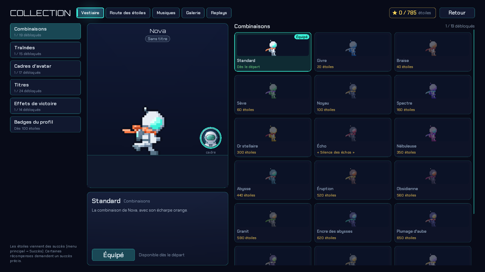

[← Retour à l'accueil (README)](../README.md)

# Collection (2.19.0)

Menu principal → **Collection** : quatre onglets, *Vestiaire*, *Route des étoiles*,
*Musiques* et *Galerie*. Tout y est **visuel** : rien ne change dans une partie, un replay,
un record ou la simulation (aucune empreinte de niveau ni version de simulation touchée).

Le Vestiaire d'un profil neuf : chaque combinaison montre l'étoile ou le succès qui la débloque.

## Récompenses (Vestiaire, Route des étoiles)

Catalogue : `data/cosmetics/cosmetics.json` (catégories, éléments, paliers).

| Catégorie | Éléments | Ce qui change |
|---|---|---|
| Combinaisons (12) | Standard, Givre (20), Braise (40), Sève (60), Noyau (100), Spectre (160), Or stellaire (300), Nébuleuse (350), Abysse (440), Éruption (520), Écho (succès « Silence des échos »), Sanctuaire (succès « Or des sanctuaires ») | la feuille de Nova, recolorée par `tools/assetgen/characters/nova_suits.py` (`assets/sprites/player/suits/` ; `nova_suits.py nebuleuse abysse` ne refait que ces combinaisons) |
| Traînées (8) | Aucune, Poussière d'étoiles (30), Comète (100), Aurore (180), Éclipse (250), Flammèches (290), Prisme (410), Runes d'Aethra (succès « Secrets des sanctuaires ») | effet dessiné derrière Nova quand elle court vite |
| Cadres d'avatar (10) | Simple, Bronze (10), Argent (50), Or (120), Platine (200), Émeraude (270), Orbite (380), Nébuleuse (500), Lauriers (succès « Chasseur de légendes »), Constellation (toutes les étoiles) | cadre de l'avatar |
| Titres (16) | Sans titre, puis un titre par succès précis (Explorateur, Gardien de Sylvanox, Mélomane, Encyclopédiste, Légende du cosmos…) | titre sous le nom |
| Effets de victoire (7) | Classique, Feu d'artifice (70), Pluie d'étoiles (140), Supernova (220), Vortex (320), Aurore boréale (470), Couronne solaire (540) | effet à l'arrivée |

53 récompenses ; la *Route des étoiles* compte 28 paliers, de 10 étoiles à toutes les étoiles
(597). Les paliers en nombre d'étoiles restent à la portée d'un joueur sans compte en ligne
(au plus 540 ; les succès qui demandent Cosmic Online en valent 50) ; seule *Constellation*
demande toutes les étoiles. La route défile (molette, clavier, manette) ; une récompense choisie s'ouvre dans le
*Vestiaire*.

* Un élément se débloque quand le nombre d'**étoiles des succès** atteint son palier, ou
  quand son **succès** est obtenu ; les étoiles déjà gagnées comptent (déblocage rétroactif).
* Ce qui est équipé est gardé dans `saves/collection.json` ; un élément qui ne serait plus
  débloqué (sauvegarde des succès effacée) est remplacé par l'élément de base.
* À la fin d'un niveau, si de nouvelles récompenses sont débloquées, une carte les présente :
  on coche ce qu'on équipe (une seule par catégorie), *Équiper* ou *Plus tard*.

### En ligne (2.23)

Connecté à Cosmic Online, le jeu envoie ce qui est équipé (`PUT /api/v1/players/me/cosmetics`,
les identifiants des cinq éléments) après la liste des succès, puis à chaque *Équiper* ; en cas
d'échec il réessaie une minute plus tard ; hors ligne ou sans compte, rien n'est envoyé et le
jeu reste entièrement jouable. Le serveur revérifie chaque élément avec sa copie du catalogue
(`server/src/cosmeticCatalog.json`, régénérée par `node scripts/cosmetics-catalog.mjs`) et les
succès déclarés : un élément inconnu ou verrouillé devient l'élément de base.

* **Classements** : le cadre autour de l'avatar et le titre sous le pseudonyme (plus petit et
  atténué). Un profil masqué garde le cadre simple, sans titre.
* **Profil** : le cadre, le titre sous le nom et un bloc *Tenue* (Nova dans sa combinaison,
  noms de la combinaison, de la traînée, du cadre et de l'effet de victoire). Rien de cela pour
  un profil masqué ; son propre profil montre ce qu'on porte en ligne.
* **Fantômes** : un fantôme porte la combinaison de son joueur, toujours teintée de sa couleur
  de fantôme. Les siens (meilleur temps, précédent, dernière course) portent la combinaison
  équipée ; un fantôme lancé depuis un classement, celle de l'entrée du classement (une
  apparence que le jeu connaît, sinon la combinaison standard). Affichage seulement : ni la
  simulation ni le format des replays ne changent (la description `.json` du fantôme garde
  `suit`).

### Combinaisons créées par un admin (2.45)

Une combinaison créée sur Cosmic Online (ADMINISTRATION › Créations, voir
[online/CREATIONS.md](online/CREATIONS.md)) est trois couleurs appliquées à la feuille de Nova
pendant le jeu, comme le fait `nova_suits.py`. Gagnée à un défi, elle rejoint les Combinaisons
du Vestiaire (identifiant `srvsuit:<n>`) ; la liste des combinaisons créées est gardée sur
l'ordinateur pour les dessiner hors ligne.

### Traînées, cadres et effets de victoire créés par un admin (2.59)

De la même façon, une **traînée** (`srvtrail:<n>` : une forme du jeu en deux couleurs, sa
largeur, sa durée, ses étincelles), un **cadre d'avatar** (`srvframe:<n>` : un style du jeu,
la couleur du bord et de la lueur) ou un **effet de victoire** (`srvvictory:<n>` : un effet du
jeu en deux couleurs) créés sur Cosmic Online se gagnent à un défi, rejoignent leur catégorie
du Vestiaire et s'équipent. Ils sont dessinés par `ui/screens/CosmeticFx` (mêmes formes que les
éléments du catalogue, recolorées) d'après la liste gardée dans
`<dossier utilisateur>/online/creation_looks.json` ou les récompenses gagnées
(`game/cosmetics/CreationLooks.*`). Les fantômes laissent la traînée de leur joueur (2.59).

### Badges du profil (2.41)

Vestiaire › *Badges du profil* : des succès obtenus, affichés comme badges sur le profil Cosmic
Online, à côté du nom et du titre. Le nombre de places dépend des étoiles : aucune en dessous de
**100 étoiles** (l'écran l'explique et montre les paliers, sans place factice), **2 dès 100**,
**3 dès 250** (paliers : `badgeSlots` de `data/achievements/achievements.json`, les mêmes pour le
serveur). Un badge est dessiné comme l'emblème de son succès : une médaille à la couleur de sa
catégorie (celle de la toile des Succès) avec ses étoiles au centre ; sous la souris ou le
focus, une bulle donne son nom, sa catégorie, ses étoiles et sa description.

* L'aperçu montre l'en-tête du profil (cadre, nom, titre, badges) et les places libres ; une place
  libre mène au premier succès non affiché, un badge le sélectionne.
* *Afficher sur le profil* / *Retirer du profil* sur le succès sélectionné ; l'ordre d'ajout est
  l'ordre d'affichage. Places pleines : il faut d'abord en retirer un.
* Le choix est gardé dans `saves/collection.json` (`badges`) ; seuls les succès encore obtenus,
  dans la limite des places, sont montrés et envoyés (`PUT /api/v1/players/me/badges`, après les
  succès, puis à chaque changement). Sans compte ou hors ligne, rien n'est envoyé : l'écran le
  dit, et le choix est publié à la connexion. Un refus du serveur est affiché tel quel.
* Le profil en ligne (le sien et celui des autres, sauf profil masqué) montre les badges sur la
  ligne du titre quand ils y tiennent, sinon sur une ligne à eux ; jamais dans les classements.

## Cadeaux

Un administrateur peut **offrir** des récompenses à un ou plusieurs joueurs (ADMINISTRATION › *Cadeaux*) :
des éléments du catalogue réel (les cinq catégories du Vestiaire, jamais l'élément de base) et les badges
du profil que le serveur accorde lui-même (ceux des raids). Chaque cadeau a l'un des onze **emballages**
(Or, Améthyste, Azur, Rubis, Émeraude, Nébuleuse, Givre, Braise, Cosmos, Rouage, Asterion : du pixel art de
`tools/assetgen/environment/gift_wraps.py`, `assets/ui/gifts/wraps.png` ; `--check` vérifie les fichiers) et
un message facultatif (140 caractères).

* **Côté joueur** : COSMIC ONLINE montre *CADEAUX* dès le premier cadeau reçu, avec le nombre de cadeaux
  à ouvrir ; une notification (« Vous avez reçu N cadeaux ») et une alerte du menu principal y mènent.
  Filtres *À ouvrir*, *Ouverts*, *Tous* ; le contenu reste une **surprise** jusqu'à l'ouverture (le
  serveur ne l'envoie pas avant). *Ouvrir le cadeau* joue l'ouverture : la boîte tremble de plus en plus,
  la lumière fuit, le couvercle s'envole, l'objet monte dans son halo (une combinaison avec sa vraie
  feuille et son clip de victoire, une traînée, un cadre, un effet de victoire et un badge avec les
  aperçus du Vestiaire, un titre en plaque dorée). Puis *Équiper maintenant* (Y), *Cadeau suivant*
  (Entrée / A) ou *Plus tard* (Échap / B : les autres attendent). Un clic ou Entrée / A passe
  l'animation ; les tremblements suivent le réglage « Tremblements d'écran », les éclats la qualité des
  particules. *Revoir l'ouverture* la rejoue.
* **Côté serveur** : c'est l'**ouverture** qui accorde l'objet, une seule fois, par le mécanisme existant
  (`player_won_rewards`, `challenge_id` « gift:<id> », pour un objet ; une récompense de raid récupérée
  pour un badge) : le jeu ne peut ni s'en inventer ni en ouvrir un deux fois. Ce qui a été ouvert est
  gardé comme les autres récompenses gagnées en ligne (utilisable hors ligne) ; sans Internet, les
  cadeaux attendent.
* **Côté admin** : les récompenses (catégories, grille avec aperçus, plusieurs au choix), l'emballage,
  les joueurs (recherche, *En ligne*, *Tous*, son clan, *Choisis*) avec « possède déjà X » d'après le
  serveur (ces joueurs sont ignorés), le message, le résumé « N récompenses × M joueurs = K cadeaux »,
  *Aperçu de l'ouverture* (la vraie scène, *Retour à l'envoi*), puis *Envoyer K cadeaux* après une
  confirmation. *Derniers envois* : chaque envoi avec ses cadeaux ouverts ; *Retirer* annule ceux qui ne
  sont pas encore ouverts. Chaque envoi et chaque retrait sont inscrits au Journal (« Cadeaux »).

### Colis

Avec **deux récompenses ou plus**, l'administrateur choisit « **N cadeaux séparés** » ou « **1 colis de N
cadeaux** ». Un colis, c'est **un seul paquet par joueur** qui contient les récompenses choisies qu'il ne
possède pas encore (s'il les a toutes, il est ignoré ; s'il n'en reste qu'une, c'est quand même un colis :
le joueur ne peut pas le deviner). Le résumé devient « … = K colis », le bouton *Envoyer K colis*, la
confirmation aussi ; *Aperçu de l'ouverture* joue le colis entier. Dans *Derniers envois*, la ligne commence
par « Colis (N) » et ses comptes (ouverts, retirés) sont des colis ; *Retirer* reprend les colis pas encore
ouverts.

* **Côté joueur** : « **Colis de X** », dans une boîte plus grande, ficelée dans les deux sens (le même
  emballage, dessiné par `gift_wraps.py` : `assets/ui/gifts/parcels.png`). Son contenu est une surprise et
  **aucun nombre** n'apparaît nulle part (ni dans la liste, ni dans la notification, qui compte le colis
  pour un, ni pendant l'ouverture). L'ouverture joue la scène habituelle pour le premier objet ; chaque
  objet suivant sort de la même boîte, déjà ouverte, avec son halo, après une validation (*Suivant*,
  Entrée / A ou un clic). Chaque objet a son propre *Équiper maintenant* (Y) tant qu'il est montré ; pas de
  compteur « 2 sur 5 ». Après le dernier : « **Le colis est vide** », *Cadeau suivant* s'il en reste,
  *Fermer*. *Plus tard* en plein colis : le reste est déjà dans la collection (le serveur ouvre le colis
  en entier), et la liste montre le colis ouvert avec tout ce qu'il contenait, chacun avec *Équiper* ;
  *Revoir l'ouverture* rejoue tout le colis.
* **Côté serveur** : un colis n'écrit aucun cadeau avant d'être ouvert (aucun identifiant ne trahit ce
  qu'il contient) ; son ouverture écrit un cadeau ouvert par récompense, dans l'ordre, et accorde chacun par
  le même mécanisme, une seule fois (idempotent).

Routes et règles : [online/API.md §8.10 sexies](online/API.md#810-sexies-cadeaux), migrations
`server/migrations/0205_gifts.sql` et `0210_gift_parcels.sql` (colis).

## Musiques

Liste : `data/music/tracks.json`. Un morceau devient écoutable la **première fois qu'il est
entendu en jeu** (menu, carte, niveau, ambiance, combat) ; les morceaux des niveaux déjà
terminés sont comptés d'après les sauvegardes. Lecture / pause, position (clic sur la barre),
précédent / suivant, répéter, ordre aléatoire. *Jouer ce morceau au menu principal* le garde
comme musique du menu. Le volume est celui de la musique (Paramètres → Audio).

## Galerie

* **Planètes** : ouvertes quand elles sont atteintes ; *Enregistrer en image (PNG)* compose
  leurs couches de fond en 1280×720 dans le dossier utilisateur `Galerie/`.
* **Gardiens** : un gardien (ou un écho) entre dans la galerie quand il est battu ; ses
  animations défilent et ses statistiques (victoires, sans dégât) sont celles de *Statistiques*.
* **Bestiaire** : une créature y entre dès qu'elle a été vue éveillée à l'écran dans un
  niveau ; celles des niveaux déjà terminés sont comptées d'après les sauvegardes.
* **Films** (2.81) : les films d'Asterion et la bande-annonce, chacun avec sa vignette, sa durée et où on le voit, à
  revoir d'un bouton (clavier, manette, souris) : le film d'Asterion une fois vu, « La chute d'Asterion » et « Après
  Asterion » une fois débloqués (pour qui a pris part à un événement où le Cœur est tombé, puis pour tous quand l'issue
  « Asterion est tombé » est officielle ; [RAIDS.md §31](RAIDS.md#31--après-asterion---le-film-du-monde-daprès-regardé-ensemble-281)).
  Un film verrouillé dit comment le débloquer. Les histoires des giga-boss restent dans *Gardiens* (« Revoir l'histoire »).

## Succès de la Collection (2.24)

La catégorie **Collection** de l'écran *Succès* (10 succès, 18 étoiles) suit ce que l'on fait
ici : récompenses différentes équipées (*Équiper* du Vestiaire ou de la carte de fin de
niveau ; ce qui était déjà porté compte au démarrage), une tenue complète (une récompense
débloquée dans chacune des cinq catégories en même temps), les morceaux du juke-box entendus
(10, puis les 19), la musique du menu choisie, les créatures du bestiaire rencontrées (15,
puis 30 : les créatures de la campagne, sans les gardiens ni les petites gelées nées d'une
division) et les images des planètes enregistrées (une, puis les 5). Compteurs gardés dans
`saves/achievements.json` (`equipped_items`, `outfit_categories`, `menu_music`,
`photographed_planets`) ; les morceaux et les créatures sont lus dans `saves/collection.json`.

---

[← Retour à l'accueil (README)](../README.md)
