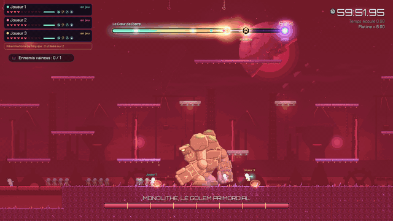
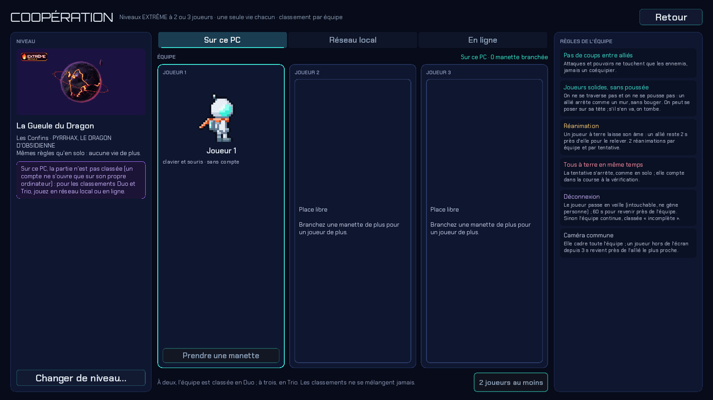

[← Retour à l'accueil (README)](../README.md)

# Coopération à 2 ou 3 joueurs (niveaux EXTRÊME, 2.63)

Ce document fixe l'architecture, les formats, les règles et la sécurité de la coopération.
Il a été écrit **avant** le code et sert de référence aux quatre étapes :

1. le cœur de la simulation (N joueurs dans `GameWorld`) et le HUD d'équipe ;
2. le jeu sur **un même PC** (2 ou 3 manettes, ou clavier + manettes) ;
3. le jeu **en ligne** (relais Durable Object) et **en réseau local** (un PC fait le relais) ;
4. les classements **Duo** et **Trio** de la course à la vérification.

Trois joueurs sur un même PC, une caméra commune (joueurs pilotés par des scripts pour la capture).

Les clans ne font pas partie de ce travail : une équipe a seulement la place d'un tag de
clan facultatif (`clan_tag`, toujours vide pour l'instant).

## 1. Règles du jeu

| Règle | Détail |
|---|---|
| Équipe | 2 ou 3 joueurs, sur les niveaux EXTRÊME. Une vie chacun, mêmes règles qu'en solo (cœurs, pouvoirs, chrono, dégâts du niveau). |
| Pas de coups entre alliés | Attaques, tirs, explosions et pouvoirs ne touchent que les ennemis (et les objets du niveau). Un tir renvoyé par le bouclier redevient un tir de joueur : il ne touche que les ennemis. |
| Joueurs qui se traversent (2.75) | Les joueurs **se traversent** : ils ne sont plus solides les uns pour les autres, aucun ne pousse ni n'arrête un allié. Les autres joueurs sont dessinés **semi-transparents** avec un liseré de leur couleur (affichage seulement). Les tentatives enregistrées avant 2.75 (règles de coopération 1) se rejouent avec leurs joueurs solides. |
| Pas d'appui sur un allié (2.75) | On ne peut plus se poser sur un allié : on le traverse comme le reste de l'équipe. Quand un joueur tombe, **personne d'autre ne bouge** ni ne réapparaît au dernier point de passage ; lui ne revient qu'une fois réanimé, près de son âme. Les tentatives d'une autre version des règles (`kCoopSimulationVersion` 2) sont refusées par le serveur ; les records Duo/Trio existants sont gardés. |
| Ennemis | Chaque ennemi vise **le joueur en jeu le plus proche** de son centre (distance au carré ; à égalité, le plus petit numéro). Le leurre holographique reste prioritaire. Les coups, tirs et dangers d'un ennemi touchent **tous** les joueurs qu'ils atteignent, pas seulement sa cible. |
| À terre | Un joueur qui tombe (cœurs à zéro ou chute dans le vide) est **à terre** : après l'animation de chute, il laisse une **âme** (2.77, règles 3) qui **tombe à la verticale**, comme un objet lâché, du point de sa mort jusqu'au **premier sol ferme dessous** : tué en plein saut au-dessus du sol, il attend juste dessous. L'âme va plutôt sur son **dernier endroit sûr** quand, sous ce point, il y a le vide ou la sortie du niveau, un liquide mortel, des pics ou un autre danger, un sol à plus de 6 tuiles (96 px), un sol qui bouge, s'effrite, se brise ou s'ouvre, une porte, ou pas la place de se tenir. Le dernier endroit sûr est un sol ferme (ni plateforme mobile ni plateforme qui s'effrite, ni porte ni barrière), hors de tout liquide et de tout danger, tenu à jour pas à pas par la simulation, donc toujours atteignable à pied. Mort dans un liquide mortel (magma, acide, eau toxique, liquide qui monte), sur des pics, en l'air, dans le vide ou écrasé, il peut donc toujours être rejoint et relevé. À l'écran, l'âme **glisse** du point de la mort jusqu'à son point de repos, une **marque au sol** montre où réanimer, et une **flèche** de sa couleur au bord de l'écran la montre quand elle n'est pas visible. Si un liquide qui monte recouvre l'âme, elle remonte au sol sûr le plus proche **au-dessus** de son niveau le plus haut. L'âme n'est pas solide et ne gêne personne. Règles 1 et 2 (replays d'avant 2.77) : l'âme reste là où il est tombé (sur son dernier sol ferme après une chute dans le vide). **2.77.2** (affichage) : le joueur à terre voit en haut de l'écran « À TERRE — en attente de réanimation », ce qu'il faut (un allié maintient Interagir 2 s près de son âme), la jauge quand un allié le relève, les réanimations restantes de l'équipe et où est son âme ; un léger filtre sur l'image dit qu'il ne joue plus ([RAIDS.md §23](RAIDS.md#23-à-terre-ou-groupe-éliminé--deux-états-clairs-une-vue-qui-ne-tremble-plus-2772)). |
| Réanimation | Un allié en jeu près de l'âme (à moins de 40 px de large et 48 px de haut) qui **maintient « Interagir »** (`Action::Interact`, dans ses entrées `InputFrame` : replays exacts) **2 s sans interruption** relève le joueur ; relâcher la touche ou s'éloigner interrompt la réanimation (le compte repart de zéro). Une jauge circulaire autour de l'âme montre la progression, et le joueur à côté voit « Maintenir [sa vraie touche Interagir, clavier ou manette] : réanimer ». Le joueur revient à un endroit libre près de l'âme (jamais dans un allié), avec la moitié de ses cœurs (arrondie au-dessus) et 2 s d'invulnérabilité. **2 réanimations par équipe et par tentative.** Sans réanimation restante, l'âme reste visible mais ne relève plus personne. Règles 1 et 2 : rester près de l'âme suffisait. |
| Tous à terre | Quand plus aucun joueur n'est en jeu (tous à terre, en veille ou partis), la tentative s'arrête : elle compte dans la course à la vérification comme une tentative solo qui tombe. |
| Déconnexion (veille) | Un joueur déconnecté passe **en veille** : il est intouchable, n'est plus solide, ne déclenche rien, et les ennemis l'ignorent. Il a **60 s** pour revenir : son jeu rattrape la partie puis il **réapparaît près de l'équipe** (endroit libre près de l'allié en jeu le plus proche). Après 60 s, il est **parti** : l'équipe continue et la tentative est classée **incomplète**. Un joueur à terre qui se déconnecte reste à terre ; s'il est relevé pendant sa veille, il revient en veille. |
| Caméra commune | La caméra cadre toute l'équipe (zoom jusqu'à `Camera::kMinFitZoom`). Un joueur **hors du cadre depuis 3 s** revient près de l'allié le plus proche (sur le dernier sol ferme de cet allié, à un endroit libre), avec 1 s d'invulnérabilité. |
| Passages qui se ferment (2.80, règles 4) | Un passage qui se ferme derrière les joueurs — les portes d'une arène (boss ou embuscade), une porte, une barrière de pouvoir ou un laser qu'un événement ferme — **attend toute l'équipe** : il reste ouvert tant qu'un joueur encore là n'est pas passé, puis se ferme comme avant. Son côté intérieur est celui de ce qui l'a fermé (l'arène, le déclencheur, le levier, l'ennemi…) ; sans objet (le chrono du niveau), le côté où se trouve toute l'équipe. Comptent : les joueurs en jeu (par leur corps : dans l'embrasure, pas encore passés) et les joueurs **à terre** (par leur âme, tant qu'une réanimation peut encore les relever) ; ne comptent pas : un joueur déconnecté (en veille : à son retour il revient près d'un allié en jeu, donc du bon côté), parti, ou ailleurs (une autre zone d'un raid). Un joueur qui ne vient jamais ne piège personne : le passage reste ouvert (le combat a commencé, rien d'autre n'attend) ; un joueur resté loin revient de toute façon près de l'équipe au bout de 3 s hors du cadre (règle du cadre), et un joueur à terre sans réanimation restante ne compte plus. Le HUD dit qui il attend et à quelle distance : « Porte : en attente de MVP (12 m) », « … de Nova (à terre, 30 m) » (sous le HUD et le bandeau « À TERRE », `ui/screens/PassageWaitView`). Seul, rien ne change : le passage se ferme aussitôt. |
| Sortie | Le premier joueur qui atteint la sortie termine le niveau pour toute l'équipe. |
| Pouvoirs | Chaque joueur porte ses propres pouvoirs. Une tablette de pouvoir offerte à un joueur dont les emplacements sont pleins arrête le monde (comme en solo) jusqu'au choix **de ce joueur** (`InputFrame::choice` de ses propres entrées). Un joueur en veille laisse le pouvoir sur sa tablette. |
| Cinématiques | Une cinématique passable est passée dès qu'un joueur la passe (drapeau `SkipCinematic` de ses entrées). |
| Hors ligne | Le jeu sur un même PC fonctionne sans compte et sans Internet. Le réseau local n'a besoin d'aucun serveur. |

### Le cadre de la caméra (règle de simulation)

Le retour des joueurs hors du cadre change le déroulement : il ne peut pas dépendre de la
caméra affichée (taille de la fenêtre, lissage). La simulation utilise donc un **cadre
fixe** : la vue la plus large de la caméra, `Camera::kViewWidth / kMinFitZoom` ×
`Camera::kViewHeight / kMinFitZoom` (≈ 1143 × 643 px du monde), moins une marge de 64 px en
largeur et 96 px en hauteur. Chaque pas, parmi les joueurs en jeu, la simulation garde **le
plus grand groupe** qui tient dans ce cadre (à égalité, celui qui contient le plus petit
numéro de joueur). Les autres sont « hors du cadre » ; au bout de 3 s, ils reviennent. La
caméra affichée cadre ce même groupe : ce que la règle appelle « hors de l'écran » est
toujours hors de l'écran.

### Ordre de résolution (déterminisme)

Tout ce qui concerne plusieurs joueurs se résout **dans l'ordre des numéros de joueur**
(1, 2, 3), à chaque pas de 1/120 s :

1. entrées du pas (une `InputFrame` par joueur), veille et retour des joueurs ;
2. entités du niveau ; transport par les plateformes mobiles ;
3. pour chaque joueur, dans l'ordre : chevauchements avec les entités (avec ses propres
   indicateurs « dedans »), puis son pas de simulation contre le décor **et les corps des
   autres joueurs à leur position du moment** (le joueur 2 voit donc la nouvelle position du
   joueur 1) ;
4. ennemis (chacun avec sa cible), dangers persistants, projectiles ;
5. chute dans le vide, réanimations, cadre de la caméra, « tous à terre ».

Deux joueurs qui se chevauchent déjà (cas limite : une plateforme qui monte en soulève un
contre un autre) ne se bloquent pas tant qu'ils se chevauchent : ils se séparent dès qu'ils
bougent ; aucune correction ne les pousse. Les apparitions (début du niveau, réanimation,
retour de veille, retour dans le cadre) cherchent toujours un endroit libre : de l'endroit
voulu, puis de 18 px en 18 px à droite et à gauche, sans décor ni allié dans la boîte et avec
un sol sous les pieds ; à défaut, la place libre la plus proche sans sol ; à défaut, l'endroit
voulu.

## 2. Simulation

### `GameWorld` à N joueurs

* `GameWorld::setTeamSize(n)` (1 à 3), **avant** `load()`. Avec 1 (par défaut), rien ne
  change : une partie solo garde exactement le même déroulement et les mêmes empreintes
  (`tests/test_determinism.cpp` inchangé).
* `player()` reste l'accès au joueur « courant » : le joueur 1 hors de tout contexte, le
  joueur simulé pendant son pas, la **cible** d'un ennemi pendant le pas de cet ennemi.
  Tout le code des ennemis, des pouvoirs et des entités qui lit `w.player()` voit donc le
  bon joueur sans le savoir.
* `playerCount()`, `playerAt(i)`, `forEachPlayer(f)` (joueurs en jeu, dans l'ordre, chacun
  devenant le joueur courant pendant `f`) ; `nearestPlayer(p)` (cible d'un ennemi).
* Chaque coup d'ennemi, danger persistant, tir, explosion ou piège est testé contre **tous**
  les joueurs en jeu (`forEachPlayer`) ; en solo la boucle passe une fois sur le joueur 1,
  avec exactement les mêmes tests qu'avant.
* Les corps des joueurs sont des collisionneurs dynamiques marqués `ColliderTag::Teammate` :
  activés seulement pendant le pas des joueurs (et le transport par les plateformes), jamais
  vus par les ennemis, les tirs ou les rayons (`raycast`). Le corps d'un joueur à terre, en
  veille ou parti est désactivé.
* Les entités gardent un indicateur « dedans » par joueur (`LevelEntity::insideMask`) ;
  `playerInside` vaut celui du joueur courant pendant ses rappels et « au moins un » ensuite.
* `stepTeam(world, frames, n, dt)` fait un pas avec une `InputFrame` par joueur ;
  `stepWorld` (une seule entrée) reste celui du solo.
* `InputFrame::Standby` (bit 1 de `flags`) : posé **par le relais seulement** sur les
  entrées d'un joueur absent ; jamais accepté venant d'un client.

### Versions et empreintes

* `kSimulationVersion` (solo) ne change pas : aucune règle solo n'a changé.
* `kCoopSimulationVersion` (dans `game/online/LevelFingerprint.h`) : version des règles
  de coopération. Elle fait partie de l'empreinte des tentatives d'équipe ; toute règle de
  coopération qui change le déroulement la fait passer, avec les empreintes de référence de
  `tests/test_coop.cpp`. **1** (2.62) : joueurs solides ; **2** (2.75) : ils se traversent ; **3** (2.77) : âme qui tombe
  sous le point de la mort (ou sur le dernier endroit sûr), réanimation en maintenant « Interagir » ; **4** (2.80) : un passage qui se ferme
  derrière les joueurs attend toute l'équipe (`GameWorld::teamThrough`). Un replay d'équipe se rejoue avec la version qu'il a
  enregistrée (`GameWorld::setCoopVersion`) : mêmes empreintes. Le serveur refuse une tentative d'une autre version
  (`COOP_SIMULATION_VERSION`, `server/src/coopRace.ts`) ; les records Duo/Trio sont gardés.
* `simulationStateHash` ajoute, **seulement quand l'équipe a plus d'un joueur**, l'état de
  chaque autre joueur (boîte, vitesse, cœurs, état, pouvoirs), l'état d'équipe de chacun
  (en jeu, à terre, en veille, parti ; âme, réanimation en cours, veille écoulée, temps hors
  du cadre) et les réanimations restantes. L'empreinte solo est inchangée.

## 3. Jeu sur un même PC

* **Un périphérique par joueur** (2.65, `engine/input/Devices.h`) : le clavier et la souris vont
  ensemble et ne servent qu'à un seul joueur ; chaque manette, à un seul joueur. Le joueur 1
  commence au clavier ; les joueurs 2 et 3 prennent une place avec **Start** ou **A / Croix**
  d'une manette libre et la quittent avec **B / Rond**. « Changer de périphérique » (sur la carte
  de chaque joueur) passe au périphérique libre suivant : le clavier, puis les manettes par numéro.
  La manette qui reçoit une place vibre une fois (si ses vibrations sont activées).
* **Numéros stables** : chaque manette vue pendant la session a un numéro (« Manette Xbox
  (n° 1) ») ; débranchée puis rebranchée (SDL lui donne un autre identifiant), elle le retrouve
  (même GUID, même numéro de série quand SDL le donne). Le type (Xbox, PlayStation, Switch,
  générique) donne les glyphes : sur Switch, B en bas et A à droite, L / R, ZL / ZR, + / −.
* **Le salon** montre pour chaque place son périphérique, ses boutons qui s'allument quand on
  appuie (pour vérifier que c'est bien le sien), « Changer de périphérique » et « Touches… », puis
  la liste des périphériques branchés, en direct (une manette débranchée y reste 10 s ; une
  ligne s'allume quand on appuie sur un bouton de cette manette).
* **Touches par joueur** : profils J1, J2, J3 dans `saves/settings.json` (`input` pour J1,
  `coopInput` pour J2 et J3 : touches du clavier et de la souris, boutons et réglages de la
  manette) ; touches des pouvoirs de chaque niveau dans `saves/power_keys.json` (J1),
  `power_keys_j2.json`, `power_keys_j3.json`. « Touches de ce niveau » a un onglet par joueur,
  Paramètres › Clavier / Manette un bouton par joueur, avec les touches du périphérique de ce
  joueur et ses glyphes, les conflits vérifiés pour ce périphérique, « Copier les touches de
  Jn » et « Par défaut ». Changer de manette change les glyphes de l'onglet, jamais les réglages
  du joueur. En solo, rien ne change : J1 seulement, sans onglet.
* Chaque manette est lue séparément (`engine/input/LocalPad`) avec le profil de son joueur ; en
  partie, le gestionnaire d'entrées ne lit plus aucune manette pour jouer
  (`InputManager::setGamepadGameplay(false)`) : le joueur du clavier joue au clavier et à la
  souris seulement, avec son profil.
* Pause (Échap ou Start de n'importe quelle manette du PC) : toute l'équipe s'arrête.
* **Manette débranchée en partie** (aussi en solo, `GameScene`) : la partie **et le chrono**
  s'arrêtent — hors simulation : simplement aucun pas — et « MANETTE DÉBRANCHÉE · J2 · Lyra ·
  Manette Xbox (n° 1) » s'affiche. La même manette rebranchée (ou réveillée) : 3, 2, 1, la partie
  reprend. **A** sur une autre manette libre : elle prend la place du joueur, avec ses touches.
  **Entrée** : le joueur passe au clavier, s'il est libre. « Continuer sans <joueur> » (même PC
  seulement) : ce PC décide son absence comme le relais en ligne (trames `Standby`, 60 s pour
  revenir — sa manette rebranchée ou A sur une manette libre —, puis parti : équipe incomplète).
  « Quitter la partie » (confirmé). Seuls les joueurs dont le périphérique est encore branché
  peuvent choisir. En solo : même écran, sans « Continuer sans… ».
* En ligne et en réseau local, chacun gère le sien : une manette débranchée ne met pas l'équipe en
  pause (une ligne dans le panneau d'équipe), la règle des 60 s de reconnexion ne change pas.
* **Pile faible** (seulement si SDL donne la charge, sur batterie, 15 % ou moins) : une ligne dans
  le panneau d'équipe, sans pause.
* Rien de tout cela ne touche la simulation : les choix passent par les trames (`InputFrame`),
  les empreintes de référence ne changent pas.
* Un joueur local n'a pas besoin de compte. Il peut se connecter à son compte dans le salon
  (« Se connecter », jeton gardé en mémoire seulement, jamais écrit) : c'est nécessaire pour
  que l'équipe soit classée (voir § 6).

## 4. Réseau : verrouillage par entrées

### Principe

* **Verrouillage par entrées (lockstep)** : chaque jeu simule le même monde avec les mêmes
  entrées. Seules les entrées circulent (14 octets par joueur et par pas), jamais l'état.
* **Délai d'entrée** `D` : l'entrée lue au pas `t` est jouée au pas `t + D`. `D` est fixé
  au départ par le relais d'après les liaisons mesurées dans le salon :
  `D = clamp(ceil((pire aller-retour + 16 ms) / 8,33 ms), 3, 15)` (3 images ≈ 25 ms sur un
  réseau local). Les pas `0 … D-1` sont vides pour tous.
* **Relais** : il reçoit les entrées de chaque siège, les **ordonne** et diffuse pour chaque
  pas la trame d'équipe complète. Un jeu ne simule un pas qu'avec la trame du relais : tous
  les jeux simulent exactement les mêmes trames.
* **Absence décidée par le relais** : un siège dont la connexion se ferme, ou dont rien n'est
  reçu depuis 3 s, est marqué absent à partir du premier pas non encore diffusé ; ses trames
  sont alors vides avec le drapeau `Standby`, pareil pour tout le monde. La simulation compte
  la veille (60 s = 7 200 pas) : la règle des 60 s est donc dans le déroulement lui-même.
* **Retour** : le jeu qui revient reçoit l'historique des trames et le **rejoue en accéléré
  dans un fil d'exécution à part** (le monde, chargé par le fil principal, est confié à ce fil :
  ni son, ni vibration, ni particule ; une texture demandée hors du fil principal n'est créée
  qu'après, par lui — `ResourceManager::finishDeferred`) ; l'écran montre l'avancement. Puis il
  annonce qu'il est à jour (`CATCHUP_DONE`). Le relais choisit le pas de retour
  `R = dernier pas diffusé + D + 1` et le diffuse (`REJOIN`) ; à partir de `R`, les trames du
  siège portent à nouveau ses entrées. Un retour au-delà de 60 s de veille est refusé.

### Messages (binaires, little-endian)

Un message = un octet de type puis son contenu. Sur WebSocket : un message binaire par
message ; en réseau local (TCP) : chaque message est précédé de sa longueur (u32).

Une **entrée** est écrite **par rapport à la précédente du même joueur dans le message** : un
octet de masque (bit 0 `held` changé, 1 `pressed` non nul, 2 `released` non nul, 3 `moveX`
changé, 4 `moveY` changé, 5 `flags` non nul, 6 `choice` non nul ; bit 7 interdit), puis
seulement les champs annoncés (`u32` pour les actions, `i8`/`u8` pour le reste). Un pas où
rien ne change coûte **un octet** par joueur. La relecture refuse tout bit d'action inconnu,
tout drapeau autre que `SkipCinematic`/`Standby`, tout choix hors de 1 … 8 et 255, un stick à
-128 ; le relais refuse en plus `Standby` venant d'un jeu.

| Type | Sens | Contenu |
|---|---|---|
| 1 `HELLO` | jeu → relais | `u8 protocole (1)`, `u8 siège voulu (255 : libre ; un retour : le sien)`, chaîne `nom` (u8 longueur + UTF-8, ≤ 24), chaîne `compte` facultative (≤ 64), puis (2.80) `u8 règles` (`kCoopSimulationVersion` ; absent avant 2.80 : 3). Un salon joue les règles de son premier joueur (l'hôte ; sur le réseau local, celles du PC qui héberge) : un jeu d'une autre version est refusé (`END` 5 « règles », « mettez le jeu à jour »). Un raid vérifie lui-même sa version (empreinte de `GO`, `TITAN_REVISION`). |
| 2 `INPUT` | jeu → relais | `u32 premier pas`, `u8 n (1 … 32)`, `n` entrées |
| 3 `PING` | jeu → relais | `u32 horloge du jeu (ms)`, `u16 dernier aller-retour mesuré (0xFFFF : aucun)` |
| 4 `READY` | jeu → relais | `u8 prêt (0/1)` (salon) |
| 5 `START` | jeu → relais | (hôte seulement, salon) `u8 nombre de joueurs` |
| 6 `CATCHUP_DONE` | jeu → relais | `u32 dernier pas simulé` |
| 7 `LEAVE` | jeu → relais | — (le joueur quitte : absent tout de suite) |
| 8 `RESULT` | jeu → relais | `u32 pas de la tentative` (en ligne : le relais note l'empreinte des entrées de ces pas) |
| 10 `WELCOME` | relais → jeu | `u8 siège`, `u8 protocole` |
| 11 `LOBBY` | relais → jeu | JSON (UTF-8) : sièges (nom, prêt, liaison en ms, connecté), niveau, hôte |
| 12 `GO` | relais → jeu | `u64 graine`, `u8 joueurs`, `u8 D`, chaîne `niveau`, chaîne `empreinte`, chaîne `tentative` (UUID) |
| 13 `FRAMES` | relais → jeu | `u32 premier pas`, `u16 n`, puis pour chaque siège ses `n` entrées compactes |
| 14 `PONG` | relais → jeu | `u32 horloge du jeu renvoyée` |
| 15 `REJOIN` | relais → jeu | `u8 siège`, `u32 pas de retour` |
| 16 `END` | relais → jeu | `u8 raison` (0 fin normale, 1 hôte parti, 2 trop long, 3 refusé, 4 retiré d'un test, 5 autres règles de coopération : 2.80) |

Le relais refuse (et ferme) tout message mal formé : type inconnu, longueur incohérente,
siège invalide, entrée avec des bits hors des actions enregistrées (21 bits), drapeau autre
que `SkipCinematic`, choix hors de 1 … 8 et 255, pas déjà diffusé ou trop loin devant
(> dernier pas diffusé + 64), plus de 200 messages par seconde. Une partie dure au plus 2 h.

### En ligne : `CoopRoom` (Durable Object)

* `GET /api/v1/coop/invitations` : les salons où l'on m'a invité depuis 2 h (encore ouverts).
* `POST /api/v1/coop/rooms` (compte requis) crée un salon (un Durable Object par salon,
  identifiant aléatoire) dont le créateur est l'hôte, pour un niveau EXTRÊME donné.
* `POST /api/v1/coop/rooms/{id}/invite {player_id}` : l'hôte invite un **ami accepté**
  (aucun blocage dans un sens ou l'autre) ; l'invité reçoit une notification
  `coop_invite`. Seuls l'hôte et les invités peuvent entrer.
* `GET /api/v1/coop/rooms/{id}/socket` (WebSocket, jeton d'accès dans l'en-tête
  `Authorization`) : le Worker vérifie le compte et l'invitation, puis passe la connexion au
  salon avec l'identifiant du joueur. Le salon garde tout **en mémoire** (salon, trames,
  historique pour les retours), borné à 2 h de pas, et l'oublie 2 min après la fin.
* Le salon note, pour la fin de la tentative, l'empreinte SHA-256 de toutes les trames
  diffusées et la liste des joueurs connectés à leur compte (`coop_sessions` en D1) : le
  serveur sait ainsi **quelles entrées ont vraiment été jouées et par qui** (§ 6).

### En réseau local

* Un PC du réseau local **héberge** : il fait tourner le même relais (`game/coop/CoopRelay`,
  la même logique que le Durable Object) dans un fil d'exécution, sur le port TCP 47 620, et
  répond aux recherches sur le port UDP 47 621 (`COSMIC-COOP?` → nom de l'hôte, niveau,
  places libres, port TCP). Son propre jeu s'y connecte comme les autres (127.0.0.1).
* Les autres PC cherchent les parties (diffusion UDP sur le réseau local) ou entrent
  l'adresse de l'hôte. Aucun serveur, aucun compte n'est nécessaire.
* Le relais du PC hôte (`game/coop/LanHost`) vit tant que la connexion de son propre jeu
  (`NetCoopLink::keepAlive`) : du salon jusqu'à la fin de la partie.

## 5. Replays d'équipe (format CPRP 5)

Un replay d'équipe est un replay CPRP de **format 5** : le format 3 du joueur 1 (trajectoire,
événements, entrées, empreintes d'état), puis une **section d'équipe** :

| Champ | Type | Notes |
|---|---|---|
| team_size | u8 | 2 ou 3 |
| coop_version | u16 | `kCoopSimulationVersion` |
| flags | u8 | bit 0 : équipe incomplète (un joueur parti) |
| revives | u8 | réanimations utilisées (0 … 2) |
| pour chaque autre joueur (2 … team_size) : | | |
| · frame_count, event_count | u32, u32 | sa trajectoire et ses événements (mêmes formats qu'au joueur 1) |
| · frames, events | | 12 et 8 octets chacun |
| · runs | u32 + runs × 18 octets | ses entrées, mêmes plages répétées que le joueur 1, autant de pas |

Les empreintes d'état (toutes les 0,5 s) portent sur **toute l'équipe**. Nouveaux
événements : `Revive = 15` (arg : joueur relevé), `Regroup = 16` (retour dans le cadre),
`Standby = 17` (veille), `Return = 18` (retour de veille), `Gone = 19` (parti).

Le lecteur de replays rejoue l'équipe et suit **un joueur au choix ou toute l'équipe**.

## 6. Classements Duo et Trio

* Solo, Duo et Trio ne se mélangent **jamais** : `coop_runs.size` vaut 2 ou 3 et chaque
  tableau est lu pour une taille. Les records solo (`race_runs`) ne sont pas touchés : ils
  restent **tous** valides.
* **Une équipe = ses joueurs exacts** : `team_key` = identifiants des joueurs triés, joints
  par `+`. Changer un joueur fait une autre équipe. La place d'un tag de clan facultatif est
  prévue (`clan_tag`, vide).
* **Progression** = celle du joueur le plus avancé : itinéraire = le plus loin atteint par
  l'un des joueurs ; boss et embuscades = ce que l'équipe a fait (événements du joueur 1,
  identiques pour tous puisque le monde est commun). Classement : score décroissant, puis
  équipe complète avant incomplète, puis moins de réanimations, puis la plus tôt vérifiée.
* **Vérification** (comme en solo : cohérence et vraisemblance, sans re-simulation) : le
  serveur lit le replay d'équipe et vérifie **la trajectoire de chaque joueur** (départ,
  niveau, déplacements possibles ; sauts permis seulement aux réanimations, retours dans le
  cadre et retours de veille), le nombre de réanimations (≤ 2), une seule chute par joueur
  sans réanimation, la cohérence des entrées de chaque joueur (autant de pas que le joueur
  1), la fin du niveau. Pour une partie en ligne, l'empreinte des entrées doit être celle
  que le relais a notée (`coop_sessions`) : les entrées ont vraiment été jouées.
* **Chaque joueur confirme avec son propre compte** (`POST /coop/attempts/{tentative}/confirm`,
  depuis son propre jeu, à la fin de la tentative ; une confirmation peut arriver avant
  l'envoi) : l'hôte ne peut pas inscrire quelqu'un à son insu. La tentative n'est classée que
  lorsque **chaque joueur de l'équipe est connecté à son compte** et l'a confirmée ; une équipe
  avec un joueur sans compte peut jouer, mais n'est pas classée (le jeu le dit).
* Routes : `POST /coop/runs` (déclaration : niveau, tentative, temps, boss, vagues, mode
  `online` / `lan` / `same_pc`, joueurs par siège ; en ligne, la liste doit être celle que le
  relais a notée), `PUT /coop/runs/{id}/replay` (le replay d'équipe ; le serveur calcule le
  score), `GET /coop/board?size=2|3&kind=…&level_id=…` (le classement), `GET
  /coop/runs/{id}/replay` (le replay d'une tentative classée). Tables : migration
  `server/migrations/0140_coop.sql` (`coop_sessions`, `coop_runs`, `coop_run_members`,
  `coop_confirms`).
* Sur un même PC, seul le joueur 1 a son compte dans le jeu : une partie à plusieurs sur un
  même PC n'est donc pas classée tant que les autres joueurs ne peuvent pas se connecter à leur
  compte dans le salon (voir § 8).

## 7. Sécurité

* Aucune donnée du client n'est crue : les entrées sont validées par le relais (bits,
  drapeaux, choix, pas, débit), le score est recalculé par le serveur depuis le replay, les
  membres d'une équipe sont ceux qui ont confirmé avec leur compte, et en ligne le relais
  atteste les entrées jouées.
* Aucun secret dans le dépôt ni dans le jeu : le salon en ligne n'utilise que le jeton de
  session du joueur ; le réseau local n'a ni compte ni secret.
* Le relais en ligne ne garde rien d'autre que le salon en cours, en mémoire ; seule
  l'empreinte des trames et la liste des joueurs vont en D1 pour la vérification.
* Localisation : aucune. Le réseau local n'expose que le nom choisi par l'hôte.

## 8. Limites connues

* **Connexion d'un invité sur un même PC** : le salon ne permet pas aux joueurs 2 et 3 de se
  connecter à leur propre compte. Depuis 2.47, un compte ne s'ouvre que depuis **son propre
  ordinateur** (`bindAtLogin`) : le connecter sur le PC d'un ami le lierait à ce PC, ou serait
  refusé. Une partie sur un même PC reste donc hors classement (elle se joue normalement, le
  salon le dit avant de jouer et le jeu à la fin) ; pour être classée, une équipe joue en
  réseau local ou en ligne, chacun sur son PC avec son compte. Changer cette règle demande une
  décision sur la liaison compte-ordinateur (par exemple une confirmation depuis le PC du
  joueur), hors de cette étape.
* Le cadre de la règle « hors de l'écran » est celui d'un écran 16:9 ; sur un écran plus étroit,
  un joueur peut sortir de l'image affichée un peu avant que la règle ne le compte hors du cadre.
* Le relais en ligne d'une équipe de 2 ou 3 garde la partie en mémoire : si Cloudflare déplace
  l'objet durable pendant une partie (rare), la partie s'arrête pour toute l'équipe. (2.74 : celui
  d'une instance de raid la stocke et la retrouve, voir § 10.) Depuis 2.74, quand plus personne n'est
  en jeu, les pas s'arrêtent : le relais (en ligne comme en réseau local) ne donne plus de trames de
  veille à personne jusqu'à la limite de 2 h.

## 9. Niveaux EXTRÊME de la communauté (2.63.5)

* **Le salon** propose « Campagne / Communauté ». La communauté, ce sont les niveaux installés depuis
  NIVEAUX EN LIGNE qui sont EXTRÊME, à une vie, et dont la copie est **la version publiée** (son empreinte de
  jeu `fingerprintGameplay` est celle de la version) : titre, auteur, version (`game/coop/CoopLevels`). La page
  d'un niveau EXTRÊME de NIVEAUX EN LIGNE a « Jouer en coop » : elle télécharge la version courante si besoin
  et ouvre le salon sur ce niveau.
* **Le niveau d'un salon** : `source` `campaign` (`id` = niveau du jeu) ou `community` (`id` = identifiant en
  ligne, `version` = version publiée), et son empreinte `hash`. Le LOBBY (JSON) donne `source`, `version` et, en
  ligne, `size` (taille du paquet). En ligne, `POST /coop/rooms` vérifie qu'un niveau de la communauté est
  publié, EXTRÊME, et que `hash` est l'empreinte de cette version (sinon 409) ; le titre vient du serveur.
* **Le même niveau pour tous** : un invité qui n'a pas le niveau dans cette version (même identifiant, même
  version, même empreinte) ne peut pas se dire « Prêt » ; il le reçoit d'abord, avec sa progression :
  * en ligne, depuis Cosmic Online (`GET /community/levels/{id}/package?version=N`, SHA-256 de l'en-tête
    `x-content-sha256` vérifié) ;
  * en réseau local, **par la liaison** (sans Internet) : `PACKAGE_ASK` (9, jeu → relais, `u32 position`) et
    `PACKAGE_PART` (17, relais → jeu : `u32 taille totale` (0 : aucun paquet), `u32 position`, 32 octets de
    SHA-256 du tout, puis au plus 48 Kio). Le PC hôte envoie le paquet qu'il a téléchargé, lu par le fil du relais
    (16 Mio au plus) ; les parties arrivent dans l'ordre, une demandée après l'autre ; le relais ferme une demande
    hors du paquet ou après le départ. Sans paquet chez l'hôte, l'invité le télécharge depuis Cosmic Online ;
    sinon un message clair le dit.
  * Le paquet est vérifié hors du fil principal (taille, SHA-256), puis installé comme tout paquet
    (`PackageImporter`) ; son empreinte de jeu doit être celle du salon, sinon il est retiré et la partie ne peut
    pas commencer. Au départ (`GO`), chaque jeu retrouve encore le niveau par identifiant, version et empreinte.
* **Classements** : `kind=community`, par version (`c:{id}:{version}`), Duo et Trio sur la page du niveau et à
  la fin de la partie. Les points de clan ne comptent que les niveaux officiels (inchangé).
* La partie elle-même ne change pas : `kCoopSimulationVersion` reste 1.

## 10. Jusqu'à 8 joueurs : les instances de raid (2.65, phase 2 des raids)

La même pile sert les instances des raids de clan (docs/RAIDS.md) : `coopnet::kMaxPlayers` et
`GameWorld::kMaxTeam` passent à **8**, la coopération des niveaux EXTRÊME reste à 2 ou 3
(`coopnet::kMaxCoopPlayers` dans le relais du réseau local, `MAX_PLAYERS` du `CoopRoom`). Rien ne
change pour une équipe de 2 ou 3 : mêmes règles, mêmes empreintes (`kCoopSimulationVersion` reste 1).

Le relais a un **mode raid** (`CoopRelay::setRaid`, `RoomInfo.raid` du `CoopRoom`) : 8 sièges,
n'importe quel siège lance, les sièges que personne ne tient reçoivent des trames `Vacant`
(drapeau 4, relais seulement), un joueur peut prendre un siège libre en cours de partie (rattrapage
puis `REJOIN`), un siège absent depuis 60 s est libéré, et `RAID_STATE` (18) donne l'état de la
branche à un pas. Le monde a un **mode raid** (`GameWorld::setRaidMode`) : sièges libres
(`Presence::Vacant`), pas de cadre d'équipe (chacun sa caméra), et `carryOf` / `restoreMember` pour
passer d'une zone à l'autre.

2.74 (phase 7 des raids, docs/RAIDS.md §15) : en mode raid, le relais **stocke sa partie** chaque seconde
(historique par parts de 4 s, sièges, états de la branche) et la retrouve après un redémarrage de l'objet
durable ; il garde la partie 60 s quand tous les liens tombent (sièges libérés à l'horloge quand personne ne
joue) ; une seconde connexion du même compte reprend sa place ; le jeu se reconnecte seul pendant ces 60 s
(`NetCoopLink::connectionLost`, `raid::Reconnect`). La coopération à 2 ou 3 ne change pas.

---

[← Retour à l'accueil (README)](../README.md)
