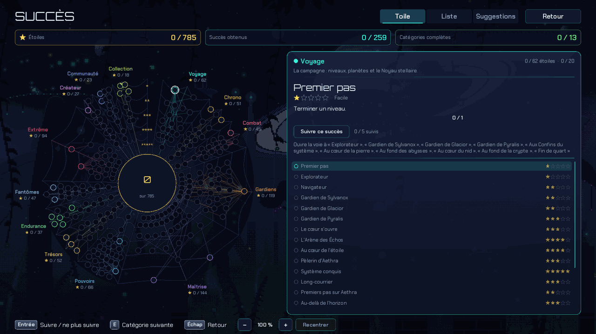

[← Retour à l'accueil (README)](../README.md)

# Ghost Racing, succès et mode concentré (2.18.0)

## Ghost Racing

Courir contre des **fantômes** : des courses déjà faites, rejouées en même temps que la
vôtre, sur le chronomètre du niveau.

### D'où viennent les fantômes

| Fantôme | Origine | Stockage |
|---|---|---|
| Mon meilleur temps | votre course la plus rapide sur **cette version** du niveau | `ghosts/local/<niveau>-<version>/pb.cprz` |
| Mon record précédent | le meilleur temps que le dernier a remplacé | `…/prev.cprz` |
| Ma dernière course | la dernière course terminée | `…/last.cprz` |
| Record mondial | 1re place du classement (officiel : Any%, classement « historique » ; niveau de joueur : version en cours) | `ghosts/cache/<record>.cprz` |
| Record d'un ami | classement des amis (officiel) ou amis présents au classement (niveau de joueur) | idem |
| Record du classement | autres records avec replay (officiel, 10 premiers) | idem |
| Replay choisi | « Importer un replay… » (fichier `.cprz`, vérifié puis copié) | `ghosts/files/` |

Chaque replay garde à côté de lui une description `.json` (joueur, niveau, empreinte exacte
de la version, record, catégorie, durée, date, temps de passage, version du jeu, vérifié en
ligne ou non). Le replay lui-même n'est jamais modifié.

Les replays téléchargés sont gardés dans un **cache** (64 Mo par défaut, réglable dans
`saves/settings.json` → `ghosts.cacheMB`) ; les plus anciens partent en premier.

### Ce qu'est un fantôme (et ce qu'il n'est pas)

* Un fantôme montre la **trajectoire enregistrée** de la course (position des pieds,
  orientation, état d'animation, planeur, bouclier, 30 fois par seconde, interpolée entre
  deux échantillons). Ce n'est **pas** une re-simulation : le monde n'est pas rejoué pour lui.
* Il est **purement visuel** : aucune collision, aucun projectile, aucun ennemi, aucun
  mécanisme, aucun point de sauvegarde. Il n'entre jamais dans la simulation : une partie
  avec ou sans fantôme donne exactement la même simulation et le même replay.
* Un fantôme n'est **jamais une preuve** : seules les vérifications du serveur (inchangées)
  décident des records en ligne. Un fantôme « vérifié en ligne » vient d'un record que le
  serveur a vérifié ; un fantôme « local » n'a été vérifié par personne.

### Écarts

* **En direct** : le temps qu'il vous a fallu pour atteindre le point le plus avancé de la
  route du niveau (la même que celle de la barre de progression) moins le temps qu'il a
  fallu au fantôme pour le même point. « +2,450 s » : retard ; « -1,230 s » : avance ;
  « 0,000 s » : égalité. Entre deux points de sauvegarde, c'est une estimation (la route est
  une ligne, le joueur peut passer ailleurs).
* **Aux points de sauvegarde** : exact. Depuis la 2.18, chaque replay contient l'événement
  `Split` (temps de passage à la milliseconde) ; pour un replay plus ancien, le temps de
  passage est lu sur l'échantillon (environ 1/30 s près) et marqué comme approximatif.
  Les points de sauvegarde sont appariés **par position** (un point sauté ou repris ne décale
  pas la comparaison).
* Les écarts se comparent **à la milliseconde** : une égalité reste une égalité.
* **Segments** : la durée entre deux points (pas le temps cumulé) ; un segment plus court que
  votre meilleur est en **or**. L'écran « Segments » de fin de course sépare toujours les
  durées et les temps cumulés.

### Versions du niveau

Un fantôme est lié à l'**empreinte exacte** de la version du niveau sur laquelle il a été
fait. Un fantôme d'une autre version (niveau modifié après publication, règles du jeu
changées) reste utilisable mais est affiché « **autre version : comparaison non officielle** »
et n'est jamais compté comme une victoire dans les succès.

### Vérifications d'un replay avant la course

Lecture sûre (taille limitée à 4 Mo, conteneur vérifié), trajectoire présente, durée possible
(2 h au plus), nombre d'échantillons cohérent avec la durée, course terminée, positions dans
le niveau, aucun déplacement impossible hors mort, réapparition ou téléportation (3
tolérés : téléporteurs du niveau), temps de passage dans l'ordre. Un replay refusé est
annoncé (« Fantôme ignoré : … ») et la course continue sans lui.

### Mode entraînement

Départ à un point de sauvegarde choisi, arrivée au suivant (ou à la sortie). Les pouvoirs des
tablettes placées avant le départ sur la route sont donnés (les derniers si les
emplacements manquent). Le fantôme part du moment où il est passé à ce point. Le segment
recommence tout seul ; R (ou Vue à la manette) recommence à tout moment.
**Aucun record, aucune progression, rien n'est envoyé en ligne.**

### Commandes

| Action | Clavier | Manette |
|---|---|---|
| Afficher / masquer les fantômes | G | clic du stick gauche |
| Mode concentré | T | Partage (Micro sur PS5) ou pavé tactile |
| Recommencer (contre-la-montre, entraînement) | R | Vue |

Toutes se changent dans *Paramètres → Contrôles*. Les options des fantômes (nombre à la fois,
opacité, couleurs, noms, écart, panneau) sont dans la pause (*Fantômes*) et sur l'écran
d'avant le départ.

### Performances

Les replays sont lus, vérifiés et placés sur la route **hors du fil principal** pendant le
chargement du niveau ; la mise à jour de 8 fantômes coûte environ 0,001 ms par image (test
`ghost: several ghosts at once`). Aucune requête réseau pendant la course : les
téléchargements se font avant le départ.

### Limites connues

* Le fantôme est la trajectoire enregistrée, pas une re-simulation : les ennemis, blocs et
  portes du monde ne sont pas montrés dans l'état où ils étaient pour lui.
* L'état des pouvoirs montré se limite au planeur et au bouclier (et à l'animation).
* En entraînement, l'état du niveau n'est pas celui d'une course complète arrivée à ce point
  (ennemis déjà vaincus, leviers, portes) : seuls les pouvoirs sont reconstitués.
* L'écart en direct est une estimation entre deux points de sauvegarde.
* Les classements en ligne ne gardent un replay que pour les records vérifiés : un joueur
  sans record vérifié n'a pas de fantôme en ligne.

## Lecteur de replay avancé (2.19)

*Voir le replay*, *Revoir la partie*, `CosmicPlatformer --replay fichier.cprz` : un replay exact
(format 2, même version du niveau) est **re-simulé** (voir `docs/online/REPLAY_FORMAT.md`).

* **Lecture / pause**, **image par image** en avant et en arrière (une image = un pas de
  simulation, 1/120 s), **vitesses** ×0,25, ×0,5, ×1, ×2, ×4.
* **Barre de temps** : un clic ou un glissement va à n'importe quel instant (le replay saute
  quand on relâche le bouton) ; repères des points de sauvegarde au-dessus.
* **Sauts** au point de sauvegarde précédent / suivant (et à l'arrivée), ±5 s, début, fin.
* **Chronomètre exact** (celui du niveau, à la milliseconde), **temps de passage** de chaque
  point (temps cumulé et durée du segment ; un clic y va), **entrées du joueur** du pas en
  cours (touches maintenues), HUD du jeu (vie, énergie, pouvoirs, objets, boss).
* **Aller en arrière sans jamais fausser l'image** : la simulation ne sait qu'avancer et un
  monde ne se copie pas. Le lecteur garde donc des **points de reprise** : trois autres
  copies du niveau rejouées avec les mêmes entrées, à environ 0,75 s, 3 s et 12 s derrière
  l'instant montré (entretenues pendant la lecture). Un retour en arrière repart de la plus
  proche (quelques dizaines de pas à simuler : immédiat) ; sans point de reprise, le niveau
  est rechargé et rejoué depuis le début (« Recherche de l'instant… », quelques milliers de
  pas par image). Dans tous les cas, l'état montré est celui de la simulation à ce pas :
  le même qu'en lecture continue (test `replay: a jump in time gives the same state as
  playing continuously`). Un saut vers un temps va au premier pas où le chronomètre
  l'atteint (le chronomètre s'arrête pendant l'intro et les arrêts sur image).
* Un replay ancien (format 1) ou désynchronisé montre sa trajectoire enregistrée, sans les
  entrées.

| Action | Clavier | Manette | Souris |
|---|---|---|---|
| Lecture / pause | K (ou Entrée / Espace sur « Lecture ») | X (ou A sur « Lecture ») | bouton |
| Image précédente / suivante | `,` / `.` (`;` en AZERTY) | LT / RT (maintenus : répétés) | boutons « ‹ Image » / « Image › » |
| −5 s / +5 s | J / L | stick droit ← / → | boutons |
| Point précédent / suivant | Q / E (Page préc. / Page suiv.) | LB / RB | boutons, lignes des temps de passage |
| Vitesse | − / + | bouton « Vitesse » | bouton |
| Début / fin | Origine / Fin | bouton « Début » | barre de temps |
| Retour | Échap | B | bouton |

Les flèches (croix directionnelle, stick gauche) déplacent le choix entre les boutons, comme
dans tous les menus.

## Comparer deux replays (2.19)

Deux courses du même niveau côte à côte, pour voir où l'une gagne du temps sur l'autre.

### Accès et choix des replays

* Lecteur de replay → **Comparer…** (le replay en cours est A) ;
* écran **Segments** de fin de course → **Comparer des replays…** (A : cette course, B : mon
  record, ou celui qu'elle vient de battre) ;
* écran d'avant course des fantômes → **Comparer deux replays…** (les fantômes cochés) ;
* **classement en ligne** (niveau) → **Comparer…** (A : le record choisi, B : le meilleur autre
  record avec replay).

L'écran « Comparer deux replays » propose les mêmes sources que l'avant-course : mes courses
de ce niveau (meilleur temps, record précédent, dernière course), les replays téléchargés
(cache) ou importés, les records en ligne (record mondial, amis, 10 premiers ; téléchargés
quand on les choisit, **avant** la lecture), plus le replay en lecture. Chaque ligne a ses
boutons **A** et **B** ; « Échanger A et B » ; chaque fichier est relu et vérifié (mêmes
vérifications que les fantômes) avant l'ouverture.

### Ce qui est montré (et ce qui est exact)

* **A est rejoué** : re-simulé à l'identique s'il est un replay exact de la version installée
  du niveau (ennemis, HUD et caméra du jeu, contrôles d'empreinte) ; sinon sa trajectoire
  enregistrée.
* **B est un fantôme** : sa trajectoire enregistrée (positions à 30 Hz interpolées, comme en
  Ghost Racing), sur le chronomètre de A. Re-simuler deux mondes à la fois n'apporterait rien
  de plus exact pour B : sa trajectoire *est* ce que son monde a produit.
* Leurs **trajectoires** sont tracées (toute la course en léger, les 2 dernières secondes en
  vif, les points de sauvegarde passés entourés) ; « Tracés » les masque.
* **Caméra** : « Suivre A » (la caméra du jeu en re-simulation), « Suivre B », « Les deux »
  (cadre les deux, en dézoomant si besoin, dans la partie de l'écran que les panneaux
  laissent libre).

### Décalage de B

Le décalage **d** déplace B sur le chronomètre de A : à l'instant t de A, B est montré où il
était à t − d. « décalage +1,250 s » : B est montré 1,25 s plus tard qu'il n'a couru ;
« décalage -0,500 s » : 0,5 s plus tôt.

* Réglage fin ±10 ms, ±100 ms, gros ±1 s, **saisie directe** (« +1,250 », « -0,5 s »,
  « 250 ms », « 1:02,5 »), **Zéro** ;
* **Recaler B** sur un point de sauvegarde choisi (ou l'arrivée) : d = (passage de A) −
  (passage de B) à ce point, à la milliseconde. B y passe en même temps que A (écart 0,000).
* Le décalage est borné (± la somme des deux durées). Le chronomètre de la comparaison
  continue après l'arrivée de A tant que B (décalé) n'a pas fini.

**Tous les écarts affichés tiennent compte du décalage** et le disent : « décalage +1,250 s
compris », « B recalé sur Grand saut ». Le décalage ne change pas les durées des segments
(ce que chaque course a mis), seulement les passages de B sur l'horloge de A et les écarts.

### Écart et tableau

* **Écart A − B en direct** : le temps de A pour atteindre le point le plus avancé de la route
  qu'il a atteint, moins celui de B (décalage compris) — l'estimation du Ghost Racing ; exact
  quand les deux ont fini. Positif : A en retard ; négatif : A en avance.
* **Tableau segment par segment** (points appariés par position, comme en Ghost Racing) :
  durée de A, durée de B, **A − B** sur le segment, **écart** au point (A − (B + d)) ; la
  durée la plus rapide des deux est en **or** ; la ligne du point de recalage est marquée.
  Un point que B n'a pas passé laisse « — » (et la durée suivante de B, qui couvrirait deux
  segments, n'est pas comparée). Ligne **Total** : les deux temps, leur différence, l'écart
  final. Un clic sur une ligne va au passage de A à ce point.

### Versions du niveau

Deux replays de versions différentes du niveau restent comparables, marqués « **autre
version : comparaison non officielle** ». Un replay A d'une autre version que celle
installée ne peut pas être re-simulé : sa trajectoire est montrée.

### Lecture seule

Aucun record, aucune progression, aucun succès, rien n'est envoyé au serveur : la
comparaison ne fait que lire. Les replays en ligne sont téléchargés (dans le cache des
fantômes) avant la lecture ; aucune requête réseau pendant la lecture.

| Action (comparaison) | Clavier | Manette |
|---|---|---|
| Caméra A / B / les deux | C | Y |
| Recaler B sur le point choisi | R | bouton « Recaler B » |
| Afficher / masquer les tracés | T | bouton « Tracés » |
| Décalage, saisie, points | boutons du panneau (flèches + Entrée) | croix + A |

Code : `game/ghost/ReplayCompare.*` (décalage, recalage, tableau, écart),
`game/ghost/ReplayPlayback.*` (re-simulation avec sauts et points de reprise),
`ui/screens/ReplayScene.cpp` (lecteur et comparaison), `ui/screens/ReplayCompareSetupScene.cpp`
(choix de A et B). Tests : `tests/test_replay_compare.cpp`.

## Succès

218 succès en 13 catégories (`data/achievements/achievements.json`), chacun avec 1 à 5 étoiles
de difficulté (597 étoiles). Ils se débloquent d'après les vraies sauvegardes
(progression, records, statistiques des boss) — y compris rétroactivement — et des compteurs
de partie gardés dans `saves/achievements.json` (ennemis vaincus, sauts, chutes, pouvoirs
utilisés, segments en or…). Certains succès en suivent d'autres (les fils de la toile) : un
succès ne se débloque qu'une fois les précédents obtenus.

* Les succès « niveau » (sans mourir, sans dégât, tout ramasser, tous les secrets, tous les
  ennemis) comptent les niveaux de la **campagne** joués depuis le départ. « Tout ramasser »
  et « tous les secrets » ne comptent que les 13 niveaux qui ont des éclats, des reliques ou
  des secrets (ni les niveaux des gardiens, ni le Noyau) ; certains se limitent à une planète
  (Aethra).
* Les pouvoirs passifs (Triple saut, Ruée aérienne, Aimant) se comptent en niveaux terminés
  en les possédant ; le Planeur à chaque ouverture.
* Depuis la 2.24 : les ennemis vaincus par famille (créatures terrestres, robots, créatures
  volantes, ennemis lourds, rapides, tourelles, utilisateurs de pouvoirs), l'or et le platine
  sur tous les niveaux d'une planète (Aethra), chaque phase d'un gardien d'Aethra battue
  sans être touché (pas forcément dans le même combat), les replays comparés et recalés
  (lecteur de replays), et la catégorie **Collection** : récompenses équipées, tenue complète,
  morceaux du juke-box entendus, créatures du bestiaire rencontrées, images des planètes
  enregistrées depuis la Galerie, musique du menu choisie.
* Les succès de la catégorie Communauté demandent Cosmic Online (commentaires publiés, niveaux
  notés : comptés quand le serveur les a acceptés) ; aucun n'est nécessaire au reste du jeu.

**Profil en ligne** : quand vous êtes connecté, la liste des succès débloqués est envoyée
(`PUT /api/v1/players/me/achievements`). Le serveur ne garde que les identifiants qu'il
connaît, recompte lui-même les étoiles avec sa copie du catalogue
(`server/src/achievementCatalog.json`, régénérée par `node scripts/achievements-catalog.mjs`)
et les affiche sur le profil comme **déclarées par le jeu, non vérifiées**.

## Mode concentré

Un HUD réduit : par défaut la vie, l'énergie, les pouvoirs et la vie du boss. Les éléments
gardés se choisissent dans l'éditeur du HUD (onglet « Mode concentré ») ; places et tailles
sont communes aux deux modes (deux éléments ne se chevauchent dans aucun des deux). Les
**messages du niveau** (indications, titres de pouvoirs et de boss) s'affichent ou non dans
chaque mode.

---

[← Retour à l'accueil (README)](../README.md)
