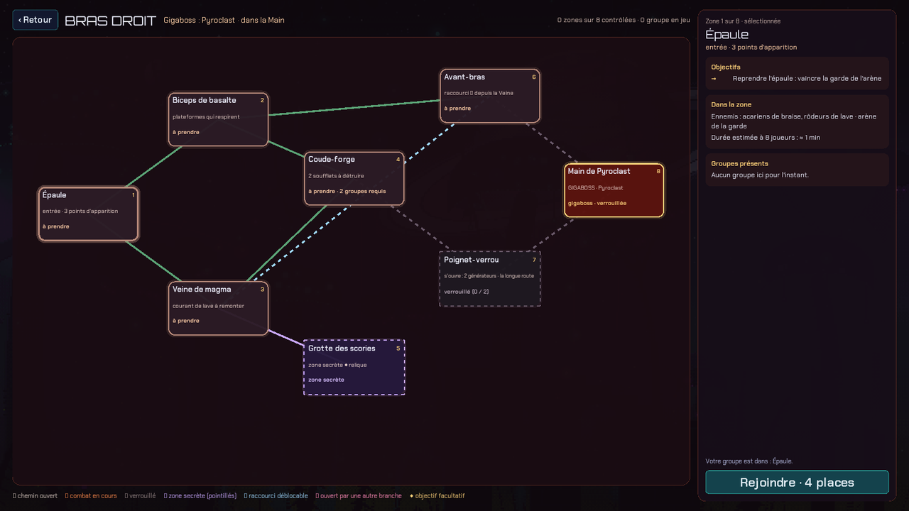
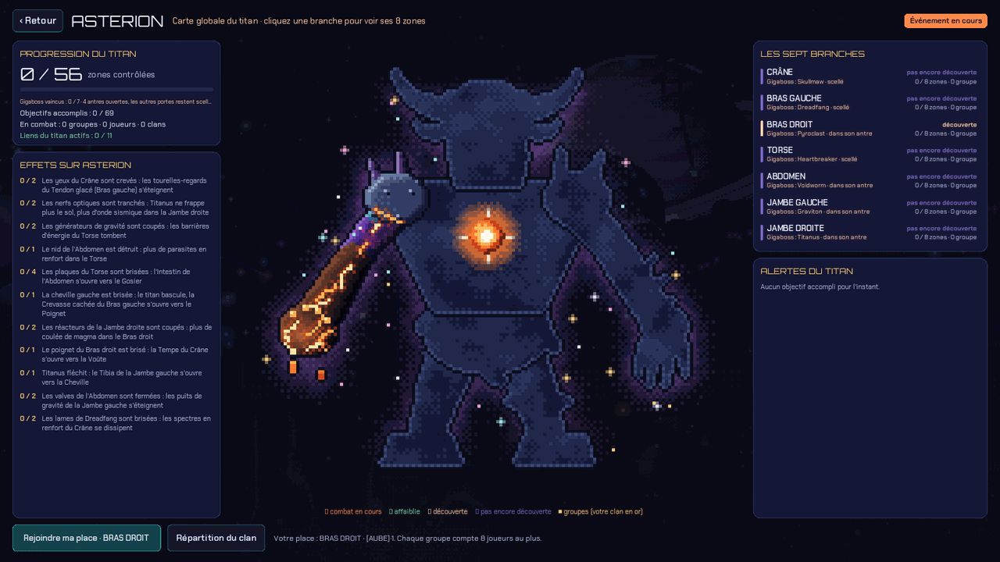
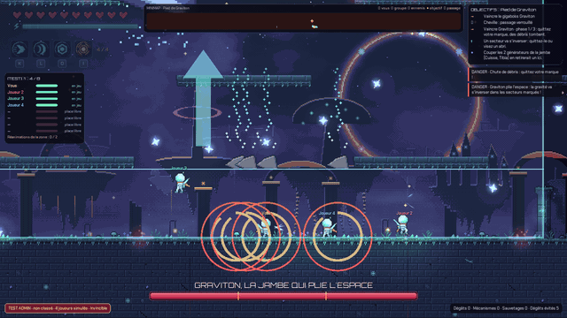
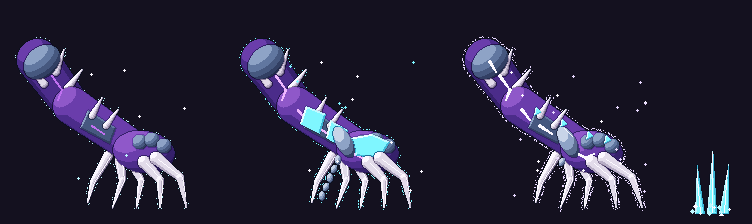
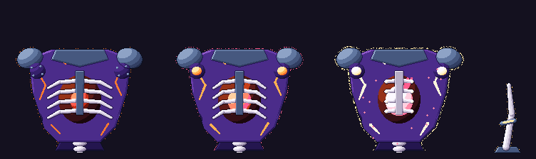
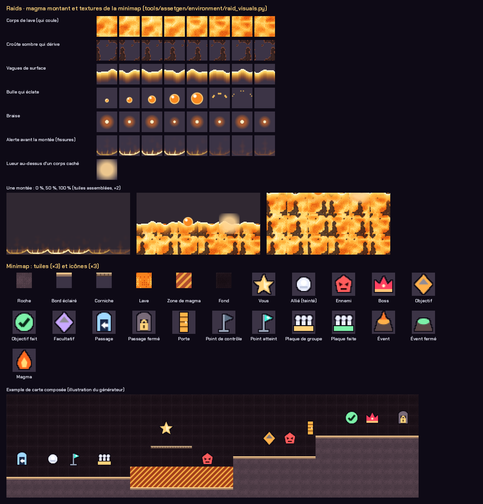

[← Retour à l'accueil (README)](../README.md)

# Raids de clan « ASTERION » — phase 2 : la branche « BRAS DROIT » (2.65) ; phase 4 : le titan entier (2.68, §6) ;
# phase 3 : le gigaboss PYROCLAST (2.68, §7 à §12) ; phase 4B : VOIDWORM, GRAVITON, TITANUS (2.69, §13) ;
# phase 5 : les événements mondiaux (2.69, §14) ; les raids tels qu'on les teste et qu'on les joue (2.72, §15)

La phase 1 (événements, inscriptions, groupes de 8, rappels : `server/src/raids.ts`, migration 0141)
prépare le raid. La phase 2 le rend **jouable** sur une première branche du titan, le **Bras droit** :
8 sous-zones, des instances de 8 joueurs au plus en verrouillage par entrées, et un état de la
branche partagé par tous les groupes, que le serveur ne met à jour qu'avec le **consensus** des
joueurs de chaque instance. La phase 3 (2.68) ouvre la Main : le gigaboss **Pyroclast** (§7 à §12).

Deux moments du mini-film d'Asterion (§4).

## 1. La branche (maquette « Branche »)

| Zone | Nom | Ce qu'on y fait | Passages |
|---|---|---|---|
| 1 | Épaule | entrée, **3 points d'apparition** ; reprendre l'arène (2 vagues) | 2, 3 |
| 2 | Biceps de basalte | plateformes qui « respirent » ; abattre le golem gardien | 1, 4, 6 |
| 3 | Veine de magma | terrasses à remonter, **montée de magma** toutes les 34 s (2.72, avant : 60 s) ; générateur ouest ; passage caché vers 5 ; raccourci (porte) vers 6 | 1, 4, 5, 6⇄ |
| 4 | Coude-forge | **deux soufflets, deux groupes** (un chacun) ; montée toutes les 42 s (2.72, avant : 90 s) ; l'Enclume vivante (facultatif) | 2, 3, 7🔒 |
| 5 | Grotte des scories | **zone secrète** ; la relique (facultatif) | 3 |
| 6 | Avant-bras | générateur est ; montée de magma toutes les 38 s (2.72) ; **levier du raccourci** vers la Veine (facultatif) | 2, 3⇄, 8 |
| 7 | Poignet-verrou | ouvert par les **2 générateurs** ; 2.68 : **la longue route** (§11) dont la dernière embuscade ouvre la Main | 4, 8 |
| 8 | Main de Pyroclast | le gigaboss **Pyroclast** (§6) ; objectif `main_pyroclast` | 6, 7 |

* Deux chemins vers le Coude-forge (Biceps / Veine), puis le Poignet-verrou et la Main ; 2.68 : la Main ne s'ouvre
  (aussi par l'Avant-bras) qu'une fois le verrou du Poignet brisé (`objective:poignet_verrou`).
* **Une zone est contrôlée** quand tous ses objectifs non facultatifs sont faits. Les verrous :
  `generators` (les 2 générateurs), `shortcut` (le levier de l'Avant-bras), `objective:<id>`.
* Ennemis du bestiaire existant (acariens de braise, rôdeurs de lave, drones de forge, golem de
  magma, rempart de forge, ailes de cendre, gloops de magma, feux follets).

### Génération (jamais à la main)

`python3 tools/levelgen/raid_bras_droit.py` écrit `data/raids/asterion/bras_droit/zone_1.json …
zone_8.json` (des niveaux ordinaires de Pyralis, avec `metadata.raid`), le catalogue
`branch.json` et **sa copie serveur** `server/src/raidBranches.json`. La sortie est stable (mêmes
octets à chaque exécution) ; `tests/test_raid.cpp` vérifie les deux copies du catalogue et
l'empreinte des zones. `revision` (catalogue) change dès qu'une zone change de jeu : toutes les
instances doivent avoir la même (le `GO` du relais la porte, `hash` = révision).

`metadata.raid` d'une zone : `spawns` (`start` : les points de départ ; `"<zone>"` : l'arrivée depuis
cette zone), `passages` (`to`, `rect` en pixels, `lock`, `door`), `objectives` (`id` du catalogue,
`source` = objet du niveau, `trigger` = l'événement qui l'accomplit : `cleared`, `killed`,
`activate`, `collected`), `magma` (`zone` de dégâts allumée `duration` s toutes les `period` s à
partir de `first`, annoncée `warn` s avant), `gigaboss` (2.68, §7 : l'objet du boss, ses évents en pixels, les
phases de sa carapace, ses points faibles et les nombres de son combat). `revision` vaut 2 depuis la phase 3.

L'**état de la branche** est l'ensemble des objectifs faits : le bit *i* = l'objectif *i* du
catalogue (ordre fixe, on n'ajoute qu'à la fin). Générateurs, raccourci, passages ouverts, zones
atteignables et contrôlées s'en déduisent, de la même façon dans le jeu (`game/raid/RaidBranch`) et
sur le serveur (`raidZones.ts`).

## 2. L'instance : 8 joueurs en verrouillage par entrées

Une instance = un groupe de 8 d'un clan (les groupes de la phase 1) sur la branche. Elle réutilise
**toute la pile de la coopération** (docs/COOP.md) : le même protocole, le même `CoopRoom`
(Durable Object) **en mode raid**, `GameWorld` à N joueurs, `stepTeam`.

* **8 sièges** (`coopnet::kMaxPlayers = 8`, `GameWorld::kMaxTeam = 8`) ; la coopération des niveaux
  EXTRÊME reste à 2 ou 3 (`kMaxCoopPlayers`), avec ses règles et ses empreintes :
  `kCoopSimulationVersion` ne change pas, `kSimulationVersion` et `kRankingGeneration` non plus.
* **N'importe quel siège lance** l'instance (un joueur suffit) ; `GO` annonce toujours 8 joueurs.
* **Siège libre** : drapeau `InputFrame::Vacant` (4), posé par le relais seulement (jamais accepté
  d'un jeu), sur les trames d'un siège que personne ne tient. Le joueur est `Presence::Vacant` :
  hors jeu, invisible, ignoré de tous.
* **Arrivée en cours de partie** : un joueur inscrit prend le premier siège libre ; il reçoit
  l'historique (états de la branche d'abord, puis trames), le rejoue hors du fil principal,
  annonce `CATCHUP_DONE`, et joue à partir du pas `REJOIN` choisi par le relais ; il apparaît près
  de l'allié en jeu le plus proche, tous cœurs, pouvoirs de départ de la zone.
* **Déconnexion** : la règle des 60 s de la coopération (veille, retour à l'identique). Au-delà, le
  siège est **libéré** (trames `Vacant`) : n'importe quel inscrit peut le prendre.
* **Caméra** : chacun suit son propre joueur (affichage seulement). Pas de « cadre d'équipe » en
  raid : personne n'est ramené. Le groupe entier à terre : la zone reprend là où il y est entré
  (objectifs gardés, tous debout, tous cœurs).
* **Changer de zone** : le premier joueur en jeu qui **entre** dans un passage ouvert (plus petit
  numéro d'abord) emmène toute l'instance. Chacun garde **ses cœurs, son énergie, ses pouvoirs et
  sa présence** (`GameWorld::carryOf` / `restoreMember`) et apparaît au point de la zone pour
  l'endroit d'où il vient (un joueur à terre revient debout avec la moitié de ses cœurs). Un
  passage où l'on se trouve à l'arrivée ne ramène personne : il faut y entrer.
* **Paires** (les soufflets) : une instance n'en fait qu'un ; l'autre doit venir d'un autre groupe.

### Message `RAID_STATE` (18, relais → jeu)

`u32 pas`, `u32 objectifs faits` : l'état de la branche **à partir de ce pas**. Le relais le lit en
D1 (toutes les 3 s, et dès qu'un rapport est accepté) et l'envoie au premier pas non encore
diffusé ; tous les jeux de l'instance l'appliquent donc au même pas (portes des passages ouvertes,
alertes). Un jeu qui arrive les reçoit tous avant les trames. L'instance compte aussi tout de
suite ce qu'elle a fait elle-même (`RaidRun::mask()` = branche | instance).

### `raid::RaidRun` (déterministe)

Il n'y lit ni horloge, ni caméra, ni réseau : seulement les trames et l'état donné avec elles.
Objectifs (événements du monde), passages, coulée de magma (pas entiers), reprise de zone,
rapports (`objective`, `zone`) avec le pas et l'empreinte de l'état (`RaidRun::hash`).

## 3. Le consensus (serveur)

`POST /raids/instances/{id}/reports {kind: "objective"|"zone", objective?, zone, tick, hash}` :
chaque jeu rapporte ce qu'il a vu. Un rapport est **accepté** quand la **majorité des joueurs
actifs** de l'instance (`raid_instance_members.active`, écrit par le relais : plus de la moitié,
au moins 1) a envoyé **la même valeur** (`zone:pas:empreinte`). Avant cela :

* **vraisemblance** : le raid est en cours, l'objectif est bien dans cette zone, la zone est
  atteignable avec l'état de la branche, le pas est possible depuis le début de l'instance ;
* un joueur ne rapporte qu'une valeur par clé ; une autre est refusée.

Les rapports minoritaires (un menteur, un jeu désynchronisé) sont **refusés et journalisés**
(`raid_report_rejections`). Un objectif accepté entre dans `raid_branch_objectives` une seule fois
(clé primaire par objectif : deux instances, ou deux acceptations simultanées, le comptent une fois),
sauf le second soufflet d'une même instance (journalisé). Un rapport de zone accepté place le
groupe sur la carte (`raid_instances.zone`).

### Routes

| Route | Rôle |
|---|---|
| `GET /raids/events/{id}/branch` | la carte : zones (atteignable, contrôlée, objectifs et par quel groupe), passages, générateurs, raccourci, instances (clan, groupe, zone, joueurs, places), la mienne, le journal des derniers objectifs |
| `POST /raids/events/{id}/instance {instance_id?}` | l'instance de mon groupe (créée une fois), ou celle d'un autre groupe que j'aide ; inscrit et raid en cours seulement |
| `GET /raids/instances/{id}/socket` | la WebSocket du relais (inscrit à l'événement) |
| `POST /raids/instances/{id}/reports` | un rapport (ci-dessus) |

Tables (migration **0142_raid_zones.sql**) : `raid_instances`, `raid_instance_members`,
`raid_reports`, `raid_accepted`, `raid_branch_objectives`, `raid_report_rejections`.

## 4. Écrans

La carte d'une branche au début d'un raid de clan (serveur lancé en local, comptes de démonstration).

* **Fiche de l'événement** (en cours) : « Carte du Bras droit ».
* **Carte de la branche** (maquette « Branche ») : les 8 zones reliées (ouvert, combat en cours,
  verrouillé en pointillés, zone secrète, raccourci), leur état et les groupes présents (le mien en
  or) ; à droite la zone choisie : objectifs (✓, ◆ facultatif, et par quel groupe), ce qu'il y a
  dedans, les groupes présents, « Rejoindre · N places » et « Aider [TAG]·n ». Clavier, manette
  (zones focalisables) et souris ; rafraîchie toutes les 10 s.
* **Combat** (maquette « Combat ») : minimap permanente en haut (vous, le groupe, ennemis,
  objectifs, passages et porte scellée, coulée), panneau du groupe (8 lignes : cœurs, état,
  réanimations de la zone), objectifs de la zone avec leur progression (générateurs 1 / 2,
  soufflets 1 / 2), alertes du groupe, de la branche et du serveur (objectif validé ou refusé),
  bandeau de danger (« Coulée dans 3 s · montez ! »), état du réseau. La pause ne s'arrête pas : le
  groupe continue. 2.72 (§15) : chaque élément se place dans l'onglet « Raids » de l'éditeur de HUD, la minimap
  est en textures et s'agrandit (M / Vue), un chronomètre s'ajoute, les flèches hors écran des niveaux aussi.
* **Mini-film d'Asterion** (2.68, `ui/screens/AsterionFilm`) : avant le premier affichage du titan
  (CLANS › RAIDS, fiche d'un événement, tout `AsterionFigure` : un seul appel `asterionfilm::hold`),
  dix plans d'environ deux minutes joués par le moteur des histoires (`makeFilm`). Le script — légende,
  titres et durée de chaque plan — se modifie à la main dans `data/raids/asterion_film.json` (une durée
  changée étire la scène) ; les scènes (`asterion_film_scenes.json`), les planches du titan en calques et
  les décors sont écrits par `tools/assetgen/environment/story_asterion.py` (`--check`, `--storyboard`),
  la musique par `tools/assetgen/audio` (`asterion_film`). Première projection impossible à passer ;
  « vu » (`asterionFilmSeen` de la progression, uni par `ProgressMerge`) écrit seulement à la fin ;
  « Revoir la cinématique » sur la carte de l'événement (celle-là se quitte). Contenu local, hors ligne.

## 5. Limites de la phase 2

* (2.68 : la Main est ouverte, voir §7.)
* Les replays d'une instance ne sont pas encore conservés côté serveur (le relais garde les trames
  en mémoire, comme la coopération).
* Les soufflets demandent deux groupes, sans la contrainte « à 3 s près » de la maquette : deux
  instances ne partagent pas d'horloge commune assez précise.
* Le chat de groupe (« GROUPE · Lyra : … » de la maquette) n'est pas dans cette phase : les
  alertes viennent du jeu et du serveur seulement.

## 6. Phase 4 (2.68) : le titan entier — sept branches, carte globale, liens, répartition

### Les sept branches (`tools/levelgen/raid_asterion.py`)

Six branches de plus, écrites par `python3 tools/levelgen/raid_asterion.py` (sortie stable, jamais à
la main ; `--en fichier.json` donne l'anglais de chaque texte pour `tools/i18n/extract.py --merge`) :
`data/raids/asterion/<branche>/zone_1.json … zone_8.json` et `branch.json`, le catalogue du titan
`data/raids/asterion/titan.json` et **sa copie serveur** `server/src/raidTitan.json` (titan + les six
catalogues ; le Bras droit reste à `raid_bras_droit.py` et `raidBranches.json`, lus seulement).

| Branche | Gigaboss | Monde | Traversée | Danger périodique | Deux groupes | Verrou de la zone 7 |
|---|---|---|---|---|---|---|
| Crâne | Skullmaw | Confins (os, obsidienne) | vertèbres flottantes, regards lasers | onde psychique | 2 nerfs optiques | les deux yeux |
| Bras gauche | Dreadfang | Glacior | glace qui cède, tourelles | balayage des griffes | 2 lames | 2 cœurs de givre |
| Torse | Heartbreaker | Noyau | côtes mouvantes, barrières d'énergie | pulsation du cœur | 2 × 2 plaques | les 4 plaques |
| Abdomen | Voidworm | Sylvanox (racines, acide) | parois qui respirent | reflux d'acide | 2 valves | 2 glandes |
| Jambe gauche | Graviton | Aethra (ruines flottantes) | puits d'apesanteur, îlots mouvants | puits de gravité | 2 rotules | 2 générateurs de gravité |
| Jambe droite | Titanus | Pyralis (forge, lave) | pistons géants | onde sismique | 2 pistons | 2 réacteurs |

Chaque branche : entrée à 3 points d'apparition et son arène, deux chemins, une **zone secrète** (5) et
sa relique, un **raccourci** ouvert au levier, une **zone à deux groupes** (une paire d'objectifs), un
verrou `generators` sur plusieurs zones (textes propres dans `lock_texts` du catalogue), l'arène de
la zone 7 qui ouvre l'antre (8), dont la **porte reste scellée** (« <Gigaboss> — prochaine version » ;
les six combats viennent ensuite). Les dangers réutilisent `metadata.raid.magma` avec `name`, `hint`,
`message` (le Bras droit garde ses textes par défaut).

### L'expédition avant l'antre (zone 7) et l'arène du gigaboss (zone 8)

La zone 7 de chaque nouvelle branche est **une longue expédition pour 8 joueurs** (≈ 15 min même à 8) :
trois étages (galeries basses avec les traversées et le danger de la branche, étage du milieu, étage
haut ; des puits de corniches les relient à chaque secteur) pour que 8 joueurs ne s'entassent pas ;
**deux écluses** (un mur sur les trois étages, une porte à chaque étage : elles s'ouvrent ensemble quand
3 joueurs se tiennent sur la plaque) et **un monte-charge** (il démarre avec 4 joueurs dessus, puis fait
la navette seul) — `metadata.raid.coop` (`rect`, `players`, `targets`, `action`), moins de joueurs
demandés quand moins sont en jeu (jamais de blocage à 1 ou 2) ; **points de contrôle** à chaque étage
(`metadata.raid.checkpoints`, arrivée `spawns["cp:<id>"]`) : le groupe entier à terre reprend au dernier
atteint, et chaque nouveau point relève les joueurs à terre ; **quatre embuscades géantes** (une zone de
combat sur les trois étages, quatre vagues, des ennemis à chaque étage : le système d'embuscade, état
gardé à la chute, compteur, flèches hors écran) — la dernière, la garde de l'antre, est l'objectif qui
ouvre la porte de la zone 8. Tout se joue dans `raid::RaidRun` (plaques, points de contrôle : au même
pas sur tous les jeux, dans l'empreinte).

**Durée estimée** (`estimate_minutes` du générateur, champ `minutes` de chaque zone du catalogue) : la
largeur à 2 tuiles/s, les PV des ennemis à 4 PV/s pour 8 joueurs, 8 s par vague, 30 s par mécanisme à
plusieurs (plus le trajet du monte-charge). Avec un joueur (1,5 PV/s), le modèle retrouve les temps de
référence de la campagne à ±40 % (`calibrate()`). Le générateur exige 13 à 17 min pour l'expédition et
18 à 35 min pour toute la branche hors gigaboss (un raid standard de 45 à 60 min avec le combat et les
attentes des autres groupes) ; `tests/test_raid_titan.cpp` le revérifie.

La zone 8 : une antichambre, la porte scellée, puis **l'arène du gigaboss**, immense pour 8 joueurs
attaqués à la fois (200 tuiles de large, plus de deux écrans ; cinq étages de plateformes ; deux piliers),
ses bornes déclarées dans `metadata.raid.arena` (`rect`, `floor`, `door`, `entry`, en pixels) pour les
combats à venir.

### Les liens entre branches (spec §7)

`titan.json` → `links` : `from` (objectifs d'autres branches, tous requis), `to` (la branche cible),
`bit` (24 et plus : un bit de **l'état de la branche cible**, sous lequel restent ses objectifs), `kind`,
`zones`, `objects` :

| `kind` | Effet dans la simulation (`raid::RaidRun::applyEffect`) |
|---|---|
| `open` | les passages verrouillés `link:<id>` s'ouvrent (portes comprises) |
| `disable` | les objets des zones (lasers, tourelles, barrières) sont éteints |
| `remove` | les ennemis des zones (leurs objets d'apparition) disparaissent |
| `hazard_off` | le danger périodique des zones s'arrête |

Onze liens : les yeux du Crâne → tourelles du Bras gauche ; ses nerfs → onde sismique de la Jambe
droite ; les générateurs de la Jambe gauche → barrières du Torse ; le nid de l'Abdomen → parasites
du Torse ; les plaques du Torse → passage Intestin ⇄ Gosier de l'Abdomen ; la cheville gauche →
passage Crevasse ⇄ Poignet du Bras gauche ; les réacteurs de la Jambe droite → coulées du Bras droit ;
le poignet du Bras droit → passage Tempe ⇄ Voûte du Crâne ; la cheville de Titanus → passage Tibia ⇄
Cheville de la Jambe gauche ; les valves de l'Abdomen → puits de gravité de la Jambe gauche ; les lames
de Dreadfang → spectres en renfort du Crâne.

Le serveur calcule l'état d'une branche (`raidMap.stateMaskOf` : ses objectifs acceptés + les liens
dont toutes les sources sont acceptées) ; `raidZones.branchMaskOf` (lu par le relais toutes les 3 s et
à chaque objectif accepté, **toutes branches confondues**) le donne aux jeux par `RAID_STATE` : chaque
jeu de l'instance applique le lien **au même pas** (et de nouveau à chaque chargement de zone), avec
une alerte « TITAN · … ». Rien ne vient d'un jeu ni de l'interface. Le hash du `GO` devient
`<révision de la branche>.<révision du titan>`.

### Progression collective

Le consensus de la phase 2 (`POST /raids/instances/{id}/reports`) vaut pour les sept branches : le
catalogue de la branche de l'instance, sa joignabilité avec les liens, l'objectif compté une fois par
événement, le menteur minoritaire journalisé, l'égalité refusée.

### Répartition des joueurs (spec §8, migration **0144**)

`raid_placements` (une place par joueur et événement : instance, branche, par qui, pourquoi) et
`raid_placement_log` (chaque changement). **8 joueurs au plus par instance** : une seule instruction
conditionnelle place un joueur (deux placements simultanés ne font jamais un neuvième) ; une instance
s'ouvre seulement quand toutes celles du clan sur la branche sont pleines.

| Route | Rôle |
|---|---|
| `GET /raids/events/{id}/titan` | la carte globale : branches (état, zones contrôlées, objectifs, groupes, joueurs), `body` (état de chaque partie pour la figure), liens, renforts demandés, clans par objectifs, alertes, ma place |
| `GET /raids/events/{id}/branches/{partie}` | la carte d'une branche (comme `/branch`, pour les sept) avec ses liens reçus et donnés |
| `POST /raids/events/{id}/branches/{partie}/join {instance_id?}` | ma place sur cette branche (groupe de ma liste d'abord, puis les groupes en combat qui ont de la place, puis une nouvelle instance) ; avec `instance_id` : aider ce groupe s'il a de la place |
| `POST /raids/events/{id}/join` | ma place, ou là où le clan a besoin de moi (un groupe en combat qui n'est pas plein, sinon la branche où le clan a le moins de joueurs) |
| `GET /raids/events/{id}/placements` | les joueurs de mon clan et leur place, les groupes, `can_manage` |
| `POST /raids/events/{id}/placements {player_id, branch, instance_id?}` | le chef, un officier ou le chef de raid déplace un membre |
| `POST /raids/events/{id}/placements/rebalance {branch}` | répartit les joueurs d'une branche sur le moins de groupes possible, à parts égales (ceux qui ne jouent pas bougent d'abord) |

Un joueur en combat garde sa partie : sa nouvelle place compte à sa prochaine entrée.

### Écrans

La carte du titan au début d'un raid de clan (serveur lancé en local, comptes de démonstration).

* **Carte du titan** (fiche d'un raid en cours › « Carte du titan ») : le titan (`AsterionFigure`, une
  partie = sa branche), les groupes par branche, la progression, les effets, les renforts, les alertes,
  « Rejoindre » et « Répartition du clan ». Les sept branches sont aussi des arrêts du focus.
* **Carte d'une branche** (`RaidBranchScene`, pour les sept) : les passages ouverts par une autre
  branche (✦), la section « Liens avec le reste du titan ».
* **Répartition du clan** (`RaidRosterScene`) : membres, groupes, « Déplacer vers », « Équilibrer ».
* **Combat** : les verrous et dangers de chaque branche, les liens actifs de la zone (✦).

## 7. Phase 3 (2.68) : le gigaboss PYROCLAST

Filmé dans le test des administrateurs (en local, jamais classé), les autres joueurs pilotés par des scripts.

`data/enemies/pyroclast.json` : une main de magma qui marche sur ses doigts (le cerveau du golem : poing météore =
`skyfall`, secousse = `quake`), trois phases et une dernière éruption ; les **Poings de magma** (un par joueur en
jeu) s'y ajoutent à chaque phase :

| Phase | Seuil | Attaques | L'arène (événements `bossPhase` de la zone) |
|---|---|---|---|
| 1 « Poing de magma » | 100 % | coup de poing, pluie de magma, éruption, bombes de lave, secousse | — |
| 2 « Carapace de basalte » | 66 % | poing météore, secousse, pluie, éruption | la croûte des fosses sous les tours cède au magma, soins |
| 3 « Cœur de magma » | 33 % | marée de magma, double poing météore, secousse, éruption folle, pluie, poing | rideaux de lave aux deux murs, soins |

Le sprite (trois feuilles, une par phase : plaques nues, carapace et évents, cœur à nu), son point faible et ses
évents sont générés par `tools/assetgen/characters/boss_k_pyroclast.py` (`--check` : mêmes octets, testé ;
`--review` : planche contact).

`game/raid/Gigaboss` mène les règles du raid autour de lui, pas à pas, dans la simulation (le même sur chaque
ordinateur) :

* **Un géant pour 8** : 2,5 fois la taille du sprite (une boîte de 220 × 300 px), une arène de 183 tuiles (plus de
  six écrans de large), deux tours de corniches au-dessus de fosses, deux monte-charges vers une plateforme haute
  au-dessus de sa tête : ses trois évents sont sur les deux tours et la plateforme (le groupe doit se séparer).
* **Poings de magma** (toutes les phases, toutes les 9 / 7 / 5,5 s ÷ sa pression) : une marque sous **chaque joueur
  en jeu**, le même pas (8 joueurs : 8 poings), puis un poing de magma tombe sur chaque marque 1,4 s plus tard.
  Avec la pluie de magma, les éruptions, la marée de magma (seules les corniches restent sûres) et les poings
  météores, il attaque tout le groupe à la fois.
* **Mise à l'échelle** : sa vie × (1 + 0,55 × (sièges occupés − 1)) au début du combat (2 à 8 joueurs), et encore
  quand un joueur prend un siège pendant le combat (jamais à la baisse) ; ses temps de recharge ÷ (1 + 0,06 ×
  (joueurs en jeu − 1)).
* **Carapace** (phase 2) : rien ne le blesse (`Enemy::setRaidGuard`) tant qu'un de ses **3 évents** est ouvert. Un
  joueur debout 3 s sur un évent le ferme (chaque joueur dessus compte un « évent fermé ») ; un évent fermé se
  rallume au bout de 15 s (× 1,35 à deux joueurs, × 2 seul) : il faut les tenir **ensemble**. Chaque évent ouvert
  crache un jet de magma toutes les 6 s, à tour de rôle (annoncé 1,2 s avant) : une zone de danger.
* **Cœur à nu** : les trois fermés, la carapace éclate 10 s (dégâts × 2) et ses **3 points faibles**
  (`pyroclast_noyau`, collés à ses jointures) peuvent être brisés : chacun lui ôte 4 % de sa vie et compte pour qui
  l'a brisé. Puis les évents se rallument.
* **Sauvetages** : relever un allié à terre (la règle de la coopération, 2 par zone) compte pour qui était près de
  son âme.
* **Sa chute** : tous les joueurs en jeu sont « présents à la chute ». Un groupe entier à terre : la zone reprend, le
  boss aussi. Une Main dont l'objectif est déjà validé (un autre groupe l'a vaincu) est éteinte.

## 8. Contributions et consensus (`game/raid/Contributions`, `raidZones.ts`)

Calculées dans la simulation (l'écouteur du monde : les attaques de chaque joueur sont étiquetées), un
enregistrement par joueur ayant tenu un siège (`seat`, `from` = le pas où il l'a pris) : dégâts (dixièmes de vie),
dégâts au gigaboss, dégâts évités (ses coups visant ce joueur et esquivés, les coups arrêtés par son bouclier),
blocages, sauvetages, évents, points faibles, objectifs (une action d'un joueur : la sienne ; un combat gagné : celle
de tous les joueurs en jeu), pas en jeu, présence à la chute. L'empreinte de `RaidRun` les contient.

Deux rapports de plus, par le même consensus (majorité stricte des joueurs actifs, minorité journalisée, égalité
jamais acceptée) :

* `{kind: "boss", phase}` (1 le combat commence, 2 et 3 ses phases, 4 sa chute) → `raid_gigaboss_fights` ;
* `{kind: "result", records: [...]}` à chaque jalon (objectif, phase) → `raid_contributions` (une ligne par
  `seat`/`from`, attribuée au membre qui tenait ce siège depuis ce pas : `raid_instance_members.seat_from`, écrit
  par le relais ; le tableau le plus récent garde ses lignes). Avant toute majorité, les tableaux impossibles sont
  refusés (temps au-delà du pas, plus d'évents qu'un toutes les 3 s, plus de sauvetages qu'un toutes les 2 s…).

La valeur comparée est le texte canonique du tableau, reconstruit par le serveur à partir des nombres.

## 9. Corps d'Asterion, résultats et récompenses (`raidRewards.ts`)

* **Corps** (`body` de chaque événement, état validé seulement) : bras droit « attaque » dès qu'il y a une progression
  validée, « affaibli » quand un combat a atteint sa phase 2, « detruit » quand `main_pyroclast` est accepté ;
  `effects` : « Plus de pluies de lave » (seulement noté et affiché dans cette phase).
* **Résultats** `GET /raids/events/{id}/results` : clans (somme des scores), joueurs par catégorie, combats contre
  Pyroclast, mon dernier tableau « en attente de validation » s'il attend sa majorité ; « Classement final » une fois
  l'événement terminé. Le **score de contribution** mélange tout, chaque part plafonnée : dégâts 500, évités 300,
  soutien 400, progression (évents, points faibles, objectifs, chute) 1 880, présence 600.
* **Récompenses** (`raid_reward_grants`, clé unique joueur + récompense + événement) accordées par le serveur à
  partir des résultats validés : badge « Main de Pyroclast » (présent à une chute validée : le succès
  `communaute_pyroclast`, que le serveur n'accepte qu'une fois la récompense récupérée), titre « Assaillant
  d'Asterion » (5 min), « Briseur de magma » (score ≥ 1 500), « Fléau de Pyroclast » (3 meilleurs scores, à la fin
  de l'événement). `POST /raids/rewards/claim {id?}` est idempotent ; les titres vont dans `player_won_rewards`
  (`raid:<événement>`) : profil et vestiaire.

Migration **0143_raid_gigaboss.sql** : `raid_instance_members.seat_from`, `raid_contributions`,
`raid_gigaboss_fights`, `raid_reward_grants`.

## 10. Écrans (2.68) et test des administrateurs

* **Combat** : les évents dessinés sur l'arène (fermé, ouvert, annoncé, jet ; la tenue en anneau), la carapace,
  les objectifs du gigaboss (évents k / 3, cœur à nu et ses points faibles, allié à relever), mes contributions en
  bas à droite, la carte de sa chute (« Résultats du raid »).
* **Résultats du raid** (maquette « Résultats ») : depuis la fiche de l'événement et à la chute de Pyroclast.
* **CLANS › RAIDS** : « Récompenses à récupérer » avec « Récupérer ».
* **ADMINISTRATION › Raids › « Tester Asterion »** (administrateurs) : une branche du catalogue
  (`raid::Branch::all`, les branches ajoutées plus tard y apparaissent seules), une zone (le combat de Pyroclast par
  défaut), « Invincible (admin) · non classé », 2 à 8 joueurs simulés, phase de départ ; seul et en local
  (`RaidRun::setTest`) : aucun rapport n'est jamais produit, et le serveur refuse tout rapport marqué `test`.
  2.72 (§15) : il se joue comme une vraie instance (`raid::TestSession`) : l'état de la branche suit d'une zone à
  l'autre, et les joueurs simulés sont visibles et jouent vraiment (IA déterministe). 2.68.2 : la pause ne fige
  jamais le monde, test compris (seul le joueur cesse d'agir).

## 11. La longue route du Poignet-verrou (2.68)

La zone 7 est un vrai niveau d'environ **15 minutes pour 8 joueurs** : des galeries à deux voies (sol et grilles) pour
que huit joueurs ne s'empilent pas, **quatre embuscades géantes sur plusieurs étages** (la Tour des tendons, la
Galerie des forges, la Fosse des scories, la Garde du verrou : des vagues sur chaque étage, les portes fermées
pendant le combat ; l'état, le compteur et les flèches violettes des embuscades du jeu), des **mécanismes de groupe**
(`metadata.raid.coop`, le format des six autres expéditions : la vanne double, 4 joueurs sur sa plaque ; le
monte-charge, 3 joueurs dessus ; les plaques jumelles, deux plaques d'un même `group` tenues au même pas, les joueurs
en jeu partagés entre elles, seul la première suffit ; chaque joueur sur une plaque compte un « mécanisme »),
des **points de contrôle** (le groupe entier à terre reprend au dernier atteint) et des réanimations.

L'estimation est celle des sept branches (`estimate_minutes` de `tools/levelgen/raid_asterion.py`, appelée par
`raid_bras_droit.py`, champ `minutes` du catalogue, recalculée par `tests/test_raid.cpp` depuis le niveau lui-même) :
**≈ 15,4 min** à 8 (13 à 17 exigés ; quatre embuscades de 4, 4, 4 et 5 vagues). Les autres zones restent courtes
(la branche entière ≈ 22 min sans le gigaboss : un raid standard de 45 à 60 min avec son combat et les attentes).

## 12. La caméra des arènes de gigaboss (`game/raid/ArenaCamera`, affichage seulement)

En entrant dans l'arène : un plan de **l'arène entière** et du boss (4 s), puis une vue qui suit le joueur de cet
ordinateur avec un zoom entre 300 et 620 px de monde en hauteur : assez large pour les marques qui le menacent, le
boss quand il est proche et les alliés voisins, jamais au point de rendre l'action minuscule. Des flèches au bord de
l'écran (hors du HUD mesuré) montrent le boss (ses points faibles quand il est à nu), les alliés (leurs couleurs) et
les ennemis d'une embuscade. Elle sert à toutes les arènes de gigaboss : elle lit `metadata.raid.arena` (`rect`,
`floor`, `door`, `entry`), le format des sept antres (`raid::ZoneRules::arena`). La simulation ne la voit jamais.

## 13. Phase 4B (2.69) : VOIDWORM, GRAVITON, TITANUS

Graviton inverse la gravité d'un secteur. Filmé dans le test des administrateurs (en local, jamais classé), les autres joueurs pilotés par des scripts.

Les antres de l'ABDOMEN, de la JAMBE GAUCHE et de la JAMBE DROITE sont descellées (zone 8 de chaque branche, écrite par
`tools/levelgen/raid_voidworm.py`, `raid_graviton.py`, `raid_titanus.py`, appelés par `raid_asterion.py` ; `BRANCH_REVISION` 2).
Chaque catalogue gagne, à la fin, l'objectif de son gigaboss (rôle `gigaboss` : `abd_voidworm`, `jg_graviton`, `jd_titanus`) :
le serveur accepte alors ses rapports `boss` et détruit la partie du titan à sa chute, comme pour Pyroclast.

`metadata.raid.gigaboss` garde le format de Pyroclast (§7 : vie et pression selon les sièges, marques sous chaque joueur
`fists`, évents `vents`, carapace `carapace`, points faibles) et ajoute `routine`, les textes (`fallText`, `goneText`,
`summary`), la planche des effets (`fx`) et `links` (des objectifs de la branche, lus dans son état au même pas). La routine
(`game/raid/GigabossRoutine`, un fichier par gigaboss) mène le reste du combat dans la simulation, après les marques ; son
état entre dans l'empreinte du gigaboss ; ce qu'elle montre (zones, plaques, marques, ondes, lignes des objectifs) est
seulement affiché par l'écran de combat.

| Gigaboss | Phases | Sur chaque joueur | Mécanisme collectif (phases) | Liens de la phase 4A |
|---|---|---|---|---|
| Voidworm (ver du vide, au milieu de l'arène) | « Le ventre affamé », « Les anneaux de chitine », « Le reflux » | Fouissement (une gueule sort du sol sur la marque) ; sa gueule vise 1 joueur (2 à partir de 6) d'un anneau vert qui suit puis se fige : qui y reste est **avalé** | 3 crochets (deux au sol, un sur la couronne au-dessus de lui) tenus ensemble 3 s : épinglé, sa gueule s'ouvre 10 s (phase 2) | nid détruit : deux fois moins de parasites ; les deux valves fermées : l'acide monte moins haut |
| Graviton (jambe qui flotte) | « Le champ de gravité », « Les générateurs », « Le monde à l'envers » | Chute de débris ; un puits de gravité sous chacun (phases 2 et 3) | 4 générateurs (deux au sol aux deux bouts, deux sur des îlots en hauteur) : un joueur sur chacun **au même instant**, 2,5 s ensemble ; elle s'effondre au sol 12 s (phases 2 et 3) | générateurs de la jambe coupés : un générateur de moins |
| Titanus (jambe de forge) | « Le pas du colosse », « Les entraves », « La forge à nu » | Écrasement (son talon) ; rochers de la voûte (phases 2 et 3) | 2 entraves de cheville brisées à moins de 1,5 s d'écart (seule, une entrave se reforge) : à genou 11 s (phases 2 et 3) | réacteurs coupés : fenêtre × 1,5 |

* **Voidworm** : un avalé est gardé dans sa poche (une pièce fermée sous le sol, des sucs toutes les 3 s), libéré quand la
  poche qui pousse sur son cou est crevée (un **sauvetage** pour qui la brise) ou recraché au bout de 12 s ; jamais le dernier
  joueur dehors. Ses parasites sortent de quatre trous (1 + joueurs / 2 par vague). À sa 3e phase, une marée d'acide couvre
  toute l'arène toutes les 22 s (annoncée 3 s avant).
* **Graviton** : l'arène en quatre secteurs ; un secteur annoncé (2 s) voit sa gravité s'inverser (4,5 à 6 s) : les joueurs
  montent vers la voûte, dont le champ blesse, sauf sous une des deux dalles du secteur. Un secteur, puis deux, puis la moitié
  de l'arène à sa 3e phase.
* **Titanus** : ses ondes de choc partent de ses pieds vers les deux murs, le long du sol (40 px de haut : à sauter), par deux
  à sa 3e phase ; sa 2e phase fend le sol au-dessus de la forge (dalles qui cèdent, lave).
* Contributions : chaque joueur sur un crochet ou un générateur quand il cède, chaque briseur d'entrave quand elles cèdent
  ensemble, compte un « mécanisme » (jamais plus d'un toutes les 3 s) ; les points faibles (3 par exposition) comme pour Pyroclast.
* Mise à l'échelle : vie × (1 + 0,55 × (sièges − 1)), points faibles, poche et entraves × (1 + 0,25 × (sièges − 1)), temps ÷
  la pression ; moins de joueurs : plus de temps (× 1,35 à deux, × 2 seul) et moins de générateurs à tenir (un par joueur).
* **Récompenses** (`raidRewards.ts`, sans migration) : un badge par gigaboss (`GIGABOSS_BADGES` : `voidworm_badge`,
  `graviton_badge`, `titanus_badge`, succès `communaute_voidworm`…), accordé une fois à qui était présent à sa chute validée
  (`raid_gigaboss_fights.boss`) ; « Fléau de Pyroclast » reste réservé à la chute de Pyroclast. Corps : chaque partie
  combattue « affaiblie » puis « détruite » ; résultats : `gigaboss.defeated_bosses`, `fights[].boss`.
* Sprites (trois phases chacun, cibles, effets) : `tools/assetgen/characters/boss_m_voidworm.py`, `boss_m_graviton.py`,
  `boss_m_titanus.py` (`--check`, `--review`), aux couleurs de leur partie dans `asterion_sprites.png`.
* Tests : `tests/test_raid_gigaboss_b.cpp` (générateurs, taille, vie de 2 à 8, même empreinte à 2 et 8 joueurs et par le relais,
  marques sur chaque joueur, crochets, avalement, acide, parasites, générateurs, inversion, entraves, ondes, chute et test admin
  jamais envoyé), `server/test/raidGigabossB.test.ts` (chute, badge accordé une fois, partie détruite, résultats).

### 13 bis. SKULLMAW, DREADFANG et HEARTBREAKER (2.69)

Les antres du Crâne, du Bras gauche et du Torse sont ouverts eux aussi : `tools/levelgen/raid_skullmaw.py` (la coque
commune `shell()` de ces trois antres), `raid_dreadfang.py`, `raid_heartbreaker.py`, appelés par `raid_asterion.py`
(révision de branche 3) ; leurs objectifs de rôle `gigaboss` : `crane_skullmaw`, `bg_dreadfang`, `torse_heartbreaker`.
Leurs routines (`game/raid/SkullmawRoutine`, `DreadfangRoutine`, `HeartbreakerRoutine`) suivent le cadre de
`GigabossRoutine` : armure = étape « carapace » de `raid::Gigaboss`, exposition et points faibles du cadre
(`expose` / `exposedStep`, un ennemi par point quand `weakSpots` en nomme un : les yeux et le cristal de Skullmaw),
plaques tenues par `holdPlates` (les chaînes, les côtes), marques sous chaque joueur par les poings du cadre
(`fists`, `rise` : tirées du sol), affichage par `BossMark` (deux genres de plus : `Beam`, un regard ou une chaîne ;
`Cone`, la lumière de l'œil qui révèle les plateformes dans les ténèbres).

 

| Gigaboss | Phases | Sur chaque joueur | Mécanisme collectif | Points faibles |
|---|---|---|---|---|
| **Skullmaw** (300 × 300 px, volant) | « Le regard qui traque », « Le voile psychique » (66 %), « Les ténèbres » (33 %, arène sombre) | **Regards traqueurs** : un laser par joueur, qui suit 1,5 s, se fige 0,45 s puis tire jusqu'au premier mur | **Voile** (phases 2-3, son armure) : son **Regard de mort** se charge 3,5 s puis frappe ceux qu'il voit (une colonne les cache) ; assez de **miroirs** tenus à cet instant (1 seul, 2 de 2 à 4 joueurs, 3 à 5-6, 4 à 7-8) : aveuglé 10 s, dégâts × 2 | ses deux yeux et le cristal du front |
| **Dreadfang** (320 × 240 px, volant) | « Les griffes », « Le bras enchaîné » (66 %), « Griffes déchaînées » (33 %, plateformes tranchées) | **Griffes du sol** ; **balayages** d'un, deux puis trois étages entiers (sauter la lame ou changer d'étage) | **Trois chaînes** (phase 2) : 2,5 s sur une ancre la verrouille 12 s ; les trois ensemble : plaqué au sol 10 s, dégâts × 2. **Griffe clouante** (phases 2-3, dès 2 joueurs) : un joueur (deux dès 5) cloué jusqu'à ce qu'un autre brise la griffe (un sauvetage) ; épargné par les griffes du sol pendant ce temps | ses trois jointures |
| **Heartbreaker** (340 × 320 px, immobile) | « La cuirasse », « La cage thoracique » (66 %), « Le cœur affolé » (33 %) | **Côtes-pièges** ; **battements** en rythme (un fort sur 4, 3 puis 2) dont l'onde court au sol | **Quatre plaques** (phase 1, les plaques de la branche reformées) : à briser dans les 20 s après la première (× 1,2 à 2 avec peu de joueurs), sinon elles repoussent ; **côtes à écarter** (phase 2) : un joueur sur chaque côte, ensemble (2,5 s, une côte lâchée se referme en 4 s) → cœur à nu 8 s, dégâts × 2,5 | ses plaques, puis la lumière du cœur |

* Badges `skullmaw_badge`, `dreadfang_badge`, `heartbreaker_badge` (succès `communaute_*`) dans `GIGABOSS_BADGES`, parties
  `crane`, `bras_gauche`, `torse` détruites à la chute validée (`GIGABOSS_OBJECTIVES`, `PART_EFFECTS`), sans migration.
* Contributions : une marque, un regard ou un flash évités comptent en dégâts évités (`Contributions::dodged`) ; un point
  faible ou une cible surveillée brisés comptent pour qui les a brisés (la liste des brisures survit au pas : correctif).
* `GigabossRoutine::spared(seat)` : un joueur tenu par la routine (avalé par Voidworm, cloué par Dreadfang) ne reçoit
  aucune marque des poings du cadre (correctif : l'avalé était frappé dans l'estomac). `targets()` : les flèches montrent
  aussi les plaques, les griffes clouantes et la poche de Voidworm.
* `exposedStep` rend l'étape « combat » à la fin d'une exposition (correctif : `setArmour` ne passe que de « combat » à
  « carapace », le gigaboss restait exposé pour de bon au lieu de reformer sa carapace, ses chaînes, ses côtes ou son voile).
* Sprites : `tools/assetgen/characters/boss_l_skullmaw.py`, `boss_l_dreadfang.py`, `boss_l_heartbreaker.py` (aides de
  dessin `boss_l_gigaboss.py` sur `gigaboss_kit.py`) ; feuilles d'effets 48 × 144 (`closed` / `open` / `warn` / `jet` des
  ancres et des côtes, `fist`, `blade`, `wave`, les miroirs).

## 14. Phase 5 (2.69) : les événements mondiaux (`server/src/raidWorld.ts`, migration **0147**)

Un événement mondial (`kind = 'world'`, programmé dans ADMINISTRATION › Raids) est **partagé par tous les clans
inscrits** : mêmes heures UTC (début, verrouillage des inscriptions, fin ; chaque jeu les montre à son heure), et un
**seul titan** : toutes les instances de tous les clans agissent sur le même `raid_branch_objectives` (un objectif compte
une fois pour le monde, au premier groupe qui l'a validé). Le reste est par clan, calculé par le serveur.

### Agrégation (validé seulement, idempotente)

`aggregate(db, event)` recalcule tout à partir de tables à clé, seulement ce que le consensus de chaque instance a
accepté (§3, §8) :

| Niveau | Ce qui compte |
|---|---|
| Monde | objectifs validés (bits du titan), zones contrôlées, gigaboss vaincus, **progression mondiale** = objectifs non facultatifs faits / total, **résultat** : « Asterion est tombé » (7 gigaboss vaincus) ou « a survécu » |
| Clan | points (somme des scores mixtes de ses joueurs, §9), joueurs validés / inscrits, groupes, objectifs validés par ses groupes (une fois par clan ; le second objectif d'une paire refusé au même groupe exclu), dont **en premier**, chutes de gigaboss |
| Groupe (instance) | points de ses tableaux, joueurs, objectifs validés, phase atteinte contre son gigaboss |
| Joueur | chaque catégorie (contribution, dégâts, évités, soutien, objectifs, temps, sauvetages, progression) : jamais les seuls dégâts |

Les mêmes rapports, acceptés dans n'importe quel ordre et autant de fois qu'on veut, donnent le même agrégat : objectif
par sa clé, tableau de contributions par `(instance, siège, pas)` remplacé seulement par un plus récent, combat par
instance. Deux instances qui valident le même objectif au même instant : compté une fois, et le doublon est **journalisé**
(`raid_world_journal`, « … à 40 ms d'écart : compté une fois »). Ce qui attend sa majorité (`pendingOf` : tableaux plus
récents que le dernier accepté, objectifs pas encore validés) est rendu **à part**, jamais dans un classement.

### Classements mondiaux — `GET /raids/events/{id}/world`

Monde (et chaque branche), résultat, tous les clans (100 premiers + le mien), groupes (60 + le mien), joueurs (100 + moi),
`pending`, mes rangs, les titres de mon clan, mes récompenses de l'événement. Avant la clôture : « Classement en cours » ;
après : le **résultat officiel figé** (« Résultat officiel · figé le … »). Écran `RaidWorldScene` (« Classement mondial »,
fiche d'un événement mondial) : progression, résultat, cinq chiffres, onglets Clans / Groupes / Individuel (catégories) /
Mon clan, bandeau « en attente de validation » à part, « Tout récupérer ». Clavier, manette, souris ; textes mesurés.

### Clôture — résultat officiel, récompenses, notifications

Le cron (chaque minute, `worldTick`) journalise le début de chaque événement mondial (une fois) et clôt ceux terminés
**depuis 10 min** (la grâce des derniers rapports, comme `raidZones.report`) — la première lecture du classement le fait
aussi. `finalizeEvent` : 1) **fige** l'agrégat dans `raid_event_results` (clé primaire : une fois ; un déclencheur SQL
refuse toute modification) ; 2) accorde les récompenses du classement final (`rewards_at`) ; 3) prévient chaque inscrit et
les chefs et officiers de chaque clan (« Résultats officiels de … : Asterion a survécu · [AUBE] 2ᵉ sur 23 clans »,
`notified_at` réservé avant l'envoi : jamais deux fois). Ensuite, tout rapport de l'événement est refusé (« résultats
officiels figés »). L'historique de CLANS › RAIDS montre le résultat officiel des événements mondiaux terminés.

### Récompenses exclusives (`raidWorldRewards.ts`, système de §9)

| Récompense | Objet | Condition |
|---|---|---|
| Combinaison « Écorce d'Asterion » | `suit_ecorce_asterion` | 5 min de combat validées dans l'**événement officiel** (dès l'acceptation, et à la clôture) |
| Titre de clan « Dévoreurs dévorés » | `title_devoreurs_devores` + `raid_clan_titles` | clan du top 10 officiel (points > 0) : ses joueurs validés |
| Combinaison « Écorce d'Asterion » argentée | `suit_ecorce_argent` | 5 min validées dans une **session de rattrapage** |

Une fois par joueur, récompense et événement (`raid_reward_grants`), jamais pour un raid de clan. Combinaisons générées par
`tools/assetgen/characters/nova_suits.py ecorce ecorce_argent`.

### Sessions de rattrapage (spec §16)

`POST /admin/raids/{id}/catchup {days}` (1 à 30, après la fin de l'événement officiel, une ouverte à la fois) : un
événement mondial de plus (`catchup_of`), ouvert tout de suite, inscriptions jusqu'à sa fin (l'inscription d'un membre
inscrit son clan), ses propres instances et résultats, la version argentée seulement, jamais de récompense de classement.
Le résultat officiel ne change jamais (autre événement ; l'officiel est figé).

### Arrivée en retard, suspension

* `late_minutes` (formulaire « Arrivée en retard ») : un nouveau joueur peut encore entrer en jeu jusqu'à N min après le
  début (`null` : jusqu'à la fin) ; un joueur déjà placé ou déjà dans une instance revient toujours (`requireEntry`).
* « Suspendre » (`POST …/suspend {reason}`) : plus aucune entrée en jeu, aucun rapport accepté (refusé et journalisé),
  pas de rappel ; « Reprendre » rend à l'événement le temps suspendu pendant qu'il tournait (6 h au plus). Les inscrits sont
  prévenus.

### Administration — « En direct » (maquette « Administration »)

`GET /admin/raids/{id}/live`, chiffres réels seulement : joueurs connectés (écrits par les relais), instances (zone,
joueurs, latence moyenne **mesurée par les jeux** et demandée aux relais en jeu, « — » sinon), gigaboss vaincus,
**reconnexions** (comptées par la base : déclencheur sur `raid_instance_members.active` 0 → 1), rapports refusés, en
attente, doublons ; le journal mêle les actions des administrateurs, les jalons et les anomalies (rapports refusés,
objectifs comptés une fois). « Valider la carte » (`POST …/validate-map`) vérifie les catalogues du titan (`checkMap` : 7
branches, 56 zones, une antre par branche, zones atteignables, liens valides ; combat encore à venir = avertissement) ; la
publication exige une carte valide. Chaque action va au Journal (`admin_raid_suspended`, `…_resumed`, `…_map_validated`,
`…_catchup`) et au journal de l'événement.

Migration **0147_raid_world.sql** : `raid_events.suspended_at / suspended_reason / late_minutes / catchup_of / map_check`,
`raid_instances.reconnects` (+ déclencheur), `raid_world_journal`, `raid_event_results` (+ déclencheur de gel),
`raid_clan_titles`.

## 15. Les raids tels qu'on les teste et qu'on les joue (2.72)

### Flèches hors écran

En raid, les flèches des niveaux reviennent pour la vue du joueur de cet ordinateur, dessinées par le même code
(`game/gameplay/EnemyArrowsDraw`, partagé avec `GameScene`) : les ennemis **déjà vus** hors de l'écran (orange, une
flèche par groupe avec « ×N »), ceux de l'**embuscade en cours** (violet, vus ou non), plus les flèches du raid vers
le gigaboss (ses points faibles à nu) et les alliés (leurs couleurs). Elles évitent le HUD mesuré ; l'éditeur de HUD
› « Raids » les coupe (`RaidHudLayout::arrows`). Affichage seulement.

### Une zone garde ce qui y a été fait (`raid::RaidRun`, dans la simulation)

Quand le groupe quitte une zone, ou quand il tombe en entier et qu'elle reprend, la zone note ce qu'elle garde
(`RaidRun::ZoneMemory`) : pour chaque objet, `LevelEntity::keepState` (porte ouverte par la progression — jamais celle
qu'une embuscade a fermée —, levier actionné, générateur allumé, arène nettoyée, ennemi vaincu, déclencheur passé, relique
ou orbe pris), les plaques de groupe faites (leurs portes ouvertes, leurs monte-charges en marche) et son dernier point de
contrôle. Rechargée, elle les retrouve tels quels (`restoreKept`, sans événement ni son). Les **objectifs de l'état de la
branche** (ceux de tous les groupes, `RAID_STATE`) sont appliqués de la même façon à chaque chargement : un gardien
qu'un autre groupe a vaincu n'est plus là, un générateur validé est allumé (l'objectif d'un gigaboss reste celui de son
combat, `Gigaboss`). Le tout est dans l'empreinte de `RaidRun` : le même pas sur tous les jeux de l'instance.

### Le test des administrateurs (`game/raid/RaidTest`)

« Tester Asterion » se joue comme une vraie instance, seul sur l'ordinateur (`raid::TestSession`) :

* **l'état de la branche** est gardé d'une zone à l'autre dans la structure de `RAID_STATE` (les objectifs faits, un
  bit chacun) : ce que le groupe fait est « accepté » aussitôt et redonné au pas suivant, comme le relais le ferait après
  le consensus ;
* **les joueurs simulés** (sièges 1 à n − 1, les autres libres) sont de vrais joueurs de l'instance, visibles, nommés
  « Joueur simulé N » avec leur couleur dans le panneau du groupe : une IA simple lit le monde (jamais l'horloge ni
  l'écran) et répond à chaque pas par une `InputFrame`, comme le jeu d'un joueur. Elle suit l'administrateur (chacun à
  sa distance), saute les trous et les murs (double saut), descend des corniches, prend les échelles, frappe les ennemis
  proches, se place sur les plaques, monte-charges et évents quand l'administrateur en tient un (le nombre demandé), et sur
  les autres plaques d'un mécanisme de gigaboss (`GigabossRoutine::marks`, crochets, miroirs, chaînes…) quand il en tient
  une, relève les joueurs à terre (le plus proche de chaque âme), sort de la zone du magma dès l'alerte et des coups
  annoncés (poings de magma, jets des évents, marques et zones d'un gigaboss ; sauf sur un mécanisme qu'il tient).
  Déterministe : mêmes trames,
  même empreinte (testé à 2 et 8 sièges) ;
* deux règles du test seulement : un joueur simulé resté loin derrière pendant 5 s revient près de l'administrateur, et
  celui qu'un mécanisme attend sans pouvoir l'atteindre en 6 s y est placé — pour que les mécanismes à plusieurs marchent
  dans un test seul ;
* un test ne produit **aucun rapport** (`RaidRun::Test`) et le serveur refuse tout rapport marqué `test`.

### Le magma montant (style « magma » de `damage_zone`)

* **Rendu** : dessiné **après les joueurs et les ennemis** (`LevelEntity::drawnOverActors`, `GameRenderer`) : son corps est
  opaque, rien ne se voit au travers ; une lueur à sa surface au-dessus de chaque corps qu'il cache. Planche animée
  `animations/raid_magma.json` (`sprites/objects/raid_magma.png`) générée par `tools/assetgen/environment/raid_visuals.py` :
  corps en fusion qui coule, croûte sombre qui dérive (fissures lumineuses), vagues de surface, bulles qui éclatent,
  braises, lueur, et l'**alerte** avant chaque montée (son futur niveau en pointillés, la zone qui rougeoie, le sol qui se
  fissure, la chaleur) ; `--check` (mêmes octets, testé), `--review` (planche contact en français).
* **Règles** (dans la simulation) : allumé, il **monte** depuis le bas de sa boîte en `rise` s, éteint il **redescend**
  en `fall` s ; seule la partie sous sa surface touche. **Choix** : il blesse les joueurs comme avant (2 cœurs toutes les
  0,6 s, il les relance vers le haut) et **brûle de la même façon tout ennemi pris dedans** (ni les boss, ni ceux qui
  dorment encore, ni les créatures d'un boss) : une montée nettoie aussi le bas. `RaidRun` lui envoie « warn » au moment
  de l'alerte.
* **Fréquence** (`tools/levelgen/raid_bras_droit.py`, révision 3) : toutes les **34 s** dans la Veine de magma (au lieu
  de 60), **42 s** dans le Coude-forge (au lieu de 90), et **38 s** dans l'Avant-bras (nouveau, avec ses corniches),
  annoncé **4 s** avant ; les fosses et les rideaux de lave de la Main de Pyroclast sont du même magma.

### Le HUD des raids (`ui/online/RaidHud`, `saves/RaidHudLayout`)

* **Disposition à part** (`GameplaySettings::raidHud`, Paramètres › HUD › onglet « Raids ») : vie et énergie, pouvoirs,
  minimap, panneau du groupe (8), objectifs et progression de la branche, alertes, barre du gigaboss, bandeau de danger,
  contributions, ligne du réseau / badge « TEST ADMIN », **chronomètre du raid** ; chacun déplaçable, redimensionnable (50 à 200 %), masquable (sauf le
  danger et le réseau). L'aperçu de l'éditeur montre un **exemple** de raid à 8 joueurs (dit sur l'aperçu, jamais en jeu) ;
  deux éléments ne peuvent jamais se chevaucher (l'enregistrement est refusé sinon). Chaque élément est dessiné dans sa
  boîte : textes mesurés, coupés, « … et N lignes de plus ».
* **Chronomètre** (vrais raids et test) : le style du chrono des niveaux (horloge, police des titres, halo), le temps depuis
  le début de l'instance (`RaidRun::tick`) et, dessous, celui de la zone (`zoneTicks`) : des pas de la simulation, donc le
  même sur tous les jeux de l'instance (affichage seulement). Il continue pendant la pause d'un joueur (le monde ne
  s'arrête jamais, test compris).
* **Minimap en textures** : le terrain de la zone cuit une fois dans une texture à partir des tuiles générées (roche et son
  bord éclairé, corniches, lave), la zone que le magma inonde (hachurée, pulsant à l'alerte, vive quand il monte), les
  plateformes mobiles en direct, et des icônes (`ui/raids/minimap.png` + `.json`, même générateur) : vous (or), le groupe
  (sa couleur), ennemis, boss, objectifs (à faire, faits, facultatifs), passages ouverts ou verrouillés, portes, points de
  contrôle, plaques, évents ; une légende mesurée dans la place qui reste à côté du titre.
* **Grande carte** (`Action::RaidMap` : **M** au clavier, **Vue / Retour** à la manette, modifiable dans Paramètres ›
  Commandes, bouton de souris possible) : presque tout l'écran, la zone entière (ou une fenêtre qui suit le joueur, à faire
  glisser à la souris, avec l'aperçu de toute la zone), les zones de la branche et leur état, toute la légende, le danger
  en cours dans son en-tête. Affichage seulement : elle ne met **jamais** le jeu en pause, le groupe continue ; la pause
  du raid rappelle sa touche. La touche n'est pas une commande « de base » des pouvoirs : les pouvoirs des autres niveaux
  gardent leurs touches (M pour le leurre).

### Des symboles que les polices ont

Les marques des panneaux (objectif fait, verrou, lien d'une autre branche, raccourci, allié à relever) et les légendes des
cartes n'utilisent que des caractères des polices du jeu (« OK », « ■ », « ◊ », « ◀▶ », « + », « – », « • ») : ✓, ✚, ✦, ▮, ⇄, ━,
┅, ▢ et ● s'y dessinaient en carrés vides. `tests/test_font_glyphs.cpp` lit les polices avec SDL_ttf (`TTF_FontHasGlyph`) et
vérifie chaque texte du catalogue i18n, son anglais et toutes les chaînes des écrans de raid et des routines des gigaboss.

### Versions

Les règles changées ne touchent que les raids : `kSimulationVersion` (14), `kCoopSimulationVersion` et
`kRankingGeneration` ne changent pas (empreintes solo et coopération inchangées) ; la révision du Bras droit passe à 3
(le `GO` du relais la porte : toutes les instances jouent les mêmes zones) et l'empreinte des zones générées change
(`tests/test_raid.cpp`).

---

[← Retour à l'accueil (README)](../README.md)
