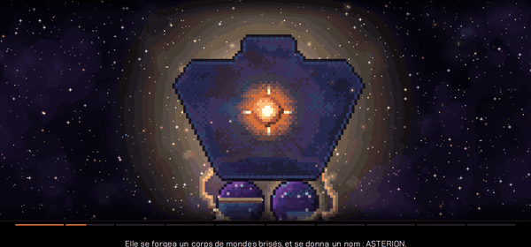
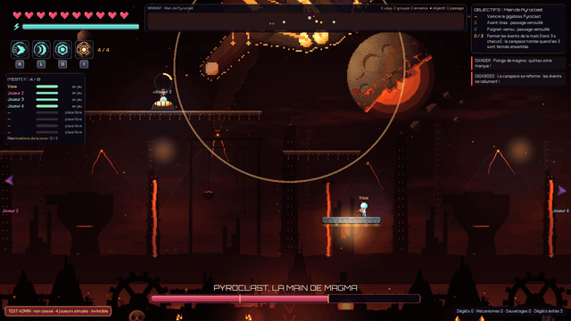
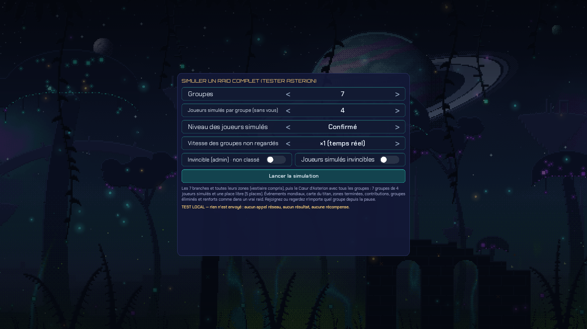
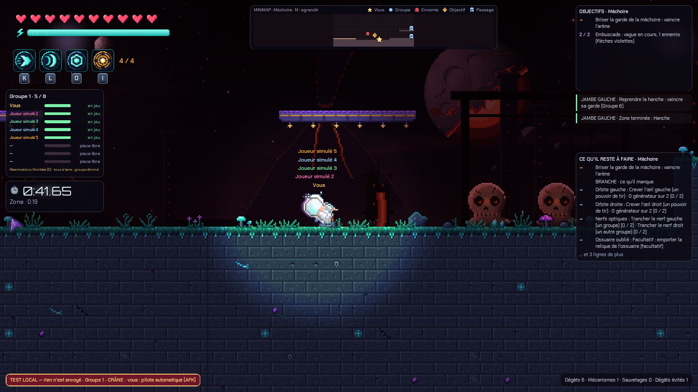

[← Retour à l'accueil (README)](../README.md)

# Raids de clan « ASTERION » — phase 2 : la branche « BRAS DROIT » (2.65) ; phase 4 : le titan entier (2.68, §6) ;
# phase 3 : le gigaboss PYROCLAST (2.68, §7 à §12) ; phase 4B : VOIDWORM, GRAVITON, TITANUS (2.69, §13) ;
# phase 5 : les événements mondiaux (2.69, §14) ; phase 7 : fiabilité, charge et anti-triche (2.74, §15) ;
# phase 6 : le Cœur d'Asterion, combat final (2.74, §17)
# les fiches d'Asterion et des Gigaboss (2.74.1, §18) ; ce qu'il reste à faire, zones terminées, tableaux des zones,
# modération, « Où frapper » (2.75, §19) ;
# réanimations, groupe éliminé, vestiaire et liquides (2.75.1, §20) ;
# notifications et menu du raid : plus aucune carte qui bloque le joueur (2.76.1, §21) ;
# joueurs simulés qui jouent, raid complet en local, âmes et vestiaire en hauteur (2.77, §22) ;
# à terre ou groupe éliminé : deux états clairs, une vue qui ne tremble plus (2.77.2, §23) ;
# statistiques des Gigaboss, fiche du Cœur, groupes du raid simulé (2.77.3, §24) ;
# les raids sont des événements, avis des joueurs (2.77.4, §25) ;
# chacun sa zone, toutes les embuscades avant l'antre, vestiaire de l'antre, tableau des contributions refait (2.78, §26) ;
# la fiche récapitulative d'un raid terminé, dans le clan (2.78.1, §27) ;
# joueurs simulés : terrain et anticipation, leurs mouvements et ce qu'ils pensent (2.79, §28) ;
# joueurs simulés : tactiques, rôles, pensées et ordres (2.79, §29) ;
# tester avec des joueurs invités (2.80, §30) ;
# « Après Asterion », le film du monde d'après regardé ensemble ; ADMINISTRATION › Films (2.81, §31 et §32) ;
# mécanismes qui attendent les embuscades, monte-charge et murs sans escalade (2.81.2, §33) ;
# « Le Balancier » et « Encore un tour », les films de transition, avant-premières du raid 2 (2.82, §34) ;
# aucune embuscade derrière soi (titan 12, §35) ;
# joueurs simulés contre les Gigaboss : mesure sur plusieurs départs, carapaces tenues ensemble (2.84, §36) ;
# titan 13 : décomptes, plateformes, Gigaboss à leur mesure et difficulté réelle (2.84.1, §37)
# titan 15 : Titanus allégé, un peu (§38) ;
# le chat des raids, « Groupe » et « Raid » (2.95, §39) ;
# raid simulé : groupes en attente, remplacements et un seul Cœur pour tous (§40) ;
# sept groupes, un par branche, une paire faite par un même groupe, défaite à 60 min (titan 16, §41)

# phase 5 : les événements mondiaux (2.69, §14) ; les raids tels qu'on les teste et qu'on les joue (2.72, §16)

La phase 1 (événements, inscriptions, groupes de 8, rappels : `server/src/raids.ts`, migration 0141)
prépare le raid. La phase 2 le rend **jouable** sur une première branche du titan, le **Bras droit** :
8 sous-zones, des instances de 8 joueurs au plus en verrouillage par entrées, et un état de la
branche partagé par tous les groupes, que le serveur ne met à jour qu'avec le **consensus** des
joueurs de chaque instance. La phase 3 (2.68) ouvre la Main : le gigaboss **Pyroclast** (§7 à §12).

Deux moments du mini-film d'Asterion (§4).

## 1. La branche (maquette « Branche »)

| Zone | Nom | Ce qu'on y fait | Passages |
|---|---|---|---|
| 1 | Épaule | entrée, **3 points d'apparition** ; reprendre l'arène (2 vagues) | 2, 3 |
| 2 | Biceps de basalte | plateformes qui « respirent » ; abattre le golem gardien | 1, 4, 6 |
| 3 | Veine de magma | terrasses à remonter, **montée de magma** toutes les 34 s (2.72, avant : 60 s) ; générateur ouest ; passage caché vers 5 ; raccourci (porte) vers 6 | 1, 4, 5, 6⇄ |
| 4 | Coude-forge | **deux soufflets, deux groupes** (un chacun) ; montée toutes les 42 s (2.72, avant : 90 s) ; l'Enclume vivante (facultatif) | 2, 3, 7🔒 |
| 5 | Grotte des scories | **zone secrète** ; la relique (facultatif) | 3 |
| 6 | Avant-bras | générateur est ; montée de magma toutes les 38 s (2.72) ; **levier du raccourci** vers la Veine (facultatif) | 2, 3⇄, 8 |
| 7 | Poignet-verrou | ouvert par les **2 générateurs** ; 2.68 : **la longue route** (§11) dont la dernière embuscade ouvre la Main | 4, 8 |
| 8 | Main de Pyroclast | le gigaboss **Pyroclast** (§6) ; objectif `main_pyroclast` | 6, 7 |

* Deux chemins vers le Coude-forge (Biceps / Veine), puis le Poignet-verrou et la Main ; 2.68 : la Main ne s'ouvre
  (aussi par l'Avant-bras) qu'une fois le verrou du Poignet brisé (`objective:poignet_verrou`).
* **Une zone est contrôlée** quand tous ses objectifs non facultatifs sont faits. Les verrous :
  `generators` (les 2 générateurs), `shortcut` (le levier de l'Avant-bras), `objective:<id>`.
* Ennemis du bestiaire existant (acariens de braise, rôdeurs de lave, drones de forge, golem de
  magma, rempart de forge, ailes de cendre, gloops de magma, feux follets).

### Génération (jamais à la main)

`python3 tools/levelgen/raid_bras_droit.py` écrit `data/raids/asterion/bras_droit/zone_1.json …
zone_8.json` (des niveaux ordinaires de Pyralis, avec `metadata.raid`), le catalogue
`branch.json` et **sa copie serveur** `server/src/raidBranches.json`. La sortie est stable (mêmes
octets à chaque exécution) ; `tests/test_raid.cpp` vérifie les deux copies du catalogue et
l'empreinte des zones. `revision` (catalogue) change dès qu'une zone change de jeu : toutes les
instances doivent avoir la même (le `GO` du relais la porte, `hash` = révision).

`metadata.raid` d'une zone : `spawns` (`start` : les points de départ ; `"<zone>"` : l'arrivée depuis
cette zone), `passages` (`to`, `rect` en pixels, `lock`, `door`), `objectives` (`id` du catalogue,
`source` = objet du niveau, `trigger` = l'événement qui l'accomplit : `cleared`, `killed`,
`activate`, `collected`), `magma` (`zone` de dégâts allumée `duration` s toutes les `period` s à
partir de `first`, annoncée `warn` s avant), `gigaboss` (2.68, §7 : l'objet du boss, ses évents en pixels, les
phases de sa carapace, ses points faibles et les nombres de son combat). `revision` vaut 2 depuis la phase 3.

L'**état de la branche** est l'ensemble des objectifs faits : le bit *i* = l'objectif *i* du
catalogue (ordre fixe, on n'ajoute qu'à la fin). Générateurs, raccourci, passages ouverts, zones
atteignables et contrôlées s'en déduisent, de la même façon dans le jeu (`game/raid/RaidBranch`) et
sur le serveur (`raidZones.ts`).

## 2. L'instance : 8 joueurs en verrouillage par entrées

Une instance = un groupe de 8 d'un clan (les groupes de la phase 1) sur la branche. Elle réutilise
**toute la pile de la coopération** (docs/COOP.md) : le même protocole, le même `CoopRoom`
(Durable Object) **en mode raid**, `GameWorld` à N joueurs, `stepTeam`.

* **8 sièges** (`coopnet::kMaxPlayers = 8`, `GameWorld::kMaxTeam = 8`) ; la coopération des niveaux
  EXTRÊME reste à 2 ou 3 (`kMaxCoopPlayers`), avec ses règles et ses empreintes :
  `kCoopSimulationVersion` ne change pas, `kSimulationVersion` et `kRankingGeneration` non plus.
* **N'importe quel siège lance** l'instance (un joueur suffit) ; `GO` annonce toujours 8 joueurs.
* **Siège libre** : drapeau `InputFrame::Vacant` (4), posé par le relais seulement (jamais accepté
  d'un jeu), sur les trames d'un siège que personne ne tient. Le joueur est `Presence::Vacant` :
  hors jeu, invisible, ignoré de tous.
* **Arrivée en cours de partie** : un joueur inscrit prend le premier siège libre ; il reçoit
  l'historique (états de la branche d'abord, puis trames), le rejoue hors du fil principal,
  annonce `CATCHUP_DONE`, et joue à partir du pas `REJOIN` choisi par le relais ; il apparaît près
  de l'allié en jeu le plus proche, tous cœurs, pouvoirs de départ de la zone.
* **Déconnexion** : la règle des 60 s de la coopération (veille, retour à l'identique). Au-delà, le
  siège est **libéré** (trames `Vacant`) : n'importe quel inscrit peut le prendre.
* **Caméra** : chacun suit son propre joueur (affichage seulement). Pas de « cadre d'équipe » en
  raid : personne n'est ramené. Le groupe entier à terre : la zone reprend là où il y est entré
  (objectifs gardés, tous debout, tous cœurs).
* **Changer de zone** (jusqu'à la 2.77 ; **2.78 : chacun change de zone seul**, §26) : le premier joueur en jeu qui **entre** dans un passage ouvert (plus petit
  numéro d'abord) emmène toute l'instance. Chacun garde **ses cœurs, son énergie, ses pouvoirs et
  sa présence** (`GameWorld::carryOf` / `restoreMember`) et apparaît au point de la zone pour
  l'endroit d'où il vient (un joueur à terre revient debout avec la moitié de ses cœurs). Un
  passage où l'on se trouve à l'arrivée ne ramène personne : il faut y entrer.
* **Paires** (les soufflets) : une instance n'en fait qu'un ; l'autre doit venir d'un autre groupe. *Titan 16 (§41) : une
  paire se fait par le même groupe, partagé en deux, les deux moitiés à 3 s près.*

### Message `RAID_STATE` (18, relais → jeu)

`u32 pas`, `u32 objectifs faits` : l'état de la branche **à partir de ce pas**. Le relais le lit en
D1 (toutes les 3 s, et dès qu'un rapport est accepté) et l'envoie au premier pas non encore
diffusé ; tous les jeux de l'instance l'appliquent donc au même pas (portes des passages ouvertes,
alertes). Un jeu qui arrive les reçoit tous avant les trames. L'instance compte aussi tout de
suite ce qu'elle a fait elle-même (`RaidRun::mask()` = branche | instance).

### `raid::RaidRun` (déterministe)

Il n'y lit ni horloge, ni caméra, ni réseau : seulement les trames et l'état donné avec elles.
Objectifs (événements du monde), passages, coulée de magma (pas entiers), reprise de zone,
rapports (`objective`, `zone`) avec le pas et l'empreinte de l'état (`RaidRun::hash`).

## 3. Le consensus (serveur)

`POST /raids/instances/{id}/reports {kind: "objective"|"zone", objective?, zone, tick, hash}` :
chaque jeu rapporte ce qu'il a vu. Un rapport est **accepté** quand la **majorité des joueurs
actifs** de l'instance (`raid_instance_members.active`, écrit par le relais : plus de la moitié,
au moins 1) a envoyé **la même valeur** (`zone:pas:empreinte`). Avant cela :

* **vraisemblance** : le raid est en cours, l'objectif est bien dans cette zone, la zone est
  atteignable avec l'état de la branche, le pas est possible depuis le début de l'instance ;
* un joueur ne rapporte qu'une valeur par clé ; une autre est refusée.

Les rapports minoritaires (un menteur, un jeu désynchronisé) sont **refusés et journalisés**
(`raid_report_rejections`). Un objectif accepté entre dans `raid_branch_objectives` une seule fois
(clé primaire par objectif : deux instances, ou deux acceptations simultanées, le comptent une fois),
sauf le second soufflet d'une même instance (journalisé). *Titan 16 (§41) : les deux moitiés d'une paire comptent
ensemble, acceptées pour la même instance à 360 pas près.* Un rapport de zone accepté place le
groupe sur la carte (`raid_instances.zone`).

### Routes

| Route | Rôle |
|---|---|
| `GET /raids/events/{id}/branch` | la carte : zones (atteignable, contrôlée, objectifs et par quel groupe), passages, générateurs, raccourci, instances (clan, groupe, zone, joueurs, places), la mienne, le journal des derniers objectifs |
| `POST /raids/events/{id}/instance {instance_id?}` | l'instance de mon groupe (créée une fois), ou celle d'un autre groupe que j'aide ; inscrit et raid en cours seulement |
| `GET /raids/instances/{id}/socket` | la WebSocket du relais (inscrit à l'événement) |
| `POST /raids/instances/{id}/reports` | un rapport (ci-dessus) |

Tables (migration **0142_raid_zones.sql**) : `raid_instances`, `raid_instance_members`,
`raid_reports`, `raid_accepted`, `raid_branch_objectives`, `raid_report_rejections`.

## 4. Écrans

La carte d'une branche au début d'un raid de clan (serveur lancé en local, comptes de démonstration).

* **Fiche de l'événement** (en cours) : « Carte du Bras droit ».
* **Fiche de l'événement › inscrits** (2.72, `ui/online/PresenceList`) : chaque inscrit de mon clan porte la
  pastille de présence de SOCIAL (en ligne, absent, hors ligne) dans sa case de groupe, et « INSCRITS DU CLAN »
  annonce « X/Y en ligne » (X : inscrits « en ligne », compté par le serveur ; Y : inscrits de mon clan). Le serveur
  ne l'envoie qu'aux membres du clan qui voient ces inscrits, depuis le signal de présence du jeu (jamais ce que dit un
  client) ; une présence masquée se lit « hors ligne ». Sans compte, hors ligne (fiche du cache) ou d'un autre clan :
  ni pastille ni compteur. Rafraîchie avec la fiche (30 s, fil réseau).
* **Carte de la branche** (maquette « Branche ») : les 8 zones reliées (ouvert, combat en cours,
  verrouillé en pointillés, zone secrète, raccourci), leur état et les groupes présents (le mien en
  or) ; à droite la zone choisie : objectifs (✓, ◆ facultatif, et par quel groupe), ce qu'il y a
  dedans, les groupes présents, « Rejoindre · N places » et « Aider [TAG]·n ». Clavier, manette
  (zones focalisables) et souris ; rafraîchie toutes les 10 s.
* **Combat** (maquette « Combat ») : minimap permanente en haut (vous, le groupe, ennemis,
  objectifs, passages et porte scellée, coulée), panneau du groupe (8 lignes : cœurs, état,
  réanimations de la zone), objectifs de la zone avec leur progression (générateurs 1 / 2,
  soufflets 1 / 2), alertes du groupe, de la branche et du serveur (objectif validé ou refusé),
  bandeau de danger (« Coulée dans 3 s · montez ! »), état du réseau. La pause ne s'arrête pas : le
  groupe continue. 2.72 (§15) : chaque élément se place dans l'onglet « Raids » de l'éditeur de HUD, la minimap
  est en textures et s'agrandit (M / Vue), un chronomètre s'ajoute, les flèches hors écran des niveaux aussi.
* **Mini-film d'Asterion** (2.68, `ui/screens/AsterionFilm`) : avant le premier affichage du titan
  (CLANS › RAIDS, fiche d'un événement, tout `AsterionFigure` : un seul appel `asterionfilm::hold`),
  dix plans d'environ deux minutes joués par le moteur des histoires (`makeFilm`). Le script — légende,
  titres et durée de chaque plan — se modifie à la main dans `data/raids/asterion_film.json` (une durée
  changée étire la scène) ; les scènes (`asterion_film_scenes.json`), les planches du titan en calques et
  les décors sont écrits par `tools/assetgen/environment/story_asterion.py` (`--check`, `--storyboard`),
  la musique par `tools/assetgen/audio` (`asterion_film`). Première projection impossible à passer ;
  « vu » (`asterionFilmSeen` de la progression, uni par `ProgressMerge`) écrit seulement à la fin ;
  « Revoir la cinématique » sur la carte de l'événement (celle-là se quitte). Contenu local, hors ligne.

## 5. Limites de la phase 2

* (2.68 : la Main est ouverte, voir §7.)
* Les replays d'une instance ne sont pas encore conservés côté serveur (le relais garde les trames
  en mémoire, comme la coopération ; 2.74 : et dans le stockage de son objet durable tant que dure la
  partie, pour la retrouver après un redémarrage, §15).
* Les soufflets demandent deux groupes, sans la contrainte « à 3 s près » de la maquette : deux
  instances ne partagent pas d'horloge commune assez précise. *Titan 16 (§41) : un même groupe les fait, partagé en
  deux, à 3 s près (une seule instance, une seule horloge).*
* Le chat de groupe (« GROUPE · Lyra : … » de la maquette) n'est pas dans cette phase : les
  alertes viennent du jeu et du serveur seulement.

## 6. Phase 4 (2.68) : le titan entier — sept branches, carte globale, liens, répartition

### Les sept branches (`tools/levelgen/raid_asterion.py`)

Six branches de plus, écrites par `python3 tools/levelgen/raid_asterion.py` (sortie stable, jamais à
la main ; `--en fichier.json` donne l'anglais de chaque texte pour `tools/i18n/extract.py --merge`) :
`data/raids/asterion/<branche>/zone_1.json … zone_8.json` et `branch.json`, le catalogue du titan
`data/raids/asterion/titan.json` et **sa copie serveur** `server/src/raidTitan.json` (titan + les six
catalogues ; le Bras droit reste à `raid_bras_droit.py` et `raidBranches.json`, lus seulement).

| Branche | Gigaboss | Monde | Traversée | Danger périodique | Deux groupes | Verrou de la zone 7 |
|---|---|---|---|---|---|---|
| Crâne | Skullmaw | Confins (os, obsidienne) | vertèbres flottantes, regards lasers | onde psychique | 2 nerfs optiques | les deux yeux |
| Bras gauche | Dreadfang | Glacior | glace qui cède, tourelles | balayage des griffes | 2 lames | 2 cœurs de givre |
| Torse | Heartbreaker | Noyau | côtes mouvantes, barrières d'énergie | pulsation du cœur | 2 × 2 plaques | les 4 plaques |
| Abdomen | Voidworm | Sylvanox (racines, acide) | parois qui respirent | reflux d'acide | 2 valves | 2 glandes |
| Jambe gauche | Graviton | Aethra (ruines flottantes) | puits d'apesanteur, îlots mouvants | puits de gravité | 2 rotules | 2 générateurs de gravité |
| Jambe droite | Titanus | Pyralis (forge, lave) | pistons géants | onde sismique | 2 pistons | 2 réacteurs |

Chaque branche : entrée à 3 points d'apparition et son arène, deux chemins, une **zone secrète** (5) et
sa relique, un **raccourci** ouvert au levier, une **zone à deux groupes** (une paire d'objectifs), un
verrou `generators` sur plusieurs zones (textes propres dans `lock_texts` du catalogue), l'arène de
la zone 7 qui ouvre l'antre (8), dont la **porte reste scellée** (« <Gigaboss> — prochaine version » ;
les six combats viennent ensuite). Les dangers réutilisent `metadata.raid.magma` avec `name`, `hint`,
`message` (le Bras droit garde ses textes par défaut).

### L'expédition avant l'antre (zone 7) et l'arène du gigaboss (zone 8)

La zone 7 de chaque nouvelle branche est **une longue expédition pour 8 joueurs** (≈ 15 min même à 8) :
trois étages (galeries basses avec les traversées et le danger de la branche, étage du milieu, étage
haut ; des puits de corniches les relient à chaque secteur) pour que 8 joueurs ne s'entassent pas ;
**deux écluses** (un mur sur les trois étages, une porte à chaque étage : elles s'ouvrent ensemble quand
3 joueurs se tiennent sur la plaque) et **un monte-charge** (il démarre avec 4 joueurs dessus, puis fait
la navette seul) — `metadata.raid.coop` (`rect`, `players`, `targets`, `action`), moins de joueurs
demandés quand moins sont en jeu (jamais de blocage à 1 ou 2) ; **points de contrôle** à chaque étage
(`metadata.raid.checkpoints`, arrivée `spawns["cp:<id>"]`) : le groupe entier à terre reprend au dernier
atteint, et chaque nouveau point relève les joueurs à terre ; **quatre embuscades géantes** (une zone de
combat sur les trois étages, quatre vagues, des ennemis à chaque étage : le système d'embuscade, état
gardé à la chute, compteur, flèches hors écran) — la dernière, la garde de l'antre, est l'objectif qui
ouvre la porte de la zone 8. Tout se joue dans `raid::RaidRun` (plaques, points de contrôle : au même
pas sur tous les jeux, dans l'empreinte).

**Durée estimée** (`estimate_minutes` du générateur, champ `minutes` de chaque zone du catalogue) : la
largeur à 2 tuiles/s, les PV des ennemis à 4 PV/s pour 8 joueurs, 8 s par vague, 30 s par mécanisme à
plusieurs (plus le trajet du monte-charge). Avec un joueur (1,5 PV/s), le modèle retrouve les temps de
référence de la campagne à ±40 % (`calibrate()`). Le générateur exige 13 à 17 min pour l'expédition et
18 à 35 min pour toute la branche hors gigaboss (un raid standard de 45 à 60 min avec le combat et les
attentes des autres groupes) ; `tests/test_raid_titan.cpp` le revérifie.

La zone 8 : une antichambre, la porte scellée, puis **l'arène du gigaboss**, immense pour 8 joueurs
attaqués à la fois (200 tuiles de large, plus de deux écrans ; cinq étages de plateformes ; deux piliers),
ses bornes déclarées dans `metadata.raid.arena` (`rect`, `floor`, `door`, `entry`, en pixels) pour les
combats à venir.

### Les liens entre branches (spec §7)

`titan.json` → `links` : `from` (objectifs d'autres branches, tous requis), `to` (la branche cible),
`bit` (24 et plus : un bit de **l'état de la branche cible**, sous lequel restent ses objectifs), `kind`,
`zones`, `objects` :

| `kind` | Effet dans la simulation (`raid::RaidRun::applyEffect`) |
|---|---|
| `open` | les passages verrouillés `link:<id>` s'ouvrent (portes comprises) |
| `disable` | les objets des zones (lasers, tourelles, barrières) sont éteints |
| `remove` | les ennemis des zones (leurs objets d'apparition) disparaissent |
| `hazard_off` | le danger périodique des zones s'arrête |

Onze liens : les yeux du Crâne → tourelles du Bras gauche ; ses nerfs → onde sismique de la Jambe
droite ; les générateurs de la Jambe gauche → barrières du Torse ; le nid de l'Abdomen → parasites
du Torse ; les plaques du Torse → passage Intestin ⇄ Gosier de l'Abdomen ; la cheville gauche →
passage Crevasse ⇄ Poignet du Bras gauche ; les réacteurs de la Jambe droite → coulées du Bras droit ;
le poignet du Bras droit → passage Tempe ⇄ Voûte du Crâne ; la cheville de Titanus → passage Tibia ⇄
Cheville de la Jambe gauche ; les valves de l'Abdomen → puits de gravité de la Jambe gauche ; les lames
de Dreadfang → spectres en renfort du Crâne.

Le serveur calcule l'état d'une branche (`raidMap.stateMaskOf` : ses objectifs acceptés + les liens
dont toutes les sources sont acceptées) ; `raidZones.branchMaskOf` (lu par le relais toutes les 3 s et
à chaque objectif accepté, **toutes branches confondues**) le donne aux jeux par `RAID_STATE` : chaque
jeu de l'instance applique le lien **au même pas** (et de nouveau à chaque chargement de zone), avec
une alerte « TITAN · … ». Rien ne vient d'un jeu ni de l'interface. Le hash du `GO` devient
`<révision de la branche>.<révision du titan>`.

### Progression collective

Le consensus de la phase 2 (`POST /raids/instances/{id}/reports`) vaut pour les sept branches : le
catalogue de la branche de l'instance, sa joignabilité avec les liens, l'objectif compté une fois par
événement, le menteur minoritaire journalisé, l'égalité refusée.

### Répartition des joueurs (spec §8, migration **0144**)

`raid_placements` (une place par joueur et événement : instance, branche, par qui, pourquoi) et
`raid_placement_log` (chaque changement). **8 joueurs au plus par instance** : une seule instruction
conditionnelle place un joueur (deux placements simultanés ne font jamais un neuvième) ; une instance
s'ouvre seulement quand toutes celles du clan sur la branche sont pleines. *Titan 16 (§41) : remplacé : toujours sept
groupes par clan, un par branche, de 2 à 8 joueurs ; ni autre branche, ni autre groupe, ni nouvelle instance.*

| Route | Rôle |
|---|---|
| `GET /raids/events/{id}/titan` | la carte globale : branches (état, zones contrôlées, objectifs, groupes, joueurs), `body` (état de chaque partie pour la figure), liens, renforts demandés, clans par objectifs, alertes, ma place |
| `GET /raids/events/{id}/branches/{partie}` | la carte d'une branche (comme `/branch`, pour les sept) avec ses liens reçus et donnés |
| `POST /raids/events/{id}/branches/{partie}/join {instance_id?}` | ma place sur cette branche (groupe de ma liste d'abord, puis les groupes en combat qui ont de la place, puis une nouvelle instance) ; avec `instance_id` : aider ce groupe s'il a de la place |
| `POST /raids/events/{id}/join` | ma place, ou là où le clan a besoin de moi (un groupe en combat qui n'est pas plein, sinon la branche où le clan a le moins de joueurs) |
| `GET /raids/events/{id}/placements` | les joueurs de mon clan et leur place, les groupes, `can_manage` |
| `POST /raids/events/{id}/placements {player_id, branch, instance_id?}` | le chef, un officier ou le chef de raid déplace un membre |
| `POST /raids/events/{id}/placements/rebalance {branch}` | répartit les joueurs d'une branche sur le moins de groupes possible, à parts égales (ceux qui ne jouent pas bougent d'abord) |

Un joueur en combat garde sa partie : sa nouvelle place compte à sa prochaine entrée.

### Écrans

La carte du titan au début d'un raid de clan (serveur lancé en local, comptes de démonstration).

* **Carte du titan** (fiche d'un raid en cours › « Carte du titan ») : le titan (`AsterionFigure`, une
  partie = sa branche), les groupes par branche, la progression, les effets, les renforts, les alertes,
  « Rejoindre » et « Répartition du clan ». Les sept branches sont aussi des arrêts du focus.
* **Carte d'une branche** (`RaidBranchScene`, pour les sept) : les passages ouverts par une autre
  branche (✦), la section « Liens avec le reste du titan ».
* **Répartition du clan** (`RaidRosterScene`) : membres, groupes, « Déplacer vers », « Équilibrer ».
* **Combat** : les verrous et dangers de chaque branche, les liens actifs de la zone (✦).

## 7. Phase 3 (2.68) : le gigaboss PYROCLAST

Filmé dans le test des administrateurs (en local, jamais classé), les autres joueurs pilotés par des scripts.

`data/enemies/pyroclast.json` : une main de magma qui marche sur ses doigts (le cerveau du golem : poing météore =
`skyfall`, secousse = `quake`), trois phases et une dernière éruption ; les **Poings de magma** (un par joueur en
jeu) s'y ajoutent à chaque phase :

| Phase | Seuil | Attaques | L'arène (événements `bossPhase` de la zone) |
|---|---|---|---|
| 1 « Poing de magma » | 100 % | coup de poing, pluie de magma, éruption, bombes de lave, secousse | — |
| 2 « Carapace de basalte » | 66 % | poing météore, secousse, pluie, éruption | la croûte des fosses sous les tours cède au magma, soins |
| 3 « Cœur de magma » | 33 % | marée de magma, double poing météore, secousse, éruption folle, pluie, poing | rideaux de lave aux deux murs, soins |

Le sprite (trois feuilles, une par phase : plaques nues, carapace et évents, cœur à nu), son point faible et ses
évents sont générés par `tools/assetgen/characters/boss_k_pyroclast.py` (`--check` : mêmes octets, testé ;
`--review` : planche contact).

`game/raid/Gigaboss` mène les règles du raid autour de lui, pas à pas, dans la simulation (le même sur chaque
ordinateur) :

* **Un géant pour 8** : 2,5 fois la taille du sprite (une boîte de 220 × 300 px), une arène de 183 tuiles (plus de
  six écrans de large), deux tours de corniches au-dessus de fosses, deux monte-charges vers une plateforme haute
  au-dessus de sa tête : ses trois évents sont sur les deux tours et la plateforme (le groupe doit se séparer).
* **Poings de magma** (toutes les phases, toutes les 9 / 7 / 5,5 s ÷ sa pression) : une marque sous **chaque joueur
  en jeu**, le même pas (8 joueurs : 8 poings), puis un poing de magma tombe sur chaque marque 1,4 s plus tard.
  Avec la pluie de magma, les éruptions, la marée de magma (seules les corniches restent sûres) et les poings
  météores, il attaque tout le groupe à la fois.
* **Mise à l'échelle** : sa vie × (1 + 0,55 × (sièges occupés − 1)) (titan 13 : puis × `hpScale` et la difficulté, §37) au début du combat (2 à 8 joueurs), et encore
  quand un joueur prend un siège pendant le combat (jamais à la baisse) ; ses temps de recharge ÷ (1 + 0,06 ×
  (joueurs en jeu − 1)).
* **Carapace** (phase 2) : rien ne le blesse (`Enemy::setRaidGuard`) tant qu'un de ses **3 évents** est ouvert. Un
  joueur debout 3 s sur un évent le ferme (chaque joueur dessus compte un « évent fermé ») ; un évent fermé se
  rallume au bout de 15 s (× 1,35 à deux joueurs, × 2 seul) : il faut les tenir **ensemble**. Chaque évent ouvert
  crache un jet de magma toutes les 6 s, à tour de rôle (annoncé 1,2 s avant) : une zone de danger.
* **Cœur à nu** : les trois fermés, la carapace éclate 10 s (dégâts × 2) et ses **3 points faibles**
  (`pyroclast_noyau`, collés à ses jointures) peuvent être brisés : chacun lui ôte 4 % de sa vie et compte pour qui
  l'a brisé. Puis les évents se rallument.
* **Sauvetages** : relever un allié à terre (la règle de la coopération, 2 par zone) compte pour qui était près de
  son âme.
* **Sa chute** : tous les joueurs en jeu sont « présents à la chute ». Un groupe entier à terre : la zone reprend, le
  boss aussi. Une Main dont l'objectif est déjà validé (un autre groupe l'a vaincu) est éteinte.

## 8. Contributions et consensus (`game/raid/Contributions`, `raidZones.ts`)

Calculées dans la simulation (l'écouteur du monde : les attaques de chaque joueur sont étiquetées), un
enregistrement par joueur ayant tenu un siège (`seat`, `from` = le pas où il l'a pris) : dégâts (dixièmes de vie),
dégâts au gigaboss, dégâts évités (ses coups visant ce joueur et esquivés, les coups arrêtés par son bouclier),
blocages, sauvetages, évents, points faibles, objectifs (une action d'un joueur : la sienne ; un combat gagné : celle
de tous les joueurs en jeu), pas en jeu, présence à la chute. L'empreinte de `RaidRun` les contient.

Deux rapports de plus, par le même consensus (majorité stricte des joueurs actifs, minorité journalisée, égalité
jamais acceptée) :

* `{kind: "boss", phase}` (1 le combat commence, 2 et 3 ses phases, 4 sa chute) → `raid_gigaboss_fights` ;
* `{kind: "result", records: [...]}` à chaque jalon (objectif, phase) → `raid_contributions` (une ligne par
  `seat`/`from`, attribuée au membre qui tenait ce siège depuis ce pas : `raid_instance_members.seat_from`, écrit
  par le relais ; le tableau le plus récent garde ses lignes). Avant toute majorité, les tableaux impossibles sont
  refusés (temps au-delà du pas, plus d'évents qu'un toutes les 3 s, plus de sauvetages qu'un toutes les 2 s…).

La valeur comparée est le texte canonique du tableau, reconstruit par le serveur à partir des nombres.

## 9. Corps d'Asterion, résultats et récompenses (`raidRewards.ts`)

* **Corps** (`body` de chaque événement, état validé seulement) : bras droit « attaque » dès qu'il y a une progression
  validée, « affaibli » quand un combat a atteint sa phase 2, « detruit » quand `main_pyroclast` est accepté ;
  `effects` : « Plus de pluies de lave » (seulement noté et affiché dans cette phase).
* **Résultats** `GET /raids/events/{id}/results` : clans (somme des scores), joueurs par catégorie, combats contre
  Pyroclast, mon dernier tableau « en attente de validation » s'il attend sa majorité ; « Classement final » une fois
  l'événement terminé. Le **score de contribution** mélange tout, chaque part plafonnée : dégâts 500, évités 300,
  soutien 400, progression (évents, points faibles, objectifs, chute) 1 880, présence 600.
* **Récompenses** (`raid_reward_grants`, clé unique joueur + récompense + événement) accordées par le serveur à
  partir des résultats validés : badge « Main de Pyroclast » (présent à une chute validée : le succès
  `communaute_pyroclast`, que le serveur n'accepte qu'une fois la récompense récupérée), titre « Assaillant
  d'Asterion » (5 min), « Briseur de magma » (score ≥ 1 500), « Fléau de Pyroclast » (3 meilleurs scores, à la fin
  de l'événement). `POST /raids/rewards/claim {id?}` est idempotent ; les titres vont dans `player_won_rewards`
  (`raid:<événement>`) : profil et vestiaire.

Migration **0143_raid_gigaboss.sql** : `raid_instance_members.seat_from`, `raid_contributions`,
`raid_gigaboss_fights`, `raid_reward_grants`.

## 10. Écrans (2.68) et test des administrateurs

* **Combat** : les évents dessinés sur l'arène (fermé, ouvert, annoncé, jet ; la tenue en anneau), la carapace,
  les objectifs du gigaboss (évents k / 3, cœur à nu et ses points faibles, allié à relever), mes contributions en
  bas à droite, la carte de sa chute (« Résultats du raid »).
* **Résultats du raid** (maquette « Résultats ») : depuis la fiche de l'événement et à la chute de Pyroclast.
* **CLANS › RAIDS** : « Récompenses à récupérer » avec « Récupérer ».
* **ADMINISTRATION › Raids, générique (2.83)** : tout ce que l'écran dit d'un raid vient du **catalogue des raids**
  (`game/raid/RaidCatalog`, objet `catalog` de chaque `data/raids/<raid>.json` : titre, nom, sous-titre, accroche, icône et
  affiche — des découpes d'images existantes —, formats et leurs minutes, plage de difficulté, cœur, fiche) ; ses compteurs
  (parties, gigaboss, cœur) sont ceux de ses `parts`. La liste « Raid » montre chaque raid du catalogue avec son icône,
  l'affiche du raid choisi suit (« Fiche du raid › » ouvre sa fiche), les plaques « Format » et la difficulté sont les
  siennes ; « Tester le raid » porte son icône, chaque événement l'icône et « Raid — Format » de son raid. Aucun nom de
  raid dans le code de l'écran (`tests/test_admin_raids.cpp`). Un raid s'ajoute par ses données.
* **ADMINISTRATION › Raids › « Tester le raid »** (administrateurs) : une branche du catalogue
  (`raid::Branch::all`, les branches ajoutées plus tard y apparaissent seules), une zone (le combat de Pyroclast par
  défaut), « Invincible (admin) · non classé », 2 à 8 joueurs simulés, phase de départ ; seul et en local
  (`RaidRun::setTest`) : aucun rapport n'est jamais produit, et le serveur refuse tout rapport marqué `test`.
  2.72 (§15) : il se joue comme une vraie instance (`raid::TestSession`) : l'état de la branche suit d'une zone à
  l'autre, et les joueurs simulés sont visibles et jouent vraiment (IA déterministe). 2.68.2 : la pause ne fige
  jamais le monde, test compris (seul le joueur cesse d'agir).

## 11. La longue route du Poignet-verrou (2.68)

La zone 7 est un vrai niveau d'environ **15 minutes pour 8 joueurs** : des galeries à deux voies (sol et grilles) pour
que huit joueurs ne s'empilent pas, **quatre embuscades géantes sur plusieurs étages** (la Tour des tendons, la
Galerie des forges, la Fosse des scories, la Garde du verrou : des vagues sur chaque étage, les portes fermées
pendant le combat ; l'état, le compteur et les flèches violettes des embuscades du jeu), des **mécanismes de groupe**
(`metadata.raid.coop`, le format des six autres expéditions : la vanne double, 4 joueurs sur sa plaque ; le
monte-charge, 3 joueurs dessus ; les plaques jumelles, deux plaques d'un même `group` tenues au même pas, les joueurs
en jeu partagés entre elles, seul la première suffit ; chaque joueur sur une plaque compte un « mécanisme »),
des **points de contrôle** (le groupe entier à terre reprend au dernier atteint) et des réanimations.

L'estimation est celle des sept branches (`estimate_minutes` de `tools/levelgen/raid_asterion.py`, appelée par
`raid_bras_droit.py`, champ `minutes` du catalogue, recalculée par `tests/test_raid.cpp` depuis le niveau lui-même) :
**≈ 15,4 min** à 8 (13 à 17 exigés ; quatre embuscades de 4, 4, 4 et 5 vagues). Les autres zones restent courtes
(la branche entière ≈ 22 min sans le gigaboss : un raid standard de 45 à 60 min avec son combat et les attentes).

## 12. La caméra des arènes de gigaboss (`game/raid/ArenaCamera`, affichage seulement)

En entrant dans l'arène : un plan de **l'arène entière** et du boss (4 s), puis une vue qui suit le joueur de cet
ordinateur avec un zoom entre 300 et 620 px de monde en hauteur : assez large pour les marques qui le menacent, le
boss quand il est proche et les alliés voisins, jamais au point de rendre l'action minuscule. Des flèches au bord de
l'écran (hors du HUD mesuré) montrent le boss (ses points faibles quand il est à nu), les alliés (leurs couleurs) et
les ennemis d'une embuscade. Elle sert à toutes les arènes de gigaboss : elle lit `metadata.raid.arena` (`rect`,
`floor`, `door`, `entry`), le format des sept antres (`raid::ZoneRules::arena`). La simulation ne la voit jamais.

## 13. Phase 4B (2.69) : VOIDWORM, GRAVITON, TITANUS

Graviton inverse la gravité d'un secteur. Filmé dans le test des administrateurs (en local, jamais classé), les autres joueurs pilotés par des scripts.

Les antres de l'ABDOMEN, de la JAMBE GAUCHE et de la JAMBE DROITE sont descellées (zone 8 de chaque branche, écrite par
`tools/levelgen/raid_voidworm.py`, `raid_graviton.py`, `raid_titanus.py`, appelés par `raid_asterion.py` ; `BRANCH_REVISION` 2).
Chaque catalogue gagne, à la fin, l'objectif de son gigaboss (rôle `gigaboss` : `abd_voidworm`, `jg_graviton`, `jd_titanus`) :
le serveur accepte alors ses rapports `boss` et détruit la partie du titan à sa chute, comme pour Pyroclast.

`metadata.raid.gigaboss` garde le format de Pyroclast (§7 : vie et pression selon les sièges, marques sous chaque joueur
`fists`, évents `vents`, carapace `carapace`, points faibles) et ajoute `routine`, les textes (`fallText`, `goneText`,
`summary`), la planche des effets (`fx`) et `links` (des objectifs de la branche, lus dans son état au même pas). La routine
(`game/raid/GigabossRoutine`, un fichier par gigaboss) mène le reste du combat dans la simulation, après les marques ; son
état entre dans l'empreinte du gigaboss ; ce qu'elle montre (zones, plaques, marques, ondes, lignes des objectifs) est
seulement affiché par l'écran de combat.

| Gigaboss | Phases | Sur chaque joueur | Mécanisme collectif (phases) | Liens de la phase 4A |
|---|---|---|---|---|
| Voidworm (ver du vide, au milieu de l'arène) | « Le ventre affamé », « Les anneaux de chitine », « Le reflux » | Fouissement (une gueule sort du sol sur la marque) ; sa gueule vise 1 joueur (2 à partir de 6) d'un anneau vert qui suit puis se fige : qui y reste est **avalé** | 3 crochets (deux au sol, un sur la couronne au-dessus de lui) tenus ensemble 3 s : épinglé, sa gueule s'ouvre 10 s (phase 2) | nid détruit : deux fois moins de parasites ; les deux valves fermées : l'acide monte moins haut |
| Graviton (jambe qui flotte) | « Le champ de gravité », « Les générateurs », « Le monde à l'envers » | Chute de débris ; un puits de gravité sous chacun (phases 2 et 3) | 4 générateurs (deux au sol aux deux bouts, deux sur des îlots en hauteur) : un joueur sur chacun **au même instant**, 2,5 s ensemble ; elle s'effondre au sol 12 s (phases 2 et 3) | générateurs de la jambe coupés : un générateur de moins |
| Titanus (jambe de forge) | « Le pas du colosse », « Les entraves », « La forge à nu » | Écrasement (son talon) ; rochers de la voûte (phases 2 et 3) | 2 entraves de cheville brisées à moins de 1,5 s d'écart (seule, une entrave se reforge) : à genou 11 s (phases 2 et 3) | réacteurs coupés : fenêtre × 1,5 |

* **Voidworm** : un avalé est gardé dans sa poche (une pièce fermée sous le sol, des sucs toutes les 3 s), libéré quand la
  poche qui pousse sur son cou est crevée (un **sauvetage** pour qui la brise) ou recraché au bout de 12 s ; jamais le dernier
  joueur dehors. Ses parasites sortent de quatre trous (1 + joueurs / 2 par vague). À sa 3e phase, une marée d'acide couvre
  toute l'arène toutes les 22 s (annoncée 3 s avant).
* **Graviton** : l'arène en quatre secteurs ; un secteur annoncé (2 s) voit sa gravité s'inverser (4,5 à 6 s) : les joueurs
  montent vers la voûte, dont le champ blesse, sauf sous une des deux dalles du secteur. Un secteur, puis deux, puis la moitié
  de l'arène à sa 3e phase.
* **Titanus** : ses ondes de choc partent de ses pieds vers les deux murs, le long du sol (40 px de haut : à sauter), par deux
  à sa 3e phase ; sa 2e phase fend le sol au-dessus de la forge (dalles qui cèdent, lave).
* Contributions : chaque joueur sur un crochet ou un générateur quand il cède, chaque briseur d'entrave quand elles cèdent
  ensemble, compte un « mécanisme » (jamais plus d'un toutes les 3 s) ; les points faibles (3 par exposition) comme pour Pyroclast.
* Mise à l'échelle : vie × (1 + 0,55 × (sièges − 1)), points faibles, poche et entraves × (1 + 0,25 × (sièges − 1)), temps ÷
  la pression ; moins de joueurs : plus de temps (× 1,35 à deux, × 2 seul) et moins de générateurs à tenir (un par joueur).
* **Récompenses** (`raidRewards.ts`, sans migration) : un badge par gigaboss (`GIGABOSS_BADGES` : `voidworm_badge`,
  `graviton_badge`, `titanus_badge`, succès `communaute_voidworm`…), accordé une fois à qui était présent à sa chute validée
  (`raid_gigaboss_fights.boss`) ; « Fléau de Pyroclast » reste réservé à la chute de Pyroclast. Corps : chaque partie
  combattue « affaiblie » puis « détruite » ; résultats : `gigaboss.defeated_bosses`, `fights[].boss`.
* Sprites (trois phases chacun, cibles, effets) : `tools/assetgen/characters/boss_m_voidworm.py`, `boss_m_graviton.py`,
  `boss_m_titanus.py` (`--check`, `--review`), aux couleurs de leur partie dans `asterion_sprites.png`.
* Tests : `tests/test_raid_gigaboss_b.cpp` (générateurs, taille, vie de 2 à 8, même empreinte à 2 et 8 joueurs et par le relais,
  marques sur chaque joueur, crochets, avalement, acide, parasites, générateurs, inversion, entraves, ondes, chute et test admin
  jamais envoyé), `server/test/raidGigabossB.test.ts` (chute, badge accordé une fois, partie détruite, résultats).

### 13 bis. SKULLMAW, DREADFANG et HEARTBREAKER (2.69)

Les antres du Crâne, du Bras gauche et du Torse sont ouverts eux aussi : `tools/levelgen/raid_skullmaw.py` (la coque
commune `shell()` de ces trois antres), `raid_dreadfang.py`, `raid_heartbreaker.py`, appelés par `raid_asterion.py`
(révision de branche 3) ; leurs objectifs de rôle `gigaboss` : `crane_skullmaw`, `bg_dreadfang`, `torse_heartbreaker`.
Leurs routines (`game/raid/SkullmawRoutine`, `DreadfangRoutine`, `HeartbreakerRoutine`) suivent le cadre de
`GigabossRoutine` : armure = étape « carapace » de `raid::Gigaboss`, exposition et points faibles du cadre
(`expose` / `exposedStep`, un ennemi par point quand `weakSpots` en nomme un : les yeux et le cristal de Skullmaw),
plaques tenues par `holdPlates` (les chaînes, les côtes), marques sous chaque joueur par les poings du cadre
(`fists`, `rise` : tirées du sol), affichage par `BossMark` (deux genres de plus : `Beam`, un regard ou une chaîne ;
`Cone`, la lumière de l'œil qui révèle les plateformes dans les ténèbres).

 

| Gigaboss | Phases | Sur chaque joueur | Mécanisme collectif | Points faibles |
|---|---|---|---|---|
| **Skullmaw** (300 × 300 px, volant) | « Le regard qui traque », « Le voile psychique » (66 %), « Les ténèbres » (33 %, arène sombre) | **Regards traqueurs** : un laser par joueur, qui suit 1,5 s, se fige 0,45 s puis tire jusqu'au premier mur | **Voile** (phases 2-3, son armure) : son **Regard de mort** se charge 3,5 s puis frappe ceux qu'il voit (une colonne les cache) ; assez de **miroirs** tenus à cet instant (1 seul, 2 de 2 à 4 joueurs, 3 à 5-6, 4 à 7-8) : aveuglé 10 s, dégâts × 2 | ses deux yeux et le cristal du front |
| **Dreadfang** (320 × 240 px, volant) | « Les griffes », « Le bras enchaîné » (66 %), « Griffes déchaînées » (33 %, plateformes tranchées) | **Griffes du sol** ; **balayages** d'un, deux puis trois étages entiers (sauter la lame ou changer d'étage) | **Trois chaînes** (phase 2) : 2,5 s sur une ancre la verrouille 12 s ; les trois ensemble : plaqué au sol 10 s, dégâts × 2. **Griffe clouante** (phases 2-3, dès 2 joueurs) : un joueur (deux dès 5) cloué jusqu'à ce qu'un autre brise la griffe (un sauvetage) ; épargné par les griffes du sol pendant ce temps | ses trois jointures |
| **Heartbreaker** (340 × 320 px, immobile) | « La cuirasse », « La cage thoracique » (66 %), « Le cœur affolé » (33 %) | **Côtes-pièges** ; **battements** en rythme (un fort sur 4, 3 puis 2) dont l'onde court au sol | **Quatre plaques** (phase 1, les plaques de la branche reformées) : à briser dans les 20 s après la première (× 1,2 à 2 avec peu de joueurs), sinon elles repoussent ; **côtes à écarter** (phase 2) : un joueur sur chaque côte, ensemble (2,5 s, une côte lâchée se referme en 4 s) → cœur à nu 8 s, dégâts × 2,5 | ses plaques, puis la lumière du cœur |

* Badges `skullmaw_badge`, `dreadfang_badge`, `heartbreaker_badge` (succès `communaute_*`) dans `GIGABOSS_BADGES`, parties
  `crane`, `bras_gauche`, `torse` détruites à la chute validée (`GIGABOSS_OBJECTIVES`, `PART_EFFECTS`), sans migration.
* Contributions : une marque, un regard ou un flash évités comptent en dégâts évités (`Contributions::dodged`) ; un point
  faible ou une cible surveillée brisés comptent pour qui les a brisés (la liste des brisures survit au pas : correctif).
* `GigabossRoutine::spared(seat)` : un joueur tenu par la routine (avalé par Voidworm, cloué par Dreadfang) ne reçoit
  aucune marque des poings du cadre (correctif : l'avalé était frappé dans l'estomac). `targets()` : les flèches montrent
  aussi les plaques, les griffes clouantes et la poche de Voidworm.
* `exposedStep` rend l'étape « combat » à la fin d'une exposition (correctif : `setArmour` ne passe que de « combat » à
  « carapace », le gigaboss restait exposé pour de bon au lieu de reformer sa carapace, ses chaînes, ses côtes ou son voile).
* Sprites : `tools/assetgen/characters/boss_l_skullmaw.py`, `boss_l_dreadfang.py`, `boss_l_heartbreaker.py` (aides de
  dessin `boss_l_gigaboss.py` sur `gigaboss_kit.py`) ; feuilles d'effets 48 × 144 (`closed` / `open` / `warn` / `jet` des
  ancres et des côtes, `fist`, `blade`, `wave`, les miroirs).

## 14. Phase 5 (2.69) : les événements mondiaux (`server/src/raidWorld.ts`, migration **0147**)

Un événement mondial (`kind = 'world'`, programmé dans ADMINISTRATION › Raids) est **partagé par tous les clans
inscrits** : mêmes heures UTC (début, verrouillage des inscriptions, fin ; chaque jeu les montre à son heure), et un
**seul titan** : toutes les instances de tous les clans agissent sur le même `raid_branch_objectives` (un objectif compte
une fois pour le monde, au premier groupe qui l'a validé). Le reste est par clan, calculé par le serveur.

### Agrégation (validé seulement, idempotente)

`aggregate(db, event)` recalcule tout à partir de tables à clé, seulement ce que le consensus de chaque instance a
accepté (§3, §8) :

| Niveau | Ce qui compte |
|---|---|
| Monde | objectifs validés (bits du titan), zones contrôlées, gigaboss vaincus, **progression mondiale** = objectifs non facultatifs faits / total, **résultat** : « Asterion est tombé » (7 gigaboss vaincus) ou « a survécu » |
| Clan | points (somme des scores mixtes de ses joueurs, §9), joueurs validés / inscrits, groupes, objectifs validés par ses groupes (une fois par clan ; le second objectif d'une paire refusé au même groupe exclu), dont **en premier**, chutes de gigaboss |
| Groupe (instance) | points de ses tableaux, joueurs, objectifs validés, phase atteinte contre son gigaboss |
| Joueur | chaque catégorie (contribution, dégâts, évités, soutien, objectifs, temps, sauvetages, progression) : jamais les seuls dégâts |

Les mêmes rapports, acceptés dans n'importe quel ordre et autant de fois qu'on veut, donnent le même agrégat : objectif
par sa clé, tableau de contributions par `(instance, siège, pas)` remplacé seulement par un plus récent, combat par
instance. Deux instances qui valident le même objectif au même instant : compté une fois, et le doublon est **journalisé**
(`raid_world_journal`, « … à 40 ms d'écart : compté une fois »). Ce qui attend sa majorité (`pendingOf` : tableaux plus
récents que le dernier accepté, objectifs pas encore validés) est rendu **à part**, jamais dans un classement.

### Classements mondiaux — `GET /raids/events/{id}/world`

Monde (et chaque branche), résultat, tous les clans (100 premiers + le mien), groupes (60 + le mien), joueurs (100 + moi),
`pending`, mes rangs, les titres de mon clan, mes récompenses de l'événement. Avant la clôture : « Classement en cours » ;
après : le **résultat officiel figé** (« Résultat officiel · figé le … »). Écran `RaidWorldScene` (« Classement mondial »,
fiche d'un événement mondial) : progression, résultat, cinq chiffres, onglets Clans / Groupes / Individuel (catégories) /
Mon clan, bandeau « en attente de validation » à part, « Tout récupérer ». Clavier, manette, souris ; textes mesurés.

### Clôture — résultat officiel, récompenses, notifications

Le cron (chaque minute, `worldTick`) journalise le début de chaque événement mondial (une fois) et clôt ceux terminés
**depuis 10 min** (la grâce des derniers rapports, comme `raidZones.report`) — la première lecture du classement le fait
aussi. `finalizeEvent` : 1) **fige** l'agrégat dans `raid_event_results` (clé primaire : une fois ; un déclencheur SQL
refuse toute modification) ; 2) accorde les récompenses du classement final (`rewards_at`) ; 3) prévient chaque inscrit et
les chefs et officiers de chaque clan (« Résultats officiels de … : Asterion a survécu · [AUBE] 2ᵉ sur 23 clans »,
`notified_at` réservé avant l'envoi : jamais deux fois). Ensuite, tout rapport de l'événement est refusé (« résultats
officiels figés »). L'historique de CLANS › RAIDS montre le résultat officiel des événements mondiaux terminés.

### Récompenses exclusives (`raidWorldRewards.ts`, système de §9)

| Récompense | Objet | Condition |
|---|---|---|
| Combinaison « Écorce d'Asterion » | `suit_ecorce_asterion` | 5 min de combat validées dans l'**événement officiel** (dès l'acceptation, et à la clôture) |
| Titre de clan « Dévoreurs dévorés » | `title_devoreurs_devores` + `raid_clan_titles` | clan du top 10 officiel (points > 0) : ses joueurs validés |
| Combinaison « Écorce d'Asterion » argentée | `suit_ecorce_argent` | 5 min validées dans une **session de rattrapage** |

Une fois par joueur, récompense et événement (`raid_reward_grants`), jamais pour un raid de clan. Combinaisons générées par
`tools/assetgen/characters/nova_suits.py ecorce ecorce_argent`.

### Sessions de rattrapage (spec §16)

`POST /admin/raids/{id}/catchup {days}` (1 à 30, après la fin de l'événement officiel, une ouverte à la fois) : un
événement mondial de plus (`catchup_of`), ouvert tout de suite, inscriptions jusqu'à sa fin (l'inscription d'un membre
inscrit son clan), ses propres instances et résultats, la version argentée seulement, jamais de récompense de classement.
Le résultat officiel ne change jamais (autre événement ; l'officiel est figé).

### Arrivée en retard, suspension

* `late_minutes` (formulaire « Arrivée en retard ») : un nouveau joueur peut encore entrer en jeu jusqu'à N min après le
  début (`null` : jusqu'à la fin) ; un joueur déjà placé ou déjà dans une instance revient toujours (`requireEntry`).
* « Suspendre » (`POST …/suspend {reason}`) : plus aucune entrée en jeu, aucun rapport accepté (refusé et journalisé),
  pas de rappel ; « Reprendre » rend à l'événement le temps suspendu pendant qu'il tournait (6 h au plus). Les inscrits sont
  prévenus.

### Administration — « En direct » (maquette « Administration »)

`GET /admin/raids/{id}/live`, chiffres réels seulement : joueurs connectés (écrits par les relais), instances (zone,
joueurs, latence moyenne **mesurée par les jeux** et demandée aux relais en jeu, « — » sinon), gigaboss vaincus,
**reconnexions** (comptées par la base : déclencheur sur `raid_instance_members.active` 0 → 1), rapports refusés, en
attente, doublons ; le journal mêle les actions des administrateurs, les jalons et les anomalies (rapports refusés,
objectifs comptés une fois). « Valider la carte » (`POST …/validate-map`) vérifie les catalogues du titan (`checkMap` : 7
branches, 56 zones, une antre par branche, zones atteignables, liens valides ; combat encore à venir = avertissement) ; la
publication exige une carte valide. Chaque action va au Journal (`admin_raid_suspended`, `…_resumed`, `…_map_validated`,
`…_catchup`) et au journal de l'événement.

Migration **0147_raid_world.sql** : `raid_events.suspended_at / suspended_reason / late_minutes / catchup_of / map_check`,
`raid_instances.reconnects` (+ déclencheur), `raid_world_journal`, `raid_event_results` (+ déclencheur de gel),
`raid_clan_titles`.

## 15. Phase 7 (2.74) : fiabilité, charge et anti-triche

La phase 7 met tout le raid sous charge, sur un réseau dégradé et face aux tricheurs, avec des tests automatisés qui
tournent à chaque compilation (serveur : vitest dans Miniflare, avec le vrai Worker, D1 et le `CoopRoom` ; jeu :
`cosmic_tests`). Chaque problème trouvé a été corrigé, et le test qui l'a montré échoue avec l'ancien code.

### Ce que les tests ont trouvé

| Problème trouvé | Effet | Correction |
|---|---|---|
| Le dernier joueur d'une instance part (un joueur seul qui ferme son jeu, un groupe dont la connexion tombe) | le relais donnait des trames de veille **à personne**, aussi vite que possible, jusqu'à la limite de 2 h (864 000 pas × 8 sièges en mémoire : l'objet durable épuisait sa mémoire et son temps de calcul), puis oubliait la partie | **personne en jeu : les pas s'arrêtent** (`CoopRoom` et `CoopRelay` du réseau local) |
| Tous les liens d'une instance se ferment | la partie était oubliée à l'instant : aucun retour possible dans les 60 s | en mode raid, la partie **attend ses joueurs 60 s** (sièges libérés à l'horloge quand personne ne joue), puis se termine |
| Un jeu se reconnecte avant que le relais n'ait vu la coupure (lien mort sans fermeture : 3 s de silence) | refusé (« plus de 60 s d'absence ») | une **seconde connexion du même compte** (celui de la session) reprend sa place ; l'ancienne est fermée |
| L'objet durable redémarre (déploiement, éviction, panne) | toute l'instance perdue | la partie est **stockée chaque seconde** et revient au démarrage de l'objet (ci-dessous) |
| Un siège libéré pendant l'écriture D1 du relais | le joueur arrivé entre-temps perdait son identité (rapports refusés, contributions sans joueur) | le siège oublie son joueur tout de suite ; les écritures du relais en D1 partent dans l'ordre |
| Consensus : des membres **absents** envoient un rapport | leurs votes comptaient contre une majorité calculée sur les seuls joueurs actifs : trois complices absents l'emportaient sur deux joueurs en jeu | **seuls les votes des joueurs en jeu comptent** ; les autres attendent, puis sont journalisés s'ils sont minoritaires |
| Un rapport minoritaire croise l'acceptation | le menteur recevait « accepted » et n'était pas toujours journalisé | refusé et **journalisé une fois** |
| La clôture croise une acceptation | un rapport pouvait être accepté juste après le gel du résultat officiel | l'acceptation est une seule instruction conditionnelle : **figé ou suspendu, refusé** |
| Deux rapports de zone acceptés dans l'autre ordre (requêtes croisées sur le réseau) | le groupe revenait en arrière sur la carte | `raid_instances.zone_tick` : **le pas le plus récent gagne** |
| Résultat officiel figé : `DELETE` ou `INSERT OR REPLACE` | contournaient le déclencheur de gel (qui ne voyait que les `UPDATE`) | déclencheurs `raid_event_results_kept` et `raid_event_results_once` |
| Un objectif accepté dans un événement mondial | réveillait les relais de **toutes** les instances l'un après l'autre, dans la requête | tous ensemble, **après la réponse** (`waitUntil`) : la requête fait le même travail avec 2 ou 30 instances |
| La récompense de fin d'événement (cron, chaque minute) | lisait tous les combats de gigaboss jamais livrés | part des événements qui viennent de finir (index `raid_events_end`) |
| Le jeu perd sa liaison avec le relais | l'instance s'arrêtait (« Retour à la carte ») | **reconnexion automatique** pendant 60 s (ci-dessous) |

### Persistance : le relais d'une instance survit à son objet

* Le `CoopRoom` d'une instance stocke sa partie (stockage de l'objet durable) **chaque seconde** : l'historique des
  trames par parts de 4 s (480 pas, écrites une fois chacune, la dernière réécrite tant qu'elle se remplit ; trames
  compactes : un octet par joueur quand rien ne change), les sièges, les états de la branche donnés. Une écriture est
  atomique : les pas stockés correspondent toujours à l'état stocké.
* Au démarrage de l'objet (`blockConcurrencyWhile`), la partie revient : plus personne n'est connecté, chaque joueur est
  **absent à partir du dernier pas stocké**, écrit ainsi en D1 (le consensus ne compte plus ses votes), et revient comme
  tout retour (historique, rattrapage hors du fil principal, `REJOIN`) ; les reconnexions sont comptées par la base
  (déclencheur 0 → 1 de la migration 0147). Au pire, la dernière seconde jouée est perdue : le groupe la rejoue.
* Une partie dont tous les sièges sont libres et personne connecté est effacée (le salon reste : le prochain joueur
  lance une nouvelle partie de l'instance).
* D1 reste la vérité de la branche et du monde : objectifs par leur clé, tableaux par `(instance, siège, pas)` remplacés
  seulement par un plus récent, combats par instance (`MAX(phase)`), zone par le pas le plus récent. Les crons
  (`worldTick`, `grantEndedTops`) et la première lecture du classement peuvent clore un événement en même temps :
  résultat figé une fois, récompenses une fois, notifications une fois (testé avec trois crons et deux lectures à la
  fois). Le résultat officiel ne change plus : ni `UPDATE`, ni `DELETE`, ni `INSERT OR REPLACE` (seule la suppression
  de l'événement lui-même l'emporte).

### Réseau : le verrouillage à 8 sous latence

* **Relais** (`server/test/raidRelay.test.ts`, vraies WebSockets) : 8 jeux, gigue de 0 à 25 ms par message, un lot
  d'entrées sur trois envoyé avant le précédent : les 8 jeux reçoivent les mêmes trames, chaque entrée à son pas ; le
  dernier joueur part et revient dans les 60 s ; 60 s de pas libèrent le siège (trames `Vacant`) qu'un membre arrivé en
  retard prend (son `seat_from` = son pas de retour) ; celui qui a lancé l'instance part, les autres continuent ; une
  seconde connexion du même compte reprend sa place ; un neuvième joueur est refusé ; l'objet redémarre au milieu
  (3 parts stockées) et les deux joueurs retrouvent exactement l'historique.
* **Jeu** (`tests/test_raid_net.cpp`, réseau simulé, 73 s de jeu) : 8 jeux à 120 Hz derrière des liaisons de 25 ms
  (+ 0 à 15 ms de gigue) dans chaque sens, où un message sur 5 000 n'arrive que 200 ms plus tard en retenant toute sa
  liaison (une retransmission TCP), des entrées envoyées dans le désordre, une liaison coupée (ce qui était en route est
  perdu) puis rétablie 2 s plus tard, le lanceur qui part pour de bon, son siège libéré au bout de 60 s de pas et repris
  par un retardataire. Résultat : tous les jeux en jeu reçoivent exactement les mêmes trames (≈ 8 650 pas), chaque
  entrée tombe sur son pas et son siège, l'absence est en veille puis libre (`Vacant`) au bout de 7 200 pas ; le relais
  choisit un délai d'entrée de 12 images (100 ms), un jeu attend sa trame sur ≈ 5,5 % de ses images (les
  retransmissions) et le verrouillage suit l'horloge à plus de 90 %. Au-delà du délai maximal (15 images, 125 ms :
  liaisons de 40 + 30 ms), rien ne se désynchronise mais le jeu ralentit (≈ 72 % de l'horloge, mesuré pendant la mise au
  point) : c'est la limite du verrouillage par entrées.
* **Reconnexion automatique** (`game/raid/Reconnect`, `RaidGameScene`) : une liaison qui meurt sans `END` du relais
  (`NetCoopLink::connectionLost`, distinct d'un refus du relais) déclenche des essais tout de suite, puis 1, 2, 4 et 8 s
  après, puis toutes les 8 s, pendant les 60 s où le relais garde la place. Le monde reste affiché, figé, sous la carte
  « LIAISON PERDUE » (message mesuré, compte à rebours, « Retour à la carte de la branche » au clavier, à la manette et à
  la souris) ; chaque essai est un retour (nouveau monde, historique rejoué hors du fil principal, « Liaison rétablie :
  rattrapage de la partie (n %) ») ; après 60 s : « La liaison avec le relais n'a pas pu être rétablie en 60 s : votre
  place a été libérée… ». Un refus du relais (place reprise, instance pleine) est dit tel quel.

### Charge (Miniflare, `server/test/raidLoad.test.ts`)

Quatre clans de 50 joueurs (200 comptes) :

| Opération, toutes en même temps | Résultat | Durée mesurée |
|---|---|---|
| 200 inscriptions pour 180 places (50 par clan au plus) | exactement 180, aucune en double, aucun clan au-delà de 50 | ≈ 4,2 s |
| 180 placements sur le titan | jamais un neuvième dans une instance ; 27 instances | ≈ 8,0 s (avec les nouveaux essais « réessayez ») |
| 180 rapports d'objectif (chaque instance son premier objectif) | un objectif par branche pour le monde, un par instance pour son consensus, chaque doublon journalisé, aucun refus | ≈ 4,1 s (≈ 23 ms par rapport, 60 à la fois) |
| 180 rapports de tableau, pendant deux agrégations | 180 lignes de contributions, agrégat identique après avoir tout renvoyé dans un autre ordre | ≈ 3,9 s |
| 360 demandes de récompenses (deux par joueur) | chaque récompense réclamée une fois, aucun objet en double | ≈ 4,5 s |
| clôture : trois crons et deux lectures du classement | résultat figé une fois, notifications une fois, titres des 4 clans | ≈ 0,4 s |

Travail par requête (allers-retours D1, **identiques avec 2 et 30 instances**) : rapport en attente 10,
rapport accepté 16, rapport répété 9, agrégation 1 (un seul lot), classement mondial 10,
récupération 4, carte du titan 6, place 14, « En direct » 6, cron du monde
4, clôture 16. Le plan de chaque instruction de ces chemins est vérifié (`EXPLAIN QUERY PLAN`) :
aucune ne lit une table de raid entière.

À l'échelle d'un événement mondial (50 clans de 50 joueurs, 350 instances, 2 500 tableaux validés) : agrégation
≈ 60 ms (un seul lot), classement mondial ≈ 55 ms (11 allers-retours), clôture (gel, 2 500 combinaisons, 2 500 notifications) ≈ 0,4 s (44 allers-retours). Les
durées sont celles de Miniflare sur la machine de test (les objets durables y partagent le fil des requêtes) : des
ordres de grandeur, pas des garanties.

### Anti-triche (`server/test/raidCheat.test.ts`)

* **Identité** : le serveur ne connaît le joueur que par sa session : le relais reçoit l'identifiant du Worker (un en-tête
  `x-player-id` envoyé par le jeu est écrasé, le compte et le siège dits dans `HELLO` sont ignorés) ; un rapport qui dit
  un joueur ou un siège est refusé (400) ; un non-membre de l'instance, ou un membre dont le siège a été libéré : 403.
* **Consensus** : majorité stricte des joueurs en jeu, égalité jamais acceptée, un joueur une valeur par clé, menteurs
  minoritaires journalisés (une fois), complices absents sans voix, rapports rejoués ou dupliqués sans effet (20 fois
  le même à la fois : un rapport, un objectif).
* **Vraisemblance** avant toute majorité : objectif inconnu, d'une autre zone ou d'une zone verrouillée, gigaboss hors de
  son antre, pas plus loin que l'horloge depuis le début de l'instance, tableaux impossibles (dégâts, évents…) : refusés
  et journalisés pour chaque joueur.
* **Temps** : rien n'est accepté pendant une suspension ni après le gel, même au milieu d'une requête.
* **Débit** : 600 rapports par joueur et par 10 min (429 avec `retry-after`), 200 messages par seconde et par
  connexion au relais (au-delà, la connexion est fermée).
* **Limite connue** : une instance dont **plus de la moitié** des joueurs en jeu mentent ensemble peut faire accepter des
  faits *vraisemblables* (le serveur ne simule pas la partie) ; ils restent bornés par les règles ci-dessus, ne valent
  que pour son instance (un objectif compte une fois pour le monde) et chaque refus est journalisé pour les
  administrateurs (« En direct »).

### Performance (`tests/test_raid_net.cpp`, sans affichage)

Un pas de simulation de l'instance (8 joueurs, `RaidRun::step`), 1 800 pas (15 s de jeu, les joueurs avancent depuis
l'entrée de la zone ; chaque ennemi est simulé à chaque pas, sans tri par distance), dans les zones les plus lourdes,
build Release (GCC 13, Linux, 4 cœurs) :

| Zone | Ennemis | Moyenne | 1 % le plus lent | Pire pas |
|---|---|---|---|---|
| Bras droit, zone 7 (Poignet-verrou) | 192 | 0,10 ms | 0,37 ms | 4,1 ms (le premier : les ennemis apparaissent) |
| Torse, zone 7 (magma) | 143 | 0,09 ms | 0,15 ms | 4,2 ms (le premier) |
| Jambe gauche, zone 7 (magma) | 143 | 0,10 ms | 0,16 ms | 4,2 ms (le premier) |

Seuil enregistré dans le test : en moyenne **moins de la moitié** du budget d'un pas à 120 Hz (8,33 ms : l'autre moitié
reste pour l'affichage), et le 1 % le plus lent **sous le budget entier**.

### Les tests

| Fichier | Ce qu'il vérifie |
|---|---|
| `server/test/raidRelay.test.ts` | le relais d'une instance : 8 jeux sous gigue, départ et retour, siège libéré et repris, sans hôte, seconde connexion, identité, débit, redémarrage de l'objet |
| `server/test/raidLoad.test.ts` | 4 clans de 50 en même temps, travail borné par requête, plans des requêtes, échelle mondiale chronométrée |
| `server/test/raidCheat.test.ts` | consensus face aux tricheurs, courses rendues exactes (rapport minoritaire, clôture), ordre, rejeux, identité, débit, gel |
| `tests/test_raid_net.cpp` | réseau simulé à 8, relais sans personne en jeu, liaison perdue ou refusée, calendrier de reconnexion, performance |

Migration **0149_raid_reliability.sql** : `raid_instances.zone_tick`, déclencheurs `raid_event_results_kept` /
`raid_event_results_once`, index `raid_report_rejections_key`, `raid_reward_grants_event`, `raid_events_end`.
Le serveur est à déployer avec la migration (le jeu reste compatible avec un serveur qui ne l'a pas encore : il ne dépend
d'aucune nouvelle route ; sans le serveur 2.74, il retrouve seulement les anciennes limites du relais).

## 16. Les raids tels qu'on les teste et qu'on les joue (2.72)

### Flèches hors écran

En raid, les flèches des niveaux reviennent pour la vue du joueur de cet ordinateur, dessinées par le même code
(`game/gameplay/EnemyArrowsDraw`, partagé avec `GameScene`) : les ennemis **déjà vus** hors de l'écran (orange, une
flèche par groupe avec « ×N »), ceux de l'**embuscade en cours** (violet, vus ou non), plus les flèches du raid vers
le gigaboss (ses points faibles à nu) et les alliés (leurs couleurs). Elles évitent le HUD mesuré ; l'éditeur de HUD
› « Raids » les coupe (`RaidHudLayout::arrows`). Affichage seulement.

### Une zone garde ce qui y a été fait (`raid::RaidRun`, dans la simulation)

Quand le groupe quitte une zone, ou quand il tombe en entier et qu'elle reprend, la zone note ce qu'elle garde
(`RaidRun::ZoneMemory`) : pour chaque objet, `LevelEntity::keepState` (porte ouverte par la progression — jamais celle
qu'une embuscade a fermée —, levier actionné, générateur allumé, arène nettoyée, ennemi vaincu, déclencheur passé, relique
ou orbe pris), les plaques de groupe faites (leurs portes ouvertes, leurs monte-charges en marche) et son dernier point de
contrôle. Rechargée, elle les retrouve tels quels (`restoreKept`, sans événement ni son). Les **objectifs de l'état de la
branche** (ceux de tous les groupes, `RAID_STATE`) sont appliqués de la même façon à chaque chargement : un gardien
qu'un autre groupe a vaincu n'est plus là, un générateur validé est allumé (l'objectif d'un gigaboss reste celui de son
combat, `Gigaboss`). Le tout est dans l'empreinte de `RaidRun` : le même pas sur tous les jeux de l'instance.

### Le test des administrateurs (`game/raid/RaidTest`)

« Tester le raid » se joue comme une vraie instance, seul sur l'ordinateur (`raid::TestSession`) :

* **l'état de la branche** est gardé d'une zone à l'autre dans la structure de `RAID_STATE` (les objectifs faits, un
  bit chacun) : ce que le groupe fait est « accepté » aussitôt et redonné au pas suivant, comme le relais le ferait après
  le consensus ;
* **les joueurs simulés** (sièges 1 à n − 1, les autres libres) sont de vrais joueurs de l'instance, visibles, nommés
  « Joueur simulé N » avec leur couleur dans le panneau du groupe : une IA simple lit le monde (jamais l'horloge ni
  l'écran) et répond à chaque pas par une `InputFrame`, comme le jeu d'un joueur. Elle suit l'administrateur (chacun à
  sa distance), saute les trous et les murs (double saut), descend des corniches, prend les échelles, frappe les ennemis
  proches, se place sur les plaques, monte-charges et évents quand l'administrateur en tient un (le nombre demandé), et sur
  les autres plaques d'un mécanisme de gigaboss (`GigabossRoutine::marks`, crochets, miroirs, chaînes…) quand il en tient
  une, relève les joueurs à terre (le plus proche de chaque âme), sort de la zone du magma dès l'alerte et des coups
  annoncés (poings de magma, jets des évents, marques et zones d'un gigaboss ; sauf sur un mécanisme qu'il tient).
  Déterministe : mêmes trames,
  même empreinte (testé à 2 et 8 sièges) ;
* deux règles du test seulement : un joueur simulé resté loin derrière pendant 5 s revient près de l'administrateur, et
  celui qu'un mécanisme attend sans pouvoir l'atteindre en 6 s y est placé — pour que les mécanismes à plusieurs marchent
  dans un test seul ; **2.77** : les joueurs simulés ne suivent plus l'administrateur, ils jouent la zone eux-mêmes
  (objectifs, chemin sur le graphe de la zone, Gigaboss, pilote automatique de l'administrateur AFK) et la première règle
  devient « un joueur simulé qui ne se rapproche plus de son but pendant 8 s avance sur son chemin » (§22) ;
* un test ne produit **aucun rapport** (`RaidRun::Test`) et le serveur refuse tout rapport marqué `test`.

### Le magma montant (style « magma » de `damage_zone`)

* **Rendu** : dessiné **après les joueurs et les ennemis** (`LevelEntity::drawnOverActors`, `GameRenderer`) : son corps est
  opaque, rien ne se voit au travers ; une lueur à sa surface au-dessus de chaque corps qu'il cache. Planche animée
  `animations/raid_magma.json` (`sprites/objects/raid_magma.png`) générée par `tools/assetgen/environment/raid_visuals.py` :
  corps en fusion qui coule, croûte sombre qui dérive (fissures lumineuses), vagues de surface, bulles qui éclatent,
  braises, lueur, et l'**alerte** avant chaque montée (son futur niveau en pointillés, la zone qui rougeoie, le sol qui se
  fissure, la chaleur) ; `--check` (mêmes octets, testé), `--review` (planche contact en français).
* **Règles** (dans la simulation) : allumé, il **monte** depuis le bas de sa boîte en `rise` s, éteint il **redescend**
  en `fall` s ; seule la partie sous sa surface touche. **Choix** : il blesse les joueurs comme avant (2 cœurs toutes les
  0,6 s, il les relance vers le haut) et **brûle de la même façon tout ennemi pris dedans** (ni les boss, ni ceux qui
  dorment encore, ni les créatures d'un boss) : une montée nettoie aussi le bas. `RaidRun` lui envoie « warn » au moment
  de l'alerte.
* **Fréquence** (`tools/levelgen/raid_bras_droit.py`, révision 3) : toutes les **34 s** dans la Veine de magma (au lieu
  de 60), **42 s** dans le Coude-forge (au lieu de 90), et **38 s** dans l'Avant-bras (nouveau, avec ses corniches),
  annoncé **4 s** avant ; les fosses et les rideaux de lave de la Main de Pyroclast sont du même magma.

### Le HUD des raids (`ui/online/RaidHud`, `saves/RaidHudLayout`)

* **Disposition à part** (`GameplaySettings::raidHud`, Paramètres › HUD › onglet « Raids ») : vie et énergie, pouvoirs,
  minimap, panneau du groupe (8), objectifs et progression de la branche, alertes, barre du gigaboss, bandeau de danger,
  contributions, ligne du réseau / badge « TEST ADMIN », **chronomètre du raid**, **chat** (2.95 : sa largeur, ses lignes,
  sa disparition et son opacité, §39) ; chacun déplaçable, redimensionnable (50 à 200 %), masquable (sauf le
  danger, le réseau et, depuis la 2.76.1, les notifications avec le bouton du menu du raid, §21). L'aperçu de l'éditeur montre un **exemple** de raid à 8 joueurs (dit sur l'aperçu, jamais en jeu) ;
  deux éléments ne peuvent jamais se chevaucher (l'enregistrement est refusé sinon). Chaque élément est dessiné dans sa
  boîte : textes mesurés, coupés, « … et N lignes de plus ».
* **Chronomètre** (vrais raids et test) : le style du chrono des niveaux (horloge, police des titres, halo), le temps depuis
  le début de l'instance (`RaidRun::tick`) et, dessous, celui de la zone (`zoneTicks`) : des pas de la simulation, donc le
  même sur tous les jeux de l'instance (affichage seulement). Il continue pendant la pause d'un joueur (le monde ne
  s'arrête jamais, test compris).
* **Minimap en textures** : le terrain de la zone cuit une fois dans une texture à partir des tuiles générées (roche et son
  bord éclairé, corniches, lave), la zone que le magma inonde (hachurée, pulsant à l'alerte, vive quand il monte), les
  plateformes mobiles en direct, et des icônes (`ui/raids/minimap.png` + `.json`, même générateur) : vous (or), le groupe
  (sa couleur), ennemis, boss, objectifs (à faire, faits, facultatifs), passages ouverts ou verrouillés, portes, points de
  contrôle, plaques, évents ; une légende mesurée dans la place qui reste à côté du titre.
* **Grande carte** (`Action::RaidMap` : **M** au clavier, **Vue / Retour** à la manette, modifiable dans Paramètres ›
  Commandes, bouton de souris possible) : presque tout l'écran, la zone entière (ou une fenêtre qui suit le joueur, à faire
  glisser à la souris, avec l'aperçu de toute la zone), les zones de la branche et leur état, toute la légende, le danger
  en cours dans son en-tête. Affichage seulement : elle ne met **jamais** le jeu en pause, le groupe continue ; la pause
  du raid rappelle sa touche. La touche n'est pas une commande « de base » des pouvoirs : les pouvoirs des autres niveaux
  gardent leurs touches (M pour le leurre).

### Des symboles que les polices ont

Les marques des panneaux (objectif fait, verrou, lien d'une autre branche, raccourci, allié à relever) et les légendes des
cartes n'utilisent que des caractères des polices du jeu (« OK », « ■ », « ◊ », « ◀▶ », « + », « – », « • ») : ✓, ✚, ✦, ▮, ⇄, ━,
┅, ▢ et ● s'y dessinaient en carrés vides. `tests/test_font_glyphs.cpp` lit les polices avec SDL_ttf (`TTF_FontHasGlyph`) et
vérifie chaque texte du catalogue i18n, son anglais et toutes les chaînes des écrans de raid et des routines des gigaboss.

### Versions

Les règles changées ne touchent que les raids : `kSimulationVersion`, `kCoopSimulationVersion` et
`kRankingGeneration` ne changent pas (empreintes solo et coopération inchangées) ; la révision du Bras droit passe à 3
(le `GO` du relais la porte : toutes les instances jouent les mêmes zones) et l'empreinte des zones générées change
(`tests/test_raid.cpp`).

## 17. Phase 6 (2.74) : LE CŒUR D'ASTERION

Le combat final du raid (spec §9). Le cœur n'est pas une huitième branche du corps : c'est le `heart` de `titan.json`
(partie `coeur`), son propre petit catalogue (`data/raids/asterion/coeur/branch.json`, copie serveur `heart_catalog` de
`raidTitan.json`), écrit par `tools/levelgen/raid_coeur.py` (appelé par `raid_asterion.py`, révision du titan 2 : tous les
jeux d'une instance doivent avoir la même).

| Zone | Nom | Ce qu'on y fait |
|---|---|---|
| 1 | Aorte cosmique | entrée (3 points d'apparition) ; la longue expédition à huit des antres (≈ 15 min à 8 : trois étages, quatre embuscades géantes, deux écluses, un monte-charge, points de contrôle) ; sa dernière embuscade, la garde du cœur (`coeur_aorte`), ouvre la porte |
| 2 | Le Cœur d'Asterion | une antichambre puis l'arène : 260 tuiles (plus de neuf écrans de large, 3,5 de haut), sept étages de corniches, quatre navettes verticales du sol aux balcons, deux bacs au-dessus du cœur, deux plateaux qui montent le long de ses flancs ; le cœur flotte au milieu (`coeur_asterion`, rôle `gigaboss`) |

### Ouverture et répartition

`raidHeart.ts` : le cœur s'ouvre quand les objectifs des sept gigaboss sont acceptés (`heartOpenIn`). Avant, rejoindre la
branche `coeur` répond `409 HEART_SEALED` (« … (k / 7) »). À l'ouverture (le septième gigaboss accepté par le consensus),
les inscrits sont prévenus une fois (`raid_heart_events.notified_open`, notification `heart_open`) et le journal de
l'événement le note. Ensuite, « Rejoindre là où le clan a besoin de moi » place au cœur ; la carte du titan lui donne sa
ligne (scellé k / 7, ouvert, combat : sa vie partagée, sa phase, les groupes ; tombé), `GET …/titan` → `heart`.

### La vie partagée (plusieurs instances, une seule vie)

Chaque instance de 8 simule le cœur seule (mêmes trames, même empreinte), mais **sa vie est commune à tout l'événement** :

1. **La part de l'instance.** Le jeu calcule, dans la simulation, ce que son instance a pris au cœur (dix-millièmes de sa
   vie, `AsterionHeartRoutine::own`, ses points faibles compris, jamais la part des autres) et le rapporte
   (`{kind: "heart", damage}`, toutes les 15 s quand elle change et à sa chute). Le consensus habituel l'accepte (clé
   `h:<pas>`, valeur `zone:pas:empreinte:part`) ; vraisemblance : l'arène du cœur ouvert, au plus une vie entière par
   minute d'instance.
2. **L'agrégat.** `raid_heart_damage` (migration **0148**) garde **une ligne par instance**, la plus grande part acceptée
   (`MAX` : un rapport tardif, répété ou simultané ne la baisse ni ne la compte deux fois). La vie partagée vaut
   10 000 − la somme (plafonnée) ; la phase partagée la suit (75 %, 50 %, 25 %).
3. **Le retour aux instances.** Le relais d'une instance du cœur (`CoopRoom`, toutes les 3 s et à chaque rapport accepté)
   ajoute à `RAID_STATE` un `u32` (`raid::HeartShared`) : la part des **autres** instances, la phase partagée (5 : tombé) et
   les reliques des branches validées. Chaque jeu de l'instance l'applique **au même pas** : la part nouvelle des autres
   est retirée à son cœur (jamais comptée comme la sienne), sa phase ne reste pas au-dessus de la phase partagée. Les
   anciens jeux ne reçoivent jamais ce champ (seules les instances du cœur l'envoient).
4. **La chute.** Quand la somme atteint 10 000, `checkHeartFall` écrit l'objectif du cœur **une fois**
   (`INSERT OR IGNORE` : deux groupes qui portent le dernier coup ensemble le comptent une fois), le journal le note, les
   inscrits sont prévenus une fois (`heart_fallen` : « Asterion est tombé ! »), les récompenses sont accordées et chaque
   relais donne l'état à ses jeux. Partout, le cœur dont la vie partagée est éteinte entre dans son dernier battement
   puis tombe ; le bit de son objectif dans l'état de la branche, au même pas pour toute l'instance, est la **victoire
   validée** (`RaidRun::heartWonNow`) : le film se lance là. Le rapport d'objectif d'un groupe ne suffit jamais seul.

### Le combat (`game/raid/AsterionHeartRoutine`, sur `GigabossRoutine`)

`data/enemies/asterion_coeur.json` : 400 × 400 px (échelle 3), quatre phases (« Le cœur qui bat », « Les artères »,
« La couronne d'étoiles », « Supernova »), ses ondes, spirales, couronnes, rayons et prismes sur toute l'arène, un dernier
battement à survivre. Vie × (1 + 0,55 × (sièges − 1)), points faibles × (1 + 0,25 × (sièges − 1)), temps ÷ la pression ;
chaque relique validée lui ôte 3 % de vie au réveil (pour toutes les instances, jamais la part de personne).

| Mécanisme | Phases | Effet de la partie détruite |
|---|---|---|
| **Lances stellaires** : une marque sous **chaque** joueur en jeu qui le suit 1,2 s, se fige, puis une lance de lumière tombe | toutes | **Crâne** tombé : aveuglé, la marque ne suit plus et tombe à 48–120 px à côté |
| **Charges stellaires** : une comète traverse un étage d'un mur à l'autre (annoncée) | 2 à 4 | **Jambe droite** tombée : 0,55 × la vitesse, annonce × 1,6 |
| **Balayages des artères** : des lames du cœur vers les murs sur un, deux puis trois étages | 2 à 4 | **Bras gauche** tombé : aucun |
| **Pluie de magma** : 6 à 10 colonnes aux points annoncés | 1 à 4 | **Bras droit** tombé : aucune |
| **Pièges de gravité** : un puits sous chaque joueur | 2 à 4 | **Jambe gauche** tombée : aucun |
| **Engeances** : 1 + joueurs / 2 renforts (8 au plus) | 2 à 4 | **Abdomen** tombé : aucune |
| **Les artères** (son armure) : ses 4 plaques, deux au sol aux murs, deux sur les balcons hauts, tenues ensemble → ses 3 ventricules à nu 10 s (dégâts × 2) | 2 et 3 | **Torse** debout : une cage d'os le garde dès sa 1re phase et ses expositions durent 0,6 × autant ; tombé : la voie de ses ventricules s'ouvre |
| **Marée de plasma** : le sol brûle 6 s (annoncée 3 s), plateformes sûres | 3 et 4 | — (l'environnement) |
| **Supernova** : il se charge 6 s ; assez de joueurs sur les ancres (les artères : 1, 2, 2, 2, 3, 3, 4, 4 selon les joueurs en jeu) la contiennent (ventricules à nu), sinon toute l'arène brûle | 4 | — (la dernière phase, très difficile) |

Dans un vrai raid, les sept parties sont détruites (c'est la condition d'ouverture) : le cœur n'a plus que ses propres
attaques, ses lances imprécises, ses charges lentes, ses artères, sa marée et sa supernova ; les effets « debout » se
voient dans le test des administrateurs. Contributions : chaque joueur sur une artère tenue ou une ancre de supernova
contenue compte un mécanisme, chaque lance esquivée des dégâts évités, les ventricules des points faibles. Phases
rapportées au serveur : 1 à 3 pendant le combat (sa 4e phase est rapportée comme la 3e), 4 à sa chute.

**Écran de combat** : sous la minimap, la barre de sa vie partagée (le reste pour tous, la part de votre groupe, celle des
autres, la phase) ; à l'entrée de l'arène, « EFFETS DES BRANCHES SUR LE CŒUR » (chaque partie tombée ou debout et ce
qu'elle fait) ; ses lignes d'objectifs (artères, ventricules, supernova et ses ancres, parties tombées et reliques) ; ses
marques tirées de `asterion_coeur_fx` ; à sa chute, « LE CŒUR D'ASTERION CÈDE » tant que la victoire n'est pas validée.

### Le film de la victoire

`data/raids/asterion_victoire.json` (sept plans, ≈ 80 s, légendes et titres à la main ; anglais dans `en.json`) et ses
scènes `asterion_victoire_scenes.json`, écrites par `tools/assetgen/environment/story_asterion_victoire.py` (`--check`,
`--storyboard`) à partir des planches du premier film (le titan en calques, ses parties « détruites », les bannières, les
balises) et de deux images à lui (`nova.png`, `onde.png`) : l'assaut des clans, la carcasse, l'effondrement, la
supernova, l'onde à travers la galaxie, les bannières, « ASTERION EST TOMBÉ ». Il se lance au pas de la victoire validée
pour toute l'instance (par-dessus le combat, qui continue : le joueur envoie des entrées neutres pendant le film), se
quitte, et se revoit depuis la fiche de l'événement (« Revoir la victoire »).

### Récompenses (`raidHeartRewards.ts`, système du §9, chacune une fois)

| Récompense | Objet | Condition |
|---|---|---|
| Badge « Cœur d'Asterion » | succès `communaute_coeur` | présent à la chute (`GIGABOSS_BADGES`) |
| Effet de victoire « Supernova d'Asterion » | `victory_supernova_asterion` | 1 min de combat validée dans une instance du cœur, le cœur tombé |
| Cadre de profil « Cœur d'Asterion » | `frame_coeur_asterion` | 10 meilleurs **scores mixtes** de l'événement parmi ses combattants (jamais les seuls dégâts), accordé une fois à la fin |
| Titre de clan collectif « Briseurs d'étoile » | `title_briseurs_etoile` + `raid_clan_titles` | chaque clan avec un joueur présent à la chute ; l'objet à ses joueurs validés |

L'effet et le cadre sont dessinés par `ui/screens/CosmeticFx` avec la planche générée `sprites/fx/asterion_supernova.png`.
L'issue mondiale « Asterion est tombé » (`raidWorld.ts`, §14) exige désormais les sept gigaboss **et** le cœur
(`world.heart_down`) ; « Valider la carte » vérifie aussi le catalogue du cœur et ses sept liens `modifier`.

### Test des administrateurs

ADMINISTRATION › Raids › « Tester le raid » liste le cœur après les sept branches : sa phase de départ (1 à 4), les
parties du titan simulées comme tombées (leurs liens `modifier` allumés dans l'état de la branche du test), les reliques ;
seul, en local, invincible si demandé, **jamais aucun rapport** ; sa chute y est sa victoire (le film se lance). Le test
se joue comme une vraie instance (`raid::TestSession`, §15) : les liens choisis et les reliques sont donnés à chaque pas
(`TestSession::setHeart`), comme `RAID_STATE` les donnerait, et les joueurs simulés combattent avec l'administrateur.

### HUD

Deux éléments du HUD des raids (`RaidHudLayout`, `ui/online/RaidHud`), réglables dans Paramètres › HUD › « Raids » comme
les autres : **« Vie partagée du Cœur »** (`heart` : ce qui reste pour tous les groupes, la part de ce groupe, celle des
autres, les marques des phases partagées à 75, 50 et 25 %, la phase et les parties tombées), par défaut sous la minimap ;
**« Effets des branches sur le Cœur »** (`heart_effects` : l'effet de chaque partie tombée ou debout, chaque ligne mesurée,
le reste compté), par défaut dans la colonne de gauche sous le chronomètre, montré à la porte de l'arène (avant son réveil,
20 premières secondes). Ils n'apparaissent que dans l'arène du cœur ; l'éditeur les montre sur son exemple.

### Sprites et tests

`tools/assetgen/characters/boss_n_coeur.py` (`--check`, `--review`) : le cœur en quatre feuilles (une par phase), son
ventricule, `asterion_coeur_fx` (artères, ancre, lance, lame, comète, colonne de magma, puits, crête de la marée) et
l'effet « Supernova d'Asterion ». Tests : `tests/test_raid_heart.cpp` (générateurs, catalogue et arène, quatre phases,
vie de 2 à 8, part des autres appliquée au pas donné, rapports et phases, effets des sept parties, même empreinte à 2 et 8
joueurs et par le relais avec l'état partagé, supernova contenue, test jamais rapporté, film), `server/test/raidHeart.test.ts`
(scellé puis ouvert, part par majorité gardée au maximum, part des autres donnée au relais, chute une seule fois à deux
groupes, issue mondiale, récompenses une seule fois).

## 18. Fiches d'Asterion et de ses Gigaboss (2.74.1)

`ui/screens/RaidSheetsScene` (modèle pur `game/raid/RaidSheets`, testé par `tests/test_raid_sheets.cpp`) : la fiche
d'Asterion et celle de chacun des sept Gigaboss, **visibles par tous**, même sans les avoir jamais rencontrés (aucun
verrou, aucun « ??? »), et hors ligne : ce sont les données du jeu.

* **Accès** : CLANS › RAIDS › « Fiches d'Asterion » (au-dessus du titan de la carte de l'événement, et sous le message
  quand l'onglet n'est pas chargé), la fiche d'un événement › « Fiches », l'antre de chaque carte de branche › « Fiche
  de … ». Pastilles « NOUVEAU » : `raids.sheets` et `raids.sheet.<id>` (`data/news/new_features.json`). Clavier,
  manette et souris (liste des fiches, parties du titan, onglets, attaques, boutons).
* **Asterion** : le titan en calques (`AsterionFigure` ; une partie survolée ou sélectionnée montre son infobulle,
  activée ouvre la fiche de son Gigaboss), son histoire, la structure du raid (branches, zones, antres, joueurs par
  instance, durée estimée d'une branche : catalogues des branches), son **cœur** (ce qui en est connu :
  `asterion.heart`), les sept parties (Gigaboss, effet de leur destruction de `data/raids/asterion.json`, liens du
  titan de `titan.json`) et les récompenses (badges : succès « raid_reward » ; titres et combinaisons : cosmétiques
  « raid »: "asterion").
* **Chaque Gigaboss**, en trois onglets : « Combat » (sa description, ses phases avec leurs attaques et leurs
  mécanismes, son dernier souffle, puis la liste dépliable : chaque mécanisme de sa routine avec un schéma animé aux
  sprites du combat — `ui/screens/RaidSheetSketch`, planche d'effets `fx` de ses règles —, chaque attaque de sa
  définition avec son exemple joué par le moteur — `BossAttackPreview`, la même liste que Statistiques des boss ›
  Fiche, `ui/widgets/BossSheetWidgets` — et « Comment l'éviter »), « Mécanismes » (ce que le groupe fait ensemble :
  combien de joueurs, combien de temps, la table par nombre de joueurs en jeu quand les règles en ont une ; points
  faibles ; sa force selon le groupe ; ce qui compte dans les contributions), « Lieu et récompenses » (branche,
  expédition, antre, objectif, sa chute et ce qu'elle fait à Asterion, liens du titan, badge).
* **Pas de nombre inventé** : `data/raids/asterion_sheets.json` ne contient que les mots ; chaque nombre est un
  emplacement (`{0}`…) rempli depuis les règles de l'antre (`metadata.raid.gigaboss` de la zone 8, celles que lisent
  les routines), ou depuis les constantes des routines nommées dans `game/raid/GigabossTunables.h` (`slack`,
  `plateSlack`, griffe clouante, gueule de Voidworm : mêmes valeurs, aucune règle changée). Les phases d'un mécanisme
  se lisent aussi dans les règles (`range:carapace`, `from:pin.from`, `nonzero:swallow.periods`…). Le test vérifie
  que tout se résout, que chaque phase a ses attaques et mécanismes, que chaque type d'attaque dit comment l'éviter et
  que les panneaux fixes tiennent leurs textes à 1280 × 720 et 1920 × 1080, en français et en anglais.
* **Ajouter une fiche par les données** (le cœur, phase 6) : une entrée de `gigaboss` avec sa partie (`"part":
  "coeur"`), son ennemi (`enemy`) et son antre (`lair`: `{"part": <dossier de branche>, "zone": <zone>}`) ; la fiche
  d'Asterion propose alors « Sa fiche » sur le cœur, et sa partie s'ouvre depuis le titan.
* **Capture sur demande** : `CosmicPlatformer --headless --raid-sheets <fiche>[:<onglet 0-2>][:attaque=<id>|:attaque=m:<mécanisme>]`
  (au-dessus du menu, l'attaque dépliée avec son exemple) ; `--clans --online-open raids` ouvre l'onglet RAIDS. 2.75.2 :
  `--raid-sheets <fiche>:1:frapper=<n>[:pose=<attaque>]` ouvre « Où frapper » sur sa n-ième puce de phase et d'état, et sur la
  pose de cette attaque.
## 19. Ce qu'il reste à faire, zones terminées, tableaux des zones et modération (2.75)

### « Ce qu'il reste à faire » (`game/raid/ZoneGoals`, `RaidHudElement::Remaining`)

Une fonction pure lit l'état de la branche (les mêmes bits que le jeu et le serveur) : une zone est **terminée** quand
tous ses objectifs non facultatifs sont faits (la zone secrète, qui n'a que des objectifs facultatifs : tous). Ses
conditions, dans l'ordre : ce qui l'ouvre quand elle est encore verrouillée (« Ouvrir l'accès : … » avec « 1 / 2 » pour
les générateurs, le levier, un lien du titan, un objectif), chaque objectif (une paire : « 1 / 2 », un générateur :
« 1 générateur sur 2 »), les facultatifs en dernier. Chacune est **cochée depuis l'état validé par le serveur**
(`RaidRun::validated`, le `RAID_STATE`) ; faite seulement par ce groupe : « validation du serveur en attente ».

* **Panneau du HUD** (déplaçable, redimensionnable, masquable dans Paramètres › HUD › « Raids » ; par défaut dans la
  colonne de droite sous les alertes, jamais sur le bandeau de danger ni sur les contributions) : les conditions de la
  zone, ses embuscades qui ne sont pas un objectif (« Embuscade 2 sur 4 : vague en cours », dans l'ordre du niveau), ses
  plaques à tenir ensemble, puis « BRANCHE · ce qu'il manque » : chaque autre zone non terminée avec ce qu'il lui manque,
  les **zones à reprendre** d'abord (un groupe y est tombé : « [AUBE]·2 est tombé », lu dans `retake_by` de la carte de la
  branche, relue toutes les 15 s). Textes mesurés dans sa boîte (« … et N lignes de plus »).
* **Grande carte (M)** : chaque zone dit son état (terminée, à finir, verrouillée, zone à reprendre, vous êtes ici) et, tant
  qu'elle n'est pas terminée, ce qu'il lui manque sur une seconde ligne (mesurée, un tiers de la largeur au plus).

### Une zone terminée (`raid::RaidRun::checkFinished`, dans la simulation)

À chaque pas, après les objectifs et l'état reçu, `RaidRun` note les zones qui viennent d'être terminées (un bit par zone,
**une seule fois** ; celles déjà terminées à l'arrivée ne sont pas des nouvelles ; l'antre a sa propre carte). Pour la zone où
se trouve l'instance : une alerte « ZONE TERMINÉE », sa carte et son son sur **tous les jeux de l'instance au même pas** (par
ce groupe ou par un autre, via `RAID_STATE`), son **tableau des contributions** et un rapport `zone_table` ; pour une autre
zone de la branche : une alerte « BRANCHE · Zone terminée : … ». Côté serveur, l'objectif accepté qui termine une zone écrit
`raid_zone_completions` (**une ligne par événement, branche et zone**, clé primaire : deux acceptations ou deux instances la
disent une fois) ; les alertes du titan (`feed`, `kind: "zone"`) et la carte de la branche (`finished`, `finished_by`) la
montrent.

### Le tableau des contributions d'une zone (`game/raid/Contributions`)

`Contributions` tient, en plus de ses enregistrements, une ligne par joueur **et par zone** (`ZoneContribution`) : dégâts au
**boss et aux mini-boss** de la zone (un boss du bestiaire, un ennemi dont la chute est un objectif « killed » de la zone, son
gigaboss et ses points faibles), dégâts dans la zone, soutien (alliés relevés, coups bloqués), mécanismes (plaques tenues quand
elles marchent, évents, points faibles), objectifs. Tout vient des événements de la simulation : les mêmes nombres sur tous
les jeux (testé à 2 et 8 sièges). La part de chacun est celle des dégâts au boss (des dégâts de la zone quand elle n'en a pas).

* **Rapport** `{kind: "zone_table", zone, tick, hash, records: [{seat, from, boss_damage, damage, support, mechanisms,
  objectives}]}` : clé `t:<zone>`, valeur canonique reconstruite par le serveur (`zoneCanonical`), même consensus que les
  autres (majorité stricte des joueurs actifs, minorité journalisée), tableaux impossibles refusés avant tout vote
  (`implausibleZone`). Accepté : `raid_zone_contributions` (migration **0160**), attribué au membre qui tenait le siège.
* **Écrans** : le tableau mesuré (nom, barre et pourcentage de la part, dégâts, soutien, mécanismes, objectifs) est dans
  le **menu du raid › « Zones terminées »** depuis la 2.76.1 (§21 : une notification courte annonce la zone terminée ;
  la carte « ZONE TERMINÉE » de la 2.75, qui prenait les touches du joueur, n'existe plus), et dans **Résultats du raid ›
  « Tableaux des zones »** (`zone_tables` de `GET /raids/events/{id}/results` : les groupes de **mon** clan seulement).

### Les administrateurs voient tout (modération)

Pour la modération, un **administrateur actif** (`isAdminViewer`, décidé par le serveur depuis la session) reçoit la
présence **réelle** d'un joueur qui la masque et le marqueur de profil masqué (`presence_hidden`, `profile_hidden`) dans
ADMINISTRATION › Joueurs (le filtre « en ligne » les compte aussi), la page d'un clan et les inscrits d'un raid de son clan ;
le jeu écrit « masqué ». **Jamais un autre joueur** (testé : membre, joueur extérieur, administrateur suspendu). La position
précise n'est jamais collectée et le pays reste caché tant que le joueur ne le montre pas (`visibleCountry`, administrateurs
compris). L'explication de « Montrer ma présence » (Paramètres en ligne) le dit. Depuis la 2.75.3, l'administrateur voit
aussi **tout** du profil d'un joueur (records et replays non vérifiés, listes, amis, réglages) : voir
[online/PRIVACY.md](online/PRIVACY.md#ce-que-voit-un-administrateur-2753).

### Où frapper : le schéma des fiches des Gigaboss (`game/raid/BossHitboxes`)

Dans l'onglet « Mécanismes » de chaque fiche (§18) : un sélecteur (une puce par phase et par état : « Combat », « Blindé »,
« À nu » ; clavier, manette, souris), le **vrai sprite** du Gigaboss pour cette phase (son ancrage `pivot` comme le moteur le
place), et par-dessus les rectangles lus dans les règles du combat : son corps (la boîte de l'ennemi), **vert** quand il prend
les coups, **gris** quand son blindage tient (les phases `carapace` de ses règles, `veil` pour Skullmaw, quand il a un
mécanisme), **rouge** ce qui blesse au contact ou attaque (son contact, les yeux de Skullmaw), ses **points faibles** à nu
(`weakSpots`, placés par `raid::spotFeet`, la fonction même dont `Gigaboss` se sert pour les coller à lui) et les cibles de son
mécanisme (entraves de Titanus, plaques de Heartbreaker), puis **en or** les plaques du mécanisme collectif dans son arène
(évents, crochets, ancres, artères, miroirs, générateurs de gravité). Une légende mesurée et « Frappez ici quand… ».
`tests/test_raid_zone_goals.cpp` vérifie un schéma par phase pour chaque Gigaboss et que ses rectangles sont ceux des règles.

**2.75.2 — les poses et les sprites.** Sous les puces de phase et d'état, une rangée **« Pose : »** : « Au repos » ou une des
attaques de la phase choisie. La pose joue la **vraie animation** de l'attaque (son élan `telegraphAnim`, puis son coup
`attackAnim`, avec leurs durées) sur la feuille de la phase. Par-dessus, ce que l'attaque envoie depuis son corps, lu dans le
code de son type (`raid::hitAttack`) :
* en **rouge** ce qui blesse : la ruée (le corps entier), l'impact au sol et ses deux ondes de choc, l'atterrissage, la couronne
  de flammes (`orbitRadii`), l'onde qui s'étend ;
* en **rose** d'où partent les tirs et les rayons (`attackOriginOf`, la formule même d'`Enemy::attackOrigin`).

Une phrase sous la scène dit la portée. Les points faibles et les cibles sont dessinés avec **leur propre sprite** là où le
combat les colle (yeux et cristal de Skullmaw, phalanges de Pyroclast, genou et entraves de Titanus…). Une croix blanche marque
ses pieds (le pivot), d'où tout se mesure. Heartbreaker : ses **quatre plaques** sont le blindage de sa **première phase**
(`HeartbreakerRoutine`), ses côtes celui de la deuxième ; le schéma montrait les plaques en phase 2.

**2.75.2 — les tirs partent du dessin.** Les `origin` des attaques sont des pixels du sprite depuis les pieds, multipliés par
l'échelle (`Enemy::attackOrigin`). Celles des Gigaboss avaient été écrites en unités du monde : × 2,5 ou × 3, leurs tirs
partaient de 80 à 300 px au-dessus d'eux (regard de Skullmaw, bombes de Pyroclast, caillots de Heartbreaker, crachat du
Voidworm, rayon du Cœur). Elles sont maintenant divisées par l'échelle : yeux, phalanges, haut de la poitrine, gueule du Voidworm
(mesurée sur l'image de son crachat), cœur. La **couronne de flammes** (`Orbit`) garde son `radius` : son rayon intérieur,
« boîte × échelle + 14 », dépassait le rayon des Gigaboss, qui était alors ignoré. Le rayon intérieur reste le même pour tous
les autres ennemis (`orbitRadii`, vérifié sur toutes les définitions) ; pour les Gigaboss, il passe juste au bord de la boîte.
Celui de Graviton passe à 330 pour faire le tour de son corps dessiné. `tests/test_raid_hitbox_sprites.cpp` lit les pixels des
feuilles : chaque origine de tir tombe sur le dessin de son attaque.

### Versions

Rien ne change le déroulement d'une partie : `kSimulationVersion`, `kCoopSimulationVersion` et `kRankingGeneration` ne
changent pas ; l'empreinte de `RaidRun` non plus (les tableaux des zones sont comparés par leur texte canonique).

2.75.2 : les origines des tirs des Gigaboss et leur couronne changent le déroulement de leurs **combats de raid**. Les
empreintes de référence des raids (`tests/test_raid.cpp`, `tests/test_raid_titan.cpp`) ne changent pas : elles ne vont pas
jusqu'à ces tirs. Le lockstep reste le même sur chaque ordinateur d'une même version. Aucun niveau solo ni de coopération n'a ces
ennemis, et la couronne de tous les autres garde ses rayons : `kSimulationVersion` (15), `kCoopSimulationVersion` (2) et
`kRankingGeneration` (8) ne changent pas, aucun record n'est effacé.

### 2.76.2 — les Gigaboss se battent par parties

Les 8 Gigaboss d'Asterion se battent par leurs **parties de frappe** dès la version de simulation **17**
(`"partsFromVersion": 17` ; [HITPARTS.md](HITPARTS.md), [HITBOX_PARTS.md](HITBOX_PARTS.md)). Leurs parties sont des
**régions** dessinées sur leur image de repos (profil « regions » de `tools/assetgen/hitparts.py`), découpées en convexes
sur chaque image :

| Gigaboss | Point faible (× 2) | Blindé (× 0,5) | Blesse |
|---|---|---|---|
| Skullmaw | yeux | cornes | mâchoire |
| Dreadfang | jointures (blessent aussi pendant la ruée) | épaule | griffes |
| Pyroclast | phalanges | bras | doigts |
| Heartbreaker | cœur | côtes, épaules | pointe |
| Voidworm | gueule (blesse aussi pendant ses crachats) | racines | épines |
| Graviton | orbe, noyau | pied | débris |
| Titanus | genou | cuisse | pied |
| Cœur d'Asterion | cœur | côtes | antennes |

Leurs points faibles et cibles d'avant (ennemis collés à eux), leurs blindages de phase et leurs mécanismes ne changent
pas. Les coups qui touchent leur corps en prennent le multiplicateur de la partie touchée. Tout leur corps blesse au
contact, au pixel près, et leurs parties « blesse » frappent en plus pendant leurs attaques ; leurs attaques gardent
leurs zones. La fiche « Où frapper » dessine leurs parties à la
couleur de leur rôle, et leur boîte d'avant en cadre blanc. Les parties suivent la pose dans le pas fixe : le lockstep
reste le même sur chaque ordinateur. `TITAN_REVISION` passe à 6 : une instance ne réunit que des joueurs aux mêmes
règles. `tests/test_hitparts_gigaboss.cpp` vérifie leurs rôles, et leurs coups par parties en 17 et par boîte en 16.

## 20. Réanimations, groupe éliminé, vestiaire et liquides (2.75.1)

* **Les joueurs se traversent** (raids et coopération, `GameWorld::solidTeammates`) : plus de corps solide, plus
  d'appui sur la tête d'un allié, aucune poussée. Une équipe ou un groupe apparaît toujours côte à côte
  (`freeSpot`). Les replays d'équipe enregistrés avant (règles de coopération **1**) se rejouent avec leurs joueurs
  solides (`ReplayData::coopVersion` → `GameWorld::setCoopVersion`) : mêmes empreintes. `kCoopSimulationVersion`
  passe à **2** ; les empreintes solo ne changent pas (`kSimulationVersion` 15, `kRankingGeneration` 8 : aucun record
  effacé) ; le serveur refuse les tentatives Duo/Trio jouées avec d'autres règles (`COOP_SIMULATION_VERSION`).
* **Affichage** : les autres joueurs (en ligne ou simulés) sont dessinés **semi-transparents** (50 %) avec un liseré de
  leur couleur ; seuls les joueurs de cet ordinateur sont opaques (`GameRenderer::setOpaquePlayers`). Leur nom reste
  au-dessus d'eux. Affichage seulement, hors simulation.
* **Personne d'autre ne bouge quand un joueur tombe** : il passe « à terre » (son âme attend), les autres gardent
  leur place, leurs cœurs et leur progression. Il ne revient **que réanimé**, près de son âme (2 s d'un allié tout
  près ; 2.77 : l'allié **maintient « Interagir »** et l'âme attend sur le dernier endroit sûr, §22) : plus de relève au point de contrôle, et un joueur à terre quand le groupe change de zone reste à terre
  (son âme attend à l'arrivée). En coopération, **2 réanimations** par équipe et par tentative ; en raid,
  **autant qu'on veut** tant qu'un coéquipier est en jeu pour le relever (le HUD l'indique : « Réanimations
  illimitées »). Correctif : dans le test d'administration, la chute d'un joueur simulé renvoyait l'administrateur
  invincible au départ (`rescueInvincible` déplaçait le joueur 1) ; seul l'administrateur est invincible, les joueurs
  simulés tombent, sont relevés et peuvent être éliminés comme des joueurs.
* **Groupe éliminé** (`RaidRun::wiped`, `server/src/raidWipe.ts`, migration **0161**) : quand **tous** les joueurs de
  l'instance sont à terre en même temps, le groupe est **éliminé de la zone pour de bon** : pas de reprise, pas de
  point de contrôle, la zone n'est **pas validée**. Ses jeux envoient un rapport `wipe` (même consensus que les
  autres) ; une fois accepté, l'instance ne joue plus (aucune place, aucun rapport accepté), ses joueurs deviennent
  **spectateurs** pour le reste de l'événement (`raid_spectators`) : revenir depuis le menu donne un lien de
  spectateur, jamais une place (`spectator: true`, socket qui regarde : `NetCoopLink::kWatcherSeat`). Un joueur
  déconnecté n'est pas à terre : tant que sa place est gardée (60 s), le groupe attend son retour (revenu alors que
  personne n'est en jeu, il réapparaît là où il s'était arrêté, pour relever les autres) ; parti pour de bon, il
  compte avec les joueurs à terre. Seul un groupe dont tout le monde est parti sans personne à terre reprend la zone
  comme avant.
* **Mode spectateur** (`ui/screens/RaidSpectator.h`) : bandeau « GROUPE ÉLIMINÉ — mode spectateur », caméra libre
  (flèches, stick, molette), puis joueur suivant / précédent de la branche (Q/E, LB/RB, boutons à la souris) :
  `GET /raids/instances/{id}/watch` liste les joueurs encore en jeu ; regarder un autre groupe rejoue sa partie
  depuis son historique par une socket de spectateur, sans jamais rien envoyer.
* **Zone à reprendre** : la carte de branche marque `to_retake` sur la zone (et `to_retake` liste les zones, le
  groupe éliminé, depuis quand et le groupe qui la reprend). Un joueur d'un groupe qui a **fini sa zone** (tous ses
  objectifs non optionnels faits) voit `my.retake_offers` et le bouton « Reprendre cette zone » : `POST
  /raids/instances/{id}/retake {zone}` le place dans une **nouvelle instance de cette zone** (`start_zone`,
  `relieves` : l'instance éliminée ; une par clan et par instance éliminée, son groupe la rejoint un par un, 8 au
  plus) ; ses jeux commencent dans cette zone avec l'état validé de la branche, et seuls ses rapports la valident.
* **Vestiaire** (`tools/levelgen/raid_armory.py`, `data/raids/asterion/<partie>/armory.json`, zone 0 du jeu, hors du
  catalogue du serveur et jamais signalé) : chaque branche commence par une salle où chacun prend les pouvoirs voulus
  pour le raid (une tablette par pouvoir ; 4 au plus : la fenêtre de choix dit lequel laisser, réponse dans
  `InputFrame::choice`, donc replays exacts ; une tablette du vestiaire garde son pouvoir pour tous). Tout le groupe
  sur la plaque « Prêts » ouvre la porte de la route, dont le passage mène à la zone de départ, pouvoirs emportés.
  Le test d'administration propose aussi « Vestiaire (choix des pouvoirs) ».
* **Liquides montants** (`raid_asterion.py : Zone.flood`, `raid_bras_droit.py`) : chaque danger périodique remplit
  tout son bassin, au moins **72 cases** (plus large que la vue la plus large : 1 143 px), bordé d'un petit rebord de
  roche à chaque bout (2 cases, il se saute) ; les veines de magma du Bras droit vont d'un mur à l'autre. Ils restent
  dessinés devant les joueurs et les ennemis. `TITAN_REVISION` passe à 3 (les jeux d'une instance ont tous les mêmes
  zones).
* **Test d'administration** : « Joueurs simulés : 0 (vous seul) … 7 », sans compter l'administrateur ; le groupe a
  1 + ce nombre de places et le gigaboss se met à l'échelle de ce total.
* Tests : `tests/test_raid_revive.cpp` (empreintes à 2 et 8 places, traversée, réanimations illimitées, chute d'un
  joueur simulé sans effet sur les autres, groupe éliminé, coopération à 2 et 3, largeur des liquides, vestiaire
  rejoué, 0 et 7 joueurs simulés), `tests/test_coop.cpp` (règles 1 et 2), `server/test/raidWipe.test.ts`,
  `server/test/coopRace.test.ts`.

## 21. Notifications et menu du raid (2.76.1)

Une portion finie ne doit jamais arrêter un joueur, peut-être au-dessus du vide. Plus **aucune carte ne s'ouvre d'elle-même**
pendant qu'on joue en raid : une **notification courte** annonce ce qui arrive, et le **menu du raid**, que chaque joueur ouvre
et ferme lui-même, garde tout le détail (`ui/online/RaidMenu`).

### Ce qui bloquait vraiment (recensement)

| Ce qui s'ouvrait seul | Ce que cela faisait | Depuis la 2.76.1 |
| --- | --- | --- |
| Carte « ZONE TERMINÉE » et tableau des contributions (2.75) | 30 s au milieu de l'écran (les plateformes cachées) ; elle prenait le **focus** de l'interface sur « Continuer » : **Espace / A, le saut**, la fermait ou changeait de zone, les **déplacements** (flèches, ZQSD, croix, stick) promenaient le focus entre ses boutons, le pointeur revenait. Les entrées du lockstep n'étaient pas neutres, mais chaque saut agissait aussi sur la carte. | Notification ; le tableau dans le menu › « Zones terminées » |
| Carte de la chute d'un gigaboss (« PYROCLAST EST VAINCU », 2.68 ; « LE CŒUR D'ASTERION CÈDE ») | Le premier déplacement donnait le focus à « Résultats du raid », le saut suivant ouvrait les résultats **par-dessus le combat** : tant qu'ils étaient ouverts (`topScene() != this`), **entrées neutres envoyées au lockstep**, le personnage figé. | Notification ; « Résultats du raid » dans le menu › « Titan » (bouton, Entrée / A) |
| Groupe éliminé (2.75.1) | Une alerte et un son ; les entrées sont neutres **par règle** (tout le groupe est à terre : spectateurs, `RaidRun::wiped`). | Notification (section « Groupe ») ; règle inchangée |
| Zone reprise par un renfort, zone à reprendre | Une alerte (rien ne bloquait). | Notifications (« Zones terminées », « Ce qu'il reste à faire ») |
| Autre zone de la branche terminée, lien du titan (« TITAN · … »), Asterion tombé (« MONDE · … ») | Des alertes de la simulation (rien ne bloquait ; les notifications en ligne sont retenues pendant un raid, `holdsNotifications`). | Notifications (« Zones terminées », « Titan ») |

Restent tels quels : la **pause** (choix du joueur), le **film de la victoire** et « FIN DE L'INSTANCE » (fin de partie),
« LIAISON PERDUE » (plus de relais : le monde ne peut plus avancer), le **choix du pouvoir du vestiaire** (une réponse du
joueur, par `InputFrame::choice`, dans la salle sans danger du début de branche). **Coopération** : aucune carte
d'information ne s'ouvre en jeu (le choix d'un pouvoir et « MANETTE DÉBRANCHÉE » attendent une réponse) : rien à changer.

### Les notifications (`raidmenu::Notices`, `RaidHudElement::Notices`)

* Une boîte courte : un titre à sa couleur, une ligne (deux au plus, mesurées), et le **rappel de la touche du menu** à
  droite du titre, mesuré d'abord (« Tableau : Tab », « Groupe : Tab », « Titan : L3 » à la manette). Un son à son arrivée.
* **3,5 s** à l'écran, puis elle s'efface (fondu sur sa dernière demi-seconde). **Trois** au plus en même temps, l'une sous
  l'autre ; les suivantes attendent leur tour, et leur temps ne court qu'à partir de leur première image : elles attendent
  aussi pendant la pause, le menu, la grande carte, une carte de liaison perdue, un grand message du niveau ou le titre
  de l'arène, pour ne jamais passer dessous.
* **Aucune entrée prise** : ce n'est pas un widget (pas de focus, pas de touche) ; seul le bouton « MENU DU RAID · Tab »
  au-dessus d'elles répond à la souris (le pointeur revient quand on bouge la souris). L'`InputFrame` du joueur est le
  même avec ou sans notification (testé).
* **Place** : entre les deux colonnes du HUD, sous la minimap (et la vie du Cœur), au-dessus du bandeau de danger, loin du
  milieu de l'écran. Elle se déplace et se redimensionne dans Paramètres › HUD › « Raids » (« Notifications et menu du
  raid », jamais masquée), jamais sur un autre élément.
* Toutes restent dans le **journal**, avec leur heure dans le temps du raid (les pas de la simulation : la même pour tout
  le groupe).

### Le menu du raid (`raidmenu::Menu`, `Action::RaidMenu`)

* **Ouvert et fermé par le joueur** : **Tab** au clavier, **L3** (clic du stick gauche) à la manette, réglables dans
  Paramètres › Commandes (« Menu du raid ») ; le bouton du HUD à la souris (2.84 : plus d'entrée dans la pause). **Échap** ou
  **B** le ferment aussi (sans ouvrir la pause). Il s'ouvre sur la section de la notification affichée, sinon là où le
  joueur l'avait laissé. L3 est aussi le bouton des fantômes de Ghost Racing : jamais dans la même partie. Un ancien
  fichier de réglages où Tab ou L3 servaient à une autre commande laisse le menu sans touche (à choisir).
* **Le jeu continue**, comme la pause en ligne, et le menu le dit en tête : « Le jeu continue : vous pouvez être touché. »
  Tant qu'il est ouvert, les entrées de ce joueur sont neutres : les touches qui naviguent ne bougent jamais le personnage.
* **Sections** (Gauche / Droite, Q / E, LB / RB, ou un clic sur l'onglet) : « Ce qu'il reste à faire » (les conditions de la
  zone et de la branche, §19) ; « Zones terminées » (le tableau de chaque zone finie pendant que l'instance y était, la plus
  récente d'abord, puis les autres zones terminées de la branche) ; « Journal » (toutes les notifications, horodatées) ;
  « Groupe » (chaque place : nom, vie, état : en jeu, à terre, absent, parti, **spectateur** une fois le groupe éliminé) ;
  « Titan » (son gigaboss vaincu ou debout, les parties tombées dans l'arène du Cœur, les liens des autres branches qui
  agissent ici ou pas encore, ses événements, et « Résultats du raid » après une chute).
* **Défilement** : Haut / Bas, le stick, la molette ou la barre ; chaque section garde le sien. Tout est mesuré : onglets à
  la largeur de leur nom, règle et touches sur deux lignes au plus, chaque partie placée après la précédente.

### Tests (`tests/test_raid_menu.cpp`)

Une zone terminée par un autre groupe au pas 100 : l'`InputFrame` du joueur est le même à chaque pas avec ou sans sa
notification, et les deux parties ont la même empreinte ; la notification s'efface seule, les suivantes attendent leur tour,
le journal les garde ; Tab ouvre et ferme le menu, Échap le ferme sans pause, les sections suivent les touches ; ouvert, il
neutralise les entrées comme la pause ; le placement par défaut ne touche aucun autre élément (1280 × 720 à 2560 × 1440), les
notifications et les parties du menu sont dans leur place, sans chevauchement, et ne prennent pas le focus.

### Versions

Affichage et entrées de cet ordinateur seulement : `kSimulationVersion`, `kCoopSimulationVersion`, `kRankingGeneration` et
les empreintes de référence ne changent pas.

## 22. Des joueurs simulés qui jouent, le raid complet en local, les âmes et le vestiaire (2.77)

### Les joueurs simulés jouent la zone (`game/raid/RaidBots`, `game/raid/RaidNav`)

Dans « Tester le raid », les joueurs simulés ne suivent plus l'administrateur : ils **jouent la zone eux-mêmes**, qu'il
soit là, absent ou AFK. Une IA à objectifs, déterministe, qui répond à chaque pas par une `InputFrame` par siège (jamais
l'horloge, l'écran ni le réseau) :

* **Ce qu'il reste à faire** : les mêmes données que le panneau du §19 — les objectifs de la branche pas encore faits dans
  la zone (générateurs, leviers, arènes, gardiens, reliques ; une paire dont ce groupe a déjà fait l'autre moitié est
  laissée), les plaques à tenir ensemble, les embuscades en cours, le Gigaboss, puis la **sortie** vers la prochaine zone
  à finir (recherche en largeur sur les passages ouverts). 2.85 : **la relique de la zone secrète d'abord**, dès que son
  passage est ouvert (un détour de quelques salles, avant la longue zone des embuscades), puis les zones à finir, la zone
  des embuscades qui ouvrent l'antre après les autres, **l'antre en dernier** (avant 2.85 : la relique après la zone des
  embuscades). Les tâches sont redistribuées tous les quarts de seconde, les plus proches d'abord : **deux par
  générateur** (seulement ceux qui portent un tir : l'onde ou le boomerang), un par levier ou relique (2.85 : la relique,
  posée au-dessus du sol de sa grotte, est prise d'un saut, comme un orbe en l'air), **le bon nombre sur chaque plaque**
  (son compte moins les joueurs qui y sont déjà), tous les autres sur le combat. Dans une embuscade (2.85), une créature
  en l'air ou au-dessus de leur tête (drone, spectre, bombardier, ennemi d'un étage plus haut) est visée à l'onde depuis
  la place la plus proche d'où elle l'atteint (debout d'abord, sinon du haut d'un saut ou d'un double saut ; chacun la
  sienne, jamais contre elle), ou frappée à la lame d'un saut. Une créature qu'il n'arrive pas à rejoindre (4 s sans un
  pas vers elle) est visée de même pendant 8 s ; ce qu'il attend au bord de son chemin et qui ne passe pas est traversé
  après 4 s (bouclier levé s'il le peut). Hors combat de Gigaboss seulement : les combats des antres ne changent pas. Quand
  l'administrateur est là et joue, le groupe l'**attend près de la sortie** ; absent ou AFK, il y va seul. 2.85 : un
  joueur qui ne peut pas rejoindre la sortie ne retient plus le groupe : après 30 s d'attente les autres y vont (il suit).
  Test : `raid bots (2.85): alone in a whole branch…` (`tests/test_raid_goat.cpp`) — le Crâne (les sept branches avec
  `COSMIC_RAID_ALL_BRANCHES`, environ 5 min), joué seul par ses 8 joueurs simulés (l'administrateur AFK, invincibles,
  sans les sauvetages du test ; l'autre moitié de chaque paire donnée comme faite par un autre groupe) du vestiaire à
  l'antre (le premier d'entre eux qui y entre) en moins de 25 min de jeu, la relique prise avant la zone des embuscades.
  Mesure 2.85 (graine 0) : les sept branches y arrivent en 535 à 811 s de jeu, la relique entre 47 et 161 s, toujours
  avant la zone des embuscades (avant la correction : aucune antre atteinte en 40 min).
* **Se déplacer** : un graphe de la zone (`raid::NavGraph`) construit depuis le monde de collision du niveau — une place
  tous les 16 px sur chaque sol et chaque plateforme traversable (avec la place de passer, hors des dangers durables :
  pics, lave, zone de dégâts qui n'est pas le liquide périodique), les échelles, la route de chaque plateforme mobile —,
  des liaisons marcher, sauter (saut puis double saut : 88 px de haut au plus), descendre (d'un rebord ou à travers une
  plateforme), grimper, se laisser porter ; chaque saut est vérifié sur son trajet (12 corps sur une courbe). A* avec
  départage fixe (le plus petit numéro d'abord) : le même chemin à chaque fois. Le graphe ne dépend que du niveau et de
  ses portes : un petit cache le partage entre les groupes d'une même zone, refait quand une porte s'ouvre ou se ferme.
* **Combattre** : au corps à corps, l'onde de loin quand il reste de l'énergie (au moins 40) ; les coups annoncés (poings,
  jets des évents, marques et zones d'un Gigaboss) sont esquivés par le côté le plus proche ; le **liquide qui monte**
  (annoncé ou montant) fait monter chacun à la place la plus proche au-dessus de son niveau le plus haut.
* **Gigaboss**, avec les états des fiches « Où frapper » (§19) : **blindé**, ses plaques ou évents (un joueur sur chacun,
  tenus ensemble) ; les cibles de son mécanisme (entraves de Titanus…) frappées **ensemble** (personne ne frappe tant
  que tous ne sont pas à portée) ; **à nu**, ses points faibles ; sinon son corps.
* **Réanimer** le joueur à terre le plus proche (l'administrateur compris), en **maintenant « Interagir »** près de l'âme ;
  **choisir ses pouvoirs** au vestiaire : chacun saute sur la tablette de son vœu (les impairs : triple saut, les pairs :
  boomerang) et répond à la fenêtre de choix par `InputFrame::choice` (il laisse l'impulsion).
* **Niveau des joueurs simulés** (réglage de « Tester le raid » et du raid complet) : **Débutant** (réagit en 0,3 s,
  60 % de ses coups et tirs partent au bon moment), **Confirmé** (0,15 s, 85 %), **Expert** (0,05 s, toujours). Rien
  d'autre ne change.
* **Pilote automatique** : 15 s sans aucune commande, la place de l'administrateur est jouée par la même IA jusqu'à ce
  qu'il touche une touche (dit dans la ligne du test). Les entrées restent celles de la session : mêmes trames, même partie.
* Deux règles **du test seulement** (jamais dans un vrai raid) : un joueur simulé envoyé sur un mécanisme qu'il n'atteint
  pas en 6 s y est placé, et un joueur simulé qui ne se rapproche plus de son but pendant 8 s est placé sur la place
  suivante de son chemin. La règle d'avant (« revenir près de l'administrateur après 5 s ») disparaît. (2.79 : ces deux
  règles disparaissent à leur tour, le test ne déplace plus jamais un joueur simulé, §27.)
* **Limites mesurées** (à 7 joueurs simulés, niveau Expert) : seuls, ils finissent les zones (l'embuscade de l'Épaule en
  14 s, le gardien du Biceps en 16 s, le générateur de la Veine en 13 s, le vestiaire en 15 s) et, invincibles, battent
  Pyroclast (depuis sa phase 2 : évents tenus ensemble, points faibles et corps à nu ; en 906 s de jeu depuis qu'il se
  bat par parties en 2.76.2 : seuls ses phalanges, son poing et son bras comptent, jamais ses doigts — ils le frappent là,
  depuis les plateformes ou quand son poing descend), Heartbreaker, Voidworm et Graviton.
  Ils ne savent pas encore battre **Titanus** (ses entraves sont haut sur ses jambes, hors de portée depuis le sol),
  **Skullmaw** (ses miroirs ne suffisent pas à le mettre à nu) ni **Dreadfang** (ses charges le gardent hors de leur portée),
  et, mortels, ils tombent face aux Gigaboss en quelques minutes (les attaques propres à chaque boss ne sont lues qu'en
  partie : marques, poings, jets, pluies et tirs annoncés, pas ses coups au contact). Le réglage « Joueurs simulés
  invincibles » permet de voir un raid entier.
* **Pas encore corrigé : les îlots flottants** (corrigé en 2.79 : la plateforme est visée là où elle sera, §27). Dans les zones à plateformes qui bougent au-dessus du vide (Jambe gauche :
  Cuisse flottante, Muscle suspendu…), leurs sauts visent la plateforme où elle est, pas où elle sera : ils tombent
  encore dans le vide. Un groupe de renfort qui reprend une telle zone peut y être éliminé à son tour, et les 8 renforts
  s'épuiser ; « Joueurs simulés invincibles » n'y change rien (une chute dans le vide met encore à terre). Corriger
  demande de viser la position future de la plateforme (sa route est dans le graphe) : laissé pour une prochaine version.

### « Simuler un raid complet » (`game/raid/RaidSimulation`)

ADMINISTRATION › Raids › Tester le raid › **« Simuler un raid complet »** : tout le raid de clan **en local**. Réglages :
nombre de groupes (1 à 14), joueurs simulés par groupe (1 à 7, sans compter l'administrateur ; chaque groupe a en plus une
**place libre**, la sienne), niveau des joueurs simulés, invincible (admin), **joueurs simulés invincibles** (un réglage de
test : leurs cœurs reviennent à chaque pas, une chute dans le vide les met encore à terre), vitesse des groupes non
regardés (×1, ou **×2 / ×4 « accéléré »**, dit dans la ligne du test).

* **Les mêmes règles qu'un vrai raid**, ce que le serveur ferait entre les instances fait ici au même pas : chaque groupe
  est une instance (`raid::TestSession`), le groupe k (k < 7) commence dans la branche k, par son **vestiaire** (le 8e
  double le Torse, les suivants les autres branches : [§40](#40-raid-simulé--groupes-en-attente-remplacements-et-un-seul-cœur-pour-tous)) ; ce qu'un
  groupe accomplit est accepté pour tous les groupes de la branche (le consensus, ici immédiat) ; les **liens du titan**
  sont calculés comme `statesOf` (`server/src/raidMap.ts`) ; un groupe dont le Gigaboss est tombé **reste en attente** dans
  sa branche (jamais pour aider un groupe lent) ; un groupe **éliminé** devient spectateur, sa zone est **à reprendre** et
  le groupe en attente depuis le plus longtemps **le remplace** là où il est tombé (§40 ; plus aucun renfort de joueurs
  venus de nulle part) ; les sept Gigaboss tombés, le **Cœur** s'ouvre et tous les groupes encore en jeu y vont, chacun dans
  son instance : sa vie est **une seule pour tous** (la part de chaque instance additionnée, ce que les autres ont pris donné
  à chacune, sa phase, les reliques validées : `server/src/raidHeart.ts`), et sa chute finit le raid.
* **Événements du monde** (objectifs, zones terminées, liens du titan, Gigaboss tombés, groupes éliminés, groupes en attente et remplacements, phases
  du Cœur) : alertes en jeu et onglet « Événements du monde » ; **carte du titan** (chaque partie : pas encore découverte,
  combat en cours, affaiblie, détruite) ; zone terminée annoncée avec son **tableau des contributions** ; onglet
  « Contributions » (chaque joueur de chaque groupe : dégâts, Gigaboss, relevés, mécanismes, points faibles, objectifs).
* **L'administrateur** : depuis la pause, « Groupes, contributions et carte du titan » ; chaque groupe dit sa branche, sa
  zone, ses joueurs en jeu et ce qu'ils font ; **Rejoindre** (sa place libre ; l'ancienne redevient libre) ou
  **Regarder** (Q / E, LB / RB ou les boutons : joueur précédent / suivant). La grande carte (**M**) montre la branche du
  groupe regardé avec ses zones à reprendre.
* **Rien n'est envoyé** : aucune ligne de réseau dans `RaidSimulation` (elle ne reçoit que les services du monde), chaque
  instance est un test (`RaidRun::Test` : aucun rapport), aucun résultat, aucune récompense. Le bandeau **« TEST LOCAL —
  rien n'est envoyé »** commence la ligne du test (toujours affichée, jamais masquable) et reste visible par-dessus la pause
  et le panneau du raid.
* **Déterministe** : mêmes commandes de l'administrateur (et mêmes choix de groupe, aux mêmes pas), même raid.

### Performances (mesurées, `tests/test_raid_bots.cpp`, Release, sans affichage)

| Mesure (Release, une machine de 4 cœurs partagée, sans affichage) | Résultat |
|---|---|
| Graphe d'une zone, construit une fois par zone et par état de ses portes | Épaule : 169 places, 705 liaisons en **0,4 ms** ; Poignet-verrou (la plus grande) : 1 845 places, 17 960 liaisons en **14 à 19 ms** |
| Un groupe de 8 places (7 joueurs simulés + la place libre), monde et IA, combat de Pyroclast par parties (2.76.2) | 108 678 pas en 3,4 s : **0,03 ms par pas** |
| 7 groupes de 7, du vestiaire à leur première zone (tous sortis en 15 s de jeu), puis 30 s de combats | pas du raid (les 7 mondes) : **0,19 à 0,28 ms** en moyenne, 5,4 à 9 ms au pire ; puis **0,10 à 0,16 ms**, 5,4 à 10,5 ms au pire |
| Raid complet du test (7 groupes de 8 places, des antres à la chute du Cœur ; avec les Gigaboss par parties de la 2.76.2 : 2 226 s de jeu, 1 869 952 pas de mondes) | **0,29 à 0,33 ms** par pas du raid en moyenne, **85 ms** au pire (plusieurs groupes qui changent de zone au même pas : mondes chargés, graphes construits) |

À 120 pas par seconde, un raid de 7 groupes coûte donc environ **0,7 ms par image** (60 images par seconde) ; en « ×4
accéléré », les 6 groupes non regardés font 4 pas chacun : environ **2,5 ms par image**. Les pointes (un changement de zone
de plusieurs groupes au même pas) dépassent le budget : le raid prend alors du retard sur le temps réel pendant quelques
images, sans jamais rattraper au-delà du budget suivant.

Seul le groupe regardé est dessiné ; les autres se simulent sans rendu ni son (`RaidRun::setQuiet`). Le thread principal
n'attend jamais : chaque image donne au plus **10 ms** au raid (`kSimBudgetMs`) ; au-delà, le raid avance moins vite que
le temps réel et la ligne du test le dit (« simulation à N % du temps réel »). Pas de thread de simulation : les mondes
partagent des services (ressources, sons, contenu) qui ne sont pas faits pour plusieurs threads, et le budget par image
suffit à garder le déterminisme sans verrou.

### Les âmes et la réanimation (règles de coopération 3, raids compris)

* L'âme d'un joueur à terre **tombe à la verticale** du point de sa mort jusqu'au premier sol ferme dessous (tué en plein
  saut : juste dessous). Elle va sur son **dernier endroit sûr** quand, dessous, il y a le vide ou la sortie du niveau, un
  liquide mortel, des pics ou un danger, un sol à plus de 6 tuiles (96 px), un sol qui bouge, s'effrite ou s'ouvre, une
  porte ou un passage. Le dernier endroit sûr est un sol ferme (ni plateforme mobile ni plateforme qui s'effrite, ni porte),
  hors de tout liquide et de tout danger, tenu à jour pas à pas dans la simulation : toujours atteignable à pied. Mort dans
  un liquide mortel (magma, acide, liquide qui monte), sur des pics, en l'air, dans le vide ou écrasé : il peut toujours être
  relevé. L'âme glisse à l'écran jusqu'à son point de repos (une marque au sol : où réanimer) ; hors de la vue, une flèche
  de la couleur du joueur la montre au bord de l'écran. Si un
  liquide qui monte recouvre l'âme, elle remonte au sol sûr le plus proche **au-dessus** de son niveau le plus haut.
* **Jamais dans un passage** (raids) : une âme posée dans un passage vers une autre zone ou dans une porte (le dernier
  endroit sûr y était : un passage verrouillé, un joueur remis en jeu sur place) est déplacée au pas même sur le **dernier
  endroit sûr** du joueur s'il est hors de tout passage, de toute porte et de tout danger, sinon sur le **sol sûr le plus
  proche de la zone** (`RaidRun::keepSoulsOffPassages`).
  Et une réanimation ne fait jamais changer le groupe de zone : on ne prend un passage qu'en **y entrant** en jeu ; un
  joueur qui revient en jeu dedans (réanimé, de retour d'absence, réapparu) doit d'abord en sortir.
* La réanimation se fait en **maintenant « Interagir »** 2 s près de l'âme ; relâcher l'interrompt. Jauge circulaire autour
  de l'âme ; le joueur à côté voit « Maintenir [sa touche Interagir] : réanimer ». Tout passe par les entrées.
* `kCoopSimulationVersion` passe à **3** (les replays d'équipe 1 et 2 gardent leurs règles et leurs empreintes ; le serveur
  refuse une tentative Duo/Trio d'une autre version, records gardés) ; `kSimulationVersion` et `kRankingGeneration` ne
  changent pas (rien en solo). Détails : [docs/COOP.md §1](COOP.md#1-règles-du-jeu).

### Le vestiaire : des tablettes en hauteur (`tools/levelgen/raid_armory.py`)

Les tablettes de pouvoir sont **en hauteur**, chacune sur son propre petit rebord traversable : les paires à 3 cases du
sol, les impaires à 6 (deux étages), 5 cases d'écart. On ne prend un pouvoir qu'en sautant exprès dessus (d'un saut
normal depuis le sol, ou depuis un rebord du bas pour l'étage) : le sol reste libre jusqu'à la plaque « Prêts », et le
traverser ne prend rien. Le générateur vérifie que chaque tablette est hors de portée en marchant et à portée d'un saut ;
le panneau dit « sautez sur une tablette pour prendre son pouvoir ». Au-dessus de chacune, le jeu écrit le **nom du
pouvoir** (lu dans `data/powers`), et dessous, quand la place le permet, son **icône** et son **coût d'énergie**
(`raidhud::armoryLabels` : mesurés et ajustés, jamais sur un nom voisin, une tablette ou un rebord, même quand la tablette
est déjà prise : elle garde son pouvoir pour tous).

### Versions

Les règles d'une partie de raid changent (âmes, réanimation, vestiaire) : `TITAN_REVISION` passe à **7** (le 6 est celui
des boss par parties de la 2.76.2 ; une instance ne réunit que des jeux aux mêmes règles), `titan.json` et
`server/src/raidTitan.json` régénérés ; les empreintes de référence
des raids et de la coopération 3 sont mises à jour. Tests : `tests/test_raid_bots.cpp` (graphe, zones finies par les
joueurs simulés seuls — embuscade, gardien, générateur, plaque du vestiaire, Pyroclast depuis sa phase 2 (joueurs simulés
invincibles) —, même empreinte à 2 et 8 places, pilote automatique, raid complet jusqu'à la chute du Cœur sans aucun
rapport (configuration réduite : chaque branche depuis son antre, les Gigaboss depuis leur phase 3 et le Cœur depuis sa
phase 4 — la vie que ce départ retire n'est pas comptée comme des dégâts : seul ce que les groupes ôtent ensuite est partagé —,
7 joueurs simulés Experts et invincibles par groupe, Titanus, Skullmaw et Dreadfang donnés comme vaincus par d'autres
groupes ; les vraies zones, les vrais combats : Heartbreaker, Pyroclast, Voidworm et Graviton tombent sous les joueurs
simulés, puis le Cœur sous les groupes ensemble, en 2 226 s de jeu), place libre et spectateur, âme et
réanimation tenue, âme qui tombe sous le point d'une mort en plein saut ou va au dernier endroit sûr au-dessus du vide
(même empreinte à 2 et 8 places), âme jamais dans un passage et réanimation sans changement de zone, vestiaire traversé
sans rien prendre, noms des tablettes sans chevauchement),
`tests/test_coop.cpp` (règles 1, 2 et 3), `server/test/coopRace.test.ts`.

## 23. À terre ou groupe éliminé : deux états clairs, une vue qui ne tremble plus (2.77.2)

### Le tremblement du groupe éliminé (la cause)

Un groupe éliminé ne joue plus : `RaidRun::step` laisse son monde **tel qu'il est tombé** (le relais donne encore ses pas,
rien n'avance). Mais l'image était dessinée avec l'**alpha d'interpolation** de l'application (le reste de son accumulateur
à 120 Hz, différent à chaque image) : la caméra (entre ses deux dernières positions, `prevPos` et `pos`) et chaque corps qui
avait bougé à ce dernier pas (`prevBox`, `box`) **allaient et venaient à chaque image** entre leurs deux derniers états.
Avec la caméra du monde (le raid complet en local, un joueur regardé), c'est tout l'écran qui tremblait, d'autant plus fort
que la caméra courait encore vers l'âme du dernier joueur tombé ; avec la caméra libre, les ennemis et les plateformes.

Correctif (affichage seulement) : un monde qui ne fait plus de pas est dessiné **tel qu'il est** (`downed::drawAlpha` :
alpha 1 pour un groupe éliminé et pendant le choix d'un pouvoir, qui arrête tout le monde ; en coopération aussi à la fin,
pendant la pause sur un même PC et quand une manette manque). La simulation ne change pas : empreintes identiques.

### À terre, en attente de réanimation

* Un bandeau en haut, au centre, **sous** le HUD (minimap, vie du Cœur) : « **À TERRE — en attente de réanimation** » (or),
  puis « Un allié doit maintenir Interagir 2 s près de votre âme », la **jauge** quand un allié s'en occupe (« Joueur 2 vous
  réanime… 60 % »), en coopération « Réanimations restantes de l'équipe : 1 sur 2 », et **où est l'âme** (dans la vue, ou
  hors de la vue : une flèche à sa couleur la montre au bord de l'écran, comme celles des alliés à terre).
* **Ce qu'on peut faire** : « Joueur précédent » (Q, LB), « Revenir sur mon âme » (Entrée, A), « Joueur suivant » (E, RB),
  les vraies touches de l'appareil utilisé dessinées dans chaque bouton ; les boutons répondent aussi à la souris (sans
  jamais prendre le focus). La caméra commence **sur l'âme** (`GameWorld::updateTeamCamera` : le joueur suivi à terre, c'est
  son âme), passe d'un joueur en jeu à l'autre dans l'ordre des places, l'âme entre le dernier et le premier ; un joueur
  regardé qui tombe à son tour ramène sur l'âme ; relevé, la vue revient sur le joueur. Dans l'arène d'un Gigaboss, sa
  caméra suit de même l'âme ou le joueur regardé, jamais le corps.
* Chaque changement de vue est un **mouvement doux** de 0,6 s (`downed::ViewBlend` : centre et zoom, accéléré puis ralenti),
  jamais une coupure ni un aller-retour ; un nouveau monde (autre zone, autre groupe) coupe.
* Un **léger filtre** sur l'image (vignette douce, couleurs un peu lavées) dit qu'on ne joue plus ; le HUD est dessiné
  par-dessus, aussi lisible.
* Rien de tout cela n'est simulé : la caméra ne fait pas partie de la simulation, et les entrées d'un joueur à terre ne
  jouent pas.

### Groupe éliminé : un autre état

Bandeau rouge « **GROUPE ÉLIMINÉ — mode spectateur jusqu'à la fin de l'événement** », la ligne de la caméra libre ou du
joueur regardé, la règle (« Tout le groupe était à terre en même temps : plus de réanimation, la zone attend un groupe de
renfort ») et les mêmes commandes : joueur précédent / suivant de la branche (Q / E, LB / RB), **Caméra libre** (Entrée,
A ; flèches, stick, molette pour la déplacer).

### Placement

Les deux bandeaux sont mesurés (`downed::layout` : titre ajusté, lignes coupées sur deux lignes au plus, jauge, boutons, chaque
partie après la précédente) et placés au centre, sous tout bloc du HUD qu'ils couvriraient (`downed::place`). Les
**notifications** passent sous le bandeau (`downed::below`), jamais sur un bloc du HUD : sans place, elles attendent leur
tour. Pas de bandeau sur la pause, le menu du raid, la grande carte, le titre de l'arène ni un grand message du niveau. Le
**menu du raid › « Groupe »** explique les deux états et leurs touches (celui du joueur en couleur).

### Tests (`tests/test_downed_view.cpp`)

Groupe éliminé : la vue tremblait avec l'alpha de l'application (mesuré), elle ne bouge plus sur 240 images de spectateur
sans entrée (position et zoom), la caméra libre non plus ; à terre : la caméra se pose sur l'âme et n'en bouge plus, le
passage à un autre joueur puis le retour sur l'âme se font sans saut ni retour en arrière (zoom compris) ; coopération : la
caméra de l'équipe reste immobile autour d'un joueur à terre, et pendant une pause ; bandeaux : « À TERRE » pendant
l'attente (jauge pendant la réanimation), plus rien une fois relevé, « GROUPE ÉLIMINÉ » distinct ; mise en page en
1280 × 720 et 1920 × 1080, en français et en anglais : chaque partie dans le panneau, à la suite, rien sur le HUD, les
notifications sous le bandeau.

### Versions

Affichage seulement : `kSimulationVersion`, `kCoopSimulationVersion`, `kRankingGeneration`, `TITAN_REVISION` et les empreintes
de référence ne changent pas.

## 24. Statistiques des Gigaboss, fiche du Cœur et groupes du raid simulé (2.77.3)

### « Statistiques » dans la fiche de chaque Gigaboss (`raid::SheetStats`, `ui/widgets/GigabossStatsView`)

L'onglet « Combat » de chaque fiche (CLANS › RAIDS › Fiches) commence par un bloc **« Statistiques »**, lu dans les vraies
données (`game/raid/RaidSheets.cpp`, jamais recopié) :

* **Points de vie selon le groupe**, de 2 à 8 joueurs : `hp` de sa définition × `Gigaboss::healthFactor` (1 + `hpPerPlayer`
  × (joueurs − 1), les règles de son antre), arrondis comme sa barre ; une barre par taille de groupe.
* **Phases** : pour chacune, son seuil (`hpThreshold`) en % et en PV à 2 et à 8 joueurs, et ses états, ceux du schéma
  « Où frapper » (Combat, Blindé, À nu…).
* **Dégâts reçus, en cœurs** comme l'infobulle « Où frapper » (au moins un cœur, arrondi, facteur de dégâts × 1) : le
  contact, chaque attaque de sa définition, puis chaque coup de ses règles de raid (un bloc des règles qui a des
  `damage` : ses poings, ses jets quand il a des évents, les coups de sa routine), nommé par le bloc ou par le mécanisme
  de sa fiche qui le lit.
* **Multiplicateurs par partie** (`data/enemies` « parts ») : point faible × 2, blindée × 0,5, partie qui blesse ; à nu
  (`exposedMult`, `exposed`) et point faible brisé (`weakShare`).
* **Autres caractéristiques** : vitesse (× poursuite), taille de sa boîte (et l'agrandissement du dessin), limite de temps
  (`enrageTime` du combat ou de sa dernière phase : 75 à 120 s), rythme selon le groupe (`pressurePerPlayer`), vie de ses cibles
  (`weakHpPerPlayer`), dernier souffle.
* Chaque chiffre a son **infobulle** (survol, ou le focus au clavier et à la manette) qui dit d'où il vient. Mesuré
  d'abord (`gbstats::layoutStats`), chaque texte ajusté à sa ligne, la valeur toujours entière.

### La fiche du Cœur d'Asterion (`RaidSheets::heart`, `ui/widgets/HeartSheetView`)

Le Cœur a désormais sa fiche (entrée `heart` de `data/raids/asterion_sheets.json`, son arène : zone 2 de « coeur »),
ouverte depuis la liste, depuis le cœur du titan et depuis la fiche d'Asterion. Onglets : « Combat », « Où frapper »,
« Lieu et récompenses ». « Combat » en trois colonnes (empilées sur un écran étroit) :

* **Ce que le clan a accompli** : le titan (son sprite), chaque partie tombée barrée en vert, ◆ la relique de sa branche.
  Pendant un événement en cours dont la carte du titan a été reçue (`raids::lastTitan`, gardée par l'écran de la carte),
  c'est l'**état réel** : les parties tombées (ses liens « modifier » actifs) et le nombre de reliques validées (la carte
  ne dit pas de quelles branches : la fiche le dit). Sinon, ou dès qu'on change une partie ou une relique (clic, Entrée / A
  sur le titan ou sur ses boutons « Tombé / Debout », « ◆ Relique »), une **simulation** ; **R** ou « État réel du clan »
  rétablit l'état réel. Ligne honnête : « En raid, le Cœur s'ouvre quand les 7 Gigaboss sont tombés. »
* **Statistiques** : la vie de l'instance de 2 à 8 joueurs, `hp` × (1 + `hpPerPlayer` × (joueurs − 1)), puis −`relicShare`
  par relique (au moins 50 % gardés, `AsterionHeartRoutine`), en gris sans relique ; la vie partagée par tout le clan
  (10 000 dix-millièmes) ; les phases partagées (100–75, 75–50, 50–25 %, puis Supernova) ; le contact.
* **Ses attaques selon les parties tombées** : les sept liens « modifier » du titan (`titan.json`, leurs libellés), en vert
  avec une coche dessinée (affaibli), en rouge avec « ! » (encore actif), « tombé : Partie » ou « si tombé : Partie ».

### STATISTIQUES › Boss › « Raid Asterion »

Les sept Gigaboss et le Cœur ont leur catégorie, après les boss du jeu, avec les mêmes onglets : « Mes statistiques »
(leurs combats ; « Jamais affronté » tant qu'il n'y en a pas : rien n'est inventé), « Fiche » (leurs statistiques ci-dessus,
leurs phases et attaques), « Où frapper ». Pas d'entraînement pour un boss de raid ; « Où l'affronter » dit sa branche et
son antre. Le résumé en haut (« Boss vaincus ») ne compte que les boss du jeu.

### « Simuler un raid complet » : « Joueurs par groupe (vous compris) »

Le réglage « Joueurs simulés par groupe » donnait N joueurs simulés à chaque groupe : le groupe de l'administrateur en
comptait N + 1. Il devient **« Joueurs par groupe (vous compris) » : N**, de 2 à 8, dit sous lui (« Votre groupe : vous +
6 joueurs simulés · autres groupes : 7 joueurs simulés ») : la place de l'administrateur, dans un groupe où il n'est pas,
est jouée par un joueur simulé (`SimSetup::fullGroups`, `TestSession::setFreeSeatPlayed`). En rejoignant un autre groupe,
il y remplace ce joueur simulé : aucun groupe ne dépasse N. Le test d'une zone garde son réglage, « Joueurs simulés (sans
vous) : 0 à 7 ». Les captures (`--raid-sim`) et les tests d'avant gardent l'ancienne composition (place libre).

### Tests (`tests/test_gigaboss_stats.cpp`)

Chaque nombre des statistiques des sept Gigaboss et du Cœur comparé à leurs fichiers (PV, mise à l'échelle 2 à 8, seuils et
PV des phases, contact, chaque attaque, chaque coup des règles, rôles et multiplicateurs des parties, vitesse, taille,
limite de temps, fenêtre à nu), la vie du Cœur avec 0 à 7 reliques et son plancher, ses sept liens « modifier » ; l'état
réel lu sur une carte du titan ; la mise en page (statistiques et trois colonnes du Cœur) en 1280 × 720 et 1920 × 1080, en
français et en anglais : chaque partie dans sa colonne, à la suite, les valeurs entières, les infobulles dans l'écran ;
« Joueurs par groupe : 7 » : le groupe de l'administrateur a 6 joueurs simulés et lui, chaque autre groupe 7, et rejoindre
un groupe y remplace un joueur simulé.

### Versions

Affichage, données des fiches et réglage du test seulement : `kSimulationVersion`, `kCoopSimulationVersion`,
`kRankingGeneration`, `TITAN_REVISION` et les empreintes de référence ne changent pas (sans « Joueurs par groupe », les
groupes d'un test se jouent comme avant).

## 25. Les raids sont des événements, avis des joueurs (2.77.4)

### Les raids sont des événements

Un raid n'est plus organisé par un clan : **l'équipe du jeu** crée et publie les événements de raid (ADMINISTRATION ›
Raids, `adminCreate` / `adminPublish`, §14), les clans s'y inscrivent (le chef ou un officier) puis chaque membre, et ils
y jouent. CLANS › RAIDS n'a plus le bouton « Organiser un raid du clan… » ni sa fenêtre ; la case du milieu s'appelle
« ÉVÉNEMENTS DU CLAN » (les événements auxquels le clan participe) et dit où s'inscrire quand elle est vide.

Le serveur refuse `POST /raids/events` (`scheduleClanRaid`) à tout le monde : `403 RAID_EVENTS_ONLY`, « Les raids sont
des événements publiés par l'équipe du jeu : votre clan s'inscrit à un événement dans CLANS › RAIDS. » (traduit par le
jeu ; un jeu plus ancien l'affiche tel quel dans sa fenêtre). **Rien n'est effacé** : un raid de clan programmé avant la
2.77.4 reste lisible et jouable jusqu'à sa fin, avec ses inscriptions, ses invitations (« Accepter » / « Refuser »), sa
fiche et son annulation par le clan qui l'organise. La limite `raid_schedule` disparaît.

### Noter un raid après l'avoir joué (`server/src/raidReviews.ts`, migration **0185**)

Une note de **1 à 5 étoiles** et un **commentaire facultatif** (500 caractères au plus, comptés comme le serveur : un par
lettre, accents compris). **Un avis par joueur et par événement** (clé unique `(event_id, player_id)` : deux envois en même
temps n'en font qu'un), modifiable (`edited_at`) ou supprimable par son auteur seulement.

**Qui peut noter** : le serveur le décide avec ses propres tables, jamais avec ce que dit le jeu (un champ inconnu est
refusé) : le joueur a eu **une place dans une instance** de l'événement (`raid_instance_members`, écrit par le relais) **et**
il y a **joué** (une contribution acceptée par le consensus de l'instance : `raid_contributions` avec des pas en jeu, ou une
ligne d'un tableau de zone, `raid_zone_contributions`). Être inscrit, ou membre d'un clan qui participe, ne suffit pas ;
une place sans contribution validée non plus (`403 RAID_NOT_PLAYED`, « Seuls les joueurs qui ont joué cet événement
peuvent le noter. »).

| Route | Rôle |
|---|---|
| `GET /raids/events/{id}/reviews?limit=&offset=` | ceux qui voient la fiche : `summary {average, count}`, `me {played, can_review, review}` (mon avis à part), `reviews` (les autres, du plus récent au plus ancien, sans les auteurs bloqués dans un sens ou dans l'autre), `total` |
| `PUT /raids/events/{id}/review {stars, body?}` | écrit ou modifie mon avis (`201` puis `200`) |
| `DELETE /raids/events/{id}/review` | supprime mon avis (et ses signalements) |
| `POST /raids/reviews/{reviewId}/report {reason}` | signale un commentaire (jamais le sien, une fois par joueur) |
| `GET /admin/raids/{id}/reviews` | administrateurs : tous les avis, masqués compris, avec leurs signalements |
| `POST /admin/raids/{id}/reviews/{reviewId}/moderate {action: hide\|restore}` | masque ou rétablit un commentaire (Journal) |

La **moyenne** (une décimale, arrondie au plus proche) et le **nombre d'avis** de chaque événement accompagnent ses vues
(`reviews` de `GET /raids`, de sa fiche et de `GET /admin/raids`) : tous les avis comptent, commentaire masqué ou non.

### Modération : celle des commentaires

Les avis reprennent la modération des commentaires des niveaux et des courses (`workshop.ts`) : les mêmes **filtres**
(`cleanCommentText` : pas de caractère de contrôle, deux lignes vides au plus, deux liens au plus), les mêmes **limites de
débit** (`community_comment` pour écrire, modifier et supprimer, `community_report` pour signaler), les mêmes **motifs**
et le même seuil : masqué pour tous après **3 signalements**, en attendant un administrateur. Un administrateur
(ADMINISTRATION › Raids › onglet « **Avis** ») voit tous les avis de l'événement choisi, leurs signalements et leurs motifs,
et **masque** ou **rétablit** un commentaire (rétabli : ses signalements effacés) ; chaque action va au Journal
(`admin_raid_review_hidden`, `admin_raid_review_restored`). Un commentaire masqué **garde ses étoiles** : la note vient
d'un vrai participant, seul son texte est retenu ; son auteur le voit encore, avec la raison.

### Dans le jeu (`game/online/RaidReviews`, `ui/online/RaidReviewsPanel`)

* **Jamais une fenêtre qui s'impose** : « **Noter ce raid** » est un bouton, sur l'écran des **résultats du raid** (à côté
  des récompenses) et sur la **fiche de l'événement** ; il n'apparaît que si le serveur dit `can_review`. Déjà noté :
  « **Modifier mon avis** ». Sans compte ou sans avoir joué : pas de bouton, une ligne dit pourquoi.
* **La fiche de l'événement** (en cours ou terminé) : une colonne « **AVIS DES JOUEURS** » à côté des consignes et des
  récompenses, la moyenne et le nombre d'avis en tête (★ 4,2 · 12 avis), **mon avis en premier** (encadré, « Modifier »),
  puis les autres avec leur auteur, leurs étoiles, leur date (« modifié ») et leur texte, qui défilent ; « Signaler » sur
  un commentaire, « Plus d'avis » au bout de la liste.
* **Les cartes de CLANS › RAIDS** : la moyenne et le nombre d'avis sur la carte de l'événement mondial, les lignes des
  événements du clan et l'historique, quand la place le permet (mesurée d'abord, jamais sur un autre texte).
* **La fenêtre « Noter ce raid »** : cinq étoiles, chacune un arrêt du focus (← → ou le stick choisissent la note, Entrée
  ou A et le clic aussi), le mot de la note (« 4 / 5 · Très bien »), le commentaire dans un champ de texte (Ctrl+C / Ctrl+V
  comme ailleurs) avec son compteur « 123 / 500 » et un aperçu sur quatre lignes, « Publier » (ou « Enregistrer »),
  « Annuler » et « Supprimer mon avis » (avec confirmation). Échap / B la ferme.
* **Placement** : chaque partie mesurée puis placée après la précédente (`raidreviewsui::layoutItem`, `layoutEditor`,
  `layoutSummary`) ; les textes des joueurs ne sont jamais traduits (`i18n::Verbatim`).

### Tests

* Serveur (`server/test/raidReviews.test.ts`, `raids.test.ts`) : le bouton de clan est refusé (rien d'écrit) et les raids
  de clan d'avant restent jouables ; un non-participant ne peut pas noter (inscrit seulement, une place sans contribution,
  un joueur extérieur, un champ « played » ajouté par le jeu) ; un participant note, modifie et supprime ; un seul avis par
  joueur, même pour deux envois en même temps ; 501 caractères refusés, 500 lettres accentuées acceptées, liens et
  caractères de contrôle filtrés ; signalements (masqué au troisième), un administrateur masque puis rétablit (Journal),
  un joueur bloqué disparaît de la liste ; la moyenne juste (3,75 → 3,8 ; 14 / 3 → 4,7) sur la fiche et les cartes.
* Jeu (`tests/test_raid_reviews.cpp`) : l'offre (« déjà noté » : « Modifier mon avis » ; aucun bouton pour un
  non-participant ni sans compte ; jamais dans la liste des administrateurs), la longueur comptée comme le serveur,
  la moyenne affichée ; la mise en page en 1280 × 720 et 1920 × 1080, en français et en anglais : chaque partie d'une
  carte dans la carte et à la suite (texte de 500 caractères, commentaire masqué, signalements), la moyenne à côté du titre,
  la fenêtre dans l'écran, ses étoiles, son champ, son aperçu et ses boutons sans chevauchement.

### Versions

Rien ne change dans la simulation : `kSimulationVersion`, `kCoopSimulationVersion`, `kRankingGeneration`,
`TITAN_REVISION` et les empreintes de référence restent les mêmes. La migration **0185_raid_reviews.sql** (tables
`raid_reviews`, `raid_review_reports`) doit être appliquée **avant** de déployer le serveur.

## 26. Chacun sa zone, toutes les embuscades avant l'antre, le vestiaire de l'antre et le tableau des contributions (2.78)

### Chaque joueur change de zone seul (`raid::RaidRun`)

* **Un passage n'emmène que celui qui y entre.** Un joueur en jeu qui marche dans un passage ouvert change de zone **seul** :
  les autres restent où ils sont, et le groupe peut se répartir sur plusieurs zones de la branche. Il garde ses cœurs, son
  énergie, ses pouvoirs et sa présence, et apparaît au point de la zone pour l'endroit d'où il vient. Plusieurs joueurs qui
  entrent au même pas partent chacun de leur côté (dans l'ordre fixe : la zone la plus petite, puis le siège le plus petit).
* **Toutes les zones occupées se jouent en même temps.** `RaidRun` tient **un monde par zone où se trouve un joueur** de
  l'instance (debout, à terre ou absent), dans l'ordre des numéros de zone (le vestiaire, 0, d'abord ; le vestiaire de l'antre,
  9, après les autres) : chaque monde avance au même pas sur tous les jeux du groupe, avec les trames de ses joueurs ; les
  sièges d'une autre zone y sont vides (`InputFrame::Vacant`, invisibles, ignorés). Une zone que son dernier joueur quitte
  note ce qu'elle garde (§16) et se décharge ; elle revient telle quelle au retour de quelqu'un. Un siège libre repris par un
  joueur qui arrive le place dans sa zone si elle est encore jouée, sinon dans celle du plus petit siège en jeu.
* **Chaque joueur a sa caméra dans sa zone.** Le jeu montre le monde du joueur que la caméra suit (le sien ; en spectateur,
  celui qu'on regarde : Q / E, LB / RB passent d'un joueur à l'autre, donc d'une zone à l'autre). Affichage seulement.
* **Les mécanismes comptent les joueurs de leur zone.** Une plaque à tenir ensemble, une écluse, le monte-charge demandent leur
  nombre de joueurs, moins quand moins sont **en jeu dans la zone**. Le Gigaboss se met à l'échelle des joueurs de son arène.
* **Les passages de groupe restent.** La plaque « Prêts » d'un vestiaire est un **passage de groupe** (`Passage::plate`) : il ne
  s'ouvre que quand la plaque tient le nombre de joueurs demandé (tous les joueurs en jeu dans la zone), et **seuls les joueurs
  qui sont dessus** le prennent, ensemble, à ce pas ; les autres restent (un joueur absent, par exemple). La porte reste ensuite
  ouverte : un retardataire passe seul. Les plaques à tenir ensemble et les portes de groupe des expéditions (écluses, vanne,
  plaques jumelles, monte-charge) ne changent pas : elles ouvrent des portes dans la zone, jamais un passage.
* **Le serveur sait où est chacun.** À chaque changement, les jeux envoient un rapport `zones` (`seats` : la zone de chaque siège,
  0 pour un siège libre ou un vestiaire), même consensus que les autres ; le serveur vérifie que chaque zone existe et est
  atteignable avec l'état de la branche, garde `raid_instances.seat_zones` (le pas le plus récent gagne) et donne à
  `raid_instances.zone` la zone du plus grand nombre de joueurs (les anciennes cartes). La carte d'une branche montre les zones
  de chaque groupe (`zones`) et, pour les groupes de **mon** clan, qui est dans quelle zone (`players_here`, `members`) ; « ma
  zone » est celle de mon siège (la reprise d'une zone la regarde) ; les cibles d'un spectateur ont la zone de leur siège.
* **Dans le jeu** : la grande carte (M) écrit sur chaque zone les joueurs qui y sont ; « Ce qu'il reste à faire » commence par
  « Groupe : Vous, Lyra ici · Orion : Veine de magma » ; le panneau du groupe et le menu du raid (« Groupe ») ajoutent la zone
  d'un joueur qui n'est pas dans la vôtre ; les alertes d'une autre zone y restent, et « Lyra · Entre dans la zone : … » est dit
  à tous.

### Une zone dont tous les joueurs sont à terre, le groupe éliminé

* **La réanimation se fait dans la zone.** L'âme reste dans la zone du joueur tombé ; seul un allié **de la même zone** peut la
  relever (en maintenant « Interagir » près d'elle).
* **Une zone qui se vide continue.** Quand tous les joueurs d'une zone sont à terre mais que d'autres jouent ailleurs, la zone
  **n'est pas perdue** : son monde continue (ennemis, dangers, liquide qui monte), les âmes y attendent, et un allié qui vient
  d'une autre zone peut les relever (`GameWorld::setRaidGroupRule` : le monde ne s'arrête plus seul, la course juge le groupe).
  *Pourquoi* : un sous-groupe qui tombe ne doit pas faire perdre la zone aux autres, qui jouent ailleurs et n'y peuvent rien ; aller
  chercher ses alliés est un vrai sauvetage, risqué puisque la zone vit toujours (ses ennemis attendent près des âmes) ; et la règle
  du groupe éliminé reste celle que tous connaissent.
* **Groupe éliminé** : toujours **tous les joueurs de l'instance à terre** au même pas, **toutes zones confondues** (personne en jeu
  ni absent nulle part). Le rapport `wipe` dit la zone du plus grand nombre de joueurs et `seats` ; le serveur garde
  `raid_instances.wiped_zones`, et **chacune** de ces zones est à reprendre (`zonesToRetake`).
* **Le bandeau « À TERRE »** (2.77.2, §23) le dit : sans allié en jeu dans sa zone mais avec des alliés ailleurs, « Aucun allié
  dans cette zone : un allié d'une autre zone peut revenir vous relever ». Q / E (LB / RB) n'y montrent que les joueurs de sa
  zone ; en spectateur et dans « Simuler un raid complet », le joueur suivant peut être dans une autre zone (la caméra y va).

### Toutes les embuscades avant l'antre (`ambushes:<zone>`, `tools/levelgen`)

* Dans chaque branche, le passage de la zone 7 vers l'antre (zone 8) reste fermé tant que **toutes les vagues de toutes les
  embuscades** de la zone 7 ne sont pas vaincues. Les trois premières embuscades deviennent des **objectifs** de la branche
  (rôle `ambush`, ajoutés à la fin du catalogue : les bits ne bougent pas) et la garde de l'antre prend le même rôle ; le verrou
  des passages de l'antre devient `ambushes:7` (le Bras droit : ceux de l'Avant-bras et du Poignet-verrou). L'**accès au Cœur**
  suit la même règle : les quatre embuscades de l'Aorte cosmique (`ambushes:1`). Généré : `raid_asterion.py` (`with_ambushes`),
  `raid_bras_droit.py`, `raid_coeur.py` ; l'événement qui ouvrait la porte à la fin de la dernière embuscade n'existe plus : la
  porte suit son verrou, au même pas pour tous (ce que le groupe a fait lui-même compte aussitôt, `RaidRun::syncDoors`).
* **Annonce** : marcher dans le passage fermé affiche « Passage verrouillé vers … : Embuscades restantes : 2 sur 4. » ; chaque
  embuscade vaincue le dit ; « Ce qu'il reste à faire » écrit « Embuscades restantes : 2 sur 4 » pour la zone 7 (et « Ouvrir l'accès :
  Embuscades restantes : … » pour l'antre), puis « Toutes les embuscades sont vaincues : le passage vers l'antre est ouvert ».
* **Le serveur** applique le même verrou (`lockOpenIn`, `raidZones.lockOpen`, `ambushesIn`) : aucun rapport de l'antre n'est
  accepté avant que ces quatre objectifs le soient.

#### Toute zone qui a une embuscade la garde (révision du titan 9)

*Signalé en jeu* : « dans certaines zones, je peux accéder à la partie suivante sans avoir fini les embuscades ». L'audit
(chaque zone de chaque branche et du Cœur, chaque passage, `tests/test_raid_zones.cpp`) a trouvé **deux zones ouvertes** :

| Zone | Embuscade | Ce qui restait ouvert | Pourquoi |
| --- | --- | --- | --- |
| Zone 1 des **sept** branches (Mâchoire, Épaule gelée, Épaule, Clavicule, Diaphragme, Hanche, Hanche de fer) | la garde de l'entrée (2 vagues) | les passages vers les zones 2 et 3 | sans verrou ni porte : on passait à côté de l'arène (elle n'a pas de porte) et on sortait |
| Zone 3 de l'**Abdomen** (Nid des parasites) | la garde du nid (2 vagues) | les passages vers l'Intestin (4) et la Poche oubliée (5, secrète) | même chose |
| Zone 7 de chaque branche, Aorte du Cœur | 4 embuscades | rien : le passage vers l'antre (ou le Cœur) attendait déjà toutes les vagues (2.78) | — |

S'y ajoutait un cas rare : une embuscade vaincue par **un autre groupe** pendant que la vôtre courait encore dans votre monde ouvrait le
passage (l'état de la branche) sans arrêter votre embuscade : on passait à côté d'elle.

* **La règle** : dans toute zone qui a une embuscade (une arène sans boss), chaque passage vers une zone **plus loin** (numéro plus
  grand : les zones suivantes, la zone secrète, l'antre) reste fermé tant qu'**une vague d'une de ses embuscades** reste ; le passage
  du retour (vers une zone d'avant) reste **ouvert** : personne n'est jamais enfermé. Les passages de zone sont le seul moyen de
  changer de zone et le verrou est vérifié quand un joueur y entre, d'où qu'il vienne : sauter par-dessus la porte, passer à côté de
  l'arène, foncer à travers, rien n'y fait.
* **Généré** (`tools/levelgen`) : la garde de l'entrée et celle du nid deviennent des objectifs de rôle `ambush` (leurs bits ne
  bougent pas), les arêtes vers l'avant prennent le verrou `ambushes:<zone>` (`gate_ambushes`, `AMBUSH_ZONES` ; le Bras droit :
  `raid_bras_droit.py`), une **porte** devant chaque passage vers l'avant le montre et s'ouvre avec lui ; le passage du retour n'a
  ni verrou ni porte (`passage_lock`). Le générateur **vérifie** chaque zone de chaque branche (`check_ambush_gates`) : toute
  arène sans boss est un objectif « ambush » de sa zone, tout passage vers l'avant attend ses embuscades.
* **À l'écran** : le passage fermé dit « Passage verrouillé vers Orbite gauche : Embuscades restantes : 1 sur 1. » ; « Ce qu'il
  reste à faire » écrit « Embuscades restantes : 1 sur 1 » (et la grande carte « Ouvrir l'accès : Embuscades restantes : 1 sur 1 »
  pour les zones 2 et 3), puis « Toutes les embuscades sont vaincues : les passages vers la suite sont ouverts » ; les portes
  s'ouvrent avec « L'embuscade est vaincue : les passages vers la suite s'ouvrent » (dit une fois). La distance au passage de
  l'antre reste celle de la zone d'avant l'antre.
* **Un autre groupe** : ce que l'état de la branche apporte (RAID_STATE) se voit **aussitôt** dans les zones chargées
  (`RaidRun::restoreDone`), comme au chargement d'une zone : une embuscade vaincue par un autre groupe l'est aussi chez vous (ses
  ennemis partent, ses portes s'ouvrent), au pas où le passage s'ouvre.
* **Le serveur** applique les mêmes verrous (les catalogues régénérés : `raidTitan.json`, `raidBranches.json`) : aucun rapport des
  zones 2 et 3 (ni 4 et 5 de l'Abdomen par le nid) n'est accepté avant que leur embuscade le soit.
* **Versions** : `TITAN_REVISION` passe à **9** (les instances ne réunissent que des jeux aux mêmes règles) ; rien ne change en solo
  ni en coopération (`kSimulationVersion`, `kRankingGeneration` restent). Tests : `tests/test_raid_zones.cpp` (« titan 9 » : chaque
  zone de chaque branche jouée, chaque passage vers l'avant essayé avant l'embuscade, pendant, et ouvert après ; l'embuscade d'un
  autre groupe ; le retour ouvert).

### Le vestiaire de l'antre (`raid_armory.py`, zone 9 du jeu)

* Entre la zone d'avant (7 ; 1 pour le Cœur) et l'antre, un **vestiaire** (`armory_lair.json`, hors du catalogue du serveur, jamais
  signalé) : les mêmes tablettes en hauteur avec leur nom, pour **ajuster ses pouvoirs pour le Gigaboss**, et la plaque « Prêts »
  qui demande **tous les joueurs présents** : ceux qui sont dessus partent ensemble vers l'antre. Un passage ramène à la zone
  d'avant. Les passages vers l'antre y mènent (`Passage::via` : leur `to` reste la zone du catalogue, l'arête que le serveur
  connaît). C'est une zone de passage, sans ennemi ni danger : tout son sol est un endroit sûr. La grande carte et « Ce qu'il reste
  à faire » la montrent (« zone de passage »).
* **Distance au passage** (`RaidHudElement::LairPassage`, éditeur du HUD › « Raids » › « Distance au passage de l'antre ») : dans
  la zone d'avant, « Passage vers l'antre : 124 m », une flèche vers où aller et l'état (« fermé — Embuscades restantes : 2 sur 4 »,
  puis « ouvert »). La distance est mesurée **le long du parcours** de l'expédition (`metadata.raid.route`, écrit par levelgen :
  le sol bas, les monte-charges par-dessus leur mur) depuis le point le plus proche, plus le chemin jusqu'à lui ; sans parcours,
  horizontalement. Une tuile (16 px) = 1 m. Mise à jour à chaque image, pour chaque joueur, dans **sa** zone.

### Le tableau des contributions (`ui/online/ContribTable`, maquette de la 2.78)

* **Trois chiffres de plus** par joueur et par zone, comptés par la simulation (`Contributions::seats`) : les **morts** (fois à
  terre), les **réanimations faites** (l'allié qui maintenait « Interagir » près de l'âme quand elle s'est relevée) et les
  **réanimations reçues** ; plus les **dégâts aux mini-boss** (la part de `boss_damage` faite aux ennemis dont la chute est un
  objectif de la zone). Dans l'empreinte de `RaidRun`, dans le texte canonique du rapport `zone_table`
  (« …,mini,morts,faites,reçues; »), validés par le même consensus ; le serveur refuse les impossibles (plus d'une mort ou d'une
  réanimation toutes les 2 s, plus de réanimations reçues que de morts) et les garde (migration **0180**).
* **Présentation** : onglets « Zone » (chaque zone finie, la plus récente d'abord ; Entrée / A ou ses boutons : zone suivante) et
  « Raid entier » (toutes les zones additionnées par joueur) ; barres horizontales proportionnelles pour les dégâts au boss et aux
  mini-boss ; une icône et une couleur par catégorie (`ui/raids/contrib.png`, `tools/assetgen/environment/raid_contrib_icons.py`) ;
  une **couronne** après le chiffre du meilleur de chaque catégorie ; votre ligne encadrée ; **tri** par colonne (flèches gauche /
  droite, clic sur l'en-tête ; ▼ sur la colonne triée) ; une **infobulle** par chiffre (survol, ou flèches haut / bas sur la colonne
  triée), toujours dans l'écran ; le bandeau « Meilleurs de la zone » ; une légende (d'où viennent les chiffres) ; la ligne des
  touches. Tout est mesuré (`contrib::layout`), en français et en anglais, de 1280 × 720 à 1920 × 1080.
* **Où** : menu du raid › « Zones terminées » › « Tableau des contributions » (Entrée / A), et Résultats du raid › « Tableaux des
  zones » › « Tableau détaillé » (les tableaux validés des groupes de votre clan ; `raid_totals` pour « Raid entier »). Les tableaux
  d'avant la 2.78 restent lisibles : leurs chiffres absents s'affichent « — ».

### Coût de plusieurs zones à la fois (mesuré, `tests/test_raid_zones.cpp`, Release, sans affichage)

| Mesure | Résultat |
| --- | --- |
| 4 zones simulées à la fois, 8 joueurs (1200 pas) | 0,03 à 0,09 ms par pas en moyenne ; au pire 0,1 à 0,2 ms (8 ms sur une machine chargée par d'autres compilations) |
| Une seule zone, mêmes joueurs | 0,006 à 0,014 ms par pas |
| Charger une zone (le Poignet-verrou, au premier joueur qui y entre) | 2 à 2,6 ms, une seule fois (6,5 ms sur une machine chargée) |
| « Simuler un raid complet » (7 groupes, jusqu'à la chute du Cœur) | 0,34 à 0,49 ms par pas en moyenne (un pas au pire 49 à 97 ms : des zones chargées, plusieurs groupes au même pas) |

Simuler plusieurs zones coûte donc quelques centièmes de milliseconde par pas : un pas en ligne (1/120 s) en laisse
largement assez à l'affichage. Le thread principal n'attend pas la simulation : en ligne, les pas d'une image s'arrêtent à
**6 ms** (`kOnlineBudgetMs`, au moins un pas par image ; le retard se rattrape aux images suivantes) et la simulation
locale à **10 ms** (`kSimBudgetMs`). Seul le chargement d'une zone (lecture et préparation du niveau) tombe dans un
seul pas, 2 à 3 ms (jusqu'à 6,5 ms sur une machine chargée) ; il n'a lieu qu'à la première entrée d'un joueur dans la
zone, et la zone est déchargée quand plus personne n'y est. Dans « Simuler un raid complet », plusieurs groupes peuvent
charger leurs zones au même pas : ce pas-là prend plus d'une image (49 à 97 ms mesurés sur une machine chargée), un
test local seulement.

### Versions

`TITAN_REVISION` passe à **8** (`titan.json` et `server/src/raidTitan.json` régénérés) : une instance ne réunit que des jeux aux
mêmes règles ; les empreintes de référence des raids sont recalculées. Rien ne change en solo ni en coopération :
`kSimulationVersion`, `kCoopSimulationVersion` et `kRankingGeneration` (8) restent les mêmes. Migration **0180**
(`raid_instances.seat_zones`, `seat_zones_tick`, `wiped_zones` ; `raid_zone_contributions.mini_damage`, `deaths`, `revives`,
`revived`) à appliquer **avant** de déployer le serveur. Tests : `tests/test_raid_zones.cpp` (passage pris seul à 2 et 8 sièges,
même empreinte par zone ; zone déchargée et siège repris ; passage de groupe ; les huit antres et leurs vestiaires ; passage de
l'antre fermé tant qu'une embuscade reste ; morts et réanimations exactes ; zone vidée sans élimination, puis groupe éliminé sur deux
zones ; joueurs simulés zone par zone ; distance le long du parcours ; mise en page du tableau et de l'indicateur ; icônes ; coût),
`server/test/raidZonesPerPlayer.test.ts`.

## 27. La fiche récapitulative d'un raid terminé, dans le clan (2.78.1)

Chaque raid terminé du clan, gagné ou non, garde sa **fiche récapitulative** (maquette « Récapitulatif d'un raid ») :
CLANS › RAIDS › « HISTORIQUE DES RAIDS » (un raid auquel le clan a pris part ouvre sa fiche), la fiche de l'événement
(« Fiche récapitulative » dans son bandeau, dès que le raid est fini ou que son Cœur est tombé) et les résultats du raid
(« Fiche récapitulative » en haut). Un raid est **terminé** quand son Cœur est tombé (validé) ou que l'événement est fini.

### Le serveur (`server/src/raidRecap.ts`)

* `GET /clans/{id}/raids` : les 20 derniers raids terminés auxquels le clan a pris part (`raid_clan_entries`), jamais un
  raid annulé, avec ce qu'il en reste pour la liste (Cœur tombé, parties tombées k / 7, durée).
* `GET /clans/{id}/raids/{événement}/recap` : la fiche entière. Lue par les **membres du clan** (le joueur de la session :
  jamais un identifiant venu de la requête ; un autre joueur reçoit `403 NOT_CLAN_MEMBER`) et par les **administrateurs**
  (modération, n'importe quel clan ; `viewer.member` dit au jeu que la carte du titan et la fiche de l'événement d'un
  raid de clan ne lui sont pas ouvertes). Un raid pas encore terminé ou sans le clan : `404`.
* **Seulement ce que le serveur a accepté** : les objectifs validés par le consensus de chaque instance
  (`raid_branch_objectives` : la chute de chaque Gigaboss et le groupe dont le rapport l'a validée, les reliques — l'objectif
  facultatif de la zone secrète de chaque branche —, le Cœur), les zones terminées (`raid_zone_completions`), la vie partagée
  du Cœur (`raid_heart_damage`, la part de chaque instance, d'où la part du clan), la phase la plus haute de chaque combat
  (`raid_gigaboss_fights`), les tableaux de contributions acceptés par la majorité de chaque instance (`raid_contributions`,
  `raid_zone_contributions`), les groupes éliminés (`raid_instances.wiped_zone`, écrit une fois l'élimination acceptée), les
  groupes de renfort (`relieves`, créés par le serveur), les récompenses accordées (`raid_reward_grants`) et les titres du
  clan (`raid_clan_titles`). Ce qui attend sa majorité (`pendingOf` : tableaux, objectifs) est compté **à part**, jamais dans
  un chiffre ; le jeu écrit « en attente de validation » tant que l'événement n'est pas définitif (sa fin et les dix minutes
  des derniers rapports passées) ou que quelque chose attend.
* Les joueurs du clan sont ceux de son **inscription** à l'événement (un joueur d'un autre clan n'est jamais dans les
  meilleurs du clan, même s'il a joué dans un de ses groupes). Chaque requête lit tout en un lot ; chaque instruction passe
  par un index (`server/test/raidRecap.test.ts`).
* **Morts** (2.78, §26) : celles que comptent les tableaux des zones (`raid_zone_contributions.deaths`, acceptés par la
  majorité du groupe) ; un événement d'avant la 2.78 n'en compte aucune : `null`, le jeu écrit « — » et ne montre pas « Le moins
  de morts » (jamais un 0 inventé). « Le moins de morts » : parmi les joueurs du clan dont les tableaux comptent les morts et
  qui ont joué 5 minutes au moins, le moins ; puis le plus longtemps en jeu.
* **Tableau des contributions** (`contributions`) : les tableaux validés des groupes du clan, zone par zone et « Raid entier »
  (chaque joueur additionné), construits par la même fonction que les résultats de l'événement (`contributionTables`,
  `raidRewards.ts`) ; une ligne d'avant la 2.78 a ses morts et réanimations à `null`.
* **Note des joueurs** (`reviews`, §25) : la moyenne et le nombre d'avis de l'événement (`reviewSummaries`).

### L'écran (`ui/screens/RaidRecapScene`, modèle `game/online/RaidRecap`)

* **À gauche** : les raids terminés du clan (« Asterion · 20 nov. », « Asterion vaincu · 2 h 47 min » ou « 3 / 7 parties ·
  temps écoulé », la marque du Cœur éclaté ou resté debout), puis **le titan du raid affiché** dessiné par parties
  (`AsterionFigure` : chaque partie tombée détruite, celle qui a été combattue affaiblie, le Cœur), la **relique** de chaque
  branche rapportée posée sur sa partie (le sprite des reliques du jeu), « 7 / 7 parties tombées · Cœur vaincu ».
* **L'en-tête**, sur le décor du film de la chute d'Asterion (le ciel, la nébuleuse, la supernova et son onde
  d'`assets/stories/asterion`, assombris sous les textes ; sans supernova quand le Cœur a tenu) : l'emblème du clan,
  « ASTERION EST TOMBÉ » (ou « RAID TERMINÉ »), l'événement (date, format, début → fin, durée ou « temps écoulé »), le clan,
  ses joueurs, ses groupes, ses renforts et son rang mondial officiel ; à droite, la **note des joueurs** (les avis du §25 :
  cinq étoiles remplies jusqu'à la moyenne, « 4,3 · 17 avis », « Aucun avis »).
* **Sept chiffres** : parties du titan, Cœur (vaincu, phase, scellé), zones terminées sur 56, reliques sur 7, morts (« — »
  avant la 2.78), réanimations, groupes éliminés et repris.
* **« LES SEPT PARTIES ET LE CŒUR »** : pour chaque partie, le **portrait animé de son Gigaboss** (le sprite de son combat,
  `drawCreature`), son nom, la relique de sa branche, sa barre sur l'axe du temps (de l'heure de début à l'heure pleine
  suivant la fin) jusqu'à sa chute validée, l'heure et le groupe qui l'a abattue (« Groupe 2 (renfort) », « [AUBE] groupe 3 »
  pour un autre clan d'un événement mondial), ou « debout · phase 2 / 3 », « jamais affronté » ; le Cœur et le nombre de
  groupes qui l'ont frappé.
* **« LES MEILLEURS DU RAID »** : le meilleur joueur du clan dans chaque catégorie, avec son **avatar** : dégâts aux Gigaboss et
  au Cœur (part des dégâts du clan), soutien (blocages et réanimations), réanimations faites, mécanismes, objectifs, le moins de
  morts ; « Vous » quand c'est vous.
* **« RÉCOMPENSES OBTENUES PAR LE CLAN »** : chaque récompense accordée à ses joueurs, dessinée **avec sa propre texture** (le
  badge par son emblème, le titre par sa puce, la combinaison portée par Nova, le cadre, l'effet de victoire), les badges des
  Gigaboss ensemble ; combien de joueurs l'ont reçue ; les titres du clan. Plus de récompenses que de place : des pages
  (‹ ›).
* **« VOTRE RAID »** : vos groupes, les parties qu'ils ont abattues, vos zones terminées, vos morts et vos réanimations, votre part
  des dégâts du clan au Cœur et votre rang ; « Vous n'avez pas joué ce raid… » sinon.
* **Boutons** (seulement ceux dont la cible existe) : « Tableau des contributions » (le tableau refait du §26, ouvert sur
  « Raid entier » du clan, puis zone par zone ; ses touches, Échap / B le ferme), « Carte du titan » (la carte de l'événement), « Revoir le film de
  victoire » (le film du §17, seulement si le Cœur est tombé), « Fiche de l'événement » (résultats officiels, classement
  mondial), « Noter ce raid » ou « Modifier mon avis » (la fenêtre d'avis du §25, seulement quand le serveur dit que vous
  avez joué l'événement ; un avis écrit, la note de la fiche est relue) ; Échap / B : retour.
* Clavier, manette, souris : les lignes de la liste, les parties du titan (leur infobulle), les pages des récompenses et les
  boutons sont des arrêts du focus.

### Placement et tests (`tests/test_raid_recap.cpp`)

`layoutRaidRecap` place chaque texte dans son rectangle, à la suite du précédent, mesuré (plus petit, puis raccourci, jamais
sous 11,5 pixels) ; le test vérifie en 1280 × 720, 1600 × 900 et 1920 × 1080, en français et en anglais, sur un raid gagné
(deux pages de récompenses, cinq boutons) et un raid perdu d'avant la 2.78 que je n'ai pas joué : chaque texte dans son rectangle et son panneau, aucun
texte sur un autre ni sous une image (portraits, reliques, avatars, aperçus des récompenses, icônes), aucun panneau sur un
autre ; l'écran dessine les huit portraits, le titan, le décor et chaque récompense avec sa texture, et le tableau des
contributions par-dessus ; l'audit des textes
(`--i18n-audit`) ne trouve rien resté en français. Les réponses du test sont des **données d'essai** (clan [ESSAI]) : rien
n'est livré avec le jeu.

### Versions

Affichage et lecture seulement : `kSimulationVersion`, `kRankingGeneration`, `TITAN_REVISION` et les empreintes de référence ne
changent pas ; aucune migration.

## 28. Joueurs simulés : terrain et anticipation (2.79)

Les joueurs simulés de « Tester le raid » et de « Simuler un raid complet » se déplacent désormais comme un **très bon
joueur** : ils lisent le terrain en simulant leur propre physique, essaient leurs mouvements quelques dizaines de pas à
l'avance sur une copie légère de la zone, utilisent **tous** leurs mouvements (double et triple saut, ruée au sol et en
l'air, impulsion, saut mural, traversée d'une plateforme vers le bas) et disent ce qu'ils font. Leurs décisions de
combat, de rôle et de tâche restent celles de `game/raid/RaidBots` ; ce qui suit est leur façon de **se déplacer**
(`game/raid/nav/`, `game/raid/RaidNav`). **Aucune règle de jeu ne change** : les joueurs simulés n'envoient que des
`InputFrame` de joueur, les empreintes solo, coopération et raid sans joueurs simulés sont identiques.

### La copie de la physique (`game/raid/nav/BodySim`)

Un **corps** (`nav::Body`) avance exactement comme `Player::fixedUpdate` : même `PlayerConfig`, mêmes opérations dans le
même ordre, même `PhysicsWorld::move`. Course, saut tenu plus ou moins longtemps (hauteur variable), temps de grâce et
saut mémorisé, double et triple saut, glissade le long d'un mur et saut mural, accroupi et glissade au sol, traversée
d'une plateforme à sens unique (Bas + Saut), échelles, eau, courants ascendants, ruée (au sol, en l'air, en diagonale ;
ruée au sol puis saut), impulsion (une fois par saut), énergie et temps de recharge de ces pouvoirs. Ce qu'il ne fait
jamais : être blessé, frapper, tirer — le jeu le décide ; un écart avec la prédiction est vu et le mouvement est choisi
de nouveau.

Pour lire l'état sans le changer, le jeu expose quelques accesseurs **en lecture seule** : `Player::motion()` (minuteurs
du saut et de la ruée, sauts en l'air restants…), les usages restants de la ruée et de l'impulsion,
`MovingPlatformEntity::predict` (où une plateforme mobile **sera** à chacun des prochains pas : la même arithmétique
que son `fixedUpdate`, mise en commun dans `advanceRoute` / `routePos`), la phase et le minuteur d'une plateforme qui
s'effrite, le cycle d'un laser (`LaserEntity::firesIn`), un courant allumé ou non.

**Fidélité mesurée** (`tests/test_raid_nav.cpp`) : sur des suites d'entrées jouées à la fois par le vrai joueur et par la
copie (course, saut tenu, double saut, ruée en diagonale, impulsion, accroupi, glissade, saut court, ruée au sol puis
saut, chute rapide, sauts muraux d'un mur à l'autre), l'écart est de **0,00000 px** à chaque pas.

### Le graphe de la zone : ses sauts trouvés en simulant (`game/raid/RaidNav`)

* **Places** (comme en 2.77) : le dessus de chaque sol et plateforme traversable tous les 16 px, les échelles, la route
  de chaque plateforme mobile tous les 32 px. Les places reliées en marchant forment un **segment** (un sol). Les
  **passages** de la zone le coupent : entrer dans un passage fait changer tout le groupe de zone, donc une place dedans
  est un segment à part et un chemin n'y entre que si c'est son but — un passage posé en travers d'un sol (le raccourci
  de l'Avant-bras) se **saute** par-dessus.
* **Liaisons dans les airs** : pour chaque paire de segments à portée (210 px plus haut, 300 px de côté, 460 px plus
  bas), depuis les deux meilleures places d'envol, le jeu **simule** une bibliothèque de mouvements (`nav::Program`),
  du plus simple au plus riche : se laisser tomber (puis double saut), saut court, moyen ou complet, monter puis
  avancer, double saut tôt ou tard, triple saut, ruée en l'air (de niveau, en diagonale, après le double saut), ruée au
  sol puis saut, impulsion (puis double saut), sauts muraux d'un mur à l'autre. Le premier qui **atterrit** sur le
  segment visé, hors de tout danger durable, devient la liaison et garde son programme. Une liaison dit ce qu'elle
  demande (la ruée, l'impulsion, un troisième saut) : un joueur qui ne l'a pas ne la prend jamais, et pour lui le graphe
  garde aussi le mouvement le plus simple qu'il sait faire (une liaison par besoin). Une plateforme mobile est posée à
  la place de sa route que vise la liaison.
* **Calcul borné** : un mouvement qui n'atteint pas une place même à l'air libre (sa portée, simulée une fois par
  programme) n'est jamais essayé vers elle ; 60 000 simulations au plus par zone.
* **En arrière-plan, au même pas partout** : le graphe est construit sur un autre thread à partir d'un instantané de la
  zone pris au pas où il est demandé (sa physique copiée, ses dangers, ses échelles, ses courants, ses plateformes, ses
  passages) — une fonction pure de cet instantané. Il sert à partir d'un pas fixé par la largeur de la zone (24 pas plus
  un par 120 px, 160 au plus : 0,2 s à 1,3 s), qu'il vienne du cache ou non : le déroulement est le même sur chaque
  ordinateur et à chaque exécution. Pendant ce temps les joueurs simulés **observent la zone** ; si la construction est
  en retard, le thread principal attend à ce pas-là seulement (compté). Mis en cache par niveau, état de ses portes et
  de ses zones de dégâts (un rideau de magma qui ferme une arène), passages : 48 graphes au plus, partagés par les
  groupes.

| Zone (graphe complet) | Places | Liaisons | Paires essayées | Simulations | Temps | Mémoire |
|---|---|---|---|---|---|---|
| Bras droit · Épaule | 169 | 359 | 53 | 105 (17303 pas du corps) | 6,5 ms | 20 Ko |
| Jambe gauche · Muscle suspendu | 125 | 285 | 73 | 92 (16899 pas du corps) | 7,7 ms | 14 Ko |
| Crâne · Orbite gauche | 234 | 572 | 198 | 295 (37467 pas du corps) | 9,5 ms | 30 Ko |
| Bras droit · Poignet-verrou | 1845 | 4438 | 1241 | 3344 (362581 pas du corps) | 125,6 ms | 208 Ko |
| Crâne · Voûte crânienne (16 832 px) | 3400 | 7962 | 3875 | 15389 (1646688 pas du corps) | 439,4 ms | 386 Ko |
| Jambe gauche · Cheville (16 832 px) | 3375 | 7932 | 3780 | 15314 (1635493 pas du corps) | 511,9 ms | 385 Ko |

### L'anticipation (`game/raid/nav/Terrain`, `Maneuver`, `Pilot`)

* **Une copie légère de la zone** (`nav::Terrain`) : sa physique copiée et suivie pas à pas (portes, plateformes qui
  s'effritent, murs d'un boss), dans laquelle chaque essai **déplace les plateformes mobiles là où elles seront**, porte
  le corps qui s'y tient, fait céder une plateforme qui s'effrite sous lui puis la fait revenir ; elle est remise comme
  le monde après chaque essai. Ce qui blesse, avec son heure : le vide, les liquides mortels, les pics, les zones de
  dégâts, le **liquide qui monte** de la zone (son calendrier de `RaidRun` : quand, jusqu'où), les **lasers** (leur
  cycle), les **tirs** ennemis (leur trajectoire, gravité comprise) et les **coups annoncés** (poings, jets des évents,
  marques d'un Gigaboss, dangers des boss). Elle ne lit que le monde et n'écrit que dans sa copie.
* **Un mouvement = un programme d'entrées** (`nav::Program`, `padAt`) avec une boucle fermée pour l'atterrissage : en
  l'air, il pousse vers l'endroit visé et freine à temps. La même fonction donne l'entrée de chaque pas dans l'essai et
  dans le jeu : les entrées jouées sont celles qui ont été simulées.
* **Le pilote** (`nav::Pilot`, un par place) suit son chemin (A* du graphe), marche, grimpe ; avant chaque mouvement
  dans les airs il essaie sur la copie le programme de la liaison puis les autres, et garde le plus sûr et le plus
  rapide ; une plateforme mobile, il **attend qu'elle soit là où il atterrira** (jusqu'à 3 s, porté s'il est déjà
  dessus) et vise sa position **future**. Il vérifie à chaque pas que le jeu suit la simulation : sinon (un coup, un
  ennemi, une plateforme qui part), il choisit de nouveau ; **en l'air, il se rattrape** avec ce qui lui reste (double
  saut, ruée, impulsion) sur le sol sûr le plus proche. Une liaison qui échoue est laissée de côté quelques secondes et
  un autre chemin est cherché ; pousser contre quelque chose sans avancer (un monte-charge posé au sol, une porte) aussi.
* **Ce qui arrive sur son chemin** : quelques pas devant lui (24, 32 ou 48 selon son niveau), il simule sa marche ; un
  tir, un rayon, un coup annoncé, le liquide qui monte vu pendant **son temps de réaction**, il **esquive** : rester,
  s'accroupir, reculer, sauter, double saut, ruée (invulnérable pendant la ruée : il passe à travers), chacun simulé
  sur 110 pas, le premier sans aucun mal et le plus proche de son chemin. Un mouvement en cours est revérifié tous les 3
  pas contre ce qui est apparu depuis. Six secondes avant que le liquide de la zone monte, s'il est dessous ou que son
  but l'est, il **remonte** sur la place sûre la plus proche et y attend qu'il redescende. Il n'entre jamais dans un
  liquide mortel ni dans le vide : ce sont des échecs pour tout essai.
* **Coût borné par pas** : chaque groupe a 8 000 pas simulés pour commencer des choix dans un pas de jeu ; au-delà, le
  choix d'un joueur attend le pas suivant (déterministe : par ordre des places, compté). Un choix coûte au plus 2 000,
  4 000 ou 6 000 pas simulés selon le niveau (un choix commencé va à son terme : au pire 8 000 + 6 000 pas en un pas de
  jeu). Un pas du corps simulé coûte environ 0,25 µs (1,6 million en 0,44 s pour le plus grand graphe) : 14 000 pas,
  environ 3,5 ms. Rien ne tourne sur un autre thread que la construction du graphe.

**Niveau des joueurs simulés** (jamais de triche : les mêmes entrées, la même physique) :

| Niveau | Temps de réaction | Profondeur (pas simulés par choix) | Regard devant lui | Précision du geste |
|---|---|---|---|---|
| Débutant | 0,3 s | 2 000 | 24 pas | ± 2 pas sur ses doubles sauts, ruées, impulsions, attentes |
| Confirmé | 0,15 s | 4 000 | 32 pas | ± 1 pas |
| Expert | 0,05 s | 6 000 | 48 pas | exacte |

Tous ont les mêmes mouvements ; la profondeur seule fait qu'un Débutant trouve moins souvent le mouvement riche (les
programmes sont essayés du plus simple au plus riche), et son geste imprécis le fait se rattraper en l'air plus souvent.

### Ce qu'ils pensent (`game/raid/nav/Intent.h`)

`raid::nav::Intent` et `intentText()` : la pensée de déplacement d'un joueur simulé, en français (traduite à
l'affichage, `data/i18n/en.json`) ; `TestBots::moveThought(place)` la donne avec le pas où elle a commencé
(`nav::Thought`). Affichage seulement, jamais lu par la simulation. Les pensées :

| Pensée | Anglais |
|---|---|
| Observe la zone | Looking over the zone |
| Avance vers son objectif · Attend à son poste | Heading for its objective · Holding its position |
| Saute vers la plateforme suivante · Double saut · Triple saut | Jumping to the next platform · Double jump · Triple Jump |
| Double saut au-dessus du vide | Double jump over the void |
| Saut vers la plateforme mobile · Attend la plateforme mobile · Se laisse porter par la plateforme mobile | Jump to the moving platform · Waiting for the moving platform · Riding the moving platform |
| Ruée aérienne · Ruée au-dessus du vide · Ruée puis saut allongé · Impulsion vers le haut · Saut mural | Air Dash · Dash over the void · Dash into a long jump · Impulse upward · Wall jump |
| Se laisse tomber plus bas · Traverse la plateforme vers le bas · Grimpe à l'échelle | Dropping to a lower floor · Dropping through the platform · Climbing the ladder |
| Se rattrape en l'air | Catching itself in mid-air |
| Esquive du tir · Esquive du rayon · Esquive du coup annoncé · S'accroupit sous le coup | Dodging the shot · Dodging the beam · Dodging the announced blow · Ducking under the blow |
| Remonte au-dessus du magma · Se met à l'abri en hauteur · Évite le danger | Climbing above the magma · Taking shelter up high · Keeping clear of the danger |
| Cherche un autre chemin | Looking for another way |

### Ils ne trichent jamais

Seulement les entrées d'un joueur (`InputFrame` : touches, stick, choix), la même physique ; l'anticipation lit l'état du
jeu (permis pour une IA de test) et n'écrit que dans sa propre copie. Les deux « sauvetages » du test de la 2.77 (un
joueur simulé **placé** sur son mécanisme après 6 s, ou sur la place suivante de son chemin après 8 s sans progrès)
**disparaissent** : le test ne déplace plus jamais un joueur simulé ; il compte seulement les fois où l'un d'eux est
resté bloqué, et son chemin est refait. Les îlots flottants de la 2.77 (§22, « pas encore corrigé ») sont corrigés : la
plateforme est visée là où elle sera.

### Tests (`tests/test_raid_nav.cpp`) et mesures

* La copie de la physique contre le vrai joueur : 0,00000 px d'écart (ci-dessus), sauts muraux compris.
* **Chaque zone de chaque branche d'Asterion, vestiaire compris** (7 branches et le Cœur : 66 zones) : un joueur simulé
  **Expert** seul part du départ, va à chaque objectif (un générateur, un levier, un gardien, une arène, une relique, le
  Gigaboss : à portée, ou sur la meilleure place pour le combattre ; au vestiaire, il **touche** chacune des 19
  tablettes), tient chaque plaque d'un verrou jusqu'à ce qu'elle s'ouvre (les écluses, le monte-charge, les plaques
  jumelles), puis entre dans la sortie. Les objectifs de la branche sont donnés comme faits (portes ouvertes, arènes
  vidées : seul le terrain se dresse devant lui) et les coups des ennemis ne le blessent pas (seul le terrain compte).
  Compté : ses morts (le vide, un liquide mortel) et chaque contact avec un danger du terrain (pics, zone de dégâts,
  liquide qui monte). **Résultat : **66 / 66 zones réussies**, aucune mort due au terrain, aucun danger touché ; 1891 s de jeu en tout (les plus longues : les routes de 16 832 px, environ 2 minutes) ; 161 doubles sauts, 303 ruées, 66 impulsions**

| Branche | Zones (objectifs atteints · temps de jeu) | Morts (terrain) | Dangers touchés |
|---|---|---|---|
| Crâne | Vestiaire 21/21 16,4 s · Mâchoire 2/2 11,8 s · Orbite gauche 2/2 14,7 s · Orbite droite 2/2 13,2 s · Nerfs optiques 3/3 13,9 s · Ossuaire oublié 2/2 11,4 s · Tempe 3/3 15,0 s · Voûte crânienne 5/5 121,4 s · Antre de Skullmaw 2/2 33,6 s | 0 | 0 |
| Bras gauche | Vestiaire 21/21 16,4 s · Épaule gelée 2/2 11,8 s · Biceps de givre 2/2 13,5 s · Tendon glacé 2/2 20,3 s · Coude des lames 3/3 12,3 s · Crevasse cachée 2/2 7,6 s · Avant-bras de givre 3/3 21,7 s · Poignet de glace 5/5 117,5 s · Griffes de Dreadfang 2/2 41,7 s | 0 | 0 |
| Bras droit | Vestiaire 21/21 16,4 s · Épaule 2/2 10,8 s · Biceps de basalte 2/2 11,5 s · Veine de magma 2/2 16,8 s · Coude-forge 4/4 14,0 s · Grotte des scories 2/2 12,4 s · Avant-bras 3/3 13,3 s · Poignet-verrou 6/6 89,2 s · Main de Pyroclast 2/2 28,1 s | 0 | 0 |
| Torse | Vestiaire 21/21 16,4 s · Clavicule 2/2 11,8 s · Côtes hautes 2/2 11,4 s · Poumon gauche 3/3 16,2 s · Sternum 3/3 12,5 s · Reliquaire du cœur 2/2 11,7 s · Côtes basses 3/3 13,0 s · Cage du cœur 5/5 117,3 s · Antre de Heartbreaker 2/2 26,9 s | 0 | 0 |
| Abdomen | Vestiaire 21/21 16,4 s · Diaphragme 2/2 11,8 s · Estomac 2/2 22,0 s · Nid des parasites 2/2 9,5 s · Intestin 3/3 15,5 s · Poche oubliée 2/2 10,9 s · Foie noir 3/3 13,6 s · Gosier de Voidworm 5/5 120,4 s · Antre de Voidworm 2/2 25,4 s | 0 | 0 |
| Jambe gauche | Vestiaire 21/21 16,4 s · Hanche 2/2 11,8 s · Cuisse flottante 2/2 16,8 s · Muscle suspendu 2/2 11,2 s · Genou 3/3 14,7 s · Sanctuaire des poids 2/2 11,6 s · Tibia 3/3 15,1 s · Cheville 5/5 120,9 s · Pied de Graviton 2/2 35,7 s | 0 | 0 |
| Jambe droite | Vestiaire 21/21 16,4 s · Hanche de fer 2/2 11,8 s · Cuisse-piston 2/2 11,4 s · Fémur fendu 2/2 15,7 s · Genou-forge 3/3 14,4 s · Forge oubliée 2/2 11,0 s · Mollet blindé 3/3 14,5 s · Cheville d'acier 5/5 121,9 s · Talon de Titanus 2/2 34,1 s | 0 | 0 |
| Cœur | Vestiaire 21/21 16,4 s · Aorte cosmique 5/5 117,3 s · Le Cœur d'Asterion 2/2 42,0 s | 0 | 0 |

* Ciblés : un vide de 170 px qu'un saut seul ne franchit pas (la copie le dit : il tombe) est franchi par un **double
  saut** (le graphe n'a que lui, le joueur simulé le joue et pense « Double saut au-dessus du vide ») ; les quatre îlots
  mouvants du Muscle suspendu : **4 sauts sur une plateforme mobile, dont 2 où elle a bougé d'au moins 8 px pendant le vol (visée où elle sera), 4 posés au pixel près où la simulation l'annonçait, jamais dans le vide** ; le magma de la Veine de magma (monte à 16 s pendant 7 s) : il remonte avant,
  jamais touché, redescend ensuite (« Remonte au-dessus du magma ») ; huit tirs à hauteur de tête et des pieds : aucun
  ne le touche (accroupi, saut) ; un rayon en travers du chemin : il attend qu'il s'éteigne et passe, jamais touché ; une
  cheminée de 200 px (hors de portée du double saut) : il la monte d'un mur à l'autre (« Saut mural »).
* Débutant, Confirmé, Expert sur le Muscle suspendu et le Poignet-verrou : tous arrivent, sans mort ; l'Expert ne se
  rattrape presque jamais en l'air (0 et 3 fois), le Débutant souvent (6 et 16 fois : son geste imprécis).
* « Simuler un raid complet » (le test du §22 : 7 groupes de 7 Experts invincibles, chaque branche depuis son antre) : les
  sept Gigaboss puis le **Cœur** tombent en **598 s de jeu** (2 226 s en 2.77), sans aucun déplacement par le test ; pas
  moyen du raid 1,74 ms, au pire 1 016 ms — un graphe de 16 832 px attendu au pas où il sert, dans un test sans
  affichage qui enchaîne les pas sans attendre l'horloge (en jeu, il a 1,3 s pour se construire et il en faut 0,5).
* La même empreinte à chaque exécution, à 2 et 8 places (îlots mouvants, joueurs simulés Experts, 30 s) : la même empreinte deux fois à 2 et à 8 places ; à 8 places (7 Experts, 30 s), **0,0147 ms** en moyenne par joueur simulé et par pas (2,41 ms au pire), 220 choix de mouvement, au plus 18224 pas simulés en un pas de jeu pour tout le groupe

### Limites

* Le graphe ne tente pas les sauts depuis une échelle ; ses places sur une plateforme mobile sont celles de sa route
  (une plateforme en orbite ou une bulle n'en a pas) : on y monte seulement si elle passe à une place.
* Les autres joueurs ne sont pas dans la copie (dans un raid, ils se traversent) ; un ennemi qui pousse un joueur simulé
  le fait seulement choisir de nouveau.
* Le test des zones donne les objectifs comme faits : il prouve le terrain, pas le combat (les tests de `RaidBots`).
* Le graphe d'une route de 16 832 px se construit en 0,4 à 0,5 s sur un seul thread : en « ×4 accéléré » (§22), le raid
  peut l'attendre une fois, à son pas, en entrant dans une telle zone (dit dans le coût mesuré) ; le construire sur
  plusieurs threads reste à faire.

## 29. Joueurs simulés : tactiques, rôles, pensées et ordres (2.79)

« Les IA sont très mauvaises […] : je veux jouer avec des GOAT. » La 2.79 donne aux joueurs simulés des tests (§22) une
tactique contre chaque Gigaboss, des rôles dans le groupe, l'usage de leurs pouvoirs, ce qu'ils pensent à l'écran, et
elle les fait obéir à l'administrateur. Ils **ne trichent jamais** : uniquement des `InputFrame` de joueur, la même
physique, les mêmes coups ; rien n'est lu que le joueur ne voie (les marques au-dessus de l'arène, les évents, les
ennemis de son mécanisme, ses points faibles, les coups annoncés, les tirs). Les mesures se font **sans aucune
invincibilité** ; le test ne déplace jamais un joueur simulé (§28), et `TestSession::setRescues(false)` (`SimSetup::rescues`)
coupe aussi le décompte de ses blocages.

**Qui fait quoi.** La tactique choisit **où** aller et **quoi** faire (la place d'où tirer, la station à tenir, le côté
par où sortir d'une zone, l'abri, le joueur à relever) ; la navigation du §28 décide **comment** y aller (son chemin, ses
sauts simulés à l'avance, ce qu'elle voit venir sur son chemin : les zones de coups que la tactique lui donne à chaque pas).
La tactique ne reprend la direction que pour une réaction à elle (s'écarter d'une zone, attendre à son bord, se tenir
sous une dalle), jamais pendant un mouvement en l'air en cours : il est joué tel qu'il a été simulé. Les ondes qui
courent sur un sol, elle les fait sauter elle-même (leur vitesse et leur hauteur : le bon moment).

### Une tactique par Gigaboss (`game/raid/bots/`)

`bots::BossTactic` lit, à chaque pas, la vraie routine de son Gigaboss et dit au groupe ce qui arrive (`Danger` :
une zone à quitter, une ligne d'où sortir, une onde qui court sur un sol à sauter, un liquide au-dessus duquel monter,
un secteur dont la gravité s'inverse, un puits qui aspire), les places à tenir ensemble (`Station`, avec le nombre de
joueurs) et quoi frapper (`Target` : les points faibles d'abord quand ils sont à nu, les cibles de son mécanisme
achevées **ensemble** quand ses règles le demandent). Son corps blesse au contact ([HITBOX_PARTS.md](HITBOX_PARTS.md)) : il est
toujours une zone à éviter.

| Gigaboss | Ce que lit sa tactique (`game/raid/bots/Tactic*.cpp`) |
|---|---|
| Pyroclast | poings marqués, jets des évents ouverts ; blindé : ses 3 évents tenus (celui du centre par les plateformes) ; à nu : ses phalanges (× 2) depuis les plateformes |
| Skullmaw | chaque regard figé puis tiré : une ligne d'où sortir ; voilé : les miroirs qu'il demande (4 à 8 joueurs) tenus **en permanence**, ceux du sol d'abord ; quand son regard se charge, les autres se cachent derrière une colonne (rien de solide entre ses yeux et eux), le bouclier en secours ; aveuglé : ses yeux et son cristal |
| Dreadfang | chaque balayage : une onde par étage balayé (1 500 px/s, depuis son mur) à sauter ; la marque de la griffe clouante (seul le joueur visé la quitte) ; un joueur cloué : sa griffe, première cible (un sauvetage) ; blindé : ses 3 chaînes ; enchaîné au sol : ses jointures, depuis le sol à côté de lui |
| Titanus | ses ondes de choc (le talon levé : deux ondes dans 0,9 s ; puis 430 px/s) à sauter ; rochers et écrasements marqués ; blindé : ses **2 entraves**, à 150 px sur ses jambes, frappées avec l'onde **visée vers le haut** (en diagonale depuis le sol, ou depuis les plateformes), chacune amenée bas puis achevées ensemble (moins de 1,5 s d'écart) ; à genou : sa rotule et ses coutures |
| Voidworm | sa gueule : l'anneau vert qui suit un joueur, à quitter une fois figé ; un joueur avalé : la poche de l'estomac (un sauvetage) ; l'acide annoncé, son niveau connu : tout le monde au-dessus ; blindé : ses 3 crochets ; ses parasites |
| Graviton | un secteur annoncé : en sortir, ou se mettre sous une de ses dalles (un plafond solide sous la voûte, où un joueur qui monte s'arrête) ; ses puits ; blindé : ses générateurs tenus **en même temps** |
| Heartbreaker | ses ondes de battement (520 px/s) à sauter ; phase 1 : ses 4 plaques amenées bas puis brisées ensemble (avant qu'elles repoussent) ; blindé : ses 2 côtes, tenues ensemble ; à nu : la lumière de son cœur |
| Cœur d'Asterion | ses lances une fois figées ; ses balayages et ses comètes (la comète, 64 px de haut, demande le double saut) ; pluie, puits ; la marée de plasma : sur les plateformes avant qu'elle monte ; blindé : ses 4 artères ; sa supernova : ses ancres tenues par autant de joueurs qu'il en demande |

Pour tous, les coups propres du boss sont lus pendant leur annonce (`Enemy::currentAttack` : poing, charge, ruée,
anneau, rayon vers sa cible…) et les tirs ennemis où ils seront dans la demi-seconde.

### Comment ils se battent

* **De loin, l'onde visée** : comme le stick d'une manette, huit directions (droite, diagonale, haut…). Chacun choisit
  une place du graphe de la zone d'où une onde atteint sa cible (portée 300 px, rien de solide entre), hors du corps du
  boss et de ce qui arrive, pas sur la place d'un autre ; l'appât près du boss, les autres à bonne distance. La place
  est la plus proche qu'il **peut atteindre** sur le graphe (jamais de l'autre côté d'un mur ou du corps du boss). Arrivé,
  il vise et tire ; en chemin, il tire dès qu'une direction l'atteint ; une cible trop haute pour le sol, il saute, double
  saut, et tire au sommet. Les cibles sans contact (griffes, poches, plaques) se frappent aussi à la lame ; un point
  faible à nu reçoit le **tir chargé** de ceux qui le portent (tenu immobile 0,9 s, lâché visé).
* **L'énergie** : 22 gardés pour le bouclier ; hors des points faibles, une réserve de 30 pour eux ; à nu, tout part.
* **Ce qui arrive** : sortir d'une zone par le côté sûr le plus proche (l'autre côté quand celui-ci mène à un autre coup
  ou à un mur), sortir d'un rayon perpendiculairement, sauter une onde au bon moment (sa vitesse et sa hauteur : la
  comète, saut puis double saut), monter au-dessus d'un liquide, quitter un secteur ou se mettre sous une dalle, fuir
  un puits, se cacher d'un regard ; le **bouclier** (2,2 s, rien ne passe) quand un coup ne peut plus être évité,
  quand un tir arrive (il le renvoie), ou sur une plaque (le bouclier plutôt qu'un saut qui la ferait lâcher).
* **Réanimer** quand c'est sûr : rien ne doit arriver sur lui ni sur l'âme pendant les 2 s (sinon il attend à côté,
  bouclier levé) ; en combat, le **leurre** posé au début de la réanimation détourne les coups du boss.

### Des rôles dans le groupe (`TestBots::assignRoles`)

Donnés à chaque plan (tous les quarts de seconde) parmi les joueurs simulés en jeu ; celui qui a un rôle le garde tant
qu'il est valable (pas d'échanges inutiles) :

* **Réanimateur** (dès 3 joueurs ; 2 à partir de 6 quand 2 âmes attendent) : celui qui porte le leurre, sinon le plus
  proche des âmes ; il relève l'âme la plus proche, sinon se tient prêt près du groupe ;
* **Appât** (en combat, dès 4) : le plus proche du boss (ses coups suivent le joueur le plus proche) ; il le frappe de
  près, ou l'attire loin des plaques quand il est blindé ;
* **Coureur** : autant que de places à tenir (au moins un dès 5) ; les plaques, les évents, les objectifs d'abord ;
* **Frappeur** : tous les autres ; les points faibles, les cibles du mécanisme, puis le corps.

Quand quelqu'un tombe, les rôles sont redonnés au plan suivant (le réanimateur à terre : un autre le devient). Aux
plaques de coopération qui demandent plusieurs joueurs, ceux qui ne la tiennent pas **se regroupent** à côté.
Au vestiaire, chacun prend le pouvoir de son rôle (le réanimateur : le leurre ; les frappeurs : le tir chargé, lâché sur un point
faible à nu ; l'appât et les coureurs : le triple saut).

### Ce qu'ils pensent

Au-dessus de chaque joueur simulé, une bulle : **son rôle → son intention** (« Réanimateur → réanime Joueur simulé 3 »,
« Frappeur → frappe le point faible (× 2) », « Coureur → tient le miroir », « Appât → attire Titanus loin des plaques »,
ou ce qu'il fait à cet instant : « saute l'onde », « sort de la ligne du rayon », « se cache derrière une colonne »…),
et dessous **comment il se déplace** (la pensée de sa navigation, §28 : « Double saut au-dessus du vide », « Esquive
du rayon »… ; ou sa réaction du moment : « s'écarte », « attend que ça passe »). Une
bulle dont l'intention est un ordre est bordée d'or.

* Mesurées (`botsui::layoutThoughts`) : police ajustée, intention raccourcie avec « … » quand il le faut ; posées
  au-dessus du nom du joueur, sinon plus haut, sinon à côté ; jamais l'une sur l'autre, ni sur un nom, ni sur un
  personnage, ni sur un panneau du HUD, toujours dans l'écran ; une bulle sans place n'est pas dessinée.
* **V** (`Pensées des joueurs simulés`, réglable dans Paramètres › Commandes), la roue d'ordres, ou Paramètres › HUD ›
  « Raids » › « Pensées des joueurs simulés (tests) » les affichent ou les masquent.
* Le menu du raid, section **« Groupe »**, écrit sous chaque joueur simulé son rôle, son intention et son mouvement.

### Les ordres (la roue)

**C** (manette : clic du stick droit ; `Ordres aux joueurs simulés`, réglable) ouvre la roue : **Suivez-moi**,
**Attendez ici**, **Tous sur l'objectif** (sans rôle : tout le monde sur le mécanisme ou la cible du moment),
**Réanimez-le** (les deux plus proches relèvent le joueur à terre le plus près de vous), **Libres** (retour aux rôles et à
la tactique), **Marquer un endroit** (un viseur déplacé au stick, aux flèches ou à la souris, posé avec Valider ou un
clic : les deux plus proches y frappent l'ennemi, tiennent la plaque, actionnent le levier ou le générateur, sinon
vont voir) et **Afficher / masquer les pensées**. Le stick, les flèches ou la souris choisissent, Valider ou un clic
donne l'ordre, Retour ferme ; le jeu continue dessous (vos entrées sont neutres tant qu'elle est ouverte).

L'ordre **passe par les entrées** : il voyage sur la trame de l'administrateur de ce pas (`bots::withOrder` : un bit de
`InputFrame::flags`, l'ordre et sa place dans `choice`, `moveX`, `moveY`), `TestSession::step` le prend à ce pas et
donne au monde la trame sans lui. Les mêmes trames redonnent le même test (même empreinte) ; un vrai raid n'en voit
jamais (son relais ne pose pas ce bit, et il n'y a de joueurs simulés que dans un test).

### Le niveau

**Débutant**, **Confirmé**, **Expert** agissent sur le temps de réaction (0,3 / 0,15 / 0,05 s), la précision (moment de
leurs coups et tirs, une visée qui glisse d'un cran, le moment de leurs sauts d'onde) et leurs choix (le bouclier contre
un coup inévitable : 35 % / 70 % / toujours ; se cacher d'un regard : Confirmé et Expert). Rien d'autre.

### Mesures (`tests/test_raid_goat.cpp`, sans invincibilité, le test ne déplaçant jamais personne)

Chaque Gigaboss dans son antre, depuis sa phase 1, contre **8 joueurs simulés Experts** (la place de l'administrateur
jouée aussi par l'IA), 15 minutes de jeu au plus ; un test par Gigaboss (`raid GOAT (2.79): …`), qui écrit sa mesure et
**ce qui a mis chacun à terre** (le dernier coup reçu et le rôle du joueur : `morts : …`). Le jeu est déterministe : la
même mesure à chaque lancement. Trois colonnes : avant la navigation du §28 (« avant »), juste après sa fusion
(« fusion »), et après le travail sur les causes de mort (« après », la version livrée).

| Gigaboss | avant | fusion | après | morts (après) | vie restante (après) |
|---|---|---|---|---|---|
| Pyroclast | éliminé, 661 s, phase 2 | éliminé, 537 s, phase 2 | éliminé, 484 s, phase 2 | 32 | 66 % |
| Skullmaw | debout, 900 s, phase 1 | debout, 900 s, phase 2 | debout, 900 s, phase 2 | 56 | 66 % |
| Dreadfang | debout, 900 s, phase 2 | éliminé, 295 s, phase 2 | **debout, 900 s, phase 2** | 50 | **52 %** |
| Titanus | éliminé, 213 s, phase 2 | éliminé, 255 s, phase 1 | éliminé, 200 s, phase 1 | 15 | 76 % |
| Voidworm | debout, 900 s, phase 2 | debout, 900 s, phase 2 | debout, 900 s, phase 2 | 18 | 66 % |
| Graviton | éliminé, 199 s, phase 1 | éliminé, 140 s, phase 1 | **éliminé, 513 s, phase 1** | 25 | **68 %** |
| Heartbreaker | debout, 900 s, phase 2 | debout, 900 s, phase 2 | éliminé, 757 s, phase 1 | 72 | 74 % |
| Cœur d'Asterion (les sept parties tombées) | éliminé, 578 s, phase 1 | éliminé, 356 s, phase 1 | **debout, 900 s, phase 2** | 29 | 74 % |

**Aucun Gigaboss n'est battu** par huit joueurs simulés Experts sans aide dans la limite : c'est dit tel quel (le test
l'écrit, « trop dur pour l'instant » ; la liste `kBeaten` des Gigaboss battus, vide, deviendra une garantie dès qu'un
combat sera gagné). Les combats sont chaotiques : un petit changement de comportement déplace beaucoup un combat
(Heartbreaker tenait 900 s juste après la fusion, il tombe maintenant en phase 1 à 757 s ; Graviton et le Cœur ont
gagné beaucoup).

Ce qui met les joueurs à terre, avant et après (les plus fréquents, rôle du joueur touché) :

* **Skullmaw** — fusion : son « Regard balayant » (29 morts : un rayon qui tourne de 80°, lu comme un rayon droit dont on
  s'écarte d'un pas) et ses « Regards traqueurs » (21). Après : le balayage est lu comme le **secteur** qu'il parcourt,
  et le bouclier (2,2 s) levé dès son annonce dure plus que lui (0,9 + 1,3 s) ; il en reste (au moins 18 morts du
  balayage : bouclier pas encore rechargé, 5 s ; au moins 12 des regards traqueurs).
* **Graviton** et **le Cœur** — fusion : leur couronne (« Couronne de débris », « Couronne solaire » : des tirs qui
  tournent autour d'eux jusqu'à 330 px) lue comme une zone de 100 px. Après : lue à son vrai rayon (on en sort, ou le
  bouclier) ; Graviton tient 513 s au lieu de 140 s, le Cœur 900 s jusqu'à sa phase 2 au lieu de 356 s.
* **Pyroclast** — fusion : pluie de magma (réanimateurs), poings, lave ; après : lave et coups au contact (« ? »),
  pluie de magma ; ses trois évents ne sont jamais tenus ensemble (voir plus bas).
* **Dreadfang** — après : balayages des griffes (coureurs, réanimateurs), éclats de givre, griffes du sol ; sa
  carapace tombe enfin (52 % de vie).
* **Titanus** — fusion : charge du colosse (appâts, frappeurs), écrasements, chutes de rochers ; après : effets
  persistants (lave, fissures), séisme du talon.
* **Voidworm** — après : crachats d'acide, sucs du ventre (coureurs, réanimateurs).
* **Heartbreaker** — fusion et après : éruptions du cœur (coureurs, appât), ondes du battement (frappeurs), côtes-pièges.

* **Le niveau** (Heartbreaker, 8 joueurs simulés) : Débutant éliminé en 415 s (50 morts, 88 % de vie) ; Confirmé
  éliminé en 623 s (62 morts, 82 %) ; Expert éliminé en 757 s (72 morts, 74 %) : chaque niveau tient plus longtemps et
  frappe plus que le précédent.
* **« Simuler un raid complet » sans aucune invincibilité** (7 groupes de 7 joueurs simulés Experts, depuis les
  antres) : pas fini en une heure de jeu — aucun Gigaboss ne tombe, 15 groupes engagés (renforts compris), 688 morts.
* Les ordres (rejoués à l'identique), les rôles (redonnés quand le réanimateur tombe) et les bulles (8 sur 8 placées
  en 1280 × 720, 1920 × 1080 et 800 × 600, sans chevauchement) ont leurs tests dans le même fichier.

**Ce qui a changé pour les causes de mort** (2.79, après la fusion) : le rayon qui balaie (secteur, bouclier dès
l'annonce) ; la couronne à son vrai rayon ; les missiles et les jets de vapeur des Gigaboss lus ; un joueur envoyé
tenir une place prend sous son bouclier ce qui frappe cette place (son jet, une marque) au lieu de la quitter ; une
place donnée reste au même joueur d'un plan à l'autre (avant, deux coureurs échangeaient sans fin l'évent de l'est et
celui du centre). Essayés puis retirés, parce qu'ils faisaient plus de morts : laisser la navigation seule esquiver
(la tactique réagissant plus tard), ne plus attendre au bord d'un coup qui dure, ne pas donner à la navigation les
coups du boss lui-même, garder en mémoire les marques d'une pluie ou d'une éruption après leur annonce.

### Ce qui reste

* **La carapace de la phase 2** est le premier mur : à 66 % de vie, ses places doivent être tenues ensemble. Pyroclast
  en est le cas net, mesuré aussi avec des joueurs simulés invincibles depuis sa phase 2 (`COSMIC_GOAT_PHASE=2
  COSMIC_GOAT_INVINCIBLE=1`) : l'évent de l'ouest est fermé, mais les coureurs de l'évent du centre et de celui de l'est
  ne traversent pas : le bras de Pyroclast flotte entre eux et ces évents, ses poings frappent sous chaque joueur, et la
  navigation recommence son chemin à chaque coup esquivé (le chemin reste à ses 10 premiers nœuds sur 165). Pour cette
  raison, le test de la 2.77 sur Pyroclast depuis sa phase 2 (joueurs invincibles, 1 200 s ; la navigation du §28 seule
  le battait en 906 s) **ne demande plus sa chute** : il vérifie que ses évents sont tenus et fermés, et mesure et dit
  sa chute (« raid bots (2.77): Pyroclast from its phase 2 … its fall measured »). Il faut un appât qui emmène
  vraiment le boss hors du chemin des coureurs (il suit le joueur le plus proche), ou une traversée sous lui.
* **Les passages de groupe** (2.78, « Prêts ») : la navigation garde ses joueurs hors de leur plaque, sauf ceux envoyés
  la tenir — en traversant le vestiaire pour une tablette, un joueur simulé emmenait sinon tout le monde hors de la
  zone ; un groupe ne quitte une zone qu'ensemble (tous libres, réunis près du passage).
* **Les pluies et éruptions** : leurs marques disparaissent quand le boss frappe, alors que leurs impacts tombent
  encore pendant une seconde ; les garder demande d'en lire la suite (`Enemy` ne la montre pas encore) — l'essai fait
  avec une mémoire des marques a déplacé les morts sans en ôter.
* **Skullmaw** : le bouclier ne couvre qu'un balayage sur deux (5 s de recharge) ; il faut aussi se mettre à l'abri
  derrière ses colonnes pendant le balayage, comme pour son regard de mort.
* **Survivre longtemps** : sans soin ni sauvetage, la vie baisse coup après coup ; les orbes de vie de l'arène sont
  pris, mais ne suffisent pas sur 15 minutes. Plus de 15 minutes de jeu par combat, ou un groupe de plus de 8, n'ont pas
  été mesurés.

### Versions

Rien ne change pour les vrais joueurs : les joueurs simulés n'existent que dans les tests (l'ordre ne voyage que sur la
trame d'un administrateur de test). `kSimulationVersion`, `kCoopSimulationVersion`, `kRankingGeneration` et les
empreintes de référence (solo, coopération, raid sans joueurs simulés) ne changent pas.

## 30. Tester avec des joueurs invités (2.80)

ADMINISTRATION › Raids › « Tester le raid » : dans le test d'**une zone** comme dans **« Simuler un raid complet »**,
l'administrateur peut **inviter de vrais joueurs**, administrateurs ou joueurs classiques. Chacun prend la place d'un
joueur simulé, avec sa case **« Invincible »** (décochée par défaut) que seul l'administrateur coche et décoche, avant
comme pendant le test. **Sans invité, le test reste exactement comme avant : local, hors ligne, rien n'est envoyé.**

### Inviter (`ui/online/RaidTestGuests`)

La ligne **« Inviter des joueurs connectés… »** des réglages du test (puis « Joueurs invités · … » dans la pause du test)
ouvre une fenêtre en deux colonnes, au clavier, à la manette et à la souris :

* à droite, **les joueurs connectés maintenant** (`GET /admin/raid-test-players` : leur présence récente et montrée — une
  présence masquée n'est pas proposée), cherchés par leur nom, défilés, page après page ; jamais soi-même, jamais un
  joueur bloqué dans un sens ou dans l'autre, jamais un joueur déjà invité ; « ADMIN » ou « JOUEUR » à côté du nom ;
* à gauche, **les joueurs invités** : leur nom, leur rôle, leur **groupe** (le raid complet : un groupe ou un renfort ;
  par défaut celui de l'administrateur), leur case **« Invincible »**, l'**état de l'invitation** (« invité au
  lancement », « en attente · 2:31 », « acceptée · en jeu », « acceptée · absent », « refusée », « expirée »,
  « annulée ») et son action (retirer, annuler, retirer du test, réinviter).

Choisis dans les réglages, les joueurs sont invités **au lancement** : le test passe alors par le serveur. Un joueur
invité **remplace un joueur simulé de son groupe, jamais un de plus** : un groupe de N places (« Joueurs simulés (sans
vous) » + 1 pour une zone, « Joueurs par groupe (vous compris) » pour le raid complet) reçoit au plus N − 1 joueurs
invités, et un test 7 au plus (les places du relais, celle de l'administrateur à part). Il faut donc au moins un joueur
simulé pour inviter.

### Recevoir une invitation (`ui/screens/RaidTestInviteScene.cpp`)

L'invité est prévenu par une **notification** (NOTIFICATIONS, catégorie Raid) et, en jeu, par un **message** (lu avec les
messages non lus, toutes les 30 s ; tenu pendant une partie et montré après, comme les autres). En haut de NOTIFICATIONS,
**« Un administrateur vous invite à un test d'Asterion : répondre »** (et la notification, « Répondre à l'invitation »)
ouvre la fenêtre qui dit qui invite, quel test (la branche et la zone, ou les groupes du raid complet et le sien), s'il
sera invincible et le temps qui reste : **« Accepter et rejoindre »** ou **« Refuser »**. Une invitation dure
**3 minutes**, ou jusqu'à la fin du test ; l'administrateur voit chaque réponse.

**Version** : le test a une **empreinte** (`raid::testFingerprint` : la version du jeu, `kSimulationVersion`,
`kCoopSimulationVersion` et le titan de chaque branche). Un jeu qui n'a pas la même ne peut pas accepter (« Ce test se
joue avec une autre version du jeu ou de ses règles : mettez le jeu à jour… ») ; le relais la redit au départ.

### Un test relayé (`server/src/raidTests.ts`, `game/raid/RaidTestRelay`)

Au lancement avec des invités, le jeu de l'administrateur ouvre le test sur le serveur (`POST /admin/raid-tests` :
ses réglages vérifiés champ par champ et récrits, son empreinte), se connecte à **son relais** — un `CoopRoom` marqué
comme test, l'administrateur sur la place 0 — et le démarre, puis les invitations partent. Un invité qui accepte reçoit
les réglages, **construit le même test** (`raid::buildZoneTest`, `raid::buildRaidSimulation`), se connecte, **rattrape**
les pas déjà joués (hors de l'affichage, avec une barre) puis prend sa place au pas que le relais choisit (REJOIN).

* **Les joueurs simulés sont calculés par chaque ordinateur**, de la même façon (ils sont déterministes) : le relais ne
  transporte que les entrées des vrais joueurs (8 places au plus). L'administrateur ne fait donc pas attendre les
  autres pour ses joueurs simulés, le raid complet (jusqu'à 22 groupes) n'a pas à passer par le réseau, et un invité qui
  arrive rejoue l'histoire comme un retour dans un raid.
* **Où joue chacun** : le relais seul le décide et le donne **à un pas** (message **TEST_SEATS**, `coopnet::TestSeats`) :
  pour chaque place du relais, le groupe, la place du test dans ce groupe et « Invincible ». Un invité qui arrive prend
  la première place d'un joueur simulé de son groupe (il la retrouve s'il revient) ; l'administrateur qui rejoint ou
  regarde un groupe du raid complet passe aussi par là (`POST /admin/raid-tests/{id}/seat`). Chaque ordinateur
  l'applique **au même pas** (`raid::stepRelayed`) : la place d'un vrai joueur est la sienne (son joueur simulé ne
  pense plus, n'est plus replacé, « Joueurs simulés invincibles » ne le touche pas), les sièges invincibles du test
  (`RaidRun::setInvincibleSeats`, `GameWorld::setInvincibleSeats` : la règle d'« Invincible » de l'administrateur, pour
  chaque place cochée) changent à ce pas.
* **Absent ou parti** : un invité absent (liaison coupée, entrées « en attente ») ou parti voit **son joueur simulé
  reprendre sa place** dès le pas suivant ; revenu dans les 60 s, il la reprend. Annulé par l'administrateur, il est
  retiré au pas suivant (« L'administrateur vous a retiré du test. »). L'administrateur absent 60 s, ou qui quitte le
  test, **termine le test pour tous**.
* **Invincible** : la case de chaque invité, changée par l'administrateur (`PATCH /admin/raid-tests/{id}/invitations/
  {joueur}`), passe par le relais et s'applique au même pas partout ; le serveur refuse tout autre que l'administrateur
  de ce test (la session et son rôle, jamais une donnée envoyée par le jeu).
* **Le raid complet relayé** joue chaque groupe à la même vitesse (×1, quel que soit le groupe regardé) ; chaque
  ordinateur montre (sons, particules) seulement le groupe qu'il regarde.
* **Les ordres aux joueurs simulés** (la roue de la 2.79, §29) restent ceux de l'administrateur : son jeu envoie
  chaque ordre au relais (message **TEST_ORDER**, jamais dans sa trame : le relais ne prend dans une trame que ce
  qu'un joueur peut y mettre), qui le donne à tous les jeux du test à partir d'un pas ; un invité n'en donne pas (le
  relais ferme une liaison qui essaierait).
* Notes pour tous : « TEST · X rejoint le test (Groupe 2) à la place de Joueur simulé 3 », « … est absent », « … est
  invincible »…

### Rien ne compte

Un test, relayé ou non, ne rapporte **jamais rien** (`RaidRun::Test`) : ni rapport, ni consensus, ni état de branche, ni
record, contribution, récompense, classement, succès ou progression du titan. Le serveur marque le test comme tel
(`raid_tests`, migration **0195**) : il n'a pas d'instance de raid ni de membre, son relais n'écrit rien de ce qu'écrit
une instance, et **tout rapport qui nomme un test est refusé** (`RAID_TEST_REPORT`), quel qu'en soit l'auteur.

### Serveur

| Route | Qui | Quoi |
|---|---|---|
| `POST /admin/raid-tests` | administrateur | ouvre un test (mode, réglages, empreinte) ; un test ouvert du même administrateur se termine |
| `GET /admin/raid-tests/{id}` | son administrateur | le test, ses invitations, où joue chacun |
| `GET /admin/raid-test-players?q=&test=` | administrateur | les joueurs connectés à inviter |
| `POST /admin/raid-tests/{id}/invitations` | son administrateur | invite (groupe, « Invincible ») ; limitée en débit |
| `PATCH …/invitations/{joueur}` | son administrateur | « Invincible », groupe |
| `DELETE …/invitations/{joueur}` | son administrateur | annule, retire du test |
| `POST /admin/raid-tests/{id}/seat` | son administrateur | sa propre place dans le raid complet |
| `POST /admin/raid-tests/{id}/end` | son administrateur | termine le test |
| `GET /raid-tests/invitations` | joueur | ses invitations à répondre (aussi dans `GET /social/unread`) |
| `POST /raid-tests/{id}/accept`, `…/decline` | l'invité | répond (accepter : la même empreinte) |
| `GET /raid-tests/{id}/socket` | l'administrateur, un invité qui a accepté | le relais du test |

### Limites

* Une liaison perdue en cours de test n'est pas reprise automatiquement. L'invité revient par NOTIFICATIONS (« Revenir
  dans le test d'Asterion que vous avez accepté », tant que le test dure) : il rattrape la partie et retrouve sa place s'il
  revient dans les 60 s, sinon une place d'un joueur simulé de son groupe. L'administrateur qui perd la sienne plus de
  60 s termine le test pour tous ; il le relance.
* Rejoindre tard un long raid complet demande de rejouer tous ses pas (la barre du rattrapage le dit).

### Tests

* `server/test/raidTests.test.ts` : seuls les administrateurs ouvrent, invitent, changent, annulent, terminent (un
  joueur, un autre administrateur : refusés) ; invitations seulement aux joueurs connectés, jamais deux fois, jamais plus
  que les joueurs simulés à remplacer ; expiration après 3 minutes ; empreinte différente refusée ; un rapport qui nomme
  un test refusé ; le relais : la place de l'invité donnée au pas de son arrivée, « Invincible » au premier pas suivant,
  retiré au pas suivant son annulation, le raid complet (groupe choisi, place de l'administrateur).
* `tests/test_raid_test_relay.cpp` : deux ordinateurs d'un même test (l'administrateur, et l'invité qui rattrape tout
  d'un coup, sans son ni particule) donnent la **même empreinte** à chaque point de contrôle — une zone (l'invité arrive,
  part 2 s puis revient, « Invincible » coché en cours) et le raid complet (un invité dans un autre groupe,
  l'administrateur qui change de groupe puis regarde) ; la place de l'invité est bien la sienne.
* `tests/test_raid_test_guests.cpp` : la fenêtre des invités mesurée en 1280 × 720 et 1920 × 1080, en français et en
  anglais (chaque partie dans la fenêtre, rien ne se chevauche, chaque libellé de bouton ou de case à sa taille).

### Versions

Aucune règle d'une partie ne change : `kSimulationVersion`, `kRankingGeneration`, `TITAN_REVISION` et les empreintes de
référence restent les mêmes (« Invincible » existait pour la place de l'administrateur ; la même règle vaut pour chaque
place cochée d'un test). Le protocole du relais garde sa version : TEST_SEATS n'est envoyé que par le relais d'un test,
où seul un jeu 2.80 se connecte.

## 31. « Après Asterion » : le film du monde d'après, regardé ensemble (2.81)

Battre Asterion change le monde : un **mini-film** de 81 s le raconte, que les clans de la chute regardent **ensemble**, au
même instant. Il suit le film de la victoire (§17), sans le remplacer.

### L'histoire (`data/raids/asterion_apres.json`, légendes et titres écrits à la main, anglais dans `en.json`)

| Plan | Durée | Ce qu'on voit | Légende ou titre |
|---|---|---|---|
| 1. `silence` | 9 s | un nuage d'or là où se dressait le titan, ses éclats qui dérivent, la dernière onde qui s'éteint | « Là où se dressait Asterion, il ne restait qu'un nuage d'or. Pour la première fois depuis des éons, le vide se taisait. » |
| 2. `eclats` | 10 s | les éclats des mondes dont il était fait se rassemblent ; trois mondes oubliés se rallument | « Son corps était fait de mondes dévorés. Libérés, leurs éclats se rassemblèrent, et des mondes oubliés se rallumèrent. » |
| 3. `systeme` | 10 s | le soleil et nos cinq planètes (le plan du premier film, sans le titan) : la lumière d'or passe, leurs ciels s'éclaircissent | « Sylvanox, Pyralis, Glacior, Aethra et les Confins virent leur ciel s'éclaircir. Le festin promis n'aurait jamais lieu. » |
| 4. `retour` | 10 s | sur Sylvanox, un vaisseau se pose ; les villageois de l'histoire du Monolithe reviennent et lèvent les yeux | « Les peuples partis vers les étoiles osèrent enfin revenir. Les enfants levèrent les yeux vers une lumière nouvelle. » |
| 5. `phenix` | 10 s | aux Confins, une aube d'or que le Phénix n'a pas allumée ; ses flammes se calment, il s'endort dans son nid | « Aux Confins, le Phénix vit se lever une aube qu'il n'avait pas allumée. Cette nuit-là, pour la première fois, il dormit. » |
| 6. `lyse` | 9 s | l'étoile morte du centre (Lyse, l'histoire de Singularis) : une étincelle de l'onde se pose sur elle, elle frémit | « Au cœur du système, l'étoile morte frémit : une étincelle de l'onde s'était posée sur elle. » |
| 7. `clans` | 13 s | la nouvelle étoile, les bannières des clans autour ; **le jeu écrit le nom des clans de la chute** | « ILS ÉTAIENT LÀ » ; « Le nom des clans de la chute fut gravé dans la lumière de la nouvelle étoile. » |
| 8. `veille` | 10 s | Nova sur la crête, les balises des clans allumées jusqu'à l'horizon, l'étoile au-dessus | « LA GALAXIE EST LIBRE » — « Elle se souviendra de ses héros » |

Cohérent avec ce que les joueurs connaissent : le titan « se forgea un corps de mondes brisés » (premier film), l'onde de
la supernova « traversa la galaxie » (film de la victoire), « la nuit où l'étoile du centre s'effondra » ouvre chaque
histoire des giga-boss ; le Phénix « ne sait plus s'arrêter, de peur que la nuit gagne » ; les gens du Monolithe
« partirent vers les étoiles ». Rien d'inventé dans l'image : les éclats, Nova, les balises, les bannières et la crête des
deux premiers films, nos planètes, les décors de Sylvanox, les villageois et le vaisseau du Monolithe, le nid et la planche
du Phénix, Lyse. Ses images à lui : le nuage d'or (`nuage_or.png`), la nouvelle étoile (`etoile.png`), les mondes qui se
rallument (planche `renaissance`), le Phénix au repos (l'image de sa propre boucle où ses ailes sont repliées).

### Le générateur (`tools/assetgen/environment/story_asterion_apres.py`)

Il écrit `data/raids/asterion_apres_scenes.json` (le format des histoires, `game/content/BossStories.h`), ses images et les **vignettes des films**
(`assets/ui/films/` : une image de chaque film d'Asterion et de la bande-annonce, rendue comme le jeu la dessine, pour les
listes de films). `--check` refait tout deux fois et compare les octets entre eux et aux fichiers ; `--storyboard FICHIER`
écrit la planche, un plan par case avec sa légende, et la place des noms des clans. Une durée changée dans le script étire
la scène, rien à régénérer. Les vignettes sont rendues depuis les scènes et les images sur le disque : après un changement
d'un autre film, lancer son générateur, puis celui-ci.

### Le nom des clans (`StoryRoster`, `layoutFilmRoster`)

Le plan 7 a un `roster` dans le script (sa place dans l'image, ses couleurs, son texte générique). Les noms viennent du
**serveur** (la fiche de l'événement : `aftermath.clans`), jamais du film : chaque clan qui avait un joueur dans une instance
du Cœur au moment de la chute, puis ceux qui ont reçu « Briseurs d'étoile » depuis. Ils s'écrivent dans des pastilles
centrées, sous le titre, aussi grands que la place le permet, puis « et N autres clans » ; **le clan du joueur** est en
cyan, « · votre clan » après son nom, et toujours montré. Sans données (hors ligne, un test, l'aperçu de l'administration) :
« les clans de la galaxie ». Tout est mesuré : chaque pastille dans sa zone, aucune sur une autre ni sur le titre.

### « Tous ensemble » : qui, quand, à quelle heure

* **L'heure de départ est celle du serveur.** À la chute **validée** du Cœur (`checkHeartFall`, l'objectif du cœur
  accepté par le consensus : jamais un rapport seul, jamais une part sous la vie entière, jamais un champ envoyé par un
  jeu), le serveur écrit une fois (migration **0200**) `raid_heart_events.film_at` = la chute + 90 s (`FILM_DELAY_MS` :
  le film de la victoire et une marge), `film_clans` (les clans présents à ce moment) et `notified_film`. Un second appel,
  un rapport rejoué, le cron : rien ne change.
* **Qui le regarde.** Chaque joueur de l'instance du Cœur, **juste après le film de la victoire** (`asterionfilm::playFall`,
  appelé là où se lançait le film de la victoire dans `RaidGameScene`), par-dessus le combat qui continue (entrées neutres,
  comme pour la victoire). Et **chaque membre en ligne des clans présents** : ils reçoivent une notification « raid »
  (`heart_film`, « Asterion est tombé — regarder le film avec votre clan : « Après Asterion » (…) »), lue par le jeu
  chaque minute (`OnlineService::takeFilmNotices`).
* **À la même seconde.** Le jeu lit la fiche de l'événement (`GET /raids/events/{id}` › `aftermath` : `film_at`, les clans,
  `server_time`) ; l'écart entre son horloge et celle du serveur est mesuré sur cette réponse (`aftermath::skewMs`), et la
  place dans le film est `positionAt(heure du serveur, film_at)` : **la même heure du serveur donne la même image** sur
  tous les jeux. Avant l'heure : un compte à rebours (« Le film commence dans 0:07 », « Avec les clans de la chute, au même
  moment »). Arrivé en retard : le film commence au milieu, et **« Depuis le début »** (R, Ⓨ, ou un clic sur le bouton du
  bandeau du haut) le reprend au début, pour soi. Le bandeau du haut dit « EN DIRECT · avec les clans de la chute » tant
  qu'on est au même endroit que les autres (« Passer » ou « Depuis le début » l'en sortent).
* **Jamais imposé.** Dans un niveau (une partie, une course, une coopération, un autre raid), il n'est **jamais** lancé
  par-dessus : la notification l'offre (NOTIFICATIONS › « Regarder le film »), et un message l'annonce à la fin de la
  partie. Il ne se lance de lui-même que **dans les menus** (au plus tôt 15 s avant l'heure, avec son compte à rebours), une
  seule fois, ou après le film de la victoire dans l'instance du Cœur. Il se quitte (Échap, Ⓑ) comme tout film.
* **Le test des administrateurs** (« Tester le raid », le Cœur) : sa chute lance le film de la victoire puis celui-ci,
  avec le texte générique, depuis le début ; rien n'est demandé au serveur, rien n'est rapporté.

### Le revoir (débloqué)

**Règle** : le film est débloqué pour un joueur qui **a pris part** à un événement dont le Cœur est tombé (inscrit à
l'événement, ou membre d'un clan présent à la chute), et **pour tous** dès que l'issue mondiale « Asterion est tombé » est
officielle (le résultat figé, §14). Le serveur le dit (`aftermath.took_part`, `official`, `unlocked`, et l'issue « vaincu »
des événements de `GET /raids`) ; le jeu le garde dans la progression (`asterionAftermath`, gardé par les copies et la
migration : le côté qui l'a) pour le revoir hors ligne. Où :

* la **fiche de l'événement**, « Après Asterion » à côté de « Revoir la victoire » (en direct quand il passe encore ; seulement
  si le bandeau a la place, son texte gardant la sienne) ;
* la **fiche récapitulative** du raid du clan (2.78.1, §27), « Après Asterion » après « Revoir le film de victoire » ;
* **Collection › Galerie › Films** : les films d'Asterion et la bande-annonce, chacun avec son verrou (« Se débloque quand
  Asterion tombe : pour ceux qui étaient là, puis pour tous quand le résultat est officiel. ») ;
* la notification, tant qu'elle est là.

### Serveur

`server/src/raidHeart.ts` (`stampFilm`, `aftermathOf`, `FILM_DELAY_MS`), `raids.ts` (`aftermath` de la fiche), migration
**0200** (`film_at`, `film_clans`, `notified_film`), `notifications.ts` (la phrase de `heart_film`). Aucune route nouvelle,
aucune route d'administration : tout se joue avec les données du jeu.

### Tests

`tests/test_asterion_aftermath.cpp` : le film (8 plans, 60 à 90 s, ses fichiers, ses légendes et titres en anglais, un plan
des clans et son texte générique traduit) ; la lecture de l'heure du serveur et des clans ; deux ordinateurs dont l'horloge
diffère de cinq minutes au même endroit du film ; une arrivée en retard au milieu du film, « Depuis le début » ; le compte à
rebours puis la première image à l'heure ; les noms mesurés (quelques clans, 150 clans, aucun) en 960 × 540, 1280 × 720 et
1920 × 1080, en français et en anglais ; le test du Cœur : victoire puis « Après Asterion » générique.
`server/test/raidAftermath.test.ts` : l'heure n'est écrite que par la chute validée (une part partielle, un rapport
minoritaire, un champ ajouté au rapport : rien), une seule fois, depuis l'heure de la chute ; les clans présents nommés,
leurs membres prévenus une fois (pas le clan absent) ; qui peut le revoir (pris part, inscrit, puis tous à l'issue
officielle) ; pas de chute, pas de film.

### Versions

Affichage seulement : `kSimulationVersion`, `kCoopSimulationVersion`, `kRankingGeneration`, `TITAN_REVISION`, le protocole
du relais (`RAID_STATE`) et les empreintes de référence ne changent pas. L'heure du film passe par la fiche de l'événement
(HTTP), pas par le relais.

## 32. ADMINISTRATION › Films : tous les films et présentations, rejouer le didacticiel (2.81)

Un onglet **Films** (`ui/screens/FilmCatalog`, aussi la liste de Collection › Galerie › Films) liste tout ce que le jeu
montre comme un film : **les histoires des giga-boss** (`data/stories`, chacune trouvée dans les données : une nouvelle
histoire y entre d'elle-même), **le film d'Asterion**, **la chute d'Asterion**, **« Après Asterion »**, **la bande-annonce**
et **le didacticiel** (« Le premier envol de Nova »). Chaque ligne : sa vignette, son titre, son genre et sa durée, où les
joueurs le voient ; un bouton le lance, **verrouillé ou non** pour l'administrateur, avec ses commandes habituelles
(« Passer », « Quitter »). Une recherche et des filtres (« Histoires de giga-boss », « Films d'Asterion », « Autres ») ;
clavier, manette et souris. Les films qui ont besoin du serveur se jouent avec leur texte générique.

**« Rejouer le didacticiel »** le relance depuis son début (`makeTutorialReplay`, `PlayOptions::tutorialReplay`) **sans rien
toucher** : son état dans la progression reste ce qu'il était (jamais « commencé », « passé » ni « fini »), aucun souvenir
(le titre « Premier envol »), aucun titre porté, rien de compté (une partie d'entraînement, comme toujours : ni record, ni
succès, ni statistique, ni temps de jeu) ; quitté (« Retour à l'administration » dans la pause) ou fini (sa carte de fin
sans souvenir), il ramène à ADMINISTRATION › Films. Testé pour un joueur qui l'a fini, passé ou jamais vu : la progression,
la Collection et les succès sont identiques avant et après.

Les vignettes : la première peinture de chaque histoire, les images de `assets/ui/films/` pour les films d'Asterion et la
bande-annonce, Bip dessiné pour le didacticiel. Tout est mesuré (`layoutFilmRow`) : vignette, titre (ajusté puis raccourci),
genre et durée, « où » sur deux lignes au plus, le bouton ; testé en 1280 × 720 et 1920 × 1080, en français et en anglais.

## 33. Mécanismes et embuscades (2.81.2, titan 11)

* **Deux conditions** : chaque mécanisme de groupe (écluses, monte-charge, vanne double, plaques jumelles : `metadata.raid.coop`)
  attend ses joueurs **et** les embuscades de sa zone posées **avant lui** (liste `ambushes` de sa plaque, objectifs de rôle
  `ambush` ; `CoopPlate::ambushIndex`, `RaidRun::updateCoops`). Jamais une embuscade qu'il est seul à ouvrir : pas d'impasse.
  Tant qu'il en reste une, la pastille au-dessus de la plaque (`raidhud::coopPill`, mesurée, gardée dans l'écran) et « Ce qu'il
  reste à faire » disent « Embuscade à vaincre d'abord ». Une embuscade vaincue par un autre groupe compte aussi (l'état de la branche).
* **Expéditions** (zone 7 de chaque branche, aorte du Cœur) : chaque mécanisme vient désormais **après** une embuscade (point de
  contrôle, embuscade, écluse ; … ; embuscade, monte-charge ; … ; embuscade, écluse) ; le Poignet-verrou du Bras droit l'était déjà.
  Le danger périodique de la galerie basse vient d'abord à 50 s (40 avant) : le groupe y arrive plus tard.
* **Le monte-charge** ne démarre plus avec son premier passager (il était « triggered ») : seulement quand sa plaque a ses joueurs
  et ses embuscades ; il ouvre alors la porte en haut de son mur.
* **Pas d'escalade** : les murs des écluses et du monte-charge montent jusqu'en haut de la zone (le jeu les prolonge jusqu'au
  plafond), la vanne double et les plaques jumelles du Poignet-verrou ont un mur au-dessus de leur porte : on ne les passe plus à
  coups de sauts muraux. Le générateur le vérifie (`check_mechanisms` : la liste d'embuscades de chaque plaque, un mur ou sa porte sur
  chaque rangée au-dessus de chaque porte, aucun monte-charge « triggered », aucun levier ni récepteur dans une zone à embuscade).
* **Tests** (`tests/test_raid_mechanisms.cpp`) : les listes d'embuscades de toutes les zones ; une plaque tenue ne fait rien tant
  qu'une embuscade reste ; un monte-charge à 1 sur 2 reste immobile ; pour chaque mécanisme inactif (ceux d'avant en marche), le
  graphe des joueurs simulés (`raid::NavGraph` : sauts, double et triple saut, ruée, impulsion, sauts muraux) n'atteint pas ce qu'il
  ouvre, et l'atteint une fois en marche ; `COSMIC_MECH_AUDIT=1` affiche chaque défaut sans s'arrêter.
* **Interface** : le bouton du HUD ne montre plus que la touche (« Tab », ou le bouton de la manette) ; les onglets du panneau du
  raid simulé et du menu du raid ont une seule largeur (le plus long nom mesuré) et le panneau garde sa taille d'un onglet à
  l'autre (`raidui::tabs`) ; ADMINISTRATION › Raids › Tester le raid commence par une liste « Raid à tester » (`raidui::dropdown`,
  Asterion pour l'instant). Le tableau des contributions applique les clics sur une partie après l'image (choisir une partie
  « PAS DÉCOUVERT » plantait) et dit pourquoi une partie est vide (« Pas encore découvert : aucun groupe n'y est entré. »).
* **Versions** : `TITAN_REVISION` passe à **11** (les catalogues et `raidTitan.json` régénérés) ; `kSimulationVersion` et
  `kRankingGeneration` restent.

## 34. « Le Balancier » et « Encore un tour » : les films de transition, avant-premières du raid 2 (2.82)

Deux **mini-films de près de deux minutes** racontent ce qui vient après Asterion, l'un si le Cœur tombe, l'autre s'il
survit ; ils passent tous deux par **l'atelier** (deux plans) et **finissent sur les neuf mêmes plans** : on y découvre le vaisseau du raid 2 sans jamais nommer celui qui le pilote (un
vieil homme, une silhouette aux yeux de rouages). En 2.82, ce sont des **avant-premières** : ils se regardent depuis
**Collection › Galerie › Films**, ouverts à tous (aucun verrou), et depuis **ADMINISTRATION › Films**. Rien n'est demandé au
serveur ; ils se jouent hors ligne.

### Les histoires (`data/raids/asterion_balancier.json`, `asterion_tour.json`, légendes et titres écrits à la main, anglais dans `en.json`)

**« LE BALANCIER »** (122 s), après la chute :

| Plan | Durée | Ce qu'on voit | Légende ou titre |
|---|---|---|---|
| 1. `onde` | 8 s | la lueur de la supernova se resserre, son anneau s'éteint, les éclats d'Asterion filent encore | « La lumière de la supernova s'éteignait. Les éclats d'Asterion filaient encore à travers la nuit. » |
| 2. `tic` | 8 s | un cadran de lumière bat à chaque tic, son aiguille saute ; puis les tics se dérèglent (secousses, éclairs cyan) | « Puis, du fond du silence, monta un battement. Tic. Tac. Tic… Et le battement se dérégla. » |
| 3. `fige` | 8 s | une vague de temps figé traverse l'image : les éclats, les étincelles, la poussière et le ciel s'arrêtent là où elle passe, le givre les prend, la caméra continue entre eux | « Les éclats s'arrêtèrent en plein vol. La poussière, la lumière : tout se figea. » |
| 4. `dechirure` | 10 s | près de Lyse, une déchirure cyan s'ouvre ; l'Échappement en sort, aiguilles affolées, balancier brisé (le morceau tombe en tournant) | « Près de Lyse, le vide se déchira. Il en sortit une montre grande comme une lune, aiguilles affolées, balancier brisé. » |
| 5. `vieil_homme` | 9 s | derrière le verre du dôme, à contre-jour, un vieil homme regarde les éclats figés et pose la main sur la vitre | « Mon balancier… » ; « Derrière le verre, un vieil homme contemplait les éclats immobiles. » |
| 6. `remonter` | 7 s | plus près : ses yeux s'allument et tournent comme des rouages | « Il faudra tout remonter. » ; « Ses yeux s'allumèrent et se mirent à tourner, comme des rouages. » |
| 7. `atelier` | 9 s | (commun) dans la montre, un mur de mille horloges arrêtées à la même heure, l'établi sous la lampe, le plan d'Asterion en balancier | « Dans les entrailles de la montre, mille horloges s'étaient arrêtées à la même seconde. Sur l'établi, des plans : Asterion, dessiné en balancier. » |
| 8. `manipulations` | 9 s | (commun) le vieil homme au travail, fou et génial, à contre-jour, ses yeux de rouages, ses deux mains et quatre bras de laiton à la fois (pince, loupe, tournevis, chalumeau) : il règle un échappement géant dans les étincelles, tord un spiral, fait tourner des rouages à l'envers, l'ancien balancier d'Asterion branché à une machine, une montre ouverte sur une galaxie miniature ; l'image tressaute sur le rythme cassé de la musique | « Ses mains ne s'arrêtaient jamais : pinces, loupe, tournevis, un ressort tordu à mains nues, des rouages qu'il faisait tourner à l'envers. » |
| 9. `balancier_vide` | 8 s | sous la montre, la tige brisée oscille, vide, parmi des éclats de laiton (rouage, vis, plaque, ressort) | « Sous la montre, la tige brisée oscillait encore, vide, parmi les éclats de laiton. Il lui fallait un nouveau balancier. » |

**« ENCORE UN TOUR »** (121 s), si Asterion survit :

| Plan | Durée | Ce qu'on voit | Légende ou titre |
|---|---|---|---|
| 1. `fuite` | 10 s | Asterion blessé fuit, de trois quarts, penché dans sa course, ses fissures rougeoient ; la caméra le suit, les étoiles filent, une traînée d'éclats de mondes derrière lui | « Blessé, Asterion fuyait à travers le vide, semant derrière lui des éclats de mondes. » |
| 2. `resiste` | 9 s | il se retourne, rugit, tente de s'arracher ; le temps ralentit : chacun de ses élans laisse une image de lui, figée l'une après l'autre | « Asterion se retourna et rugit. Il voulut s'arracher au vide, mais autour de lui, le temps ralentissait. » |
| 3. `main` | 10 s | une main de laiton immense sort, paume ouverte, d'une faille au bord de l'image ; le titan (le quart de sa taille) y vole ; les doigts se referment, articulation après articulation | « Alors une main immense surgit de l'ombre et se referma sur lui. Une main de laiton, de rouages et de verre. » |
| 4. `fils` | 10 s | gros plan dans la paume : un fil d'or descend sur chaque plaie, une aiguille de lumière la recoud point par point dans une gerbe d'étincelles, la plaie devient une cicatrice d'or | « Des fils d'or, tissés de temps volé, recousirent ses blessures, une à une. » |
| 5. `encore` | 8 s | le vieil homme de profil, à contre-jour, tend la main vers le titan tenu, petit, au loin | « Encore un tour, mon vieux. » ; « Une voix lasse, presque tendre, murmura au titan : » |
| 6. `chaine` | 10 s | près de Lyse, une faille s'ouvre ; l'Échappement en sort et s'en éloigne, Asterion pendu sous sa tige par des chaînes d'or, qui oscille comme un balancier | « Près de Lyse, le vide se déchira. Une montre grande comme une lune en sortit et, sous elle, enchaîné, Asterion battait la mesure. » |
| 7. `atelier` | 9 s | (commun) le même plan que dans « Le Balancier » | (la même légende) |
| 8. `manipulations` | 9 s | (commun) le même plan que dans « Le Balancier » | (la même légende) |

**Les neuf derniers plans, communs** (46 s, identiques dans les deux films, comme l'atelier ; `--check` du générateur le
vérifie) : d'abord les six mondes de la montre, vus à travers le verre du dôme, chacun avec sa loi du temps et la
silhouette du boss qui le garde, encore une ombre : une créature ou une machine propre à son monde et à l'horlogerie
(le jardinier aux ressorts et aux cisailles, le colosse de givre au sablier gelé, le forgeron-fourneau au marteau, le pèlerin
à l'auréole d'aiguilles, le bibliothécaire aux six bras, la sentinelle au visage de cadran), en volume (ombres internes,
liseré de lumière, coutures et yeux qui luisent), qui respire — et à moitié là : elle ondule comme l'air chaud, ses couleurs
se dédoublent à ses bords, elle vacille ; 4 s chacun :

| Plan | Durée | Ce qu'on voit | Légende ou titre |
|---|---|---|---|
| `monde_serre` | 4 s | des lianes qui poussent trop vite, encore et encore | « Une serre où les lianes poussaient trop vite… » |
| `monde_glacier` | 4 s | de gros flocons qui tombent au ralenti, la neige presque immobile | « un glacier où la neige tombait au ralenti… » |
| `monde_forge` | 4 s | le même coup de marteau sur l'enclume, ramené en arrière à chaque fois (un éclair cyan) | « une forge qui recommençait sans fin la même heure… » |
| `monde_ruines` | 4 s | des pierres tombées qui remontent dans leur colonne | « des ruines qui se relevaient à rebours… » |
| `monde_archives` | 4 s | des pages et de la poussière figées en l'air | « des archives figées entre deux secondes… » |
| `monde_cadran` | 4 s | un cadran pour sol, une aiguille longue comme une rue qui tourne lentement | « et, au centre, le cadran. Dans chaque monde, une ombre attendait. » |
| `cadran` | 9 s | l'Échappement près de Lyse (son balancier sous l'image) : ses six mondes s'allument un à un sous le dôme, ses aiguilles ralentissent puis battent la seconde | « Sous le dôme de verre, six mondes s'allumèrent comme les heures d'un cadran. Et les aiguilles se remirent en marche. » |
| `regard` | 6 s | les yeux de rouages, en gros plan, le monocle où se reflètent les six mondes ; puis le noir | (aucune légende) |
| `noir` | 7 s | le noir ; le tic-tac s'accélère, puis s'arrête net | « Tic… tac… Quelque part, quelqu'un remonte le temps. » ; « À SUIVRE » |

Aucune date, aucune promesse : « À SUIVRE ». Le nom du personnage est gardé pour le raid 2.

### L'Échappement et les autres images (`tools/assetgen/environment/story_horloger.py`, `story_horloger_art.py`)

Chaque élément animé a ses planches en pixel art, en couches, dans `assets/stories/horloger/` et
`assets/animations/stories/horloger_*.json` :

* **l'Échappement**, une montre de gousset grande comme une lune, en parties qui partagent un même point (le centre du
  cadran) : sa **couronne dentée** et ses quais (les dents tournent), son **dôme de verre** sur **six mondes en quartiers**
  disposés comme les heures (Serre d'Avant vert, Glacier de Demain bleu glace, Forge en Boucle orange lave, Ruines
  d'Aethra violettes, Archives Figées gris argent, Cadran Central blanc et or ; éteints, vacillants, s'allumant un à un,
  allumés) et la Salle du Balancier au centre, les **lumières** au-dessus (dessinées un peu plus près : elles flottent
  quand la caméra bouge), **deux aiguilles** dessinées en perspective sur le cadran (24 angles : folles, ralentissant,
  battant la seconde), ses nervures de laiton et son verre (un reflet qui passe), les **engrenages du dos** (une boucle
  sans saut sur la symétrie de chaque roue), son **balancier** (entier, brisé, le morceau qui tombe) ou **Asterion
  enchaîné** dessous (fait de ses propres couches, son cœur qui bat, des cicatrices d'or) ;
* la **déchirure du temps** (ouverture, frémissement, fermeture ; son halo à part, additif) ;
* la **main mécanique**, vue de côté (paume et doigts du fond derrière, doigts proches et pouce devant ce qu'elle tient ;
  chaque articulation plie à son tour, ses petits engrenages tournent) et son bras sorti d'une **faille** ;
* les **fils d'or** (un long fil qui se tisse, les points de couture, une **aiguille de lumière**) et les **plaies**
  d'Asterion (ouvertes, qui se referment, cicatrices) ;
* Asterion **en fuite** (ses couches, penché, de trois quarts, ses fissures qui rougeoient), des **étoiles filantes** ;
* le **vieil homme** (silhouette à contre-jour : de face avec ses yeux, ou de profil, voûté, long manteau, quelques
  mèches, monocle, sa main qui se tend), ses **yeux de rouages** et le **gros plan** de son regard ;
* l'**atelier** (un mur de mille horloges arrêtées, de grandes pendules, l'établi, le plan d'Asterion en balancier), les
  **éclats de laiton** ; les **six mondes** (leur décor, la silhouette de leur gardien, des lianes, des flocons, une
  enclume, des pages) ; **Lyse** sans visage, une étoile morte ;
* le **givre** sur les éclats figés, un **cadran fantôme** et son aiguille, des **étoiles proches** et un **voile** pour la
  parallaxe, la **vague** du temps figé, le noir.

Repris : les couches d'Asterion, ses éclats, son onde et son nuage d'or, le ciel de Lyse (l'histoire de Singularis),
l'espace des films d'Asterion. Les sons (`tools/assetgen/audio/sfx/stories.py`) : `story_tick`, `story_tock`,
`story_tick_faux`, `story_gong`, `story_tear`, `story_freeze`, `story_chain`, `story_servo`, `story_thread`.

`--check` refait tout deux fois et compare les octets entre eux et aux fichiers, vérifie que les neuf derniers plans
et l'atelier sont les mêmes dans les deux films ; `--storyboard balancier|tour FICHIER` écrit la planche ; `--frames DOSSIER` quelques
images clés. Il écrit aussi les vignettes `assets/ui/films/asterion_balancier.png` et `asterion_tour.png`.

### La musique : « Le Mécanisme » (`tools/assetgen/audio/music/songs/mecanisme.py`)

Une partition par film (`music/mecanisme_balancier.ogg`, `music/mecanisme_tour.ogg`), écrite en secondes, plan par plan :
tic-tac et échappements, une boîte à musique désaccordée (une berceuse chromatique, un carillon d'horloge faussé), des
bourdons graves en triton, des cuivres qui grincent en glissant vers le bas, des nappes jouées à l'envers. Le temps n'y
est jamais stable : le tempo accélère et ralentit (avec un écart à chaque mesure), la mesure change sans cesse (5/8, 7/8,
3/8, 9/8), une seconde horloge bat décalée de la première, et la machine **s'arrête net** puis repart (les arrêts coupent
tout, réverbération comprise). Elle suit l'image : calme et inquiétante quand le temps se fige et dans l'atelier, au plus
fou quand Asterion lutte et sur les six mondes, une seconde régulière quand les aiguilles repartent (avec le gong), puis,
dans le noir, elle accélère avec le tic-tac du film et s'arrête avec lui. La fin (les 46 dernières secondes) est écrite
une fois : la même dans les deux films. Mixée sous les sons (−20 LUFS), sans voix. `generate.py --check mecanisme_balancier
mecanisme_tour` la refait à part et la compare à l'octet près.

### Le moteur des films : le temps figé (`hold`)

Un élément d'une scène peut avoir `"hold": [de, à]` : **son temps s'arrête** à `de` (secondes du plan) — ses clés, sa
dérive, son clip, sa pulsation, ses particules restent comme ils étaient — jusqu'à `à`, puis reprend (sans `à` : pour
toujours). C'est ce qui fige les éclats, les étincelles et le ciel du plan `fige` pendant que la caméra continue
(`StoryElement::localTime`, lu par `BossStoryScene` et le rendu Python des planches). Un élément sans `hold` est dessiné
exactement comme avant : les films existants ne changent pas (leurs générateurs `--check` restent identiques à l'octet).

### Mode Film (tous les films et histoires)

Dans tout ce que joue le lecteur des films et des histoires (`BossStoryScene` : ces deux films, ceux d'Asterion, les
histoires des giga-boss, la bande-annonce), **F**, **Ⓨ** (quand il ne sert pas à « Depuis le début ») ou le bouton
« F · Ⓨ Mode Film » (en haut à droite) passent en **Mode Film** : seule l'image reste, plein écran, avec les sous-titres
et les titres du film ; ni bandes, ni barre de progression, ni touches, ni bandeau « EN DIRECT ». Une note discrète
(« Mode Film — F ou Y (manette) pour revenir ») s'efface après deux secondes ; à la souris, « Quitter le mode Film »
apparaît au même endroit tant qu'elle bouge. Passer et Quitter marchent comme avant ; même un premier visionnage
verrouillé peut passer en Mode Film (il ne saute rien). Le choix est gardé dans les paramètres (`gameplay.filmMode`) pour
tous les films. Tout est mesuré (`layoutFilmMode`) : le bouton, la note et le bandeau « EN DIRECT » ne se chevauchent
jamais (testé en 1280 × 720 et 1920 × 1080, en français et en anglais).

### Où, et pour la suite

ADMINISTRATION › Films et Collection › Galerie › Films (`ui/screens/FilmCatalog`, filtre « Films d'Asterion ») ;
`--asterion-balancier [<secondes>]` et `--asterion-tour [<secondes>]` les jouent par-dessus le menu (captures). Leur
lancement par le jeu lui-même (après « Après Asterion » quand le Cœur tombe, à la fin officielle d'un événement sinon,
regardés ensemble à l'heure du serveur) viendra plus tard.

### Tests

`tests/test_horloger_films.cpp` : les deux films (100 à 125 s, chaque plan animé, tous leurs fichiers, leurs légendes et
titres en anglais, les neuf mêmes derniers plans et le même atelier, personne n'est nommé) ; le temps figé (un élément tenu reste où il
était, l'autre continue) ; les deux listes de films (ouverts à tous dans la Collection), joués depuis leur début et depuis
une seconde donnée. `tests/test_asterion_aftermath.cpp` : les lignes des listes de films mesurées en 1280 × 720 et
1920 × 1080, en français et en anglais, avec les deux nouveaux films.

### Versions

Affichage seulement : `kSimulationVersion`, `kCoopSimulationVersion`, `kRankingGeneration` et les empreintes de référence
ne changent pas ; rien côté serveur.

## 35. Aucune embuscade derrière soi (titan 12)

*Signalé en jeu* (Voûte crânienne, trois captures de la carte) : « ici je n'ai pas validé la première embuscade et j'ai pu
passer », « j'ai encore des monstres à gauche, je devrais avoir 2 flèches vertes pour passer », puis « ZONE TERMINÉE » avec
des ennemis restés derrière. **La cause** : dans chaque expédition, avant chaque point de contrôle, une **galerie** tient une
meute de sept ennemis sur les trois étages (`Expedition.hall`). Elle ressemble à une embuscade mais n'en était pas une : pas
d'arène, pas d'objectif, donc pas de coche sur la carte, et rien ne l'attendait (l'écluse, le monte-charge, le passage de
l'antre ne comptaient que les arènes géantes). On la traversait par l'étage bas et on passait. Les arènes géantes, elles,
étaient bien gardées (2.81.2). Au Poignet-verrou (Bras droit), la porte est de chaque tour n'avait pas de mur au-dessus (on
la passait par les étages hauts) et s'ouvrait quand un joueur tombait pendant l'embuscade (pour le laisser revenir) : on
pouvait aller à l'embuscade suivante en laissant celle-ci derrière.

* **Chaque galerie est une embuscade** : son arène couvre toute la galerie, du haut du niveau au sol (on ne peut pas passer
  au-dessus de son déclencheur), sa meute est sa vague, qui attend qu'un joueur entre. Chacune est un **objectif** de rôle
  `ambush` (`<branche>_galerie_1` à `_4`, ajoutés à la fin du catalogue : les bits ne bougent pas), avec sa coche sur la
  carte. Au Poignet-verrou, les Gaines (l'entrée, six ennemis) le deviennent aussi (`poignet_galerie_1`).
* **Un barrage après chaque galerie** (`metadata.raid.gates`, `raid::AmbushGate`) : un mur sur les trois étages jusqu'en haut
  du niveau, une porte à chaque étage, qui **s'ouvrent ensemble au pas où toutes les embuscades de la zone posées avant lui
  sont vaincues** (ici ou par un autre groupe : `RaidRun::syncDoors`). Personne ne les ouvre : ni plaque ni levier. Au
  Poignet-verrou, la porte est de chaque tour devient celle d'un barrage (plus celle de l'arène : une chute ne l'ouvre plus),
  avec un mur au-dessus jusqu'en haut du niveau.
* **Les mécanismes et la sortie** attendent aussi les galeries (la liste `ambushes` de chaque plaque, le verrou
  `ambushes:<zone>` du passage de l'antre et de l'accès au Cœur : « Embuscades restantes : k sur 8 ») ; une zone n'est
  **terminée** qu'avec toutes ses embuscades vaincues (tous ses objectifs).
* **À l'écran** : au-dessus de chaque porte d'un barrage fermé, une pastille rouge « Embuscades restantes : 1 sur 2 »
  (`raidhud::ambushPill`, mesurée, gardée dans l'écran) ; la pastille d'une plaque dit aussi combien il en reste (plus
  « Embuscade à vaincre d'abord ») ; « Ce qu'il reste à faire » écrit « Barrage — Embuscades restantes : 1 sur 2 » ; la carte
  montre un **cadenas** (« Verrouillé ») sur les portes d'un barrage fermé ; à l'ouverture : « L'embuscade est vaincue : le
  barrage s'ouvre ».
* **Généré et vérifié** (`tools/levelgen`) : `Expedition.hall(objective=…)`, `Expedition.gate`, `raid_bras_droit.gate` ;
  `check_gates` : aucune meute (4 ennemis ou plus) hors d'une embuscade dans une zone à embuscades, chaque barrage attend
  exactement les embuscades à l'ouest de son mur et ferme sa colonne jusqu'en haut.
* **L'audit** (`tests/test_raid_ambush_gates.cpp`, toutes les zones à embuscade des sept branches et du Cœur ;
  `COSMIC_AMBUSH_AUDIT=1` affiche chaque défaut sans s'arrêter) : chaque embuscade est un objectif « ambush » de sa zone, aucune
  meute hors embuscade ; chaque barrage a son mur et sa liste ; pour chaque embuscade *k* non vaincue (celles d'avant vaincues,
  leurs barrages ouverts et leurs mécanismes en marche), le graphe des joueurs simulés (`raid::NavGraph` : sauts, double et
  triple saut, ruée, impulsion, sauts muraux, monte-charge en marche) n'atteint **ni l'embuscade suivante ni les passages vers
  la suite**, ne passe pas à côté de son déclencheur, et les atteint une fois *k* vaincue. **Avant le correctif**, il trouvait
  ouvertes : la zone 7 des six branches au format d'Asterion (Voûte crânienne, Poignet de glace, Cage du cœur, Gosier de
  Voidworm, Cheville, Cheville d'acier) et l'Aorte cosmique du Cœur (quatre meutes hors embuscade chacune, l'arène suivante
  atteinte sans elles), et le Poignet-verrou du Bras droit (les Gaines ; la Fosse des scories passée par-dessus sa porte est
  jusqu'à la Garde du verrou : les deux premières tours avaient un mécanisme après elles). 30 défauts en tout, 0 après.
  Les zones 1 (la garde de l'entrée) et le Nid des parasites étaient déjà fermées (titan 9).
* **Versions** : `TITAN_REVISION` passe à **12** (catalogues, `raidTitan.json` et `raidBranches.json` régénérés, empreintes
  des zones) ; `kSimulationVersion` et `kRankingGeneration` restent (rien ne change en solo ni en coopération).

## 36. Joueurs simulés contre les Gigaboss : mesure sur plusieurs départs, carapaces tenues ensemble (2.84)

Le but donné : « améliore les IA pour qu'elles puissent battre les Gigaboss d'Asterion et Asterion » — 8 joueurs
simulés Experts, **sans aucune invincibilité**, dans chaque antre et devant le Cœur, 4 départs sur 5 gagnés en 15 min.
**Ce but n'est pas atteint** : aucun Gigaboss ni le Cœur ne tombe encore sans invincibilité. Cette section dit ce qui a
été mesuré, ce qui a changé et ce qui bloque, tel quel.

### La mesure (`tests/test_raid_goat.cpp`, « raid GOAT bench »)

`COSMIC_GOAT_BENCH=1 cosmic_tests "raid GOAT bench"` : chaque antre (et le Cœur, les sept parties tombées) depuis la
phase 1, 8 joueurs simulés Experts (la place de l'administrateur aussi), ni invincibilité ni sauvetage, 15 min au plus,
sur `COSMIC_GOAT_SEEDS` départs (5 par défaut ; `COSMIC_GOAT_PARTS=bras_droit,crane` pour quelques parties). Un départ
est une **graine des joueurs simulés** (`TestSession::setBotSeed`, `TestBots::setSeed`) : chacun appuie sur sa première
touche 0 à 0,6 s plus tard, ses petites hésitations et le moment de ses plans changent ; la graine 0 garde les départs
d'avant (mêmes empreintes). Rien d'autre : la simulation, les règles et les empreintes de référence ne changent pas.
Pour régler : `COSMIC_GOAT_HIST` (où va leur temps, leurs dégâts, leurs coups par pouvoir), `COSMIC_GOAT_DEATHS` (chaque
mort : qui, quoi, où), `COSMIC_GOAT_EXPOSED` (chaque joueur pendant que le boss est à nu), `COSMIC_GOAT_MIRROR` (les
miroirs de Skullmaw à chaque regard), `COSMIC_GOAT_GAZE` (2.86 : chaque regard traqueur le pas avant qu'il tire, les
joueurs dans sa ligne), `COSMIC_GOAT_FOES` (2.87 : chaque seconde, les ennemis du combat et leur vie).

### Avant / après, sans invincibilité (5 départs, 15 min)

V : vaincu ; la vie qui lui reste à la fin (moyenne) ; le temps de jeu de chaque départ (un départ plus court : groupe
éliminé).

| Combat | avant : vaincus | avant : vie restante | avant : temps | après : vaincus | après : vie restante | après : temps |
|---|---|---|---|---|---|---|
| Pyroclast | 0 / 5 | 66 % | 599 / 900 / 550 / 714 / 394 s | 0 / 5 | 67 % | 601 / 661 / 495 / 342 / 384 s |
| Skullmaw | 0 / 5 | 66 % | 900 / 900 / 900 / 820 / 900 s | 0 / 5 | 66 % | 900 s (× 5) |
| Dreadfang | 0 / 5 | 60 % | 406 / 823 / 460 / 608 / 610 s | 0 / 5 | 63 % | 514 / 664 / 537 / 256 / 603 s |
| Titanus | 0 / 5 | 76 % | 215 / 289 / 324 / 143 / 209 s | 0 / 5 | 76 % | 400 / 268 / 145 / 204 / 208 s |
| Voidworm | 0 / 5 | 66 % | 900 / 792 / 512 / 900 / 900 s | 0 / 5 | 66 % | 815 / 545 / 525 / 641 / 560 s |
| Graviton | 0 / 5 | 73 % | 395 / 329 / 386 / 431 / 457 s | 0 / 5 | 71 % | 540 / 298 / 722 / 540 / 243 s |
| Heartbreaker | 0 / 5 | 77 % | 481 / 900 / 194 / 900 / 731 s | 0 / 5 | **66 %** | 900 / 900 / 897 / 900 / 610 s |
| Cœur d'Asterion | 0 / 5 | 74 % | 900 / 900 / 900 / 719 / 900 s | 0 / 5 | 75 % | 553 / 900 / 900 / 900 / 900 s |

En moyenne, 30 % de leur vie ôtée avant, 31 % après : **pas de gain mesurable sans invincibilité**, sauf Heartbreaker
(il ne tue plus le groupe en phase 1 : 4 départs sur 5 tiennent les 15 min, 66 % au lieu de 77 %). Les combats restent
chaotiques : d'un départ à l'autre, le même combat finit à 260 s ou à 660 s.

### Avant / après, le mécanisme seul (depuis la phase 2, joueurs simulés invincibles, 1 départ)

Ce que la carapace demande (tenir ses places ensemble, puis frapper ses points faibles) mesuré à part : 8 joueurs
simulés Experts **invincibles** (le réglage de test), depuis la phase 2 de chaque combat, 15 min.

| Combat (depuis sa phase 2, invincibles) | avant | après |
|---|---|---|
| Pyroclast | 66 %, carapace jamais brisée | 50 % |
| Skullmaw | 60 % | 61 % |
| Dreadfang | **vaincu en 528 s** | **vaincu en 409 s** |
| Titanus | 48 % | 32 % (phase 3) |
| Voidworm | 66 %, carapace jamais brisée | 24 à 38 % (phase 3 atteinte dans le test) |
| Graviton | 26 % (phase 3) | 8 % (phase 3) |
| Heartbreaker | 66 %, cage jamais ouverte | **vaincu en 619 s** |
| Cœur d'Asterion | 62 % | 53 % |

Le test `raid GOAT (2.84): carapaces held together — …` le garde : Dreadfang et Heartbreaker tombent, Voidworm finit à
55 % au plus (depuis leur phase 2, invincibles, un départ chacun).

### Ce qui a changé (`game/raid/RaidBots.cpp`, `game/raid/bots/`, `game/raid/nav/Pilot.cpp`)

Toujours et seulement des `InputFrame` de joueur :

* **Une place fermée reste tenue** : un évent, une chaîne, un crochet, une côte ou une artère fermés restent une place à
  tenir (priorité un peu plus basse) ; avant, son joueur partait aider ailleurs et n'était jamais revenu quand elle se
  rallumait — trois joueurs restés chacun sur la sienne les ont toutes fermées en même temps dans un tour de leur cycle.
* **Qui se tient sur une place la garde** : un joueur debout sur un évent fermé était envoyé vers l'évent ouvert au
  bout de l'arène, et le sien donné à un joueur qui ne pouvait pas l'atteindre.
* **Traverser le corps du boss sous son bouclier** : un joueur envoyé tenir une place de l'autre côté du boss (le bras
  de Pyroclast au milieu de l'arène) ne l'attend plus au bord : bouclier levé, il traverse en ruées ; retenu une seconde
  au bord de ses coups sur le chemin d'une place, il passe dessous son bouclier. Les autres rôles ne le font pas (essayé :
  plus de morts).
* **Heartbreaker** : ses côtes ne comptent qu'une fois ses plaques brisées ; avant, deux joueurs attendaient sur elles
  toute la phase 1 et y mouraient.
* **Le bouclier** (Expert) : levé dès qu'un coup est sur le point de le toucher (un sixième de seconde ; dès l'annonce
  pour les coups du boss lui-même), pas seulement contre un coup inévitable ; jamais pendant l'invulnérabilité d'un coup
  reçu ; un coureur en route le garde pour traverser. Une réanimation près du boss ou sous des coups annoncés se fait
  sous le bouclier (2,2 s : toute la réanimation), sinon il attend que le plus proche soit passé.
* **Tirer d'un saut** : rien ne l'atteint d'où il se tient, mais du sommet d'un saut ou d'un double saut une onde l'atteint :
  il saute et tire là-haut, au lieu d'attendre d'être à sa place.
* **Prêts pour les points faibles** : boss blindé, les frappeurs se placent d'où ses points faibles seront à portée une
  fois à nu (les places des règles, comme la fiche « Où frapper » les montre) ; à nu, ils les frappent d'aussi près que
  ses parties le permettent (la boîte de chaque partie, pas celle autour de toutes), et personne ne part chercher un orbe
  de vie pendant ces secondes-là.
* **L'énergie** : en combat, un frappeur sous 120 d'énergie ne prend une ruée ou une impulsion pour se déplacer que si
  rien d'autre ne passe (une ruée coûte la sienne et arrête la régénération 0,7 s).

Essayés puis retirés (plus de morts, mesuré) : le corps du boss lu partie par partie pour se déplacer (ils s'en
approchaient trop), garder les frappeurs à 150 px de son corps (moins de tirs), traverser le corps pour tous les rôles,
prendre les places de la carapace avant qu'elle se ferme (le groupe se divisait en fin de phase 1).

### Ce qui bloque encore

* **Survivre** : sans invincibilité, presque tous les départs finissent par un groupe éliminé, la plupart en phase 1
  ou au début de la phase 2 (Titanus : ses charges et sa lave en 150 à 400 s ; Graviton : ses puits, sa couronne et sa
  voûte ; Voidworm : deux joueurs avalés pendant que les autres sont à terre). Les âmes tombent près du boss et leurs
  réanimateurs y tombent à leur tour.
* **Les dégâts** : en phase 1, 2,5 à 4 de vie par seconde pour le groupe, le quart de ce que leur énergie permet ; un
  tiers de leur temps, aucune des huit directions d'une onde n'atteint ses parties qui comptent (le boss bouge, leur
  place est à refaire) ; leurs ondes sont limitées par leur énergie (18 par seconde, après 0,7 s sans dépense).
* **Skullmaw** : ses miroirs sont parfois tenus (4 sur 4 à un regard sur cinq environ), mais à nu, ses yeux flottent à 500 px
  au-dessus du sol : presque aucun dégât en 10 s.
* **Le Cœur et Pyroclast** : les artères et l'évent du centre (en hauteur) sont rarement atteints à temps.
* Avec ces limites, même invincibles, seuls Dreadfang et Heartbreaker tombent depuis leur phase 2.

### Suite (après la fusion du titan 12) : survie, distance, points faibles

Mesuré sur 5 départs, sans invincibilité (vie restante en moyenne ; avant = le même code juste après la fusion) :

| Combat | avant | après |
|---|---|---|
| Pyroclast | 0 / 5, 67 % | 0 / 5, 69 % |
| Skullmaw | 0 / 5, 66 % | 0 / 5, 66 % |
| Dreadfang | 0 / 5, 63 % | 0 / 5, 66 % |
| Titanus | 0 / 5, 76 % | 0 / 5, 79 % |
| Voidworm | 0 / 5, 66 % | 0 / 5, 66 % |
| Graviton | 0 / 5, 71 % | 0 / 5, 67 % |
| Heartbreaker | 0 / 5, 66 % | 0 / 5, 63 % |
| Cœur d'Asterion | 0 / 5, 75 % | 0 / 5, 74 % |

Toujours aucun combat gagné ; la moyenne ne bouge pas (31 % de vie ôtée). Gardé, parce que juste et sans perte :

* **La gueule de Voidworm** se quitte même depuis un crochet ou une âme (un bouclier ne l'empêche pas d'avaler) ;
* **un puits** (Graviton) : bouclier levé dès qu'il tire le joueur vers son cœur ;
* **le bond du colosse** (Titanus) : le cercle où il retombe, sous son ombre qui suit sa cible, est quitté ;
* **un saut par-dessus une onde** n'est plus annulé par un pas de la navigation, et il est tenu jusqu'au sommet du saut ;
* **les frappeurs** restent à 120 px du corps du boss quand une place le permet ;
* **à nu**, le corps du boss se lit partie par partie (seulement ces secondes-là) : leurs places près des points faibles
  ne sont plus toutes refusées — les yeux de Skullmaw sont touchés, sans être encore brisés.

Essayés et retirés (aucun gain sur 3 départs, ou des groupes éliminés plus tôt) : les places en hauteur contre un boss au
sol, la fissure du séisme lue dès son annonce, la charge lue en deux temps, laisser une âme sous le corps du boss.
Avec invincibilité, depuis leur phase 2, Dreadfang et Heartbreaker tombent, Voidworm finit entre 0 et 48 % selon la
version (le test demande 55 % au plus).

### Plans de combat : Dreadfang d'abord

Une couche **plan de combat** par Gigaboss au-dessus de la tactique (`BossView::Plan`, rempli par `game/raid/bots/Tactic*.cpp`) :
garder son bouclier pour un coup (`reserveShield`, et `Danger::shieldFirst` pour ce coup), se placer à une hauteur au-dessus
du sol du boss (`elevate`), garder l'appât au sol (`lureOnFloor`), se tenir loin de son corps quand il est blindé
(`hideArmoured`), une distance au corps (`keepOff`). Dreadfang, le combat le plus proche (invincibles, ils le battent en
586 s depuis sa phase 1), est le premier :

* **ses balayages** (une lame à 1 500 px/s sur 1 à 3 étages, annoncés 1,6 s avant) : « changez d'étage » — chacun monte
  ou descend sur un étage qui n'est pas balayé (`Danger::Kind::Storey`), le bouclier gardé pour la lame s'il ne le peut
  pas ; ils ne sont presque plus touchés par la lame ;
* les frappeurs sur les étages au-dessus de son bras, l'appât au sol ;
* pour tous : jamais deux joueurs sur la même place, une place fermée gardée sans la « tenir » (son joueur esquive et
  saute), un joueur sans place d'où tirer attend loin du boss au lieu d'aller vers lui, un orbe de vie dès 6 cœurs ou
  moins.

Mesuré (5 départs, sans invincibilité) : Dreadfang 0 / 5 (avant 0 / 5) ; ils tiennent plus longtemps (798 / 900 / 563 /
737 / 534 s au lieu de 514 / 664 / 537 / 256 / 603 s) et lui ôtent 40 % de sa vie (avant 37 %), mais la phase 2 reste un
carnage : ses coups au contact (sa ruée, ses griffes sous la glace, son éventail de lames : le bras touche ceux qui sont près
de lui) et ses griffes clouantes mettent le groupe à terre pendant que ses chaînes sont tenues. Attendre loin de lui
pendant son armure a été essayé (des groupes éliminés plus tôt).

Deuxième tour (8 départs) : le bouclier gardé cède devant son corps et ses coups au contact ; un joueur cloué brise sa
propre griffe (lame tournée vers elle, bouclier contre ses morsures) ; une place d'où tirer est refaite dès que sa cible a
bougé de 70 px (le bras qui traverse l'arène) ; plus d'appât (moins de joueurs à terre). Essayé puis laissé de côté (`Plan::frontOnly`) : à nu, tous devant lui (ses
jointures sont devant sa griffe et changent de côté quand il se retourne) — ses jointures tombaient plus lentement.
Dreadfang : 0 / 8, 38 % de sa vie ôtée, 3 départs sur 8 tiennent les 15 min (560 à 900 s, 15 à 38 morts). Ce qui
bloque : sa phase 2 avance à peine (de 66 à 55-65 %) — ses chaînes tenues et ses jointures frappées sous ses coups, des
expositions qui ôtent la moitié de la vie de ses jointures — et la phase 1 prend 350 à 420 s (240 s invincibles).

Troisième tour (8 départs) : à nu, tous sur **une jointure à la fois** (`Plan::focusWeak`) ; **tirer en esquivant** quand une
onde atteint (`Plan::fireOnTheRun`) ; une place d'où tirer se cherche à portée de la **boîte** de sa cible (son bras flotte
haut : à portée de son centre, aucune place du sol ni des étages bas ne convenait, et ils attendaient à 1 000 px de lui) ;
sans place, ils attendent entre 170 et 340 px de son corps ; le bouclier gardé ne cède plus devant son contact quand un
balayage est annoncé ou pour qui tient une chaîne. Dreadfang : **0 / 8, 43 % de sa vie ôtée** (avant 39 %), 2 départs
sur 8 tiennent 15 min (il lui reste 42 et 44 %). Ses balayages reprennent la tête des morts (les joueurs sur ses chaînes,
qui ne changent pas d'étage), avec sa poigne et ses griffes sous la glace au contact.

### Après le titan 13 (difficulté 3 / 5, 8 départs, sans invincibilité)

| Combat | titan 13, avant ces réglages | après |
|---|---|---|
| Pyroclast | 0 / 8, 40 % | 0 / 8, 40 % |
| Skullmaw | 0 / 8, 68 % | 0 / 8, 63 % (6 départs sur 8 tiennent 15 min, la plupart en phase 3) |
| Dreadfang | 0 / 8, 45 % | 0 / 8, 42 % |
| Titanus | 0 / 8, 33 % | 0 / 8, 33 % |
| Voidworm | 0 / 8, 71 % | **3 / 8**, 82 % ; puis **5 / 8**, 85 % (voir plus bas) |
| Graviton | 0 / 8, 39 % | 0 / 8, 39 % |
| Heartbreaker | 1 / 8, 52 % | **2 / 8**, 54 % |
| Cœur d'Asterion | 0 / 8, 44 % | 0 / 8, 45 % |

(% : la vie ôtée en moyenne.) Ce qui a changé : pendant une carapace, les frappeurs gardent ceux qui tiennent ses places
(ses créatures près d'elles d'abord — les parasites de Voidworm mordaient ses porteurs de crochets) ; pas de réanimation
sous un liquide qui monte ou se tient (l'acide de Voidworm), bouclier quand il rattrape un joueur qui monte ; sur sa plaque,
un pas de côté hors d'un rayon (les regards traqueurs de Skullmaw sur ses miroirs) ; les frappeurs de Heartbreaker au-dessus
du sol de ses ondes (`Plan::floorY`). Essayés puis retirés (moins bons) : deux joueurs par chaîne de Dreadfang, sa poigne lue
comme une aspiration, le crochet contre le corps de Voidworm pris en dernier, les miroirs hauts de Skullmaw donnés d'abord,
pas d'appât contre Heartbreaker.

Voidworm, ensuite : en phase 3 (son acide, 150 px, toutes les 22 s), tous ses frappeurs et son appât au-dessus de la
hauteur de l'acide (`Plan::elevate`, `elevateAll`) ; une âme sous cette hauteur relevée seulement dans les 5 s qui suivent sa
retombée (`Plan::reviveWindow`). **5 / 8** (85 %) ; les trois départs perdus : deux groupes éliminés en phase 2 (ses
morsures et son crachat au contact, près de son corps), un en phase 3. Heartbreaker : son appât aussi au-dessus de ses
ondes, 2 / 8 avec moins de morts.

### Mesure complète (difficulté 3 / 5, 8 départs)

**Les choix des joueurs simulés ne dépendent que de la partie.** Le cache des graphes de navigation (`RaidNav`) reconnaissait
un graphe à la seule signature de la zone (son niveau, ses portes, ses passages) : un graphe construit pendant un combat
précédent du même processus, à un autre moment (l'acide de Voidworm, ses crochets), resservait — le même départ donnait un
autre combat selon ce que le processus avait joué avant (Voidworm : 2 / 8 enchaîné, 4 / 8 un départ par processus), un
risque de désynchronisation entre les ordinateurs d'un test relayé. Le cache ne rend plus un graphe que construit depuis
**exactement le même monde** (tout ce que la construction lit, haché : `contentKey`) ; le moment où un graphe sert reste
fixé par la zone. Le test `raid GOAT (2.84): the simulated players' choices depend on the game only` joue le même départ
après un autre combat de l'antre, cache vidé puis cache chaud (divergence à 133 s avant la correction, identiques après) ;
`COSMIC_GOAT_DIGESTS` / `COSMIC_GOAT_DIGESTS_REF` le comparent avec un processus neuf (identiques). Les mesures enchaînées
et un départ par processus donnent maintenant les mêmes résultats.

| Combat | vaincu | vie ôtée (moyenne) | temps de chaque départ |
|---|---|---|---|
| Pyroclast | 0 / 8 | 39 % | 197 à 442 s |
| Skullmaw | 0 / 8 | 70 % | 308 à 900 s (presque tous en phase 3) |
| Dreadfang | 0 / 8 | 41 % | 200 à 615 s |
| Titanus | 0 / 8 | 33 % | 122 à 288 s |
| Voidworm | **5 / 8** | 85 % | 337 à 505 s (blindé, ses frappeurs attendent loin de son corps : `Plan::hideArmoured`) |
| Graviton | 0 / 8 | 39 % | 210 à 466 s |
| Heartbreaker | **2 / 8** | 67 % | 464 à 688 s |
| Cœur d'Asterion | 0 / 8 | 47 % | 238 à 900 s |

Depuis la ligne précédente : un orbe de vie suspendu se prend d'un saut (ils restaient dessous), jamais sous le sol des ondes
ou de l'acide ; chaque miroir de Skullmaw garde son joueur pour tout le voile, ses joueurs relevés d'abord
(`Plan::fixedHolders`) ; bouclier au regard de mort même caché. Essayés et retirés : les côtes de Heartbreaker prises
avant la fin de ses plaques, ses frappeurs plus espacés, la dernière place d'une carapace tenue seulement une fois tout le
monde relevé ; puis, après la correction du cache : Voidworm sans traverser son corps (4 / 8), à 200 px de lui (1 / 8), sans
relever les âmes collées à lui (5 / 8, pas mieux) ; Heartbreaker en tirant pendant ses esquives (0 / 8).

2.85 : les **Côtes-pièges** de Heartbreaker (la marque sous chaque joueur, sa première cause de mort : 36 morts sur 8
départs, en esquivant) sont prises **sous le bouclier** quand il est prêt (`Danger::shieldFirst` sur ses poings : un
pas de côté tombait dans la marque d'un autre, hors de sa plateforme ou parmi ses ondes) : **3 / 8**, 72 % de sa vie
ôtée en moyenne (avant : 2 / 8, 67 %). Les autres combats ne changent pas (Dreadfang, Voidworm : mêmes résultats départ
par départ). Essayés et retirés : le pic du tentacule fouisseur de Voidworm lu à l'instant où il jaillit (2 / 8), ses
parasites avant sa tête (aucun effet), sa fenêtre de réanimation de 7 s (5 / 8, pas mieux), ses réanimateurs sans
bouclier qui esquivent (5 / 8, 84 % au lieu de 90 %).

2.85 : la **cuirasse** de Heartbreaker n'attend plus ses quatre plaques ensemble : chacune est brisée dès que possible
(chacune lui ôte 5 % de vie). Tenues basses ensemble, elles repoussaient avant la dernière (« 4 → 3 → 4 plaques ») : sa
phase 1 durait 340 s, le groupe usé avant sa cage thoracique (depuis sa phase 2, frais : 7 / 8). Maintenant **5 / 8**,
89 % de sa vie ôtée, des combats de 255 à 335 s (avant : 3 / 8, 72 %, 362 à 568 s). Essayés et retirés : chercher
l'ouverture de l'onde du cœur sans bouclier (sans effet : ils sont presque toujours en l'air), garder le bouclier pour
ses Côtes-pièges et ses anneaux (`Plan::reserveShield` : 0 / 8).

2.86 : **Skullmaw, ses regards traqueurs sautés**. Ce que la sonde a montré (`COSMIC_GOAT_GAZE` : chaque regard le pas
avant qu'il tire, les joueurs dans sa ligne, ce qu'ils font) : ses rayons partent de ses yeux, haut au-dessus de l'arène,
et passent presque à plat sur ses miroirs (pente 0,3 à 0,5) — le pas de côté sur la plaque ne s'appliquait jamais, ses
porteurs n'avaient que leur bouclier (5 s de recharge, un regard toutes les 4,6 s en phase 2, 3,5 s en phase 3) ; et un
saut commencé dans le vide était coupé par la navigation au premier pas en l'air (14 px de haut, le rayon les touchait au
sommet). Maintenant (`Plan::jumpBeams`, Skullmaw seulement) :

* un rayon moins raide que 1 pour 1 se **saute au moment où il tire**, aussi haut que sa pente le demande sur la largeur
  du corps (la montée de leur propre saut : 0,12 à 0,16 s avant, au-dessus de la ligne jusqu'à 0,6 s après), tenu jusqu'en
  haut (`Bot::beamJump` : la navigation ne le coupe plus) ; un porteur de miroir le saute depuis sa plaque quand son
  bouclier n'est pas prêt, jamais pendant un regard de mort ; un joueur à genoux près d'une âme, sans bouclier, le saute
  aussi (il reprend la réanimation après) ;
* hors de son propre rayon, le côté choisi est celui dont la place la plus proche est hors de **tous** les rayons sur le
  point de tirer (un pas de côté tombait dans celui d'un voisin) ; sur sa plaque, le bord hors de tous les rayons ;
* un joueur envoyé à un miroir qu'il atteint avant l'éclair y va (il partait se cacher derrière une colonne à quelques pas
  de lui : miroir manquant à l'éclair), bouclier levé s'il n'y est pas encore à l'éclair ;
* voilé, rien à frapper : ceux qui n'ont pas de miroir attendent **loin de son crâne** (`Plan::hideArmoured`, 320 à
  700 px de son corps) — près de lui, ses rayons partis de ses yeux se croisaient tous, et son regard balayant (qui vise
  le plus proche) les prenait tous.

Skullmaw : **6 / 8, 96 %** de sa vie ôtée (avant : 0 / 8, 70 %) ; sur les départs 9 à 16, 7 / 8, 99,9 %. Mesuré étape
par étape (départs 1 à 8) : le côté libre de tous les rayons seul 0 / 8, 73 % ; plus le miroir atteint avant l'éclair
1 / 8, 71 % ; plus le saut du porteur (saut coupé par la navigation, sans le savoir) 1 / 8, 74 % ; saut réglé sur la
pente 3 / 8, 82 % ; le saut tenu jusqu'en haut 3 / 8, 90 % (départs 9 à 16 : 4 / 8, 96 %) ; loin de son crâne pendant
le voile 6 / 8, 96 %. Gardé sans gain net mesuré : le réanimateur sans bouclier qui saute le rayon au lieu de rester à genoux
dessous (16 départs : 1 / 16, 78 % ; sans lui 3 / 16, 77 %). Essayé ailleurs et retiré : attendre loin du corps blindé
(`Plan::hideArmoured`) contre le Cœur (0 / 8, 44 % au lieu de 47 %), Pyroclast (0 / 8, 37 % au lieu de 39 %) et Graviton
(0 / 8, 41 % au lieu de 39 % : aucun départ gagné de plus). Les autres combats ne changent
pas (les sept autres, mêmes résultats départ par départ).

2.87 : **le Cœur, ce qui tombe vraiment ; les rayons balayants lus comme ils tournent**. La sonde (`COSMIC_GOAT_HIT`) : la
plupart des coups de ses Lances stellaires tombaient sur des joueurs qui ne réagissaient pas — une lance frappe une
**colonne de 264 px** au-dessus de sa marque (`AsterionHeartRoutine::stepLances`), pas la marque seule : un joueur sur une
corniche au-dessus de la marque d'un autre, ou en plein saut, était touché sans l'avoir vue. Maintenant :

* chaque lance est lue comme sa colonne (sa pluie de magma aussi : 900 px au-dessus du sol ; elle ne tombe que Pyroclast
  debout, donc jamais dans la mesure, où les sept parties sont tombées) ;
* un **rayon balayant** (le Rayon du cœur, le Regard balayant de Skullmaw : `BossView::sweepRead`) est lu tel qu'il tourne
  — l'angle où il est (`Enemy::laserAngle`, `stateTimer`, lus seulement), la part qui reste à balayer, sa vitesse : le
  bouclier se lève quand le rayon arrive sur le joueur (`sweepIn`), plus à son annonce (le bouclier, 2,2 s, tombait avant
  la fin du balayage, 2,4 s avec l'annonce) ; derrière un mur, il ne se lève pas (le rayon s'y arrête). Avant, le secteur
  était centré sur le joueur le plus proche à chaque pas, même après que le rayon était parti vers un autre.

Cœur d'Asterion : 0 / 8, **52 %** de sa vie ôtée (avant 47 %) ; départs 9 à 16 : 56 % (avant 40 %). Mesuré étape par étape :
les colonnes des lances 54 % / 48 % (départs 1 à 8 / 9 à 16), plus les rayons balayants 52 % / 56 %. Skullmaw, avec ses
rayons balayants lus de même : **8 / 8**, 100 % (départs 9 à 16 : 6 / 8, 96 %). Essayés et retirés contre le Cœur : ses
frappeurs plus loin de son corps (`Plan::keepOff` 170 px : 40 % ; 230 px : 36 %), « changez d'étage » à l'annonce de sa
Charge stellaire et de son Balayage des artères (53 % / 52 %), tous sur un ventricule à la fois (`Plan::focusWeak` :
49 % / 53 %). Ce qui bloque : ses ventricules à nu flottent souvent hors de portée (le cœur flotte jusqu'à 700 px au-dessus du sol),
moins de 16 points de vie sur 50 ôtés par exposition, et le groupe s'use en phase 2.

2.87 : **Titanus, ses entraves et ses rochers**. La sonde (`COSMIC_GOAT_FOES` : chaque seconde, les ennemis du combat et leur
vie ; `COSMIC_GOAT_HIT` dit maintenant quel effet persistant a touché) : tous les départs restent bloqués à 66 % (sa
phase 2, blindé) — l'entrave ouest tombait seule sous les ondes tirées vers l'est (une onde traverse ce qu'elle rencontre)
et repoussait, l'entrave est n'était jamais touchée (de l'ouest, toute onde vers elle passe d'abord par l'autre). Et ses
rochers frappaient des joueurs qui ne réagissaient pas. Maintenant :

* **un rocher qui tombe** est lu sur tout son chemin depuis le plafond (`BossHazards::Crack::rockAt`), par bandes de 64 px,
  chacune avec le moment où la pierre y passe — les corniches sous lui, pas seulement le point d'impact (tous les boss) ;
* une cible d'un groupe à finir ensemble se vise d'où l'onde ne traverse pas une autre cible du groupe, et on ne tire pas
  à travers une cible déjà amenée basse qui attend les autres ; le corps du boss se lit partie par partie tant qu'il a de
  telles cibles (l'espace entre ses jambes).

Titanus : 0 / 8, 35 % de sa vie ôtée (avant 33 %) ; départs 9 à 16 : 36 % (avant 34 %) ; quelques départs passent enfin
sous 66 %. Ce qui bloque encore : l'entrave est presque jamais touchée (aucune place à l'est de son corps n'est atteinte :
la recherche des places refuse l'autre côté du corps), son bond et ses écrasements sur les réanimateurs. Essayés et
retirés : ses frappeurs à 200 px de son corps (35 %, pas mieux), ses âmes approchées seulement bouclier prêt (33 %), les
frappeurs de l'entrave est envoyés de l'autre côté de son corps, à travers lui sous le bouclier (34 %).

Les rochers lus sur tout leur chemin changent aussi Pyroclast : 38 % (avant 39 %) sur les départs 1 à 8, 44 % (avant 37 %)
sur les départs 9 à 16. Les autres combats ne changent pas (Voidworm, Heartbreaker, Dreadfang, Graviton : mêmes résultats
départ par départ). Essayés et retirés en 2.87 : les porteurs des générateurs de Graviton qui quittent aussi un secteur
qui s'inverse (37 % au lieu de 39 %), les réanimateurs du Cœur bouclier prêt (`Plan::reviveShielded` : 54 %, sans
gain), chaque crochet de Voidworm à son joueur, relevé d'abord (`Plan::fixedHolders` : 5 / 8, 86 % au lieu de 90 %).

La suite complète plantait parfois (une fois sur deux, au test « raid titan: a link from another branch… ») : son aide
`walkTo` tuait les ennemis d'une embuscade en parcourant la liste des entités, qu'une mort peut allonger (son butin) — la
liste est maintenant relevée d'abord, les ennemis tués ensuite.

2.87, suite : **la lame de Dreadfang en l'air, les ventricules du Cœur, le bond de Titanus**. Les sondes :
`COSMIC_GOAT_HIT` dit aussi si le bouclier était levé ou prêt et l'énergie ; `COSMIC_GOAT_EXPOSED` compte les ondes tirées
et donne le but et le chemin de chacun ; `COSMIC_GOAT_SEAT=3:150:160` suit un joueur tous les dixièmes de seconde (où il
est, comment il se déplace) ; `COSMIC_GOAT_EVERY` règle la période de `COSMIC_GOAT_TRACE` (20 s par défaut). Constats :
sur 97 Balayages des griffes de Dreadfang qui touchaient, aucun bouclier n'était levé (18 fois il était prêt), et seule la
lame sur son étage était lue, pieds au sol : un joueur en l'air (en route vers sa place, en sautant d'un étage) ne le
levait jamais ; les ventricules du Cœur étaient donnés au plus proche, même sans aucune place d'où tirer (son ventricule du haut,
depuis le sol, 1 000 px plus bas : jamais touché) ; le bond de Titanus écrase tout son corps élargi de 130 px de chaque
côté, sur toute sa hauteur, et non un cercle de 130 px autour de son ombre. Maintenant :

* une lame à prendre sous le bouclier (`Danger::shieldFirst`) lève le bouclier d'un joueur **en l'air** au-dessus de son
  étage comme au sol, quand elle arrive ;
* un point faible à nu d'où aucune place ne permet de tirer depuis presque une seconde passe à un autre joueur pendant
  4 s (`Bot::noSpotFor`) : chacun va sur un ventricule qu'il peut atteindre ;
* le bond (`AttackType::Skyfall`) est lu comme ce qu'il écrase (`Enemy::landSkyfall`) : son corps et son rayon de chaque
  côté, sur toute sa hauteur (les plateformes au-dessus de son ombre aussi) ;
* Titanus : une entrave amenée basse est tenue par un seul joueur, les autres passent sur celle qui reste haute ; la
  recherche des places accepte l'autre côté du corps pour une cible derrière une autre de son groupe (l'entrave est vue de
  l'ouest), et ses frappeurs traversent son corps sous le bouclier pour y aller.

| Combat (départs 1 à 8 / 9 à 16) | avant | après |
|---|---|---|
| Dreadfang | 41 % / 42 % | **53 % / 57 %** (17 à 32 : 50 % / 55 %, avant 47 % / 42 %) |
| Cœur d'Asterion | 52 % / 56 % | **58 % / 58 %** (17 à 32 : 63 % / 55 %, avant 52 % / 53 %) |
| Pyroclast | 38 % / 44 % | 41 % / 46 % |
| Voidworm | 5 / 8, 90 % · 1 / 8, 72 % | 4 / 8, 82 % · 3 / 8, 74 % (17 à 24 : 4 / 8, 75 %, avant 0 / 8, 62 %) |
| Heartbreaker | 5 / 8, 89 % · 2 / 8, 81 % | 6 / 8, 89 % · 3 / 8, 80 % |
| Skullmaw | 8 / 8 · 6 / 8 | 7 / 8 · 5 / 8 (sur 32 départs : 26 au lieu de 27, 97 % de sa vie ôtée dans les deux cas) |
| Titanus | 35 % / 36 % | 36 % / 36 % |
| Graviton | 39 % / 37 % | 38 % / 39 % |

Ce qui bloque encore Titanus : son groupe s'use en phase 2 (ses ondes, sa charge, les fissures de son séisme sous les
réanimateurs) ; de l'est, les seules places qui voient l'entrave est sont au sol au ras de son pied, rarement sûres. Et
Graviton : ses cœurs à nu ne reçoivent qu'une trentaine d'ondes en 11 s (ses porteurs de générateurs sont loin, ses
secteurs inversés en retiennent d'autres sous la voûte). Essayés et retirés : le bouclier en l'air contre toute onde au
sol, pas seulement la lame de Dreadfang (Heartbreaker 4 / 8, 68 % au lieu de 6 / 8, 89 %) ; le bouclier de Dreadfang
gardé pour sa lame dès 2,5 s après la précédente (50 % au lieu de 53 %) ; trois joueurs par ventricule au lieu de deux
(54 % / 49 %) ; les ventricules visés de plus près (`clearance` 24 px : 49 %) ; le dash permis en route vers un ventricule
(55 %) ; une place d'attente qui change de point faible quand elle n'en voit pas (56 %) ; l'attente d'une plateforme
mobile comptée dans le coût de la navigation (le Cœur : 47 % / 54 %, des groupes balayés plus tôt) ; tirer en esquivant
contre Graviton (`Plan::fireOnTheRun` : 38 %, pareil) ; les places près du pied de Titanus pour son entrave est (35 %).

2.88 : **le saut d'une onde tenu jusqu'en haut, la voûte de Graviton**. La sonde `COSMIC_GOAT_SEAT` montre aussi les ondes
au sol près du joueur, `COSMIC_GOAT_HIT` le moment du coup. Constats : un joueur qui sautait une onde de choc de Titanus
(40 px de haut) lâchait son saut le pas suivant — la navigation, qui joue ses mouvements en l'air, remettait la touche à
zéro dès qu'il avait quitté le sol (elle ne la gardait qu'au sol) : un saut coupé (`jumpCutMultiplier`), sous l'onde. Et
contre Graviton, un joueur dans un secteur retourné ne bougeait plus (« trop tard ») : soulevé jusqu'à la voûte, il y
restait les 4,5 à 6 s ; pire, le champ de la voûte (une bande large au-dessus de sa tête) passait pour un liquide à fuir
(`monte au-dessus du liquide`), ce qui coupait le reste. Maintenant :

* le saut d'une onde est tenu jusqu'à son sommet, même quand la navigation joue un mouvement ;
* dans un secteur retourné, hors d'une dalle, il en sort par le côté le plus proche en montant (« sort du secteur
  inversé ») ; un secteur annoncé trop large pour être quitté au pas, il le quitte en dash ; le champ de la voûte
  (`Danger::ceiling`) n'est plus un liquide.

| Combat (départs 1 à 8 / 9 à 16 / 17 à 24 / 25 à 32) | avant (2.88.0) | après |
|---|---|---|
| Heartbreaker | 6/8 · 3/8 · 4/8 · 1/8 — 14 / 32, 76 % | 3/8 · 4/8 · 7/8 · 4/8 — **18 / 32, 85 %** |
| Dreadfang | 53 · 57 · 50 · 55 (53 %) | 57 · 49 · 58 · 66 (**57 %**, ses 2 premières victoires) |
| Pyroclast | 41 · 46 · 43 · 48 (44 %) | 42 · 50 · 52 · 44 (47 %) |
| Cœur | 58 · 58 · 63 · 55 (58 %) | 63 · 51 · 55 · 54 (56 %, autant de coups par seconde) |
| Titanus | 36 · 36 | 36 · 36 · 35 · 37 (ses ondes de choc : 120 coups au lieu de 214 sur 8 départs) |
| Graviton | 38 · 39 | 38 · 35 · 37 · 37 (la voûte : 35 coups au lieu de 197) |
| Skullmaw, Voidworm | | mêmes résultats départ par départ |

Ce qui bloque encore Graviton : sa phase 1 dure 170 à 220 s (un tiers de sa vie) — ses joueurs ne tirent qu'un quart du
temps qu'ils pourraient (`COSMIC_FIREDBG`, mesure jetée : la moitié du temps aucune direction ne l'atteint, un tiers de
leur énergie sous la réserve) ; ses cœurs à nu, une trentaine d'ondes par exposition. Et Titanus : ses poings (« Écrasement
», une colonne sous chaque joueur, côte à côte quand le groupe est serré) et les fissures de son séisme. Essayés et
retirés : les générateurs lointains de Graviton tenus pendant qu'il est effondré, pour couper son champ dès son retour
(il retombe plus souvent, ses cœurs à peine touchés : 37 %, et tous tenus : 36 %) ; sa Couronne de débris lue comme son
cercle tourne, le bouclier quand il arrive (sans le disque à quitter : 32 % ; avec : pareil) ; une esquive qui ne
traverse jamais un autre coup sur son chemin (Titanus : 35 %) ; la sortie d'un coup mesurée jusqu'au premier endroit
sûr, pas jusqu'au bord de sa seule colonne (Pyroclast : 43 % au lieu de 47 %).

2.89 : **Titanus, Graviton, Dreadfang — ce qui manque pour les vaincre** (mesures seulement, aucun changement gardé).
Avec des joueurs simulés invincibles (`COSMIC_GOAT_INVINCIBLE`), les trois tombent à chaque départ : Titanus en 521 à
873 s, Graviton en 500 à 697 s, Dreadfang en 414 à 654 s (départs 1 à 8) — leurs mécanismes sont bien joués ; c'est la
survie qui manque, et pour Titanus il reste peu de marge sous les 15 min du banc. Rien ne rend de la vie au combat que les
orbes (à usage unique) et les réanimations.

* **Titanus** : sa phase 2 tue cinq fois plus que sa phase 1 (121 morts contre 22 sur 8 départs) ; 86 morts sur 143 à
  moins de 250 px du centre de sa jambe ; 88 % des coups tombent pendant que le bouclier se recharge. Ses coups à lui (charge,
  bond, séisme) suivent le joueur le plus proche, et l'appât n'est pas plus près que les frappeurs (médiane 336 px contre
  335). Une onde ne traverse que deux ennemis, sa jambe compte : de l'ouest, seule l'entrave ouest est touchée. 4 mises à
  genou en 16 départs ; une seule rapporte 13 %.
* **Graviton** : sa phase 1 dure 170 à 220 s ; pendant ce temps ses frappeurs sont 28 % du temps en l'air sans ligne de
  tir, 35 % sous la réserve d'énergie avec une ligne, 12 % en route, 8 % à attendre qu'un coup passe. L'énergie plafonne de
  toute façon une onde toutes les 1,4 s (14 par seconde, arrêtée 0,7 s après chaque dépense).
* **Dreadfang** : ses expositions rapportent 3 % au lieu de 12 % — ses jointures sont souvent masquées par des plateformes
  friables devant elles, sa « Poigne du titan » (une aspiration, lue comme une boîte de 584 × 504 autour du bras) rend
  toutes les places proches non sûres quand elle s'annonce, et ses jointures changent de côté quand il se retourne.

Essayés et retirés (départs 1 à 16, et 1 à 48 pour Dreadfang) : la fin des entraves de Titanus attendue tant qu'une ligne de
tir manque sur l'autre, et tous ses frappeurs revenus quand les deux sont basses (35 %, 3 mises à genou au lieu de 4) ; ses
frappeurs au-dessus du sol (`Plan::elevate` 50 et 100 : 36 %) ; son bouclier gardé pour ses propres coups
(`reserveShield` : 36 %) ; une âme à son pied réanimée seulement quand il s'en est éloigné (34 %) ; personne plus près de
lui que l'appât (la survie gagne 17 %, les entraves n'avancent plus : 35 %), sauf les frappeurs des entraves (36 %) ; les
places d'une volée de poings espacées d'une colonne (ses poings : 114 coups au lieu de 119, ceux de Pyroclast 121 au lieu de
146) ; la descente d'un rebord comme sortie d'un coup (Titanus : plus d'ondes) ; un tir du sommet d'un saut simple
(Dreadfang : 48 %, et pour ses seuls points faibles à nu : 53 %) ; Dreadfang tout entier devant lui à nu (`frontOnly` :
57 %, 4 victoires sur 48 au lieu de 3), chaque chaîne à son joueur (`fixedHolders` : 57 %, 3), les deux (54 %, 2).

Suite : **la survie près d'un boss**, mesurée en morts par minute et en durée des combats sur les départs 1 à 16 (la vie
ôtée dépend trop de la chance des entraves). Départ : Titanus 4,37 morts/min, 258 s ; Graviton 2,33, 344 s. Sondes
nouvelles : `COSMIC_GOAT_AGGRO` (qui le boss vise — le joueur le plus proche de son centre, `GameWorld::targetIndex` — par
rôle et par étape) ; avec `COSMIC_GOAT_TRACE`, les boucliers levés et les coups qu'ils arrêtent. Constats :

* l'appât n'attire le boss qu'en phase 1 (Titanus : 53 à 63 % du temps) ; blindé, 14 à 18 % — il est pris comme frappeur
  des entraves (8 places demandées), et il vit à 1 ou 2 cœurs, entre orbes, réanimations et attentes au bord des coups ;
* un joueur lève son bouclier une fois toutes les 11 s environ (sa recharge : 5 s), le plus souvent en esquivant
  (« esquive », 339 sur 4 départs) ou juste avant un coup (277) ;
* les coups qui touchent sont presque tous vus (« esquive · s'écarte ») : c'est la sortie qui échoue — poursuivi au bout
  d'une plateforme de 160 px par les vagues successives de son séisme (une toutes les 0,85 s, sous la cible), renvoyé dans
  une fissure par le danger de son corps, hésitant entre les colonnes de poings de ses voisins ;
* un réanimé revient à la moitié de sa vie (5 cœurs), 2,75 s invulnérable ; le niveau Expert n'a déjà presque aucun
  défaut (réaction 6 pas, précision 1, bouclier 1, saut sans erreur).

Essayés et retirés : les autres derrière le boss par rapport à l'appât et plus loin que lui, l'appât jamais pris pour une
entrave (Titanus : 3,99 morts/min, 318 s — le meilleur, mais au bruit près, et la vie ôtée n'avance pas) ; l'appât sur la
place la plus proche du boss sans toucher son corps (4,26) ; aucun bouclier sur un coup dont il sort à temps
(Titanus 4,17 ; Graviton 2,27 et 398 s) ; les deux ensemble (4,22) ; l'esquive de la navigation (`nav::Pilot`, « Esquive du
coup annoncé ») remplacée en combat de boss par celle de la tactique — deux esquives se contredisent parfois (la
navigation fonce en dash dans la fissure au bord de laquelle la tactique attendait), mais sans la sienne les combats
raccourcissent (Titanus 217 s au lieu de 258, Graviton 314 au lieu de 344). Ce qu'il faudrait : diviser les morts par trois ou
quatre — reprendre la sortie d'un coup elle-même (le chemin jusqu'à un endroit sûr à l'instant du coup, y compris
quitter une plateforme, au lieu du bord de la zone), pas un réglage de plus.

2.90 : **Pyroclast et le Cœur tombent, Voidworm 27 / 32 — ce qui touchait vraiment**. Les sondes (`COSMIC_GOAT_DEATHS`,
`COSMIC_GOAT_TRACE=1` pour les coups reçus, `COSMIC_GOAT_SEAT`, et des sondes jetées : chaque bouclier levé et ce qu'il
visait, chaque avalé de Voidworm, chaque esquive d'un siège) : contre Pyroclast et le Cœur, **le contact de leur corps**
était la première cause de coups (Pyroclast : 159 coups sur 4 départs, devant ses poings, 65) — le bras de Pyroclast passe
d'un côté à l'autre quand il se tourne vers sa cible, et la navigation, qui ne voyait pas le corps du boss, faisait sauter
ses joueurs au travers (un frappeur du Cœur en route vers un ventricule sautait dans son corps et y mourait) ; contre
Voidworm, **sa gueule** avalait les joueurs qui montaient au-dessus de son acide (l'esquive s'arrêtait pendant la fuite),
ceux qui traversaient sous leur bouclier (rien ne s'arrêtait), et ceux qui s'en écartaient dans l'anneau voisin (deux
gueules côte à côte) ; un joueur digéré dans sa poche restait à terre pour toujours, son réanimateur debout au-dessus de lui
jusqu'à la fin (un départ restait 560 s à un seul joueur en jeu). Maintenant (tout par le plan de combat ; les autres
Gigaboss inchangés départ par départ) :

* **le corps du boss parmi ce que la navigation évite** (`Plan::bodyInNav` : le Cœur, Pyroclast, Voidworm) : aucun saut ne
  le traverse plus ;
* **Pyroclast** : son corps lu des deux côtés de sa boîte, 16 px plus large (`Plan::bodyBothSides`) ; son Poing météore lu
  comme il vient (`BossView::skyfallRead` : son ombre qui suit sa cible, immobile une demi-seconde à une seconde avant la
  chute, sa chute elle-même — avant, toujours « dans une demi-seconde », le bouclier ne se levait jamais) et quitté en
  ruée quand il est trop large pour la marche (`Plan::dashOut`, 440 px) ;
* **le Cœur** : ses artères tenues de nouveau dès que ses ventricules se recouvrent — leurs joueurs les attendent au lieu de
  traverser l'arène jusqu'à ses ventricules et retour ; chaque artère à son joueur pour toute son armure (`fixedHolders`) ;
  pas d'appât (sa couronne le traîne vers son joueur le plus proche) ; sa supernova non contenue (3 cœurs à chacun hors
  de ses ancres : un quart des morts de sa dernière phase) prise sous le bouclier quand elle éclate ;
* **Voidworm** : sa gueule (ce qu'aucun bouclier n'arrête) quittée même en montant au-dessus de l'acide et en traversant
  sous le bouclier, jamais pour rentrer dans une autre ; sans sortie à temps sur une corniche, le joueur passe dessous (Bas +
  Saut) ; une âme dans sa poche n'est plus la tâche de personne (`BossView::noRevive`) ; pas d'appât (il ne bouge pas : son
  appât y mourait, ses réanimateurs ensuite) ; avec la règle de la 2.90 (une ruée garde des coups 0,31 s), quitté en ruée
  ce qui est trop large pour la marche (`Plan::dashOut`, comme Pyroclast).

Mesuré sur la règle de la 2.90 (simulation 18), difficulté 3 / 5, 32 départs :

| Combat (départs 1 à 8 · 9 à 16 · 17 à 24 · 25 à 32) | avant (2.90.0) | après |
|---|---|---|
| Voidworm | 5/8 · 3/8 · 3/8 · 2/8 — 13 / 32 (79 %) | 7/8 · 7/8 · 7/8 · 6/8 — **27 / 32** (95 %) |
| Pyroclast | 54 · 46 · 48 · 48 % — 0 / 32 | 75 · 80 · 72 · 80 % — **4 / 32** (départs 5, 16, 20, 32) |
| Cœur d'Asterion | 53 · 52 · 59 · 55 % — 0 / 32 | 86 · 74 · 73 · 78 % — **5 / 32** (départs 3, 7, 8, 15, 30) |
| Skullmaw, Dreadfang, Titanus, Graviton, Heartbreaker | | mêmes résultats départ par départ (mesuré sur la 2.89) |

Mesuré étape par étape sur la règle de la 2.89 (départs 1 à 16) : Voidworm, la gueule quittée en fuyant et en
traversant, les âmes de sa poche 7 / 16 → avec le passage sous la corniche 8 / 16 → sans appât 10 / 16 (mais 6 / 16 sur
les départs 17 à 32, avant 9 / 16) → son corps évité par la navigation 13 / 16 (17 à 32 : 11 / 16) ; le Cœur, ses artères tenues pendant ses ventricules
57 % → 60 %, son corps évité par la navigation 71 % (les groupes tiennent : beaucoup de départs vont aux 15 min), chaque
artère à son joueur 74 % (1 / 16), sans appât 71 % mais **3 / 16** (17 à 32 : 70 %, 2 / 16 ; avec appât 65 %, 0 / 16) ;
Pyroclast, son poing météore lu et quitté en ruée 46 % → 49 %, son corps des deux côtés 61 %, évité par la navigation
67 %. Essayés et retirés : contre le Cœur, son bouclier gardé pour son rayon, ses anneaux et ses
comètes, ses orbes esquivées (51 %) ; un appât qui ramène le Cœur à sa place de départ (sa couronne le traîne vers son
joueur le plus proche : 49 %) ; seules ses artères du sol tenues pendant ses ventricules (55 %) ; son corps lu 30 px plus
grand (59 % au lieu de 60 %) ; ses ancres de supernova gardées entre deux supernovas (74 % → 71 %, la victoire perdue) ;
contre Pyroclast, un appât qui le garde à l'est de l'arène (47 %, sans gain) ; la bande de son Coup de poing au sol retirée
(lue comme un liquide à fuir : 59 % au lieu de 61 %) ; son corps 40 px plus large (53 %) ; ses réanimateurs sans bouclier
qui esquivent (52 %) ; une âme au bord d'une fosse réanimée depuis le sol voisin (53 %). Sur la règle de la 2.90 : Voidworm
quitte en ruée 11 / 16 → 14 / 16 (gardé) ; Pyroclast sans appât 75 %, 1 / 32 (gardé avec : 77 %, 4 / 32 ; sur la 2.89 sans
appât 76 % au lieu de 67 %) ; le Cœur sans sa supernova sous le bouclier 73 %, 0 / 32 (avec : 78 %, 5 / 32 ; et en plus
quitté en ruée : 77 %, 3 / 16), quitté en ruée seul 73 %, ses frappeurs qui tirent en esquivant (`fireOnTheRun` : 70 %),
au-dessus du sol pendant sa marée de plasma (`elevate` 60 : 72 %). Ce qui bloque encore : le Cœur
tient maintenant ses 15 min mais sa phase 3 traîne (ses artères du sol sous sa marée de plasma toutes les 24 s, les deux de
l'est loin quand il dérive vers l'ouest) ; Pyroclast, les fissures de sa Secousse et ses réanimateurs près de son corps.

2.90 : **la sortie d'un coup reprise — une seule autorité, chaque coup à son heure, la ruée sous le coup** (Titanus,
Graviton, Dreadfang : `Plan::escape`). Le constat de la 2.89 : presque tous les coups qui touchaient étaient vus, c'est la
sortie qui échouait (deux esquives qui se contredisaient, les coups lus comme s'ils tombaient tous à la fois, le bord de la
zone pour seule sortie). Maintenant, contre ces trois-là :

* **chaque coup avec son heure** : ce qu'il reste avant qu'il tombe et combien de temps il frappe (`Danger::last` : un poing
  un quart de seconde, une fissure trois dixièmes, un rocher le temps de traverser sa bande, une attaque du boss jusqu'à la
  fin de son coup), donnés ainsi à la navigation (`nav::Blow`, de `from` à `to`) : un joueur passe là où un coup tombera plus
  tard et s'arrête là où un coup est déjà passé ;
* **la navigation seule sort des coups** (`nav::Pilot::escape`) : elle regarde 1,25 s devant (le temps d'en sortir au pas),
  essaie sur sa copie de la zone les sorties d'un joueur — rester, quelques pas plus ou moins loin de chaque côté (au bout
  de sa plateforme : la chute simulée), à travers la plateforme (Bas + Saut), un saut, un double saut, une ruée tout de
  suite, une ruée **au moment du coup** (sa garde de 0,31 s le couvre), quelques pas puis la ruée — et garde celle qui reste
  hors du coup jusqu'à sa fin (un coup qui tombera plus tard là où elle mène ne fait que peser), la plus proche de là où il
  allait, la ruée pesée (plus quand elle laisserait trop peu d'énergie au bouclier prêt), jamais finie contre un coup (12 px)
  ni dans la boîte du corps du boss ; elle la joue jusqu'au bout sans que la tactique la contredise (ni pas de côté, ni
  attente au bord, ni saut, ni tir à contre-sens ou pendant la ruée) et ne la refait que pour un coup arrivé depuis sur son
  chemin (ou l'abandonne si plus rien n'est sûr) ; ce qu'elle a vu venir ne s'oublie plus quand un mouvement commence (en
  sautillant de nœud en nœud, elle ne réagissait jamais) ; sous le bouclier ou la garde d'une ruée, seuls comptent les coups
  qui tombent après ;
* **le bouclier** quand aucune sortie n'est sûre, levé seul (un joueur n'utilise qu'un pouvoir par pas : un tir pressé avec
  lui prenait sa place, et le bouclier attendait 30 pas de plus), jamais pendant une ruée ni sa garde ; **la ruée sous le
  coup** sinon : encore sous un coup qui tombe dans trois pas ou moins, sans bouclier levé, une ruée vers le côté qui ne finit
  ni dans un autre coup ni contre le corps du boss — le bouclier (5 s de recharge) et la ruée (0,45 s, 5 d'énergie) se
  relaient ;
* **le corps du boss** parmi ce que la navigation évite (`Plan::bodyInNav`, comme le Cœur, Pyroclast et Voidworm), lu là où il
  sera dans un tiers de seconde ; touché, la navigation cherche d'abord sa sortie (hors de la plateforme, un saut, une ruée),
  le pas de côté de la tactique seulement sans elle ; la traversée sous le bouclier (les entraves de Titanus) n'entre dans le
  corps qu'une fois le bouclier levé ;
* **le bond de Titanus** lu dans son temps (accroupi, il monte à 1 000 px/s à travers les plateformes au-dessus de lui, reste
  au-dessus de la voûte, son ombre suit sa cible puis se fige 0,45 s, il retombe — son corps par bandes de 64 px — et écrase
  en un instant) ; **sa charge** lue comme son corps qui court, par vingtièmes de seconde.

Mesuré sur 32 départs (difficulté 3 / 5, sans invincibilité ; avant = le même code, `Plan::escape` et `bodyInNav` éteints) :

| Combat | avant | après |
|---|---|---|
| Dreadfang | 2 / 32 V, 56 %, 2,74 morts/min, 510 s | **16 / 32 V, 85 %, 1,71 morts/min, 627 s** |
| Titanus | 0 / 32, 35 %, 4,01 morts/min, 242 s | 0 / 32, **52 %**, 3,94 morts/min, **391 s** |
| Graviton | 0 / 32, 37 %, 2,34 morts/min, 366 s | 0 / 32, **45 %**, 2,27 morts/min, 357 s |
| Skullmaw, Heartbreaker, Voidworm, Pyroclast, Cœur | | mêmes résultats départ par départ (`Plan::escape` éteint, aucun chemin du code ne change : Voidworm 7 / 8 et Pyroclast 75 %, son départ 5 vaincu, sur les départs 1 à 8, comme mesuré plus haut) |

(V : vaincus ; % : la vie ôtée en moyenne ; morts par minute de combat ; durée moyenne d'un départ.) Les coups reçus par
minute : Dreadfang 13,6 → 9,4 (ses Griffes du sol 2,6 → 1,4, sous la glace 2,1 → 1,4) ; Titanus 19,6 → 17,2 (ses poings 3,7 → 2,1, ses fissures et rochers ≈ 4,0 → ≈ 1,9, sa charge 1,9 → 1,6, ses ondes de choc 4,3 → 4,5 ; le contact de son corps — séisme, bond, hors attaque — 4,1 → 6,3) ; Graviton 13,0 → 12,7 (sa Chute de débris 3,2 → 2,5 ; sa voûte 0,9 → 2,2). Les sorties choisies (8 joueurs, par minute de combat ;
`raid GOAT bench` les affiche : « sorties : … ») : contre Dreadfang 168 fois quelques pas, 52 sauts ou chutes, 31 ruées, 22 fois rester, 73 fois aucune sortie sûre, 41 boucliers, 20 ruées sous le coup ; contre Titanus 131 · 58 · 46 · 18 · 77, 42 boucliers, 30 ruées sous le coup ; contre Graviton
130 · 54 · 39 · 20 · 76, 44 boucliers, 18 ruées sous le coup.

Contre Titanus, la sortie ôte ses poings, ses fissures et ses rochers, mais le contact de son corps augmente (pendant son
séisme, des joueurs sur les plateformes qui traversent sa jambe) : ses morts par minute ne baissent pas, mais le groupe tient
plus longtemps et avance dans sa phase 2 (avant, presque tous les départs restaient à ses entraves, 34 %). Essayés et
retirés, contre Titanus (départs 1 à 16, sur des étapes intermédiaires) : son corps lu en entier plutôt que partie par partie
(5,02 morts/min au lieu de 4,86) ; ses parties lues 20 px plus larges (4,53 au lieu de 3,79) ; 40 px plus larges pendant
son séisme (3,92 au lieu de 3,87, le contact de son corps inchangé) ; sur la version finale, la sortie sans son corps dans
la navigation (45 % au lieu de 52 %) ; contre Graviton, ses secteurs laissés au pas de côté de la tactique (39 % au lieu de
44 %). Gardée pour les autres Gigaboss : la règle d'avant pour le bouclier pendant la garde d'une ruée (rien n'y est mesuré
avec la nouvelle). Ce qui bloque encore : Titanus, le contact de son corps pendant son séisme et sa charge ; Graviton, sa
Couronne de débris au contact et sa voûte ; ni l'un ni l'autre ne tombe.

2.93 : **Titanus tombe enfin — sa bande de piétinement n'est plus un liquide, ses entraves comptent les ondes en vol**
(titan 15, Titanus allégé ; difficulté 3 / 5, départs 1 à 8, sans invincibilité). Les sondes (`COSMIC_GOAT_DEATHS`,
`COSMIC_GOAT_FOES`, `COSMIC_GOAT_HIT=Séisme`, `COSMIC_GOAT_HIST`) :

* la bande au sol de son **Piétinement** (690 × 44 px, `readBossAttack`) passait pour un liquide montant (la règle d'avant :
  une zone large et basse qui touche le joueur) — « monte au-dessus du liquide » : ses joueurs grimpaient sur les plateformes qui
  traversent sa jambe, sans plus esquiver rien d'autre en route (13 des 39 morts du départ 7). Avec la sortie
  (`Plan::escape`), cette règle ne vaut plus : la navigation quitte la bande avec son heure, comme les autres coups ;
* une **entrave** amenée à sa part de garde (5 points de vie) continuait de descendre (8 → 2) et cédait seule, puis se
  reforgeait : quatre frappeurs décidaient sur sa vie du moment, leurs ondes déjà en vol (0,9 s) pas comptées. Maintenant, ce
  que les ondes des joueurs encore en vol vont lui ôter est compté (`TestBots::incoming_`) avant de tirer encore ou de tirer à
  travers elle.

| Combat (départs 1 à 8) | avant (2.92.0) | après |
|---|---|---|
| Titanus | 0 / 8, 70 % de sa vie ôtée (il lui restait 29 · 44 · 10 · 26 · 39 · 33 · 18 · 43 %) | **2 / 8** (départs 2 et 7), **81 %** (27 · 0 · 41 · 25 · 8 · 26 · 0 · 26 %) |
| Graviton | 0 / 8, 51 % | 0 / 8, 51 % (mêmes résultats départ par départ) |
| Dreadfang | 3 / 8 | 3 / 8 (mêmes résultats départ par départ) |
| Skullmaw, Voidworm, Heartbreaker, Pyroclast, Cœur | | aucun chemin du code ne change (ni sortie, ni entraves) |

Étape par étape : la bande seule 1 / 8, 79 % (départ 6 vaincu en 385 s, le départ 5 fini à 3 %) ; plus les ondes en vol
2 / 8, 81 %. Essayés et retirés, contre Titanus : un réanimateur qui quitte son âme pour esquiver quand son bouclier n'est pas
prêt (1 / 8, 75 %) ; les entraves finies seulement avec 6 joueurs en jeu ou après 15 s (à genou, deux ou trois joueurs ne lui
ôtaient que 1 à 2 % : 2 / 8, 79 %) ; la sortie sans issue sûre qui n'entre jamais dans son corps (1 / 8, 72 %) ; une âme dans sa
jambe réanimée seulement quand il s'en est éloigné (0 / 8, 70 %). Contre Graviton (ses groupes s'éteignent avec 8 à 17 morts
seulement : les âmes tombent près de son corps, ses réanimateurs y meurent l'un après l'autre dans sa Couronne de débris) :
les âmes près de son corps laissées jusqu'à ce qu'il s'éloigne (52 %, pas mieux : deux âmes restées 100 s à terre, il ne s'éloigne pas),
le réanimateur sans bouclier qui esquive (plus mauvais sur 3 départs), sa Couronne lue avec son heure (2,8 s : 43 %), ses
générateurs gardés sans être tenus tant que les quatre ne sont pas atteints (41 % sur 7 départs), la sortie sans issue sûre
hors de son corps (41 %). Ce qui bloque encore : Titanus, le contact de sa jambe pendant son séisme (la première cause de
morts), sa charge (360 px/s, plus haute que les plateformes : seul le bouclier la prend) et ses réanimateurs à son pied ;
Graviton, ses réanimations près de lui.

### Versions

Les joueurs simulés n'existent que dans les tests : `kSimulationVersion`, `kCoopSimulationVersion`, `kRankingGeneration`
et les empreintes de référence ne changent pas ; rien côté serveur. Trois pensées nouvelles des joueurs simulés
(« traverse sous son bouclier »…) ont leur anglais dans `data/i18n/en.json` ; en 2.90, « ruée sous le coup » aussi.

## 37. Titan 13 : des décomptes, plus de plateformes, des onglets qui ne défilent plus, des Gigaboss à leur mesure

### Des décomptes, pas des chronomètres

*Demandé* : « dans des raids c'est plutôt des décomptes pas des chronomètres ». **Affichage seulement** (la simulation ne
change pas) :

* **Le chronomètre du HUD** (`raidhud::drawTimer`, `raidhud::RaidClock`) montre le **temps qui reste au raid** et compte à
  rebours. Sa fin : celle de l'événement (`ends_at` : son début plus la durée de son format, 30, 60 ou 90 min), lue une fois
  (`GET /raids/events/{id}`, horloge du serveur corrigée par `skewOf`) et rapportée aux secondes du raid (ses pas) ; dans un
  test (aucun événement), la durée du format par défaut du catalogue (Standard : 60 min) depuis le début du test. Sous le
  temps : « Reste du raid · zone : 3:21 écoulées » (une zone n'a pas de limite : son temps reste écoulé, nommé). Dans la
  **dernière minute**, le temps passe au **rouge et bat** (deux fois par seconde, un cadre rouge autour du bloc). Sans fin
  connue (événement pas encore lu, hors ligne), le temps écoulé, marqué « Écoulé depuis le début ».
* **Le menu du raid** : « Reste 47:30 » à droite du titre (mesuré d'abord, le titre dans ce qui reste), rouge et battant dans la
  dernière minute ; le **journal** et les tableaux des zones datent chaque ligne du décompte d'alors (« reste 47:30 »).
* **Le panneau d'un test complet** (« Événements du monde ») : chaque événement daté de même.
* Aucune zone, aucun antre, aucun combat du Cœur n'a de limite de temps à lui (seule la fin de l'événement en est une).

### Plus de plateformes dans les antres et l'arène du Cœur

*Demandé* : « ajoute plus de plateformes pour combattre plus facilement ». Généré (`tools/levelgen`, jamais à la main) :
`levelkit.Level.footholds` comble, rangée par rangée, chaque trou de plus de 16 à 18 cases entre deux surfaces d'un étage par
des corniches de 6 cases (aucun trou laissé plus large qu'un saut simple), ou pose un étage nouveau ; jamais dans une zone
interdite (un mécanisme, la salle du boss), sur la course d'une plateforme mobile, dans un mur ou une échelle, ni à moins de
3 rangées au-dessus ou au-dessous d'une surface qu'elle chevauche. Appelée en dernier, elle ne décale aucun identifiant.

| Arène | Corniches avant → après | Ce qui est ajouté, ce qui est gardé |
|---|---|---|
| Skullmaw (Crâne) | 27 → 61 | chaque étage comblé, la rangée des balcons des miroirs devient un étage ; colonnes intactes |
| Dreadfang (Bras gauche) | 27 → 63 | chaque étage comblé (ses balayages traversent toujours des étages entiers), les étages hauts complétés |
| Heartbreaker (Torse) | 31 → 47 | rien contre le torse (ses tours restent le chemin des côtes et des plaques) |
| Voidworm (Abdomen) | 37 → 71 | rien près de la couronne (son crochet reste là-haut, voir plus bas : au-dessus de son corps, deux marches de chaque côté) ; les hauts restent les seuls au sec |
| Graviton (Jambe gauche) | 42 → 75 | rien près des îles des générateurs hauts ; les abris sous la voûte inchangés |
| Titanus (Jambe droite) | 37 → 72 | étages comblés ; aucune corniche basse (ses ondes de choc se sautent toujours) |
| Pyroclast (Bras droit) | 9 → 18 | un étage bas entre les tours et un second loin des monte-charges : la plateforme haute et son évent ne s'atteignent toujours que par eux ; le magma des fosses inchangé |
| Le Cœur (arène) | 68 → 89 | un étage entre le 6e et le plus haut (un double saut de chacun), un autre au-dessus ; rien dans la salle du cœur ni sur les navettes, bacs et ascenseurs |

Les antres n'ont pas d'embuscade : l'audit des barrages (`tests/test_raid_ambush_gates.cpp`) et celui des mécanismes
(`tests/test_raid_mechanisms.cpp`) passent comme avant.

### Tab en avançant : les onglets ne défilent plus

*Signalé* : « je fais Tab pour ouvrir le menu tout en avançant, ça va changer d'onglets à l'infini ». La flèche tenue pour
avancer est aussi « Droite » des menus, que l'`InputManager` répète tant qu'elle est tenue : chaque répétition changeait
d'onglet. **Correctif** (`FreshKeys`, `engine/input/InputManager.h`) : un onglet (ou un tri) ne change qu'à un **nouvel appui**,
jamais à la répétition d'une direction tenue, et **toute touche tenue à l'ouverture est ignorée jusqu'à ce qu'on la lâche**
(on peut ouvrir le menu en courant). Appliqué au menu du raid (sections, défilement), au « Tableau des contributions » (ses
onglets, ses parties, son tri), au panneau d'un test complet (ses onglets, son tableau), à la pause du raid et à la pause des
niveaux (le focus ne bouge pas, la carte ne défile pas avec une direction tenue depuis l'ouverture). La souris n'est pas
concernée. Test : `tests/test_raid_menu.cpp` (droite tenue, Tab, 60 images : aucun changement alors que l'entrée se répète ;
lâchée puis appuyée : exactement un onglet ; tenue 60 images de plus : toujours un ; un appui bref compte une fois ; le
tableau des contributions de même). `InputManager::simulateHeld` tient une touche dans un test.

### Les Gigaboss à leur mesure : environ 10 minutes pour un bon groupe

*Demandé* : « 10 minutes pour le tuer en jouant bien, nerf tous les gigaboss ». Mesuré : un administrateur invincible
faisait 15 % d'un Gigaboss en 15 min ; huit joueurs simulés Expert **invincibles** (le banc : `COSMIC_GOAT_INVINCIBLE=1
COSMIC_GOAT_LIMIT=<s> cosmic_tests "raid GOAT (2.79): <boss>"`, l'indicateur d'un bon groupe humain) battaient Dreadfang en
11 min et mettaient de 17 min à plus d'une heure pour les autres. Visé à **3 / 5** : 10 à 12 min de jeu pour eux.

* **Leviers** (générés par `tools/levelgen`, dans `metadata.raid.gigaboss` de chaque antre et de l'arène du Cœur) :
  `hpScale` (nouveau : la vie de sa définition × ce nombre dans le raid ; `Gigaboss::healthFactor` le compte, les fiches et
  leurs statistiques aussi), les fenêtres (`exposed`, `exposedMult`, `reopen`, `hold`), la part des plaques de
  Heartbreaker (`plates.share` : sa phase 1 ne descend que par elles), la fenêtre des entraves de Titanus. Chaque boss garde
  ses mécanismes ; les dégâts des boss ne changent pas à 3 / 5 (la difficulté les règle).
* **Voidworm** : le crochet de sa couronne était **dans son corps** (le haut de son corps à la rangée 25, la couronne à la
  26) : personne ne le tenait sans le toucher, et les joueurs simulés jamais (phase 2 sans fin). La couronne monte à la rangée
  22, au-dessus de lui, avec deux marches de chaque côté (sauts simples) depuis les racines hautes.

| Gigaboss (3 / 5) | `hpScale` et fenêtres | Avant (titan 12, une mesure) | Après (titan 13 : trois mesures, `hpScale` ± 0,02) |
|---|---|---|---|
| Pyroclast | 0,40 ; `hold` 2,5 s, `exposed` 14 s | 30 min 8 s | 8 min 17, **9 min 54**, 19 min 28 |
| Skullmaw | 0,25 ; aveuglé 14 s, × 3 | debout à 60 min (phase 3, 32 %) | 10 min 22, **11 min 21**, 12 min 45 |
| Dreadfang | 0,85 ; chaînes 18 s | 10 min 54 | 8 min 57, **14 min 20**, debout à 30 min (phase 2) |
| Titanus | 0,40 ; à nu 15 s, entraves 3 s d'écart | 34 min 19 | 10 min 48, **11 min 55**, 14 min 55 |
| Voidworm | 0,35 ; crochets 2 s, 30 s tenus, à nu 14 s × 2,5 | debout à 60 min (phase 2, 66 %) | 9 min 24, **11 min 44**, 22 min 13 |
| Graviton | 0,48 | 17 min 14 | 9 min 13, **12 min 00**, 12 min 55 |
| Heartbreaker | 0,55 ; plaques 30 s, part 5 % ; côtes 12 s, à nu 16 s × 3 | debout à 60 min (phase 2, 41 %) | 12 min 16, **12 min 17**, 12 min 31 |
| Le Cœur (un seul groupe) | 0,18 ; artères 24 s, à nu 14 s | debout à 60 min (phase 3, 48 %) | 8 min 05, **10 min 51**, 12 min 09 |

En gras : la valeur retenue. Un combat est chaotique (un pas de différence change tout) : d'une mesure à l'autre, ± 50 %
n'est pas rare ; les joueurs simulés de cette version restent parfois bloqués aux chaînes de Dreadfang (leur plan de combat
plus fin est à venir, §36 de la branche des joueurs simulés). Le Cœur partage sa vie entre toutes les instances : avec
plusieurs groupes, il tombe plus vite.

### La difficulté d'un événement, réelle

Jusqu'ici, « Difficulté » (1 à 5) n'était qu'enregistrée et affichée. Elle règle maintenant **les combats des Gigaboss et
du Cœur**, de façon déterministe (`game/raid/Difficulty.h`) :

| Difficulté | Vie des Gigaboss et du Cœur (points faibles, plaques, entraves compris) | Dégâts qu'ils infligent | Combat visé (bon groupe de 8) |
|---|---|---|---|
| 1 / 5 | 60 % | 60 % | ≈ 6 min |
| 2 / 5 | 80 % | 80 % | ≈ 8 min |
| **3 / 5** | **100 %** (la base ci-dessus) | **100 %** | **≈ 10 min** |
| 4 / 5 | 125 % | 125 % | ≈ 13 min |
| 5 / 5 | 150 % | 150 % | ≈ 15 min |

* **Le chemin** : l'événement (`raid_events.difficulty`) → le serveur donne au relais de chaque instance le hachage de
  niveau « 3.13.d4 » (`levelHashFor` : la version de la branche, puis la difficulté) → le `GO` du relais → chaque jeu le lit
  (`raid::readLevelHash`) et règle sa partie (`RaidRun::setDifficulty` : `Gigaboss::setDifficulty`, la vie à sa première mise
  à l'échelle, ses parties ; `GameWorld::setHurtScale` dans son arène : chaque joueur reporte les fractions d'un coup à
  l'autre, `Player::hurtCarry`, le total exact sans jamais arrondir vers le haut). Un jeu d'un autre titan refuse le `GO`
  (« mettez le jeu à jour »).
* **Le serveur** : chaque rapport d'un jeu de titan 13 dit sa difficulté ; un rapport joué à une autre que celle de
  l'événement est refusé (« difficulté différente de celle de l'événement », journalisé) ; la difficulté ne change plus
  une fois l'événement commencé. Les bornes de plausibilité (dégâts par pas, temps) ne dépendent pas de la vie des boss :
  elles restent.
* **Les tests** : ADMINISTRATION › Raids › « Tester le raid » (une zone ou le raid complet) a sa ligne « Difficulté 1 / 5 à
  5 / 5 », ce qu'elle change écrit dessous ; elle passe aux joueurs invités (`config.difficulty`, défaut 3).
* **À l'écran** : sous « Difficulté » de « Programmer un événement mondial » (mesuré, dans la hauteur du défilement), sur la
  page de l'événement (« Difficulté 3 / 5 — Vie des Gigaboss : 100 % · Dégâts reçus : 100 % · combat visé ≈ 10 min ») et dans
  l'aperçu de chaque fiche de Gigaboss (1, 3 et 5 / 5).
* **Tests** : `tests/test_raid.cpp` (« raid difficulty » : la table, le hachage, la vie et les dégâts du combat à chaque
  niveau, un test), `server/test/raidZones.test.ts` (rapport refusé à une autre difficulté), `server/test/raidMap.test.ts`
  (le hachage « .d3 »).

### Versions

`TITAN_REVISION` passe à **13** (catalogues, `titan.json`, `raidTitan.json` régénérés, empreintes des zones) : les jeux
d'avant refusent les instances. `kSimulationVersion` et `kRankingGeneration` restent (rien ne change en solo ni en
coopération).

## 38. Titan 15 : Titanus allégé, un peu

*Demandé* : « allège un peu » Titanus (Jambe droite, zone 8), pour environ 10 min de combat à un bon groupe de 8 à la
difficulté 3 / 5. Mesuré avant : huit joueurs simulés Experts **invincibles** (l'indicateur d'un bon groupe, §37) ne
l'achevaient que 12 fois sur 16 en 15 min (médiane 12 min 46 s), et sans invincibilité il restait le plus dur des sept
(35 % de sa vie ôtée, 4,2 morts par minute). **Données seulement** (générées par `tools/levelgen/raid_titanus.py` dans
`metadata.raid.gigaboss` de la zone 8, jamais à la main) : ses coups sont plus espacés, sa vie plus courte, sa mise à
genou plus longue ; ses mécanismes, ses dégâts, ses textes et la règle de ses entraves ne changent pas.

| Réglage (3 / 5) | Avant (titan 13 et 14) | Après (titan 15) |
|---|---|---|
| `hpScale` (sa vie dans le raid) | 0,40 | **0,34** (− 15 %) |
| Écrasement (`fists.periods`, phases 1 / 2 / 3) | 8,5 / 7 / 5,5 s | **9,5 / 8 / 6,5 s** |
| Ondes de choc (`waves.periods`, phases 1 / 2 / 3) | 10 / 8 / 6,5 s | **11 / 9 / 7,5 s** |
| Rochers de la voûte (`boulders.periods`, phases 2 / 3) | 9 / 7 s | **10 / 8 s** |
| À genou (`exposed`) | 15 s | **18 s** |

Inchangés : l'écrasement annoncé 1,5 s (2 dégâts, 96 px), les ondes annoncées 0,9 s et par deux à la phase 3, 6 puis 9
rochers annoncés 1,3 s, la fenêtre des entraves (3 s, × 1,5 une fois les réacteurs coupés), × 2 dégâts à genou, la lave de
la forge (2 toutes les 0,6 s). La fiche du Gigaboss (CLANS › RAIDS) lit ces nombres dans ses règles : elle montre les
nouveaux sans autre changement (`data/raids/asterion_sheets.json` n'a que les mots).

**Mesure** (banc du §36 : `COSMIC_GOAT_BENCH=1 COSMIC_GOAT_PARTS=jambe_droite`, avec et sans `COSMIC_GOAT_INVINCIBLE=1`),
départs 1 à 16, difficulté 3 / 5, 15 min au plus, le même binaire (joueurs simulés de la 2.90.1) sur les deux données :

| Titanus, 16 départs | Avant (titan 14) | Après (titan 15) |
|---|---|---|
| Invincibles : vaincu en 15 min | 12 / 16 | 15 / 16 |
| Invincibles : durée médiane (debout à 15 min compté 900 s) | 766 s (12 min 46) | **620 s (10 min 20)** |
| Invincibles : victoires, la plus courte · médiane · la plus longue | 509 · 666 · 892 s | 337 · 575 · 867 s |
| Sans invincibilité : vaincus | 0 / 16 | 0 / 16 |
| Sans invincibilité : vie ôtée (moyenne) | 35,4 % | 36,6 % |
| Sans invincibilité : morts par minute | 4,24 | 4,05 |
| Sans invincibilité : durée médiane (groupe éliminé) | 229 s | 244 s |

Un groupe qui survit le bat en 10 min environ au lieu de 13 ; il reste dur (les mêmes coups, un peu plus espacés). Sans
invincibilité, les joueurs simulés sont toujours éliminés en phase 2, sous ses entraves (sa vie ne descend plus tant
qu'elles tiennent : 34 % ôtés le plus souvent) : ce qui leur manque est leur survie près de lui (§36), pas ces réglages.

### Versions

`TITAN_REVISION` passe à **15** (la zone 8 de la Jambe droite, `titan.json` et `server/src/raidTitan.json` régénérés,
l'empreinte des zones du titan dans `tests/test_raid_titan.cpp`) : une instance ne réunit que des jeux aux mêmes règles.
`kSimulationVersion` et `kRankingGeneration` restent (le moteur ne change pas, rien en solo ni en coopération, aucun record
effacé). Aucun texte nouveau.

## 39. Le chat des raids : « Groupe » et « Raid » (2.95)

Comme dans Minecraft : les derniers messages s'affichent **en bas à gauche, par-dessus le jeu**, et disparaissent au bout de
quelques secondes ; ouvert, le chat montre tout l'historique et un champ. Deux canaux, chaque ligne avec son étiquette et sa
couleur : **[Groupe]** (cyan) — les joueurs de votre instance — et **[Raid]** (orange) — tous les joueurs de l'événement, tous
groupes confondus, chaque ligne avec le clan et le groupe de son auteur (« [AUBE]·2 Nova : … »).

### À l'écran (`ui/online/RaidChatUi`, modèle `game/raid/RaidChat`)

* **Fermé** : les lignes récentes, la plus récente en bas, chacune sur un bandeau translucide, qui s'effacent après le délai
  choisi ; sous elles, un petit « Chat · T » que la souris clique (jamais une touche ni le focus pris au jeu).
* **Ouvrir** : `Action::ChatOpen` (**T** au clavier, **Partage** à la manette — le bouton du mode concentré, jamais lu en
  raid), ce petit bouton à la souris, ou **menu du raid › Groupe › « Chat du raid »** (Entrée / A : une manette sans bouton
  Partage y arrive toujours). Le clavier écrit aussitôt dans le champ ; ouvert à la manette, le chat se place sur les
  messages rapides.
* **Ouvert** : sa ligne de titre (ce que font les touches, ou « TEST LOCAL — rien n'est envoyé »), l'historique (molette,
  barre tenue à la souris, Page précédente / suivante, stick droit ; il suit les nouvelles lignes tant qu'on est en bas), les
  **messages rapides** (◀ ▶ ou Gauche / Droite pour choisir, A, Entrée ou un clic pour envoyer : « Prêt ! », « Besoin d'aide
  ici ! », « Réanimez-moi ! »…, envoyés dans la langue affichée), puis sa rangée : le **canal** (pastille cliquable), le
  champ, « Envoyer ». À la manette, le champ ouvre la saisie du système là où il en a une (clavier à l'écran du Steam Deck,
  de Big Picture) ; sinon les messages rapides.
* **Changer de canal** : `Action::ChatChannel` (**Tab**, **RB** ; LB aussi), la pastille, ou un préfixe : « /g texte » (ou
  /groupe) envoie sur Groupe, « /r texte » (ou /raid) sur Raid, ce message seulement ; « /g » ou « /r » seul change de canal.
  Une autre commande « /… » n'est jamais envoyée (le chat rappelle les deux qui existent).
* **Entrée** ou « Envoyer » envoie et ferme (Entrée sur un champ vide ferme) ; **Échap**, **B** ou **Start** ferment (le
  brouillon reste, la pause ne s'ouvre pas avec cette pression). 200 caractères au plus (le compteur s'affiche à partir
  de 160).
* Chaque ligne est mesurée dans la boîte : coupée mot après mot (un mot plus long que la boîte, entre ses caractères),
  l'étiquette, le clan, le nom et le texte chacun dans sa couleur ; les mots des joueurs tels qu'ils les ont écrits
  (`i18n::Verbatim`), le reste traduit.
* **À terre, groupe éliminé, spectateur** : on lit et on écrit toujours. Un spectateur qui regarde **un autre groupe** n'a
  que le canal Raid (le Groupe de cette instance n'est pas le sien : le chat le dit, le serveur le refuse aussi).

### Rien dans la simulation

Pendant que le chat est ouvert, les entrées de ce joueur sont **neutres** (`raidmenu::Hold::chat`, comme sous le menu du
raid : on parle, on ne joue pas ; le groupe continue). Ses deux touches ne sont **jamais** des bits de l'`InputFrame` ; le
chat ne passe jamais par une trame : les replays et la simulation restent exacts (`kSimulationVersion` ne change pas). Le
menu, la grande carte et la roue des ordres s'effacent quand il s'ouvre ; leurs touches (M, Tab, C, V, Q / E du spectateur
ou du joueur à terre) ne sont pas lues tant qu'il est ouvert.

### Dans l'éditeur du HUD (Paramètres › HUD › « Raids » › Chat)

`RaidHudElement::Chat` se place, se redimensionne et se masque comme les autres éléments ; **« Réglages du chat… »** règle
sa **largeur** (60 à 160 %), ses **lignes** (3 à 12), la **disparition** des messages (3 à 30 s) et l'**opacité** du fond (10 à
100 %), enregistrés avec la disposition (`RaidChatSettings`, bloc `"chat"` de `raidHud`). Par défaut : en bas à gauche,
au-dessus de la ligne du réseau, à gauche de la barre du gigaboss ; « Effets des branches sur le Cœur » s'arrête au-dessus
de lui. Il ne se pose jamais sur un autre élément (l'éditeur refuse comme pour les autres ; `tests/test_raid_chat.cpp` le
vérifie en 1280 × 720, 1920 × 1080, 1366 × 768, 2560 × 1440 et 1024 × 768). Masqué, il n'affiche rien tant qu'on ne
l'ouvre pas. La liste des éléments des raids défile quand elle n'a plus la place (17 éléments).

### Le serveur (`server/src/raidChat.ts`, `coop.ts`)

* **Groupe** : la salle de l'instance (son relais, `CoopRoom`) le porte elle-même ; ses spectateurs (groupe éliminé) en sont.
* **Raid** : une salle par événement, `RaidChatRoom` (**nouveau Durable Object** : aucun objet par événement n'existait).
  La salle d'une instance la rejoint quand un jeu s'y connecte et lui donne ses lignes Raid ; elle redonne chaque ligne à
  toutes les salles qui l'ont rejointe (chacune à ses sockets). Une salle où plus personne n'est la quitte à la ligne
  suivante. La liste des salles est gardée dans son stockage (elle survit à une éviction), ses lignes en mémoire.
* **Messages** (jamais un pas du jeu) : `CHAT_SEND` (21, jeu → relais : canal, texte) et `CHAT_LINE` (22, relais → jeu :
  canal, drapeaux « avis du relais » et « historique », heure, compte, nom, étiquette, texte). Le relais dit qu'il porte le
  chat dans `WELCOME` (4e octet) : un jeu n'envoie rien à un relais d'avant 2.95 (qui y verrait une faute de protocole) et le
  dit (« Ce serveur ne transporte pas encore le chat des raids : rien n'est envoyé. ») ; un jeu d'avant ignore ces messages.
* **Rien de ce qu'envoie un jeu n'est cru** : l'auteur est le compte et le nom **de la session** (en-têtes posés par le
  Worker, jamais ceux du jeu, ni un identifiant du message) ; le texte est nettoyé comme les messages des discussions
  (`cleanMessage` : ni caractère de contrôle ni marque de direction), mis sur une ligne, 200 caractères au plus ; **3
  messages d'un coup puis un par seconde** par joueur (dans sa salle, et encore par la salle de l'événement), **20 puis 5
  par seconde pour tout le raid** ; un message mal formé ferme sa socket comme toute autre faute. Ce qui est refusé est dit
  à son auteur seul. Les **blocages** des discussions (`player_blocks`, dans les deux sens, lus à chaque connexion) : on ne
  reçoit jamais les lignes d'un joueur bloqué. Les discussions n'ont pas de filtre de mots : il n'y en a pas à reprendre.
* **Historique court** : les 50 dernières lignes de chaque canal, en mémoire, redonnées (marquées « historique », gardées une
  fois) à un jeu qui se connecte ou revient. **Aucune table D1**, aucune migration.
* **Coût** : une ligne Groupe = un message de WebSocket ; une ligne Raid = une requête de la salle vers celle de
  l'événement, puis une par salle de l'événement où quelqu'un est connecté, plafonnées par le rythme du raid entier. Aucune
  boucle d'attente : rien ne tourne quand personne n'écrit.
* **Test avec joueurs invités** (2.80, §30) : la salle du test seule ; Groupe = le groupe du test où chacun est placé (un
  joueur qui n'est placé nulle part écrit sur Raid), Raid = tout le test.

### Tests locaux, et l'IA « pour le moment »

* **Test local ou raid complet simulé** (sans joueurs invités) : le chat marche sur cet ordinateur seul et le dit (« TEST
  LOCAL — rien n'est envoyé », dans son titre et une ligne à la première ouverture) : vos lignes et celles de l'IA, rien
  d'autre ; jamais un faux envoi réussi.
* **Test avec joueurs invités** : par le relais du test, comme un vrai raid.
* **Les pensées des joueurs simulés** deviennent des lignes du canal Groupe, marquées **« IA »** (« [Groupe] IA Joueur simulé
  3 : Réanimateur → réanime Joueur simulé 5 ») : seulement **quand elles changent**, une fois tenues 1,5 s, chaque joueur
  simulé au plus toutes les 10 s, l'IA entière au plus toutes les 2,5 s (`raidchat::AiFeed`). Elles suivent le réglage des
  pensées (V, la roue, Paramètres › HUD) ; les bulles au-dessus des joueurs simulés restent. Chaque ordinateur d'un test les
  calcule pareil : elles ne sont jamais envoyées.

### Tests et déploiement

`tests/test_raid_chat.cpp` (canaux, « /g » et « /r », texte, rythme, qui écrit où — à terre, éliminé, spectateur, test
local —, pensées de l'IA dédoublonnées et espacées, trames neutres, messages du relais, élément du HUD et ses réglages,
place par défaut et lignes mesurées) ; `server/test/raidChat.test.ts` (canaux entre deux instances d'un événement, auteur de
la session, nettoyage, longueur, rythme, message mal formé, blocages, historique, spectateur d'un autre groupe, salle vide
qui quitte l'événement, salle d'un test). **Déploiement** : `wrangler deploy` (migration de Durable Object `v4` :
`RaidChatRoom`) ; aucune migration D1.

## 40. Raid simulé : groupes en attente, remplacements et un seul Cœur pour tous

*Vu par le propriétaire* (« RAID COMPLET — TEST LOCAL », 8 groupes, carte du titan › Contributions) : le Crâne, l'Abdomen
et la Jambe droite tombés mais « Aucun groupe », le Bras gauche tombé avec le Groupe 1, les Groupes 3 et 7 au Bras droit
et 2 et 4 au Torse encore loin de leur Gigaboss, les Groupes 5 et 8 à la Jambe gauche, le Cœur pas découvert. « Pourquoi
certains groupes n'arrivent même pas à aller au boss ? Un groupe qui finit avant reste en attente dans sa branche ; il
vient remplacer seulement si le groupe est éliminé. »

### Les règles entre les groupes (`game/raid/RaidSimulation`)

*Titan 16 : le [§41](#41-sept-groupes-un-par-branche--une-paire-faite-par-un-même-groupe--défaite-à-60-min-titan-16)
remplace ces règles : toujours sept groupes (14 à 56 joueurs), une paire faite par le même groupe à 3 s près, le
remplacement pour seul secours, la défaite à 60 min. Le 8e groupe et les deux cas sans aide ci-dessous n'existent plus.*

| Règle | Avant (2.94.1) | Maintenant |
|---|---|---|
| Un groupe dont le Gigaboss est tombé | après 5 s sans rien à faire, il partait vers la branche « où il manquait le plus de groupes » : toutes, puisque chaque branche a une zone à deux groupes (la zone 4) ; c'est ce qui vidait le Crâne, l'Abdomen et la Jambe droite de la capture | il **reste dans sa branche, « en attente »** (carte du titan : « Groupe 1 en attente », « Groupes 3, 7 (7 en attente) » ; carte du groupe : « Skullmaw tombé · en attente » ; panneau des groupes : « EN ATTENTE ») ; jamais pour aider un groupe lent ou affaibli |
| Un groupe éliminé | un « Renfort N » de joueurs simulés nouveaux reprenait la zone (8 au plus) | sa place attend ; le groupe **en attente depuis le plus longtemps** (puis le plus petit numéro) quitte sa branche et **le remplace** : il reprend **la zone où il est tombé** (celle de la plupart de ses joueurs), avec **l'état validé de la branche** (tout ce que les groupes y ont fait et qui est accepté : passages, générateurs, embuscades), comme la reprise du serveur (`raidWipe.ts`, `start_zone` ; ce que le groupe éliminé n'avait pas validé ne compte pas). Personne n'attend : la zone reste à reprendre. Aucun joueur ne vient plus de nulle part |
| Le 8e groupe (plus de groupes que de branches) — *supprimé au titan 16 (§41) : toujours sept groupes* | « k mod 7 » : il doublait le Crâne, qui n'en a pas besoin | il **double le Torse** dès le départ : le verrou de sa Cage du cœur veut ses 4 plaques, qui sont deux paires, et une instance ne fait jamais les deux objectifs d'une paire (§6 : « Deux groupes : 2 × 2 plaques ») ; du 9e au 14e, les autres branches dans l'ordre du titan (14 groupes : deux par branche). Pas de réserve au départ : le premier groupe qui finit devient la réserve (en attente) |
| Deux cas sans aide (pas un groupe lent) — *supprimés au titan 16 (§41) : un groupe en attente ne part que pour remplacer* | — | un groupe en attente prend aussi une branche **qu'aucun groupe ne joue** (moins de 7 groupes) et devient le **deuxième groupe d'une branche que son seul groupe ne mène jamais à son Gigaboss** (le Torse à 7 groupes ou moins) : calculé depuis le catalogue (`needsTwoGroups`, `reachesAlone` : ce que la branche a validé plus tout ce que ce groupe peut encore y faire seul, l'antre est-il atteignable ?) |
| Les sept Gigaboss tombés | tous les groupes en jeu allaient au Cœur | de même, **chacun dans son instance**, plusieurs à la fois ; un groupe éliminé au Cœur n'est pas remplacé (personne n'attend) et sa part reste comptée |

Les événements du monde le disent : « EN ATTENTE · Groupe 1 reste dans la branche CRÂNE (Skullmaw tombé) : il n'en part que
pour remplacer un groupe éliminé », « REMPLACEMENT · Groupe 1 quitte sa branche pour remplacer Groupe 3, éliminé dans
Coude-forge (BRAS DROIT) : il reprend cette zone », « Groupe 8 double la branche TORSE : un groupe seul n'en atteint
jamais le Gigaboss », « CŒUR · 8 groupes le combattent, chacun dans son instance : une seule vie pour tous, leurs dégâts
additionnés ».

### Le Cœur : une seule vie, vérifiée dans la simulation et dans le vrai raid

| | Vrai raid (`server/src/raidHeart.ts`, relais `RAID_STATE`) | Simulation (`RaidSimulation::step`, `aggregate`) |
|---|---|---|
| Part d'une instance | `AsterionHeartRoutine::own` rapporté toutes les 15 s et à sa chute, accepté par le consensus, gardé au **maximum** (`raid_heart_damage`) | la même `own`, lue à chaque pas (le consensus et le relais, ici immédiats) |
| Vie partagée | 10 000 − la somme des parts (plafonnée) | `heartTaken` : la somme des parts (plafonnée), jamais en baisse |
| Ce que reçoit chaque instance | la part des **autres** (`raw − own`), la phase partagée (5 : tombé), les reliques | la même (`HeartShared`) |
| Chute | la somme atteint 10 000 : l'objectif du Cœur écrit une fois, donné à toutes les instances | la même (ou la chute locale d'une instance, qui rapporte alors tout ce qui reste comme sa part) |

Les règles étaient les mêmes ; l'affichage ne l'était pas : la barre de la bulle du Cœur sur la carte du titan prenait la
vie **locale la plus basse des instances** (une instance, avec un pas de retard sur les autres), pas la vie partagée. Elle
montre désormais la vie partagée (`heartTaken`) et la phase partagée, la même que la ligne « Cœur : ouvert, N % ôtés » du
panneau des groupes ; la légende sous le titan ajoute « une seule vie pour tous les groupes, chacun dans son instance ».
Dans le vrai raid, la bulle du Cœur (le tableau des contributions d'une instance) montre la vie de son cœur, où la part
validée des autres est déjà ôtée, et « Résultats du raid » la vie validée du serveur (`heartStatusOf`) : rien à corriger.

### Pourquoi des groupes n'arrivaient pas au boss (mesuré)

**Le banc** (`tests/test_raid_sim_rules.cpp`, « raid simulation bench », sans affichage) : `COSMIC_RAID_SIM_BENCH=1`
(8 groupes de 5 joueurs Confirmés depuis les vestiaires, comme le menu ; *titan 16 : sept groupes, `COSMIC_RAID_SIM_PLAYERS`
au lieu de `_GROUPS` et `_BOTS`, §41* ; `COSMIC_RAID_SIM_GROUPS`, `_BOTS`, `_SKILL`,
`_MINUTES`, `_INVINCIBLE` pour les joueurs simulés invincibles, `_DETAIL` : chaque plaque et chaque joueur, où il est et
ce qu'il pense) ; il écrit chaque événement du monde, où est chaque groupe toutes les `_EVERY` secondes, puis, par groupe,
son chemin de zone en zone et son plus long séjour dans une zone. Le banc d'une zone (`COSMIC_RAID_ZONE_BENCH=1`,
`COSMIC_RAID_ZONE_PART`, `_NUMBER`, `_FROM` : -1 depuis le vestiaire, ses pouvoirs choisis, `_SECONDS`, `_SEED`) montre
toutes les 10 s chaque plaque (tenue, demandée, embuscades restantes) et chaque joueur (place, état, tâche, chemin, ce qu'il
pense) : c'est lui qui a trouvé les blocages ci-dessous.

**Avant** (2.94.1, 8 groupes, joueurs simulés invincibles) : 6 / 7 Gigaboss à 26 min, puis plus rien (mesure arrêtée à
38 min). Mortels : 2 / 7 à 34 min.

| Groupe (départ) | Invincibles | Mortels |
|---|---|---|
| 1 (Crâne) | Skullmaw à 12 min, puis parti « aider » le Bras gauche (16 min) | idem, parti au Bras gauche à 18 min |
| 2 (Bras gauche) | Dreadfang, puis Jambe gauche (22 min), puis Jambe droite (26 min) : 10 min dans le Genou-forge sans rien y faire | parti au Torse à 26 min, coincé au monte-charge |
| 3 (Bras droit) | **jamais à l'antre** : 33 min dans le Poignet-verrou (la vanne double) | **29 min** dans le Poignet-verrou (les plaques jumelles) |
| 4 (Torse) | **20 min** dans les Côtes basses (seul : ses plaques à moitié), puis **14 min** au monte-charge de la Cage du cœur | 24 min seul, puis le monte-charge |
| 5 (Abdomen) | Voidworm à 16 min, puis au Torse : 14 min au monte-charge | **28 min** au monte-charge du Gosier |
| 6 (Jambe gauche) | à l'antre à 14 min | à l'antre à 14 min (Graviton debout) |
| 7 (Jambe droite) | à l'antre à 14 min | **28 min** au monte-charge de la Cheville d'acier |
| 8 (le Crâne, en double) | parti au Bras droit à 16 min : Pyroclast à 25 min | idem |

Les causes, chacune trouvée et corrigée :

1. **La règle d'aide** (ci-dessus) : les groupes qui finissaient quittaient leur branche (le Crâne, l'Abdomen, la Jambe
   droite vides sur la carte du propriétaire) et seul ce départ débloquait le Torse, une vingtaine de minutes plus tard.
2. **Le Torse seul** : son verrou ne s'ouvre jamais à un seul groupe (deux paires de plaques) ; le 8e groupe doublait le
   Crâne. Il double désormais le Torse.
3. **Deux groupes d'une même branche jouaient les mêmes pas** (même départ, même graine des joueurs simulés) : au Torse, les
   deux faisaient la même moitié de chaque paire au même pas, et le verrou restait fermé pour toujours. Chaque groupe d'une
   branche a sa graine (le premier garde 0 : sa partie est celle d'avant ; `TestSession::setBotSeed`).
4. **Le monte-charge** (Poignet-verrou, Cage du cœur, Gosier, Cheville d'acier) : sa plaque est sur la plateforme mobile ;
   la place la plus proche hors plateforme envoyait les joueurs à côté (Poignet-verrou) ou **dans la fosse sous le monte-charge**
   (Cage du cœur : 32 px sous la plateforme, d'où l'on ne ressort pas). Leur place est maintenant sur la plateforme au repos.
5. **Les échelles qui traversent une grille** (Poignet-verrou) : debout sur la grille, « Bas » seul ne prend jamais l'échelle
   (`Player::stepMovement`) ; le joueur simulé appuyait sur « Bas » pour toujours, et la vanne double (4 joueurs) en manquait
   un. Comme un joueur : « Bas » + « Saut » traverse la grille et l'échelle le rattrape (`nav::Pilot`, mouvement `Climb`).
6. **Les plaques jumelles** (Poignet-verrou) : (a) un drone et un traqueur gardent la plaque haute ; leurs coups faisaient
   attendre sans fin celui qui y montait : un joueur en trop (jamais un de ceux que les plaques demandent) bat d'abord les
   gardes éveillés à moins de 320 px des plaques (« Dégager … ») ; (b) la plaque haute était donnée au plus proche, qui
   n'avait aucun chemin avec ses pouvoirs du vestiaire : ceux qui ont un chemin (le graphe, leurs pouvoirs) d'abord
   (`Navigator::reaches`) ; (c) à chaque plan (quatre fois par seconde), deux joueurs entre les deux plaques se les
   échangeaient et aucun n'arrivait en haut : qui allait à une plaque la garde.

**Après** (le même banc, le même binaire pour les deux colonnes) :

| Groupe | Invincibles (Cœur tombé à **33 min 41**) | Mortels (60 min) |
|---|---|---|
| 1 (Crâne) | à l'antre à 12 min, Skullmaw à 15 min 33, puis **en attente** au Crâne | Skullmaw à 14 min 52, en attente |
| 2 (Bras gauche) | antre à 12 min 45, Dreadfang à 20 min 30, en attente | Dreadfang à 21 min, en attente |
| 3 (Bras droit) | Poignet-verrou en 7 min 38, antre à 10 min 35, **Pyroclast à 16 min 02** | antre à 12 min 34 ; Pyroclast debout |
| 4 et 8 (Torse) | Côtes basses finies à 2 min 14 (une moitié de paire chacun), antre à 11 min, **Heartbreaker à 13 min 17** | Heartbreaker à 14 min 05 |
| 5 (Abdomen) | antre à 15 min, Voidworm à 22 min 04 | antre à 13 min 18 ; Voidworm debout |
| 6 (Jambe gauche) | antre à 12 min 16, Graviton à 23 min 24 | antre à 12 min 16 ; Graviton debout |
| 7 (Jambe droite) | antre à 14 min, Titanus à 20 min 41 | Titanus à 27 min 50 |
| Le Cœur | ouvert à 23 min 24, les 8 groupes y vont (chacun son instance) ; l'Aorte finie à 31 min 44 ; la vie partagée : 25 % à 32 min 38, 50 % à 33 min 17, 75 % à 33 min 32, tombé à 33 min 41 | fermé (4 / 7) |

Chaque groupe atteint maintenant son Gigaboss (le plus long séjour dans une zone avant l'antre : 11 min 32 dans le Gosier de
Voidworm, la longue expédition prévue de 13 à 17 min ; mortels, tous à leur antre entre 11 min 35 et 13 min 57). Aucun groupe n'a
quitté sa branche avant l'ouverture du Cœur.

### Ce qui reste

* **Mortels, trois Gigaboss** : Pyroclast, Voidworm et Graviton restent debout une heure ; leurs groupes ne sont jamais
  éliminés (un joueur relève toujours les autres, 1 / 5 en jeu à la fin), donc personne ne les remplace. C'est la limite
  des joueurs simulés contre les Gigaboss mesurée au §36 (survie et dégâts près du boss), pas une règle du raid.
* **Le Poignet-verrou** reste une longue expédition (7 min 38 invincibles) : sa dernière embuscade (un traqueur sur une
  grille entre deux échelles) se finit lentement.
* « Joueurs simulés invincibles » : le Cœur tombe en 90 s une fois l'arène ouverte, ses huit instances additionnées.

### Versions

Aucune règle d'une instance ne change (`RaidRun`, ses zones, ses objectifs, le consensus) : `TITAN_REVISION`,
`kCoopSimulationVersion`, `kSimulationVersion` et `kRankingGeneration` restent, aucune empreinte de référence ne bouge et aucun
record n'est touché. Ce qui change est entre les instances du test local (`RaidSimulation`) et dans les joueurs simulés
(`RaidBots`, `nav::Pilot`, des tests seulement) ; le test relayé avec des joueurs invités vérifie déjà la version du jeu
(`testFingerprint`). Le serveur ne change pas (rien à déployer). Tests : `tests/test_raid_sim_rules.cpp` (le 8e groupe double
le Torse, 14 groupes deux par branche ; un groupe en attente ne bouge pas pendant que les autres sont lents ; à 7 groupes, le
premier en attente devient le deuxième du Torse et personne d'autre ne bouge ; éliminé sans personne en attente : la zone
attend, aucun groupe de nulle part ; avec un groupe en attente : il remplace l'éliminé dans sa zone, avec l'état validé ; le
Cœur à trois instances : la somme des parts, la même vie et la même phase partout), `tests/test_raid_mechanisms.cpp` (la ligne
des groupes d'une bulle : « Groupe 1 en attente », « Groupes 2, 8 (8 en attente) », « · Vous »).

## 41. Sept groupes, un par branche ; une paire faite par un même groupe ; défaite à 60 min (titan 16)

*Décidé par le propriétaire*, pour le vrai raid en ligne comme pour le raid simulé. Ces règles remplacent celles du §6
(« Répartition des joueurs ») et la partie « entre les groupes » du §40 (le 8e groupe qui doublait le Torse, les 9e à 14e,
l'exception `needsTwoGroups` / `reachesAlone`).

### Les règles

| Règle | Maintenant |
|---|---|
| Les groupes | **Toujours exactement sept groupes au départ**, un par branche du titan : le groupe *k* joue la branche *k* (1 Crâne, 2 Bras gauche, 3 Bras droit, 4 Torse, 5 Abdomen, 6 Jambe gauche, 7 Jambe droite). Jamais deux groupes d'un clan dans une même branche ; plus d'instance ouverte « là où il y a de la place », plus d'aide à un groupe lent |
| Les inscriptions | **14 inscrits au moins** pour qu'un clan commence (2 par groupe : les fiches des Gigaboss sont réglées pour 2 à 8, `RaidSheets` `kMinPlayers = 2`) ; **56 en jeu au plus** (7 × 8). Au-delà, une **liste d'attente** dans l'ordre des inscriptions : son premier prend la place de qui se désiste avant le début. Les groupes sont aussi égaux que possible (leurs tailles diffèrent de 1 au plus), formés dans l'ordre des inscriptions ; le chef de raid mène le groupe 1 |
| Le seul secours : le remplacement | Un groupe dont le Gigaboss est tombé **attend dans sa branche**. Il n'en part que pour **remplacer un groupe éliminé** de son clan : il reprend sa zone, avec l'état validé de la branche (`raidWipe.ts`, `start_zone`). Personne n'attend : la zone reste « à reprendre » |
| Les paires (« zones à deux groupes ») | La zone 4 de chaque branche et les 2 × 2 plaques du Torse (le verrou de sa Cage du cœur) se font par **le même groupe**, qui se partage et fait les deux moitiés **en même temps, à 3 s près** (la fenêtre de la maquette, §5). Une moitié seule ne compte pas et se referme au bout de 3 s. La règle « une instance ne fait jamais les deux objectifs d'une paire » disparaît partout : serveur, jeu, joueurs simulés, contributions. Sans elle, le Torse ne s'ouvrait jamais avec un groupe par branche |
| Le Cœur | Il s'ouvre quand **les sept Gigaboss sont tombés** ; chaque groupe encore en jeu le combat, chacun dans son instance, une seule vie pour tous (`raidHeart.ts`, `HeartShared`, §40) |
| La défaite | Le raid standard dure **60 minutes**. Le clan **perd** si le Cœur n'est pas tombé à la fin des 60 min (des Gigaboss encore debout ou le Cœur lui-même) : « **Défaite : temps écoulé** » ; et **aussitôt** quand tous ses groupes sont éliminés : « **Défaite : tous les groupes éliminés** ». « **Victoire : Asterion est tombé** » sinon |

La durée : un événement finit à `starts_at + max` de son format (`RAID_FORMATS`, `timesOf`) ; le format standard vaut
désormais **60 à 60 min** (avant : 45 à 60, la fin était déjà à 60 min) ; `data/raids/asterion.json` dit « 60 min ».

### Le serveur

* **Les sept groupes** (`raids.ts` `groupsOf`, `rosterSplit`, `groupSizeOf` ; `raidMap.ts` `ensureGroups`) : formés **une
  fois**, à la première entrée, vue ou décision de répartition d'un membre du clan pendant le raid : les 56 premiers inscrits
  (ordre des inscriptions), sept instances (`group_no` *k*, branche *k*) et une place par joueur, en deux instructions qui
  ne doublent rien si deux joueurs arrivent ensemble (`INSERT OR IGNORE` sur le groupe et la branche de l'instance, une place
  déjà là est gardée). Moins de 14 inscrits : `409 RAID_TOO_FEW` (« il en faut au moins 14 pour commencer »). Un inscrit
  arrivé après (session de rattrapage) va dans le plus petit groupe qui a de la place ; au-delà des 56 :
  `403 RAID_WAITLIST` avec son rang.
* **Rejoindre** (`/join`, `/branches/{partie}/join`, `/instance`) : toujours l'instance de **son groupe** (sa branche ; un
  remplaçant, son instance de relève ; les sept tombés, sa propre instance du Cœur). Une autre branche : `409 RAID_OTHER_BRANCH`
  (« Votre groupe joue la branche … ») ; l'instance d'un autre groupe : `409 RAID_OTHER_GROUP`. **La WebSocket du relais** ne
  donne une place qu'à un joueur placé dans cette instance ou qui y joue déjà ; tout autre inscrit ne fait que regarder.
  Rien ne vient du jeu : le joueur est celui de la session, son groupe celui de la base.
* **La répartition** (`GET /placements`) : les sept groupes (branche, placés, en attente, éliminé), la liste d'attente,
  `rules` (7 groupes de 2 à 8, 14 et 56). `POST /placements {player_id, instance_id | branch}` déplace un membre vers un
  autre des sept groupes ; **une seule instruction** vérifie qu'il reste 2 joueurs au moins dans son groupe et 8 au plus dans
  l'autre (`409 GROUP_TOO_SMALL`, `409 INSTANCE_FULL`). `POST /placements/rebalance` égalise les sept groupes (tailles à 1
  près ; ceux qui ne jouent pas bougent d'abord ; `branch` n'est plus utile).
* **Le remplacement** (`POST /raids/instances/{id}/retake {zone, branch?}`) : seulement depuis l'instance d'un groupe **en
  attente** (le Gigaboss de sa branche validé, le Cœur pas encore ouvert : sinon `409 RAID_NOT_WAITING`), pour une zone
  à reprendre d'un groupe **de son clan**, dans une branche où le clan n'a plus de groupe en jeu (`409 RAID_BRANCH_TAKEN`).
  Tout le groupe part : ses places suivent dans l'instance de relève (faite une fois par instance éliminée). La carte d'une
  branche dit `my.group_waiting`, `my.group_instance_id` et `retake_offers`.
* **Les paires** (`raidZones.ts`, `PAIR_WINDOW_TICKS` = 360 pas) : une moitié acceptée par le consensus n'entre dans l'état
  de la branche qu'avec l'autre, acceptée pour **la même instance** à 360 pas au plus de la sienne (les deux comptées
  ensemble, par cette instance) ; plus loin : refusée et journalisée (« les deux objectifs d'une paire se font ensemble,
  par le même groupe, à 3 s près ») ; une moitié dont l'autre est déjà validée pour la branche compte seule.
* **L'issue** (`raidMap.ts` `outcomeOf`) : `outcome {id, text}` dans la carte du titan et dans « Résultats du raid »
  (`victoire`, `defaite_temps`, `defaite_groupes`, `en_cours`) ; « tous les groupes éliminés » quand aucun des sept groupes
  du clan n'a plus d'instance en jeu. La carte du titan donne aussi `my.group` (numéro, branche, en attente, éliminé) ;
  `needs` (« renforts demandés ») reste vide.
* **Arrivées en retard** (`requireEntry`) : tout le monde ayant une place dès le début, « déjà en jeu » veut dire être
  entré dans une instance.
* **Le test relayé** (`raidTests.ts`) : `config {players: 14 à 56, full_groups}` (sept groupes ; les places offertes aux
  invités : celles du plus petit groupe).
* Aucune migration : tout tient dans `raid_instances` et `raid_placements` (0142, 0144).

**Limite** : un clan compte 50 membres au plus (`MAX_CLAN_MEMBERS`) et un événement 50 inscriptions par clan au plus
(`clan_capacity`, contrainte `CHECK` de `raid_events`) : la liste d'attente est calculée et vérifiée par les tests, mais ne
se remplit pas tant que ces deux limites restent sous 56.

### Le jeu

* **`raid::RaidRun`** : une moitié de paire touchée seule est « armée » `kPairWindow` pas (3 s) ; l'autre touchée pendant ce
  temps les accomplit toutes les deux (chacune rapportée au pas où elle a été touchée, la contribution à qui l'a touchée) ;
  sinon elle se referme (le récepteur s'éteint : action `reset`, aussi dans ce que la zone garde) et une alerte dit « Trop
  tard : … se referme. Les deux ensemble, à 3 s près. ». L'état armé entre dans l'empreinte. Les libellés, panneaux et
  descriptions des zones le disent (« Détruire le soufflet ouest (en même temps que l'est) », « Deux plaques à briser
  ensemble : le groupe se partage… »), écrits par `tools/levelgen` ; `groups_required` vaut 1 partout.
* **Les joueurs simulés** (`RaidBots`) : sur une paire, le groupe se partage : un tireur sur chaque moitié d'abord, puis les
  autres ; chacun tire quand l'autre moitié est prête (un joueur à sa place) ou déjà armée — au-delà de 15 s d'attente, il
  tire quand même.
* **Le raid simulé** (`RaidSimulation`) : `SimSetup::players` (14 à 56) en **sept groupes** (`groupSize` : à 1 près), le
  groupe *k* dans la branche *k* ; un groupe en attente ne part que pour remplacer (plus de branche « que personne ne joue »
  ni de deuxième groupe) ; `minutes` (60) : à la fin, Cœur debout, « DÉFAITE · Temps écoulé » ; tous éliminés : « DÉFAITE ·
  Tous les groupes sont éliminés » ; le raid perdu ne joue plus aucun pas (`outcome()`, `endedAt()`).
* **Les écrans** : ADMINISTRATION › Raids › « Simuler un raid complet » : « Joueurs du raid (vous compris) : 14 à 56 » et
  la ligne « 7 groupes de 5 joueurs, un par branche · le vôtre : vous + 4 joueurs simulés » (le cycle « Groupes 1 à 14 » et
  « Joueurs par groupe » disparaissent) ; la fiche d'un événement : chaque groupe avec sa branche, « N / 14 inscrits »,
  la **liste d'attente** ; la répartition du clan : les sept groupes (placés, en attente, éliminé), « Déplacer vers le
  groupe de : » (les boutons qui feraient tomber un groupe sous 2 ou au-dessus de 8 sont éteints), « Équilibrer les sept
  groupes » ; la carte d'une branche : plus de « Aider », « Rejoindre » sur la branche de son groupe seulement,
  « Remplacer le groupe éliminé ici (tout votre groupe y va) » ; la carte du titan : « Rejoindre mon groupe · … », l'issue
  dans sa pastille (« Défaite : temps écoulé » en rouge) ; « Résultats du raid » : l'issue en tête ; le panneau du raid
  simulé : l'issue ou « 12 min sur 60 ». Chaque texte est mesuré (`fit`, `wrap`) et traduit.
* `--raid-sim <joueurs>[:<vitesse>[:<onglet>]]` (captures).

### Mesure : sept groupes jusqu'à chaque Gigaboss

Le banc (`COSMIC_RAID_SIM_BENCH=1 COSMIC_RAID_SIM_INVINCIBLE=1`, 35 joueurs : sept groupes de 5, Confirmés, joueurs simulés
invincibles, depuis les vestiaires ; 355 s de calcul) : **chaque groupe atteint son Gigaboss et le bat**, le Cœur tombe à
**34 min 33**, dans les 60 min. Chaque paire est faite par son propre groupe, partagé en deux, entre 1 min 15 et 2 min 15
(les deux plaques nord et sud du Torse à 1 min 15, est et ouest à 2 min 15 : le verrou de la Cage du cœur s'ouvre avec un
seul groupe) ; aucun groupe n'a quitté sa branche avant le Cœur.

| Groupe (branche) | Antre atteint | Gigaboss tombé |
|---|---|---|
| 1 (Crâne) | 11 min 46 | Skullmaw à 14 min 35 |
| 2 (Bras gauche) | 12 min 48 | Dreadfang à 19 min 45 |
| 3 (Bras droit) | 10 min 16 | Pyroclast à 15 min 43 |
| 4 (Torse) | 12 min 27 | Heartbreaker à 14 min 36 |
| 5 (Abdomen) | 14 min 02 | Voidworm à 18 min 48 |
| 6 (Jambe gauche) | 12 min 40 | Graviton à 20 min 27 |
| 7 (Jambe droite) | 13 min 50 | Titanus à 24 min 19 |
| Le Cœur | ouvert à 24 min 19 (les sept groupes, chacun dans son instance) | tombé à 34 min 33 |

Les joueurs simulés étant invincibles, aucun groupe n'est éliminé (0 mort) ; le banc compte 1 300 « sauvetages » du test
(un joueur simulé remis sur sa tâche quand il reste bloqué, §28). Avant (§40, huit groupes, le Torse doublé), le Cœur
tombait à 33 min 41.

### Versions

`TITAN_REVISION` passe à **16** (`titan.json`, `raidTitan.json`, `raidBranches.json` et les zones 4 (et 6 du Torse)
régénérés, empreintes des zones) : une instance ne réunit que des jeux aux mêmes règles (le `GO` porte la révision), un
jeu d'avant est refusé (« mettez le jeu à jour »). `kSimulationVersion`, `kCoopSimulationVersion` et `kRankingGeneration`
ne changent pas : la règle des paires vit dans `RaidRun`, et l'action `reset` du récepteur n'est demandée que par elle
(aucun niveau ne l'utilise). Le serveur se déploie avec le jeu ; aucune migration.

### Tests

* Serveur : `raidMap.test.ts` (13 inscrits refusés, 20 → 3,3,3,3,3,3,2 ; 56 en jeu, la liste d'attente et son premier qui
  prend la place ; une autre branche, un autre groupe, l'aide : refusés ; le chef déplace entre 2 et 8 et égalise ; la
  défaite à 60 min, celle de tous les groupes éliminés, la victoire), `raidZones.test.ts` (une paire par deux groupes ne
  compte pas, 4 s d'écart refusées, 2,5 s acceptées), `raidWipe.test.ts` (seul un groupe en attente remplace, tout le
  groupe, jamais dans une branche où le clan a un groupe), `raidHeart.test.ts` (scellé avant les sept), `raids.test.ts`
  (`groupsOf` pour 10, 14, 20, 34, 56, 60). Les autres tests forment les sept groupes avec `test/raidGroups.ts`.
* Jeu : `tests/test_raid_sim_rules.cpp` (14, 20 et 56 joueurs : sept groupes, tailles, jamais deux dans une branche ; une
  paire à 3 s près, la moitié seule qui se referme ; deux et quatre joueurs simulés font les deux soufflets ensemble ; le
  remplacement ; les deux défaites ; le Cœur à sept instances), `tests/test_raid_test_relay.cpp` (la configuration `players`).

### Le Cœur d'Asterion (2.98) : joueurs simulés

Le banc du §36 (`COSMIC_GOAT_BENCH=1 COSMIC_GOAT_PARTS=coeur`, les sept parties tombées, 8 joueurs simulés Experts, ni
invincibilité ni sauvetage, difficulté 3 / 5, 15 min au plus), départs 1 à 5, mesuré sur la 2.98 (simulation 19). Les
sondes (`COSMIC_GOAT_HIST`, `_DEATHS`, `_TRACE`) ont montré deux pertes de temps, pas un manque de dégâts :

* **le Cœur traîné sur une artère** : sa couronne le tire vers son joueur le plus proche, et le groupe, entré par l'ouest,
  le frappait depuis son côté ouest ; il dérivait de 2 850 à 1 900 px et s'arrêtait au-dessus de l'artère du balcon ouest
  (1 808, 720). Son joueur devenait sa cible (rayon, prisme, couronne), mourait, son réanimateur après lui : la phase 3 restait
  bloquée de longues minutes (28 % et 38 % de sa vie jusqu'à l'élimination du groupe) ;
* **des orbes de vie hors de portée** : dans son combat, un joueur blessé ne fait pas de double saut pour un orbe ; ceux qui
  pendent plus haut qu'un saut au-dessus d'un rebord étaient attendus dessous pour toujours — 29 à 43 % du temps des joueurs
  sur tout le combat (3 départs sur 5), surtout dans sa dernière phase.

Maintenant (son plan de combat, `game/raid/bots/TacticHeart.cpp`, avec deux options du plan qui ne changent rien pour les
autres Gigaboss) :

* `Plan::pullX` : loin du milieu de son arène (plus de 160 px), ses frappeurs choisissent d'abord leur place du côté de son
  corps tourné vers ce milieu (la navigation passe sous lui) ; sa couronne le ramène vers le centre, à un millier de pixels
  des deux balcons ;
* `Plan::orbsInReach` : un orbe de vie seulement s'il existe, sous lui, une place d'où un seul saut le prend (et le joueur y va).

| Cœur d'Asterion, départs 1 à 5 | Avant | Après |
|---|---|---|
| Vaincu en 15 min | **1 / 5** (840 s) | **2 / 5** (531 s, 315 s) |
| Chaque départ (V vaincu, E éliminé, D debout à 15 min ; vie restante) | E 760 s 28 % · E 801 s 38 % · V 840 s · D 900 s 1 % · D 900 s 16 % | D 900 s 5 % · V 531 s · E 365 s 56 % · V 315 s · D 900 s 30 % |
| Vie restante (moyenne) | 16,6 % | 18,2 % |
| Morts (moyenne) | 40 | 29 |
| Temps à « va prendre un orbe de vie » | 4 à 43 % | moins de 0,5 % |

Le but (4 départs sur 5 en 15 min pour un groupe de 8) **n'est pas atteint**. Ce qui bloque encore : le combat reste
chaotique (un départ gagne en 5 min, un autre est éliminé en phase 2) ; le Cœur dérive encore vers un balcon quand ses joueurs
les plus proches sont ceux des artères ou leurs réanimateurs (départs 1 et 5 : vers l'est, puis la même chaîne de morts) ;
le rayon du cœur et les comètes sur les étages des artères (1 216, 928 et 736) restent les premières causes de mort.
Aucun coup injuste n'a été relevé : tous sont annoncés et le bouclier les arrête. Essayés et retirés : les ancres de la
supernova tenues entre deux supernovas (le Cœur arrêté au-dessus de l'ancre du balcon ouest : 61 morts, aucune supernova
contenue) ; le côté du centre imposé aussi faute d'autre place (départs 1 et 2 : debout à 32 %, éliminé à 21 %).

**Avec plusieurs groupes** (une seule vie pour toutes les instances, §40) : une instance ôte **1/7** de sa vie (sa part à
7 groupes) en **50 à 70 s** de combat et **1/3** (sa part à 3 groupes) en **135 à 170 s**, avant comme après (phase 1, puis
la première fenêtre de ses ventricules) ; c'est le combat d'un seul groupe jusqu'au bout qui reste long.

**Versions** : rien ne change dans la simulation ni dans les règles (`TITAN_REVISION`, `kSimulationVersion`,
`kCoopSimulationVersion`, `kRankingGeneration` restent) ; seuls les joueurs simulés du Cœur choisissent autrement
(`BossView::Plan::pullX`, `orbsInReach`, lus par `game/raid/RaidBots.cpp`). Aucun texte nouveau.

### Voidworm (2.98) : joueurs simulés

*Demandé* : que les joueurs simulés battent Voidworm (l'Abdomen), vite — 8 Experts, sans invincibilité ni sauvetage,
difficulté 3 / 5, au moins 4 départs sur 5 gagnés en 15 min ; et dire ce que font les petits groupes (un groupe de raid
compte maintenant 2 à 8 joueurs). Seuls les joueurs simulés changent : ni sa routine, ni ses règles, ni son antre, ni
aucune version.

**La mesure** : le banc du §36 (`COSMIC_GOAT_BENCH=1 COSMIC_GOAT_PARTS=abdomen COSMIC_GOAT_SEEDS=5`) ; nouveau,
`COSMIC_GOAT_PLAYERS` : la taille du groupe (8 par défaut). Mesuré sur la 2.98 (simulation 19) ; repris après la fusion
de la 2.101 (simulation 21 : glissades sous les plafonds bas) : à huit, les départs 1 à 5 donnent exactement les mêmes
combats. Départs 1 à 5 (V : vaincu, E : groupe éliminé, D : debout au bout des 15 min ; entre parenthèses, la vie qui
lui reste) :

| Groupe | avant : vaincus | avant : vie restante | avant : temps | après : vaincus | après : vie restante | après : temps |
|---|---|---|---|---|---|---|
| 8 joueurs | 4 / 5 | 7 % | V 285 · E 683 (37 %) · V 422 · V 387 · V 363 s | **5 / 5** | **0 %** | V 312 · V 435 · V 348 · V 424 · V 434 s |
| 4 joueurs | 4 / 5 | 8 % | E 625 (40 %) · V 392 · V 315 · V 302 · V 429 s | 4 / 5 | 8 % | V 354 · E 377 (42 %) · V 509 · V 356 · V 442 s |
| 2 joueurs | 1 / 5 | 38 % | E 391 · E 367 · E 314 · E 332 · V 475 s | 2 / 5 | 33 % | E 254 · V 460 · E 672 · E 326 · V 454 s |

Sur dix départs (1 à 10), où un départ de plus ou de moins compte moins :

| Groupe | avant | après |
|---|---|---|
| 8 joueurs | 9 / 10, 403 s en moyenne pour une victoire, 47 morts | **10 / 10**, 445 s, 33 morts |
| 4 joueurs | 7 / 10, 14 % de vie restante, 347 s | **9 / 10**, 4 %, 381 s |
| 2 joueurs | 1 / 10, 43 % de vie restante (aucun groupe ne passait la phase 2 en neuf départs) | **6 / 10**, 22 %, 517 s |

Les victoires prennent 5 à 11 min de jeu, sans être plus rapides qu'avant (à huit, les départs 6 à 10 durent 355 à
684 s, avant 346 à 491 s) : des groupes qui perdaient un départ sur dix à huit, trois sur dix à quatre et neuf sur dix à
deux le finissent maintenant.

**Ce qui bloquait** (sondes `COSMIC_GOAT_DEATHS`, `_SEAT`, `_FOES`, `_HIST`) :

* **à deux, les crochets.** Chaque crochet fermé le reste 30 s (40 s à deux joueurs en jeu, 60 s seul) : il suffit de
  les fermer tous dans la même fenêtre, pas de les tenir ensemble. Mais un joueur debout sur un crochet fermé le gardait
  (2.84 : « qui se tient sur une place la garde ») : à deux, chacun sur le sien, le troisième n'était jamais fermé, et le
  groupe restait en phase 2 jusqu'à mourir sous ses coups (le même blocage, à huit, quand il ne reste que deux joueurs
  debout : le départ 2, 180 s à deux joueurs à 37 % puis éliminé) ;
* **en phase 2, les porteurs de crochets.** Ses parasites sortent près des crochets (deux sorties à côté de chacun) : leurs
  morsures et les orbes des feux follets tuaient les porteurs, qui ne faisaient que lever leur bouclier ; à quatre, les
  trois porteurs n'avaient personne pour les garder. La première cause de morts de la phase 2 avant ces réglages ;
* **en phase 3, l'estomac** (signalé plus bas) : la plupart des morts restantes, à huit, sont des joueurs avalés pendant
  ou juste avant une marée d'acide.

**Ce qui change** (`game/raid/bots/TacticVoidworm.cpp` ; un réglage du plan de combat dans `RaidBots`, pour Voidworm seul) :

* **un crochet fermé est lâché** quand il y a moins de joueurs libres (en jeu, hors de l'estomac) que de crochets et qu'il
  reste fermé encore plus de 16 s (`Gigaboss::reopenIn`, ce qu'un joueur compte en le voyant se fermer) : son porteur va
  fermer le suivant, et y revient quand il est sur le point de se rallumer. À huit, cela ne joue presque jamais ;
* **les porteurs défendent leur place** (`Plan::holdersFire`) : debout sur leur crochet, ils tirent l'onde sur la créature
  la plus proche à moins de 240 px qu'une de ses huit directions atteint, sans faire un pas (pensée « défend sa place ») ;
  l'énergie du bouclier reste en réserve ;
* **avalé, le bouclier contre la marée** : un joueur dans l'estomac voit l'acide y entrer (la marée blesse sous sa surface,
  estomac compris) et le prend sous son bouclier quand il est prêt.

Étape par étape (départs 1 à 5, 8 · 4 · 2 joueurs) : les crochets lâchés seuls 4 / 5 · 4 / 5 · **4 / 5** (huit et quatre :
les mêmes départs qu'avant ; deux : 7 / 10 sur dix départs) ; plus les porteurs qui défendent leur place **5 / 5** · 4 / 5 ·
2 / 5 (à huit, le départ 2 n'est plus une cascade : 4 morts au lieu de 8, vaincu en 444 s) ; plus le bouclier dans l'estomac
5 / 5 · 4 / 5 · 2 / 5 (9 morts au lieu de 10 à huit, trois morts dans l'estomac au lieu de six). À deux, les porteurs qui
défendent leur place ne changent rien de mesurable (6 / 10 au lieu de 7 / 10 : un départ, dans le chaos du combat).

**Ce qui bloque encore** : à deux et à quatre, les morts près de son corps (la Cage de tentacules et le Tentacule fouisseur
au pied du ver) et le réanimateur qui attend à côté d'une âme tombée là (« attend que ce soit sûr pour réanimer ») jusqu'à
tomber à son tour ; le crochet de la couronne, long à atteindre (sept étages au-dessus du sol, à côté de sa tête) ; à huit,
en phase 3, l'estomac.

**Signalé, sans y toucher : l'acide dans l'estomac.** Un joueur avalé en phase 3 pendant une marée d'acide meurt presque
toujours. La marée (`BossHazards::Flood` : sol 992, de x 576 à 3 776, 150 px) blesse tout joueur sous sa surface dans cette
largeur — y compris l'estomac, la poche fermée **sous le sol** (1 504..1 760 × 1 024..1 104) où l'avalé est enfermé : rien à
gravir, aucune sortie, 2 de dégâts toutes les 1,5 s (son invulnérabilité) pendant les 10,5 s de la marée, plus la digestion
(1 toutes les 3 s). Le bouclier (2,2 s, 5 s de recharge) n'en prend qu'une partie ; seule la poche crevée le sauve, et en
phase 3 elle est dure à atteindre (contre l'avant de son corps, ses frappeurs au-dessus de l'acide) : au départ 3 (8
joueurs), `COSMIC_GOAT_FOES` la montre à 28 / 28 pendant 4 s, à 24 / 28 quand l'avalé meurt, 8 s après avoir été avalé.
Sur les départs 1 à 10, 16 des 47 morts sont dans l'estomac avant, 10 des 33 après. La routine décrit l'estomac comme
une poche fermée où seule la digestion blesse : que la marée l'épargne serait une règle de la routine, pas des joueurs
simulés.

**Versions** : aucune (`TITAN_REVISION`, `kSimulationVersion`, `kCoopSimulationVersion`, `kRankingGeneration` et les
empreintes de référence ne bougent pas ; les joueurs simulés n'existent que dans les tests). Les autres Gigaboss ne lisent
pas `Plan::holdersFire` (faux par défaut) : leurs combats ne changent pas. Une pensée nouvelle, « défend sa place », a son
anglais dans `data/i18n/en.json`.

---

[← Retour à l'accueil (README)](../README.md)
