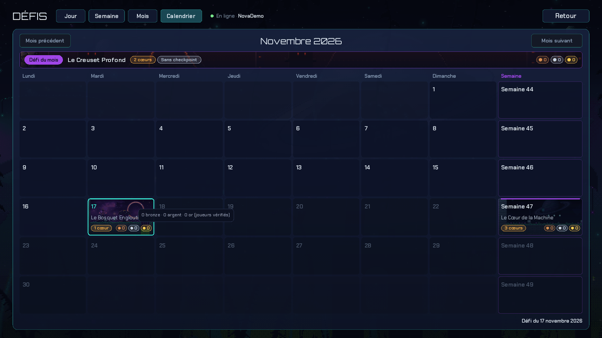

[← Retour : Cosmic Online](README.md) · [Accueil (README)](../../README.md)

# Défis de la semaine et du mois, calendrier, « Plus loin » (2.33), récompenses (2.35)

Suite de `DAILY_CHALLENGES.md` (défi du jour, 2.32), qui reste valable pour tout ce qui n'est
pas changé ici. Mêmes principes : jouable sans compte et hors ligne, le serveur ne fait jamais
confiance au client, un défi futur n'est jamais révélé, un défi commencé ne change plus,
« Vérifié » = replay contrôlé par le serveur (pas de re-simulation : étape suivante).

Deux livraisons :

- **2.33.0** : défis de la semaine et du mois, calendrier, anciens défis jouables (§1 à §4),
  classement « Plus loin » (essais qui vont le plus loin, finis ou non) (§5).
- **2.35.0** : récompenses des défis (cosmétiques de la Collection, §6).

Les jeux 2.32.x continuent de fonctionner sans changement (routes et réponses existantes
gardées, voir §3).

## 1. Trois sortes de défis

| sorte | identifiant | période (UTC) | tirage automatique |
|---|---|---|---|
| `daily` | `daily-AAAA-MM-JJ` | le jour, 00:00 → 00:00 | comme en 2.32 |
| `weekly` | `weekly-AAAA-Www` (semaine ISO 8601, `W01`..`W53`) | lundi 00:00 → lundi suivant 00:00 | niveau plus long ou plus dur (3e/4e niveau d'une planète, niveaux à boss), règles plus exigeantes |
| `monthly` | `monthly-AAAA-MM` | le 1er 00:00 → 1er du mois suivant 00:00 | le plus dur (Épreuves, niveau final, boss rush, ou niveau EXTRÊME de la communauté **choisi par l'administrateur** seulement) |

- L'objet défi (réponse JSON) garde la forme de 2.32, avec `kind` = `daily|weekly|monthly`,
  `period` (`"2026-11-16"`, `"2026-W47"`, `"2026-11"`), `starts_at`, `ends_at` ; `date` reste
  présent (= jour de début) pour les jeux 2.32.
- Forme canonique des règles et `rules_hash` : **inchangées** (la clé `"challenge"` porte
  l'identifiant, quelle que soit la sorte). Le replay format 4 est inchangé. Aucune règle de
  simulation nouvelle : `kSimulationVersion` reste 11, `kRankingGeneration` reste 8.
- Paliers : mêmes trois paliers (Bronze / Argent / Or), mêmes règles de calcul.
- Tirage à l'avance (pour que l'administrateur puisse remplacer) : jours jusqu'à J+7,
  semaines jusqu'à S+2, mois jusqu'à M+1. Jamais montrés avant leur début.
- Script d'administration : `node scripts/challenge-set.mjs --kind daily|weekly|monthly
  --period <AAAA-MM-JJ | AAAA-Www | AAAA-MM> --level campaign:<id> | community:<uuid>@<version>
  [règles…]` (l'ancienne forme `--date AAAA-MM-JJ` reste acceptée pour le jour). Refuse une
  période commencée. Créateur à l'honneur : même notification (`challenge_featured`) pour les
  trois sortes, texte adapté (« … est le défi de la semaine / du mois ! »).

## 2. Anciens défis jouables (« hors délai »)

- Un défi terminé reste jouable, aussi longtemps que son niveau est disponible à la même
  version (même `level_hash` ; sinon : « S'entraîner » seulement, hors classement).
- Une partie envoyée après `ends_at` + 10 min est acceptée avec `late = true` (plus de
  `CHALLENGE_ENDED` pour un jeu 2.33 ; un jeu 2.32 qui l'envoie quand même est aussi accepté :
  rien ne casse). Elle est contrôlée comme les autres.
- Une partie hors délai **ne compte pas** pour la série ni pour les futurs badges, et
  n'apparaît que dans le classement « Depuis » (§3, `period=all`).

## 3. Routes (`/api/v1`)

Gardées telles quelles pour les jeux 2.32 : `GET /challenges/daily/current`,
`GET /challenges/daily`, et toutes les routes par identifiant de défi.

| méthode | route | accès | rôle |
|---|---|---|---|
| GET | `/challenges/current` | public | `{ server_time, daily, weekly, monthly, previous: { daily, weekly, monthly } }` (chacun : un défi ou `null`) |
| GET | `/challenges/calendar?month=AAAA-MM` | public (+ `me` si connecté) | `{ month, first_month, challenges: [défi…], me: { "<challenge id>": { best_time_ms, tier, status, late, best_progress } } }` : tous les défis **commencés** qui touchent ce mois (jours du mois, semaines qui le chevauchent, le mois). `first_month` = mois du plus ancien défi (pour bloquer la navigation). |
| GET | `/challenges/{challengeId}` | public | un défi commencé (404 sinon) |
| GET | `/challenges/{challengeId}/leaderboard?scope=world\|country\|friends&period=live\|all&board=time\|progress&limit=50` | public (`friends` : connecté) | `period=live` (défaut) : parties reçues pendant le défi (+10 min) ; `all` : aussi les parties hors délai, marquées `late: true`. `board=time` (défaut) : comme 2.32. `board=progress` : §5 (2.33). |
| POST | `/challenges/{challengeId}/runs` | connecté | comme 2.32 ; réponse : `run.late` en plus |
| GET | `/challenges/me?limit=60` | connecté | comme 2.32 (`streak` = série des jours) **+** `streaks: { daily, weekly, monthly }` (mêmes champs `current, best, last_period`), et `results[]` avec `kind`, `period`, `late`, `best_progress` |

Série d'une sorte : périodes consécutives (jours, semaines ISO, mois) jusqu'à la période en
cours ou la précédente, avec au moins une partie **non hors délai** et non rejetée.

### Précisions du serveur (2.33, lecture la plus simple de ce qui précède)

- `GET /challenges/{challengeId}` : `data` est **l'objet défi lui-même** (même forme que dans
  `/challenges/current`), `404 CHALLENGE_NOT_FOUND` pour un défi futur, inconnu ou mal formé
  (`weekly-2027-W53` n'existe pas : 2027 a 52 semaines).
- `/challenges/current` : `previous.<sorte>` = le défi de la période précédente (hier, la
  semaine dernière, le mois dernier) ; `null` quand il n'y en a pas.
- `/challenges/calendar` : `month` facultatif (défaut : le mois en cours), `400
  VALIDATION_ERROR` s'il n'est pas `AAAA-MM` (années 2000 à 2999). `challenges` triés par
  premier jour, le mois puis la semaine puis le jour pour un même premier jour. `me` vaut
  `null` sans connexion, `{}` connecté sans partie ; seuls les défis où j'ai une partie y
  figurent. `first_month` = le mois en cours tant qu'aucun défi n'existe.
- Résultat d'un défi (`me` du calendrier, `results[]`) : les parties **à l'heure** d'abord.
  Avec au moins une partie à l'heure non rejetée : la meilleure d'entre elles (son temps, son
  statut ; `tier` = meilleur palier à l'heure), `late: false`. Sinon, avec seulement des
  parties hors délai non rejetées : la meilleure d'entre elles, `late: true`. Sinon (tout est
  rejeté) : la meilleure partie rejetée, `tier: null`, `status: "REJECTED"`. `best_progress`
  : voir §5 (serveur 2.33 : toujours `null`). `results[]` garde `date` (= premier jour) et
  contient aussi les défis de la semaine et du mois (un jeu 2.32 les range par
  `challenge_id`, sans effet).
- Classement : la réponse rappelle `period` et `board` ; chaque entrée et `me` ont `late`
  (toujours `false` avec `period=live`). Un joueur qui n'a que des parties hors délai n'est
  pas dans `period=live` (son `me` y vaut `null`). `board` : `time` ou (serveur 2.33)
  `progress`, `400` sinon.
- Partie : `run.late` aussi dans la réponse idempotente (`duplicate: true`) et dans celle du
  replay. Le contrôle de la partie (paliers, replay, première place en revue) est le même ;
  la position utilisée pour la revue est celle du classement `live` pour une partie à
  l'heure, `all` pour une partie hors délai. Le message de `426` dit « défis » (plus « défis
  du jour »).
- Tirage automatique (le serveur seul, depuis `src/challengeCatalog.json`, version 2 : place
  du niveau dans sa planète). Tous les niveaux de la campagne ont un boss, donc « niveaux à
  boss » ne distingue rien : **semaine** = 3e, 4e ou dernier niveau d'une planète (avec le
  catalogue actuel : `*_03`, `*_04` et `noyau_02`), **mois** = dernier niveau de chaque
  planète (les Épreuves `*_04` et le niveau final `noyau_02`). Le boss rush `noyau_01`
  (EXTRÊME, une seule vie) n'est jamais tiré : comme tout niveau non tirable du catalogue et
  tout niveau de la communauté, seul l'administrateur peut le choisir. Règles « plus
  exigeantes » : semaine = cœurs 1, 2 ou 3 et 0 ou 1 pouvoir en plus ; mois = cœurs 1, 2 ou 3
  et aucun pouvoir en plus ; stations toujours actives, points de passage au hasard, paliers
  comme le jour. Le tirage évite les niveaux des défis de la même sorte des 10 jours / 4
  semaines / 2 mois autour.
- Script : `--kind` vaut `daily` par défaut ; `--date X` = `--kind daily --period X`
  (`--date` avec une autre sorte est refusé). Le nom de fichier conseillé devient
  `NNNN_challenge_<sorte>_<période>.sql`. La migration n'écrit que si le premier jour de la
  période n'a pas commencé quand elle est appliquée.
- Notification `challenge_featured` : envoyée une fois quand la période commence ; `data`
  ajoute `challenge_kind` et `period` (le texte vient du serveur ; une ancienne notification
  sans `challenge_kind` reste « du jour »).
- Base : la table `daily_challenges` devient `challenges` (colonnes `period`, `end_date` ;
  déclencheur `challenges_frozen`), `challenge_runs` gagne `late` (migration
  `0058_challenge_periods.sql`, qui recopie les défis et parties de 2.32).

## 4. Côté jeu (2.33.0)

- Écran « Défis » : onglets **Jour**, **Semaine**, **Mois**, **Calendrier** (remplace
  « Archives »). Les trois premiers montrent le défi en cours de leur sorte, avec la même fiche
  qu'en 2.32 (niveau, règles, paliers, mon meilleur temps, série de la sorte, classement,
  Jouer / Revoir / S'entraîner, « Touches… » avant le départ).
- **Calendrier** : un mois en grille (lundi → dimanche), navigation mois précédent / suivant
  (jamais avant `first_month`, jamais après le mois en cours). Chaque jour : le défi du jour
  (mon palier ou mon état : vérifié, en attente, hors délai, rien), le jour courant mis en
  valeur, les jours à venir grisés et sans contenu. Chaque semaine (bande ou colonne) : le
  défi de la semaine ; le défi du mois en tête. Clic / Entrée / bouton A sur une case : la
  fiche de ce défi (comme les onglets), avec pour un défi terminé le classement
  « Pendant le défi » / « Depuis » et « Jouer (hors délai) ». Jouable au clavier, à la manette
  et à la souris.
- Hors ligne : le calendrier montre ce qui est en cache et le dit.
- Fin d'une partie hors délai : « Hors délai : classé dans "Depuis", ne compte pas pour la série ».
- Classement : chaque ligne qui a un replay (`has_replay`, `run_id`) a son bouton « Voir »
  (`GET /challenges/runs/{runId}/replay`, public pour une partie VERIFIED, comme en 2.32).

### Précisions (lecture retenue par le jeu 2.33)

- Un défi dont l'`id` n'est pas exactement `<kind>-<period>`, ou dont `starts_at` / `ends_at`
  ne sont pas les bornes UTC de sa période (et `date` son premier jour), est refusé par le jeu.
  Un défi sans `kind` ni `period` (serveur 2.32) est un défi du jour (`period` = `date`).
- Serveur pas encore à jour : `GET /challenges/current` → 404 : le jeu lit
  `GET /challenges/daily/current` (le jour seulement) ; `GET /challenges/calendar` → 404 : le
  jeu prend les jours du mois dans `GET /challenges/daily?before=<1er du mois suivant>&limit=30`
  (deux pages au plus) ; un défi plus ancien que le mois dit que le calendrier va plus loin.
- Classement : `period=live` (défaut) n'est pas écrit dans la requête ; `period=all` l'est.
  Avec `period=all`, chaque entrée (et `me`) porte `late`.
- `me` du calendrier : une clé par identifiant de défi (`null` sans session) ; `best_time_ms`
  et `tier` `null` quand le joueur n'a fini aucune partie de ce défi (des essais seulement).
- `streaks.*.last_period` : la dernière période de la série (`"2026-11-16"`, `"2026-W47"`,
  `"2026-11"`) ; le jeu lit encore `streak.last_date` d'un serveur 2.32 pour le jour.
- Le jeu estime qu'une partie est hors délai quand elle finit plus de 10 min après `ends_at`
  (horloge du serveur) ; il garde ensuite le `run.late` que le serveur renvoie.

## 5. « Plus loin » (2.33.0)

Pour les défis que peu de joueurs finissent : chaque essai est noté par sa progression, comme
la course à la vérification (`server/src/race.ts`, `game/race/Race.cpp`) : 40 points pour le
trajet atteint le long du tracé du niveau, 60 pour les boss (2 parts chacun, santé retirée) et
les vagues d'embuscades (1 part chacune), 100 seulement si le niveau est fini. Le tracé vient
de `level_versions.race` (campagne) ou `community_level_versions.race` (communauté) ; sans
tracé, pas de « Plus loin » pour ce défi (`progress_available: false` dans l'objet défi).

- Le jeu calcule la progression d'un essai non fini (même fonction `raceScore`) seulement
  pour décider s'il bat son meilleur essai sur ce défi ; si oui, il l'envoie :
  `POST /challenges/{challengeId}/attempts` `{ attempt_id, time_ms, level_hash, rules_hash,
  game_version, claim: { finished: false, bosses: [‰…], waves: [n…] } }` puis
  `PUT /challenges/attempts/{attemptId}/replay` (format 4). Le **serveur** calcule le score
  depuis le replay (trajectoire projetée sur le tracé, événements BossHit / vagues) ; il ne
  prend jamais celui du jeu. Morts et retours aux points de passage permis si les règles du
  défi ont `checkpoints: true` (le score = le plus loin atteint pendant l'essai).
- Une partie finie compte 100.
- `board=progress` : meilleur score par joueur (VERIFIED), du plus haut au plus bas ; à score
  égal, le plus tôt envoyé d'abord. Entrées : `{ rank, player, progress, finished, time_ms,
  status, late }`.
- Fiche du défi : bascule **« Meilleurs temps » / « Plus loin »** au-dessus du classement ;
  « Mon meilleur essai : 63,4 % » à côté de mon meilleur temps ; fin d'un essai non fini :
  progression de l'essai, « Nouveau record de progression » si c'est le meilleur, état de
  l'envoi.
- Limites de débit : comme les parties ; un joueur ne garde qu'un replay d'essai par défi
  (le meilleur).

### Précisions du serveur (2.33, lecture la plus simple de ce qui précède)

- Objet défi : `progress_available` (booléen) en plus, sur toutes les routes qui le donnent.
  Il est vrai quand la version du niveau du défi a un tracé. **Avec les fichiers actuels,
  seul `noyau_01` (EXTRÊME) en a un dans la campagne**, et les niveaux EXTRÊME de la
  communauté en ont un : un défi tiré automatiquement a donc `progress_available: false` tant
  que les autres niveaux de la campagne n'ont pas de tracé enregistré.
- `POST /challenges/{challengeId}/attempts` (connecté · limite `challenge_submit`, corps 4 Kio
  au plus, aucun autre champ : ni joueur, ni score) : `claim.finished` doit valoir `false`
  (une partie finie s'envoie par `…/runs`) ; `claim.bosses` : un entier 0..1000 par boss du
  tracé, `claim.waves` : un entier 0..99 par embuscade du tracé, dans l'ordre du tracé
  (`400 VALIDATION_ERROR` sinon). Mêmes contrôles et mêmes erreurs que `…/runs`
  (`CHALLENGE_NOT_STARTED`, `CHALLENGE_NOT_FOUND`, `426`, `LEVEL_MISMATCH`,
  `RULES_MISMATCH`), plus `409 PROGRESS_UNAVAILABLE` (pas de tracé). Idempotent par
  `attempt_id` (`ATTEMPT_CONFLICT` si les données diffèrent) ; hors délai comme les parties
  (`late`). Réponse `201 { duplicate: false, attempt: { attempt_id, status: "PENDING",
  progress: null, finished: false, late }, replay: { required: true, upload_path } }` (`200`
  et `duplicate: true` pour un essai déjà reçu). Un essai plus long que la limite de temps du
  niveau est refusé d'emblée (`status: "REJECTED"`, `required: false`).
- `PUT /challenges/attempts/{attemptId}/replay` (connecté · limite `replay_upload`,
  `application/octet-stream`, 1 Mio au plus) : `{attemptId}` est **l'`attempt_id` envoyé par
  le jeu** (cherché parmi les essais du joueur connecté seulement ; `upload_path` le donne
  tel quel). Erreurs : `404 ATTEMPT_NOT_FOUND`, `409 REPLAY_EXISTS` (déjà reçu), `409
  ATTEMPT_REJECTED`, `422 REPLAY_MALFORMED` (rien n'est gardé), `409 PROGRESS_UNAVAILABLE`.
  Réponse `201 { attempt: { attempt_id, status: "VERIFIED" | "REJECTED", progress, finished:
  false, late, rank, reasons }, new_best, best_progress }` : `progress` (une décimale, < 100)
  calculé par le serveur, `null` si l'essai est refusé ; `rank` dans `board=progress` de sa
  période (`live` à l'heure, `all` hors délai) ; `new_best` : meilleur que tous mes essais et
  parties finies vérifiés de ce défi ; `best_progress` : ma meilleure progression vérifiée sur
  ce défi après cet essai. Contrôles : ceux de la course à la vérification (version du niveau,
  `attempt_id`, durée, départ, trajectoire, boss et vagues **identiques** à ce que le replay
  montre) + section défi exactement la forme canonique (format 4), vie jamais au-dessus de
  `hearts`, durée dans la limite du niveau. `checkpoints: false` : une seule vie (l'essai
  s'arrête à sa première mort ; un `Respawn` ou deux morts le font refuser) ; `checkpoints:
  true` : morts et retours permis, la trajectoire peut alors sauter à une mort ou un retour.
  « Vérifié » = replay contrôlé par le serveur, comme les parties.
- Un seul replay d'essai par joueur et par défi : celui du meilleur essai vérifié ; un essai
  moins bon n'est pas gardé, l'ancien meilleur perd le sien. Ce replay se regarde depuis le
  classement : `GET /challenges/attempts/{id}/replay` (connexion facultative ; `{id}` =
  `attempt_id` d'une entrée de `board=progress`, l'**identifiant du serveur** de l'essai, pas
  celui du jeu), public pour un essai `VERIFIED` d'un compte actif, toujours pour son joueur ;
  `403 PROFILE_PRIVATE` pour un profil masqué ; `404 ATTEMPT_NOT_FOUND` (inconnu, refusé, en
  attente) ou `404 REPLAY_NOT_FOUND` (replay non gardé). Réponse :
  `application/octet-stream`, en-tête `x-replay-sha256`, comme `GET /challenges/runs/{runId}/replay`.
- `board=progress` : `409 PROGRESS_UNAVAILABLE` sans tracé ; `period`, `scope`, `limit`,
  `offset` comme `board=time`. Entrées `{ rank, player, progress, finished, time_ms, status:
  "VERIFIED", late, is_me, attempt_id, run_id, has_replay }` : un essai (`finished: false`,
  son `time_ms`, `attempt_id` = identifiant du serveur pour regarder son replay, `run_id:
  null`) ou une partie finie vérifiée (`progress: 100`, `finished: true`, son temps,
  `attempt_id: null`, `run_id` pour `GET /challenges/runs/{runId}/replay`). `has_replay` : le
  replay est gardé et ce lecteur peut le regarder (`false` pour un profil masqué, sauf le
  sien ; un essai qui n'est plus le meilleur de son joueur n'a plus de replay). À score égal, le plus tôt
  envoyé d'abord (entre parties finies aussi : la première envoyée, pas la plus rapide).
  `me` : ma meilleure progression vérifiée de cette période (`rank: null` hors de ce
  `scope`), sinon `null` (un essai en attente de son replay n'a pas encore de score).
- `best_progress` (`results[]`, `me` du calendrier) : ma meilleure progression vérifiée sur
  ce défi, à l'heure ou hors délai (essais ; 100 pour une partie finie vérifiée, même sans
  tracé), `null` sans. Un défi seulement essayé (aucune partie finie) figure dans les
  résultats avec `best_time_ms: null`, `tier: null`, `status` et `late` de son meilleur essai.
  Les essais ne comptent pas pour les séries.
- Base : table `challenge_attempts` (migration `0059_challenge_progress.sql`) ; dans l'export
  des données (`challenge_attempts`) ; supprimée avec le compte, replays compris.

### Précisions (lecture retenue par le jeu 2.33)

- `progress_available` absent (serveur 2.33) = `false` : ni bascule « Plus loin », ni essai envoyé.
- L'essai n'est envoyé que si son estimation (`raceScore`, une décimale, arrondie vers le bas)
  dépasse strictement mon meilleur : celui gardé sur ce PC ou le `best_progress` du serveur
  (100 dès qu'une partie est finie, ici ou ailleurs). Un seul essai en attente par défi : un
  meilleur remplace celui qui n'est pas encore parti.
- Sans points de passage (`checkpoints: false`), l'essai est la première vie : son replay
  s'arrête à la première mort (la partie continue ; finie, elle compte comme une partie). Avec
  points de passage, l'essai se termine à l'échec du niveau, à « Recommencer » ou au retour au
  menu.
- Réponse lue de `POST …/attempts` : `{ duplicate, attempt: { attempt_id, status, progress,
  late }, replay: { required, upload_path } }` ; sans `upload_path`, le jeu envoie le replay à
  `PUT /challenges/attempts/{attempt_id}/replay` (son propre `attempt_id`). Réponse du `PUT` :
  `{ attempt: { attempt_id, status, progress, finished, late, rank, reasons }, new_best,
  best_progress }` ; le jeu garde `best_progress`.
- Entrées de `board=progress` (et `me`) : `{ rank, player, progress, finished, time_ms, status,
  late, is_me, attempt_id, run_id, has_replay }` ; « Voir » si `has_replay` :
  `GET /challenges/runs/{run_id}/replay` pour une partie finie, sinon
  `GET /challenges/attempts/{attempt_id}/replay` (identifiant du serveur, public pour un essai
  VERIFIED).
- `PROGRESS_UNAVAILABLE` (409), `ATTEMPT_REJECTED` (409), `ATTEMPT_NOT_FOUND` (404) : l'essai
  est refusé, avec sa raison, et n'est pas renvoyé.

## 6. Récompenses des défis (2.35.0)

Des cosmétiques de la Collection se gagnent avec les défis. Seules comptent les parties
**VERIFIED par le serveur** (jamais une partie gardée sur un PC seulement, ni un essai « Plus
loin ») : le serveur les compte lui-même dans `challenge_runs`, le jeu affiche ce qu'il lit.

- Conditions (`data/cosmetics/cosmetics.json`, recopiées par `server/scripts/cosmetics-catalog.mjs`) :
  - `"challenge": { "kind": "daily|weekly|monthly|any", "tier": "gold|silver|bronze", "count": N }` :
    N défis de cette sorte (`any` : toutes) où j'ai une partie vérifiée à ce palier **ou mieux**,
    reçue à l'heure ou hors délai ;
  - `"challengeStreak": { "kind": "daily", "days": N }` : N périodes de suite (jours) avec une
    partie vérifiée reçue **à l'heure** (une partie hors délai ne compte pas), à n'importe quel
    palier ; la meilleure série compte (une récompense gagnée le reste).
- Récompenses : titre « Défiant » (1 Or, toute sorte) ; cadre « Couronne de la semaine » (1 Or
  sur un défi de la semaine) ; traînée « Comète du mois » (1 Or sur un défi du mois) ;
  combinaison « Champion des défis » (10 Or, toute sorte) ; effet de victoire « Série de feu »
  (défi du jour 7 jours de suite).
- `GET /challenges/me` ajoute `verified: { daily, weekly, monthly }`, chacun `{ gold, silver,
  bronze, best_streak }` : `gold` = défis de cette sorte avec une partie vérifiée en Or, `silver`
  = en Argent ou mieux, `bronze` = finis (tous paliers), sur tout l'historique (pas seulement les
  `limit` résultats) ; `best_streak` = la plus longue suite de périodes consécutives avec une
  partie vérifiée à l'heure.
- `PUT /players/me/cosmetics` : une récompense des défis n'est gardée que si ces mêmes comptes
  du serveur la débloquent (sinon : l'élément par défaut de la catégorie), comme les étoiles et
  les succès déclarés pour les autres.
- Jeu : la ligne « Récompenses » de la fiche du défi et de l'écran avant le départ montre, en
  icônes (aperçu de la récompense, marque du palier, « obtenu »), celles que ce défi peut faire
  avancer (sa sorte et « toute sorte » ; pas la série pour une partie hors délai ; rien pour un
  entraînement), avec une infobulle (souris ou focus clavier / manette) : nom, catégorie,
  condition, ma progression « 3 / 10 », « Obtenu ». Une icône ouvre la récompense dans la
  Collection. Les comptes lus sont gardés sur le PC (`saves/challenges/state.json`, avec le
  compte qui les a lus) pour jouer hors ligne ; un autre compte ne les reprend pas. Serveur 2.33
  (sans `verified`) : le jeu compte les `results` dont le statut est `VERIFIED`. Après une partie
  vérifiée, le jeu relit `/challenges/me` ; une récompense débloquée est annoncée (notification,
  puis la carte « Nouvelles récompenses » à la fin du défi).

## 7. Calendrier des défis de l'administration, objectif « Finir le niveau » (2.41.0)

Pour les comptes `admin` seulement (écran ADMINISTRATION › Calendrier des défis du jeu). Pour
tout autre compte ces routes n'existent pas (`404 NOT_FOUND`, comme une route inconnue) ; sans
session : `401`. L'admin vient de la session, jamais d'une donnée du jeu. Chaque changement et
chaque refus est inscrit au Journal (`audit_log`, sans IP).

| méthode | route | rôle |
|---|---|---|
| GET | `/admin/challenges?month=AAAA-MM` | `{ month, today, server_time, first_month, last_month, ahead, periods }` : le mois, les semaines ISO qui le chevauchent et ses jours, chacun `{ id, kind, period, date, end_date, starts_at, ends_at, state: past\|running\|coming, editable, draws_on, challenge }`. **Les défis à venir aussi** (seule route qui les montre) ; les périodes que le serveur tire à l'avance sont tirées d'abord (`ensureChallenges`). `challenge` = l'objet défi + `replaced_title` (titre du tirage remplacé) et `updated_at` ; `null` sans défi (`draws_on` = jour où une période à venir sera tirée). |
| GET | `/admin/challenges/levels?source=campaign\|community&q=&limit=&offset=` | niveaux qu'on peut choisir : la campagne (catalogue `src/challengeCatalog.json`, avec `draw_kinds` = sortes où le tirage peut le prendre, `available` = révision classée par le serveur, `has_race`, emplacements, pouvoirs, temps des médailles) ; la communauté (niveaux publiés à leur version courante, recherche par titre dès 2 lettres, paginée, `has_race`, temps proposés d'après le temps de l'auteur). |
| PUT | `/admin/challenges/{challengeId}` | `{ level: { source, id, version? }, hearts?, slots?, powers?, stations?, checkpoints?, objective?, silver_ms?, gold_ms?, gold_no_damage?, bronze_progress?, silver_progress? }` : le défi d'une période **pas encore commencée** (UTC : premier jour > aujourd'hui), `source = 'admin'`. Mêmes contrôles et mêmes valeurs par défaut que `scripts/challenge-set.mjs` (module partagé `src/challengeSpec.mjs`) ; `rules_hash` = SHA-256 de la forme canonique (inchangée). Réponse `{ challenge, warnings }`. |
| DELETE | `/admin/challenges/{challengeId}` | « Revenir au tirage » : le choix de l'admin d'une période à venir est retiré et le serveur la tire à nouveau aussitôt si elle est dans la fenêtre de tirage (sinon le jour `draws_on`). Réponse `{ challenge, draws_on }`. |

Refus (inscrits au Journal, action `admin_refused`, `reason` = le code) : `409
CHALLENGE_STARTED` (période commencée ou passée), `400 VALIDATION_ERROR` (règles invalides :
pouvoir inconnu ou en double, plus de pouvoirs que d'emplacements, Or plus lent que l'Argent,
temps manquants pour un niveau de la communauté…), `409 LEVEL_UNAVAILABLE` (niveau non classé,
version non publiée), `409 FINISH_NEEDS_ROUTE`, `409 NOT_CHOSEN` (« Revenir au tirage » sur un
défi qui est déjà le tirage). Journal : `GET /admin/log?kind=challenge` (actions
`admin_challenge_set`, `admin_challenge_reset`) ; chaque entrée a `challenge` : période, niveau,
règles, objectif, paliers, ce qu'il remplace (`replaced`), ce qui a été retiré (`removed`) et
tiré à la place (`drawn`).

Objectif d'un défi (`objective`, colonne de `challenges`, migration `0079_challenge_objective.sql`) :

- `speed` (« Vitesse », défaut, tous les défis d'avant 2.41) : inchangé.
- `finish` (« Finir le niveau ») : seulement sur une version de niveau **avec un parcours tracé**
  (`race`, comme les niveaux EXTRÊME). Le classement du défi est celui de « Plus loin » (§5) : le
  plus loin d'abord, puis le premier à finir ; le jeu 2.41 en fait son classement principal
  (`board=progress`). `board=time` reste le défaut de `GET …/leaderboard` (les anciens jeux n'ont
  que lui : les parties finies, Or ou Argent). Paliers : **Bronze** = `bronze_progress` % de progression (défaut 50),
  **Argent** = `silver_progress` % (défaut 80 ; 10 à 95, Argent au-dessus du Bronze), **Or** =
  niveau fini (sans dégât si `gold_no_damage`, sinon Argent). Le palier d'un essai est calculé
  par le serveur depuis la progression qu'il tire du replay (`challenge_attempts.tier`), jamais
  d'une valeur du jeu ; il compte pour le résultat (`tier` de `/challenges/me` et du calendrier),
  la série et les récompenses (§6) comme celui d'une partie. L'objet défi ajoute `objective` et,
  pour `finish`, `tiers.bronze_progress` / `tiers.silver_progress` ; `silver_ms` / `gold_ms`
  valent alors 2 h, pour que les anciens jeux (qui ignorent `objective`) montrent pour une
  partie finie le palier que décide le serveur. Les entrées du classement `progress` d'un défi
  `finish` ont `tier` ; la réponse du replay d'un essai aussi.
- L'objectif change le classement, jamais la simulation : il n'entre pas dans la forme
  canonique des règles ni dans le replay ; `kSimulationVersion` et `kRankingGeneration` ne
  changent pas.

### Côté jeu (2.41.0)

- ADMINISTRATION › **Calendrier des défis** (entre « Joueurs » et « Journal ») : le mois (défi du
  mois en tête, lundi → dimanche, colonne des semaines), chaque case avec l'image de son niveau et
  une pastille « tirage » (tiré par le serveur, remplaçable), « choisi » (par un admin), cadenas
  « en cours » / « passé » (lecture seule), « + choisir » et « tirage le JJ/MM » pour une période
  pas encore tirée. L'éditeur de la période choisie : « Niveau et règles » (campagne ou niveaux en
  ligne avec recherche, cœurs, emplacements, pouvoirs imposés, stations, checkpoints) et
  « Objectif et paliers » (Vitesse : temps de l'Argent et de l'Or, Or sans dégât ; Finir le
  niveau : % du parcours du Bronze et de l'Argent, grisé avec la raison sans parcours tracé),
  « Revenir au tirage », « Enregistrer ». Les erreurs du serveur sont dites en français.
  Clavier, manette, souris. Captures : `--admin calendar[:AAAA-MM[:<id>[:objectif]]]`.
- Journal : filtre « Défis » et phrases « a choisi le défi du jour du 20/11 : … (remplace le
  tirage « … ») », « a remis au tirage le défi … », refus « modification du défi … refusée : … ».
- Défi « Finir le niveau » côté joueur : règle « Objectif : finir le niveau », paliers « Atteindre
  50 % du parcours » / « 80 % » / « Finir le niveau, sans dégât », classement « Progression »
  d'abord (avec le palier de chaque ligne), « Ma progression » et son palier sur la fiche, palier
  de l'essai à la fin d'une partie ; l'ATH dit « Or : finir sans dégât » au lieu des temps.

## 8. Récompenses d'un défi, titres créés par un admin (2.43.0)

Un admin donne à un défi **pas encore commencé** ses propres récompenses (ADMINISTRATION ›
Calendrier des défis › « Récompenses ») : chacune est un élément du catalogue du jeu
(`src/cosmeticCatalog.json`, jamais un élément de départ) ou un **titre créé sur le serveur**
(`server_titles`, porté sous l'id `srv:<n>` : aucune mise à jour du jeu), avec une condition sur
les résultats de **ce** défi reçus à l'heure (`late = 0`) et **vérifiés** (`VERIFIED`) :

- `tier` (valeur 1 Bronze, 2 Argent, 3 Or : ce palier ou mieux) — parties finies et, sur
  « Finir le niveau », essais dont la progression a atteint un palier (`challenge_attempts.tier`) ;
- `top` (valeur N de 1 à 100) — place au classement final du défi (son classement principal :
  temps, ou progression pour « Finir le niveau » ; égalité départagée comme le classement, la
  partie reçue la première d'abord ; comptes actifs seulement) ;
- `finished` — au moins une partie finie.

Migration `0081_challenge_rewards.sql` : `server_titles` (texte ≤ 32 caractères, couleur
`gold|silver|cyan|violet`, `text_key` unique : même texte aux accents et à la casse près refusé),
`challenge_reward_rules` (par id de période `<kind>-<period>`, sans clé étrangère : elles restent
après « Revenir au tirage »), `challenge_reward_grants` (défi accordé, une fois),
`player_won_rewards` (unique par joueur, défi et récompense).

| méthode | route | rôle |
|---|---|---|
| GET | `/admin/titles` | `{ titles: [{ id: "srv:<n>", text, color, created_at, created_by, uses }], max_chars, colors }` |
| POST | `/admin/titles` | `{ text, color }` → `201 { title }` ; texte nettoyé (espaces), 1 à 32 caractères, lettres, chiffres, ponctuation et espaces (ni contrôle ni emoji) ; `409 TITLE_EXISTS` (`details.title` = le titre existant) |
| PUT | `/admin/challenges/{challengeId}/rewards` | `{ rewards: [{ kind: item\|title, ref, condition: tier\|top\|finished, value }] }` (6 au plus, dans l'ordre ; `[]` les retire) → `{ rewards }` ; `409 CHALLENGE_STARTED` dès le premier jour (vérifié aussi par chaque écriture), `400` (élément inconnu ou de départ, titre inconnu, valeur hors bornes, récompense en double) |
| GET | `/players/me/rewards` | `{ rewards: [{ challenge: { id, kind, period, date, title }, kind, ref, item: { id, category, name } \| null, title: { id, text, color } \| null, granted_at }] }`, les plus récentes d'abord |

Toutes les routes admin : `requireAdminRole` (sinon `404`), limite `admin_write`, inscrites au
Journal (`admin_challenge_rewards` avec `rewards` et `previous`, `admin_title_created` avec
`title`, refus `admin_refused`). `GET /admin/challenges` donne pour chaque période `rewards` et
`rewards_granted_at`. L'objet défi public ajoute `rewards` (même forme que la réponse du `PUT`).

**Attribution** : une heure après la fin de la période (`GRANT_DELAY_MS` : parties à l'heure
reçues, replays contrôlés), par le cron quotidien (après la reprise des parties en attente) ou à
la lecture (`GET /players/me/rewards`, classement d'un défi terminé). Un seul lot D1 (une
transaction) : récompenses gagnées (`INSERT OR IGNORE`, jamais retirées), une notification
`challenge_reward` par gagnant (désactivable comme les autres), marque `challenge_reward_grants`.
Une seconde passe n'ajoute rien et ne notifie personne ; une partie vérifiée après l'attribution
ne change plus rien.

**Port** : `PUT /players/me/cosmetics` accepte `title: "srv:<n>"` seulement pour un titre gagné
(sinon le titre par défaut) ; un élément du catalogue gagné se porte quelle que soit sa condition
habituelle. Profil : `cosmetics.title = { id, look, name, color }` ; classements :
`player.title = { id, name, color }`.

### Côté jeu (2.43.0)

- Éditeur du calendrier : 3ᵉ onglet « Récompenses » (liste avec aperçu, condition modifiable, ×) ;
  « + Récompense du jeu » (fenêtre : catégories, éléments, titres déjà créés, condition) ;
  « + Créer un titre » (texte ≤ 32 caractères, Or / Argent / Cyan / Violet, condition). « Enregistrer »
  envoie le défi puis ses récompenses. Captures : `--admin calendar:AAAA-MM:<id>:recompenses`.
- Fiche d'un défi et fin de partie : les récompenses du défi d'abord dans « Récompenses » (marque de
  la condition, info-bulle : condition, « Gagnée », « À gagner jusqu'à la fin du défi »…).
- `GET /players/me/rewards` après chaque lecture de `/challenges/me`, gardé dans
  `saves/challenges/state.json` (hors ligne). Collection : les titres gagnés dans « Titres »
  (« Défi du jour du 20/11 »), équipables ; un titre du serveur s'affiche dans sa couleur (profil,
  classements).

## 9. Défi en cours modifiable tant que personne n'y a de résultat (2.60.0)

Un défi **commencé** (jour, semaine ou mois dont la période court) se change encore —
`PUT /admin/challenges/{id}`, `DELETE` (« Revenir au tirage », retiré aussitôt), `PUT …/rewards` —
**tant qu'aucun joueur n'y a de résultat** : rien de ce que le serveur a reçu pour lui, quel que
soit son statut (partie de `challenge_runs`, essai de `challenge_attempts`, récompense gagnée
`player_won_rewards`, récompenses accordées `challenge_reward_grants` ; le record, la place au
classement et la série en découlent). Un défi **terminé** ne change jamais.

- Atomique : chaque écriture porte la condition (`… WHERE date > date('now') OR (end_date >
  date('now') AND NOT <résultats>)`), pas seulement une lecture avant ; la migration
  `0117_challenge_running_edit.sql` remplace le déclencheur `challenges_frozen` (refus pour un défi
  terminé) et ajoute `challenges_have_results` (refus pour un défi commencé avec un résultat). La
  suppression est gardée par la condition de l'écriture et les clés étrangères des parties et des
  essais (pas de déclencheur : l'import d'une sauvegarde vide la table avant de la remplir).
- Refus, au Journal comme les autres : `409 CHALLENGE_STARTED` (défi terminé), `409
  CHALLENGE_HAS_RESULTS` (« Des joueurs ont déjà un résultat sur ce défi : il ne change plus. »,
  `details.results_count`). Un changement d'un défi en cours a `running: true` au Journal.
- `GET /admin/challenges` : `editable` = à venir, ou en cours sans résultat ; `results_count` =
  joueurs qui ont un résultat (parties, essais, récompenses), pour dire pourquoi un défi en cours est
  figé.
- Versions jamais mélangées : l'objet défi gagne `updated_at` (heure de sa version). Une partie ou
  un essai n'est inséré que si le défi a toujours le `level_hash`, le `rules_hash` et
  l'`updated_at` lus pour le vérifier, dans la même requête ; sinon `RULES_MISMATCH`,
  `LEVEL_MISMATCH` ou `409 CHALLENGE_CHANGED`. Comme un changement n'est permis que sans aucun
  résultat, une partie de l'ancienne version ne peut pas rejoindre celles de la nouvelle ; si seuls
  les paliers ou l'objectif changent (mêmes empreintes), le serveur classe la partie avec ceux de
  la version qu'il a.
- Côté jeu : le cache garde la version la plus récente (`updated_at`, jamais une réponse plus
  ancienne gardée hors ligne) ; une version changée (niveau, règles, objectif ou paliers) remplace
  l'ancienne, dont le résultat gardé sur le PC, son replay et les parties pas encore envoyées
  disparaissent (« ce défi a changé »). Une partie finie sur l'ancienne version ne compte pas :
  l'écran de fin dit « DÉFI CHANGÉ » au lieu d'un succès, « Nouvelle version » ramène aux Défis.
- Calendrier joueur (`GET /challenges/calendar`) : `tier_counts: { "<id>": { bronze, silver, gold } }`
  pour chaque défi commencé de la réponse : les joueurs (comptes actifs) à leur meilleur palier,
  parties et essais **vérifiés reçus à l'heure** seulement (comme les classements et les
  récompenses), 0 sans personne ; à part des objets défi (qui ne changent pas à chaque résultat).

---

[← Retour : Cosmic Online](README.md) · [Accueil (README)](../../README.md)
