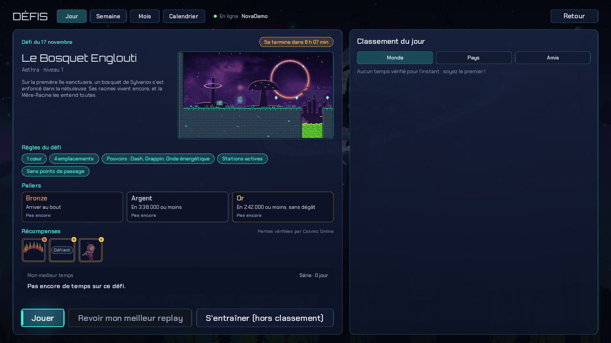

[← Retour : Cosmic Online](README.md) · [Accueil (README)](../../README.md)

# Défis du jour (2.32) — contrat entre le jeu et Cosmic Online

<p align="center"></p>

Étape 1 de la maquette « Défis et événements » : un défi chaque jour, tiré au sort par le
serveur ou choisi par l'administrateur (niveau de la campagne **ou niveau ONLINE LEVELS**), un
classement du jour, la série de jours. Les défis de la semaine, les badges, la vérification par
re-simulation, les événements et l'administration web viennent aux étapes suivantes : rien
ici ne les annonce comme faits.

Principes : le jeu reste jouable sans compte et sans Internet ; le serveur ne fait jamais
confiance au client ; un défi futur n'est jamais révélé ; un défi commencé ne change plus.

## 1. Le défi

Un défi du jour couvre un jour UTC : de `AAAA-MM-JJT00:00:00Z` à minuit UTC suivant (1 h à
Paris l'hiver, 2 h l'été). Identifiant : `daily-AAAA-MM-JJ`.

```json
{
  "id": "daily-2026-11-16",
  "kind": "daily",
  "date": "2026-11-16",
  "starts_at": "2026-11-16T00:00:00Z",
  "ends_at": "2026-11-17T00:00:00Z",
  "source": "auto",
  "level": {
    "source": "campaign",
    "level_id": "glacior_02",
    "level_version": 8,
    "level_hash": "<64 hex : empreinte classée de cette révision>",
    "title": "Les Grottes de Cristal",
    "author": null
  },
  "rules": { "hearts": 2, "slots": 3, "powers": ["dash", "glide", "grapple"], "stations": true, "checkpoints": false },
  "rules_hash": "<sha256 hex de la forme canonique ci-dessous>",
  "tiers": { "silver_ms": 85000, "gold_ms": 72000, "gold_no_damage": true }
}
```

- `source` : `auto` (tiré par le serveur) ou `admin` (choisi par l'administrateur).
- `level.source` : `campaign` (niveau de la campagne, `level_id` = son identifiant) ou
  `community` (niveau ONLINE LEVELS : `level_id` = UUID du niveau, `level_version` = sa version
  publiée **figée** pour tout le défi, `title` et `author` `{ "id", "username" }` renseignés).
  Le jeu télécharge cette version par la voie existante d'ONLINE LEVELS.
- Un niveau de la communauté n'est jamais tiré au sort : seul l'administrateur le choisit.

### Règles (`rules`)

| clé | valeurs | effet dans la partie |
|---|---|---|
| `hearts` | 1 .. 20 | cœurs maximum de la partie, plein au départ ; les réceptacles de cœur du niveau ne donnent rien |
| `slots` | 1 .. 8 | emplacements de pouvoirs |
| `powers` | 0 .. `slots` identifiants de pouvoirs (`data/powers`), sans doublon | portés dès le départ, accordés dans l'ordre de la forme canonique (tri croissant) avec la règle habituelle (un pouvoir sur la même entrée qu'un précédent le remplace) |
| `stations` | booléen | `false` : les stations de pouvoirs du niveau n'offrent rien |
| `checkpoints` | booléen | `false` : aucun point de passage ne s'active ; une mort ramène au départ du niveau, avec l'état de départ du défi (cœurs pleins, pouvoirs imposés) |

**Forme canonique** (pour `rules_hash` et pour le replay) : exactement cette chaîne, clés dans
cet ordre, `powers` trié par ordre croissant, sans espace :

```
{"challenge":"daily-2026-11-16","hearts":2,"slots":3,"powers":["dash","glide","grapple"],"stations":true,"checkpoints":false}
```

`rules_hash` = SHA-256 (hex minuscule) de ces octets UTF-8. Le jeu et le serveur la
construisent chacun ; le test `tests/data/challenge_rules_fixture.json` (mêmes entrées, même
chaîne, même empreinte) est vérifié des deux côtés.

### Paliers (`tiers`)

- Bronze : arriver au bout.
- Argent : `time_ms <= silver_ms`.
- Or : `time_ms <= gold_ms` et, si `gold_no_damage`, aucun dégât (`damage_taken == 0`).

## 2. Côté serveur

### Tirage

Le cron quotidien existant et toute lecture du défi courant garantissent que les défis
existent d'aujourd'hui à J+7 (tirés à l'avance pour que l'administrateur puisse les
remplacer ; jamais montrés avant leur début). Tirage automatique (`crypto.getRandomValues`) :

- un niveau de la campagne classé (`levels.ranking_enabled`, révision active), pas utilisé
  dans les 10 derniers défis ;
- règles sûres : `slots` >= ceux du niveau, `stations` toujours `true` (le niveau garde ses
  pouvoirs, donc reste faisable), 0 à 2 pouvoirs en plus pris dans une liste sûre, `hearts`
  parmi 1, 2, 3, 5 ou le maximum du joueur, `checkpoints` vrai ou faux ;
- paliers d'après les médailles du niveau : Argent = temps de la médaille d'or, Or = temps de
  la médaille de platine, sans dégât.

Les données par niveau (révision, emplacements, médailles, pouvoirs du niveau) viennent d'un
catalogue généré depuis les fichiers du jeu (`server/scripts/challenge-catalog.mjs` →
`server/src/challengeCatalog.json`, comme les catalogues des succès).

### Choix de l'administrateur

`node scripts/challenge-set.mjs --date AAAA-MM-JJ --level campaign:<id> | community:<uuid>@<version>
[--hearts N] [--slots N] [--powers a,b] [--no-stations] [--no-checkpoints] [--silver m:ss] [--gold m:ss] [--gold-damage-ok]`
écrit une migration SQL (`migrations/00NN_challenge_AAAA_MM_JJ.sql`) appliquée comme les
versions. Elle refuse une date passée ou du jour, et le SQL ne modifie qu'un défi pas encore
commencé au moment où il est appliqué. Pour un niveau de la communauté : version publiée
obligatoire, empreinte reprise de `community_level_versions`. L'administration web viendra
plus tard ; aucune clé d'administration n'est dans le jeu.

**Créateur à l'honneur** : quand un niveau de la communauté devient le défi du jour, son
auteur reçoit une notification (« Votre niveau « … » est le défi du jour ! ») et le défi garde
`featured_player_id` : les badges spéciaux du créateur seront attribués à l'étape des badges,
y compris pour les défis déjà passés.

### Routes (`/api/v1`)

| méthode | route | accès | rôle |
|---|---|---|---|
| GET | `/challenges/daily/current` | public | `{ server_time, challenge, previous }` (défi du jour et celui d'hier) |
| GET | `/challenges/daily?before=AAAA-MM-JJ&limit=N` | public | défis commencés, du plus récent au plus ancien (`limit` <= 30), jamais un défi futur |
| GET | `/challenges/{challengeId}/leaderboard?scope=world\|country\|friends&limit=50` | public (`friends` : connecté) | `{ entries: [{ rank, run_id, player, time_ms, tier, status }], me, total }` : meilleurs temps **VERIFIED** ; `me` montre aussi un temps PENDING du joueur connecté (sans rang) |
| POST | `/challenges/{challengeId}/runs` | connecté | soumettre une partie ; idempotent par `attempt_id` |
| PUT | `/challenges/runs/{runId}/replay` | connecté, propriétaire | replay CPRZ (format 4, section défi obligatoire) |
| GET | `/challenges/runs/{runId}/replay` | public pour un temps VERIFIED, sinon propriétaire | télécharger le replay (fantôme du 1er du jour) |
| GET | `/challenges/me?limit=60` | connecté | `{ streak: { current, best, last_date }, results: [{ challenge_id, date, best_time_ms, tier, status }] }` |

Corps de `POST …/runs` : `{ attempt_id, time_ms, deaths, damage_taken, level_hash, rules_hash,
game_version, has_replay }`. Le joueur vient de la session, jamais du corps. Réponse :
`{ duplicate, run: { id, status, tier, time_ms }, replay: { required, upload_path } }`.

Erreurs : `CHALLENGE_NOT_FOUND` 404 ; `CHALLENGE_NOT_STARTED` 409 ; `CHALLENGE_ENDED` 409
(reçu plus de 10 minutes après `ends_at`) ; `RULES_MISMATCH` 409 ; `LEVEL_MISMATCH` 409 ;
`GAME_VERSION_UNSUPPORTED` 426.

Le palier est **recalculé par le serveur** (jamais pris du client). Statuts : `PENDING`,
`VERIFIED`, `REJECTED`, avec les mêmes règles de décision et de confiance que les records
(analyse du replay : structure, révision, durée, trajectoire plausible ; santé jamais au-dessus
de `hearts` ; section défi identique à la forme canonique). « Vérifié » veut dire « replay
contrôlé par le serveur », comme pour les records : la re-simulation complète est l'étape 3.

**Série** : jours UTC consécutifs, jusqu'à aujourd'hui ou hier, où le joueur a au moins une
partie du défi du jour non rejetée.

## 3. Replay format 4

Format 3 + bit 1 de `input_flags` (`2` : règles de défi) + une section après les sommes de
contrôle : `u16 rules_len` puis `rules_len` octets (1 .. 1024) de la forme canonique des
règles. Écrit **seulement** pour une partie de défi ; toute autre partie reste au format 3 (un
serveur pas encore à jour continue de les accepter). Le jeu rejoue la section pour revoir une
partie de défi ; le serveur vérifie qu'elle est identique à la forme canonique du défi.

## 4. Côté jeu

- Menu principal : entrée **Défis** (pastille NOUVEAU). Onglets **Aujourd'hui** et
  **Archives** seulement (la semaine et les événements viendront avec leur étape).
- Avant le départ : niveau, règles du jour, paliers, fantôme au choix (mon meilleur, le 1er du
  jour, aucun), état de la connexion.
- Fin du défi : temps, palier, série, état de l'envoi (envoyé / en attente de contrôle /
  vérifié / hors ligne, à l'envoi).
- Une partie de défi ne compte ni pour les records du niveau, ni pour les médailles, ni pour
  la progression de la campagne, ni pour les compteurs de succès (comme l'entraînement) ; elle
  a ses propres meilleurs temps et replays locaux (`saves/challenges/`).
- Sans compte : jouable, résultats gardés sur le PC, ni classement ni envoi. Sans Internet : le
  défi déjà téléchargé (et son niveau de la communauté) reste jouable jusqu'à sa fin ; la
  partie attend la connexion pour partir. « S'entraîner » rejoue le défi hors classement.
- `kSimulationVersion` 11 : règles de défi (cœurs, emplacements, pouvoirs imposés, stations,
  points de passage). Une partie sans défi se joue exactement comme avant (mêmes empreintes) ;
  `kRankingGeneration` reste 8.

---

[← Retour : Cosmic Online](README.md) · [Accueil (README)](../../README.md)
